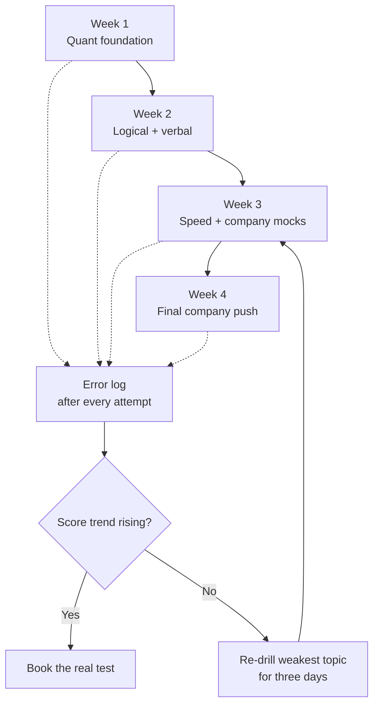

<!-- improved -->
# Universal Aptitude Master Plan — Crack Any Company's Aptitude Round

> This plan is company-neutral. It builds a complete aptitude skill set (Quant + Logical + Verbal)
> that clears the aptitude gate at ANY company: TCS NQT, Infosys, Wipro, Accenture, Cognizant,
> Capgemini, Zoho, Deloitte, HCL, Tech Mahindra, Infosys SP, and the cognitive sections of
> product companies that still run them.
>
> Duration: 4 weeks. Time: 1 hour/day minimum (90 minutes recommended).
> Pace: every topic formula memorized cold + 20-30 questions/day + 1 mock per week.

---

## Learning Objectives

By the end of this plan you should be able to:

- Place your current preparation on the skill pyramid and name the layer you are actually stuck in, instead of "I am weak at aptitude".
- Run a 28-day schedule that covers quant, logical and verbal without deciding topic order every morning.
- Keep an error log that turns a wrong answer into a named cause, so the same mistake does not survive two mocks.
- Pick the next mock by company cut-off rather than by whatever looks interesting.
- Say what "ready" means for a specific company, in numbers, before you sit its test.

## How This Package Is Organized

| Layer | Files | Purpose |
|---|---|---|
| Master plan | `00-any-company-master-plan.md` (this file) | Daily schedule, mocks rotation, benchmarks |
| Theory | `quant-all-topics.md`, `logical-all-types.md`, `verbal-all-sections.md` | All topics with formulas + worked examples |
| Drill banks | `practice/quant-100.md`, `practice/logical-100.md`, `practice/verbal-100.md` | 100 questions each, answers at the end |
| Old drills | `practice/quant-50.md`, `practice/logical-50.md`, `practice/verbal-50.md` | Second pass material |
| Mocks | `practice/mock-any-company-1.md` to `-3.md` + 8 company mocks | Full timed simulations |
| Tooling | `practice/aptitude-drill.py` | Random timed quiz generator with weak-topic flagging |
| Speed kit | `speed-tricks-cheatsheet.md` | ~40 instant-recognition rules |

---

## The Universal Skill Pyramid

```
             TOP (interview-ready)
        Full mocks, 80%+ score, 60s/question
        ------------------------------------
        MID (core speed)
        40 speed tricks memorized cold
        100% formula recall from memory (no looking up)
        ------------------------------------
        BOTTOM (foundation)
        16 quant topics, 12 logical types, 10 verbal sections
        Each understood with at least 3 solved examples
```

Every aptitude round at every company tests the same bottom layer.
The companies only differ in **question mix, time pressure and cut-off**.
Master the layer, and every company's pattern becomes a variation you have already seen.

---

## The Plan at a Glance



## Week-by-Week Schedule

### Week 1 — Quant Foundation (Days 1-7)

| Day | Morning (45 min) | Evening (15 min drill) |
|---|---|---|
| 1 | `quant-all-topics.md` — percentages, profit/loss/discount | 10 random from `quant-100.md` sections 1-2 |
| 2 | SI/CI, time-speed-distance | 10 random from `quant-100.md` sections 3-4 |
| 3 | Time & work, pipes & cisterns | 10 random from `quant-100.md` sections 5-6 |
| 4 | Ratio & proportion, partnership, averages | 10 random from `quant-100.md` sections 7-8, 13 |
| 5 | Mixtures & alligation, ages, boats & streams | 10 random from `quant-100.md` sections 14-16 |
| 6 | P&C, probability, number series, number system | 10 random from `quant-100.md` sections 9-12 |
| 7 | **Mock 1**: `mock-any-company-1.md` (timed 45 min) | Log errors in the error log (below) |

Target: 70%+ on Mock 1.

### Week 2 — Logical + Verbal (Days 8-14)

| Day | Morning (45 min) | Evening (15 min drill) |
|---|---|---|
| 8 | `logical-all-types.md` — series, analogies, odd-one-out | `logical-100.md` sections 1-3 (15 Q) |
| 9 | Syllogisms, coding-decoding, blood relations | `logical-100.md` sections 4-6 (15 Q) |
| 10 | Direction sense, seating arrangement, puzzles | `logical-100.md` sections 7-9 (15 Q) |
| 11 | Data sufficiency, statement-conclusion, figure series | `logical-100.md` sections 10-12 (15 Q) |
| 12 | `verbal-all-sections.md` — grammar, vocab, synonyms/antonyms | `verbal-100.md` sections 1-4 (20 Q) |
| 13 | Sentence correction, fill blanks, para jumbles, RC | `verbal-100.md` sections 5-8 (20 Q) |
| 14 | **Mock 2**: `mock-any-company-2.md` (timed 45 min) | Log errors |

Target: 70%+ on Mock 2.

### Week 3 — Speed + Company Mocks (Days 15-21)

| Day | Focus | Drill |
|---|---|---|
| 15 | Memorize `speed-tricks-cheatsheet.md` rules 1-20 | 20 quant from `quant-100.md` at 60s/question |
| 16 | Memorize rules 21-40 | 20 logical from `logical-100.md` at 60s/question |
| 17 | Verbal speed: RC skim + para jumble shortcuts | 20 verbal from `verbal-100.md` |
| 18 | **Mock 3**: `mock-tcs-nqt.md` (existing, full 85 min) | Error log + weak-topic re-drill |
| 19 | **Mock 4**: `mock-infosys.md` (existing) | Error log + weak-topic re-drill |
| 20 | **Mock 5**: `mock-cognizant.md` + `mock-capgemini.md` (split 2 halves) | Error log |
| 21 | **Mock 6**: `mock-wipro.md` + `mock-accenture.md` (split 2 halves) | Error log |

Target: 75%+ on every mock.

### Week 4 — Final Company Push (Days 22-28)

| Day | Focus | Drill |
|---|---|---|
| 22 | **Mock 7**: `mock-zoho.md` (timed 60 min) | Error log |
| 23 | **Mock 8**: `mock-deloitte.md` (timed 60 min) | Error log |
| 24 | Weak topic closure: re-read the theory file sections you failed | 30 mixed questions from all 3 banks |
| 25 | **Mock 9**: `mock-any-company-3.md` (timed 60 min) | Error log |
| 26 | Full error-log review — redo every question you got wrong | 20 random questions |
| 27 | Speed audit: re-time yourself on 30 questions (50s each) | `aptitude-drill.py` with 60s timer |
| 28 | **Final check**: redo Mock 1 — score must be 85%+ | Rest day |

---

## Mock Rotation Table

| Mock | Pattern | Time | Sectional cut-off target |
|---|---|---|---|
| `mock-any-company-1.md` | Generic 30 Q (12 quant, 9 logical, 9 verbal) | 45 min | 70% overall |
| `mock-any-company-2.md` | Generic 40 Q (16 quant, 12 logical, 12 verbal) | 60 min | 70% overall |
| `mock-any-company-3.md` | Generic hard 45 Q | 60 min | 75% overall |
| `mock-tcs-nqt.md` | TCS NQT 54 Q (24/15/15) | 85 min | Q20+/L12+/V12+ |
| `mock-infosys.md` | Infosys 45 Q | 60 min | 70% overall |
| `mock-cognizant.md` | CTS GenC pattern | 60 min | 75% overall |
| `mock-capgemini.md` | Capgemini pattern | 60 min | 75% overall |
| `mock-wipro.md` | Wipro NLTH pattern | 60 min | 75% overall |
| `mock-accenture.md` | Accenture cognitive pattern | 60 min | 75% overall |
| `mock-zoho.md` | Zoho advanced pattern | 60 min | 70% overall |
| `mock-deloitte.md` | Deloitte reasoning-heavy pattern | 60 min | 70% overall |

---

## Error Log Template

Copy this into your daily journal after every mock or drill session.

```markdown
## Date: ____  Mock/Drill: ____  Score: __/__

| # | Question (short) | My answer | Correct | Why I got it wrong | Topic | Fix |
|---|---|---|---|---|---|---|
| 1 | | | | | | |
| 2 | | | | | | |

### Wrong-answer categories (tick)
- [ ] Formula not memorized
- [ ] Calculation slip (careless)
- [ ] Misread the question
- [ ] Time pressure (took too long)
- [ ] Concept gap (never seen this type)

### Tomorrow's 3 fixes
1.
2.
3.
```

**Rule: never re-drill a topic until you have written 3 fixes from your error log.**
Repeating questions without understanding the failure wastes time.

---

## Cut-off Benchmarks by Company (approximate, verify at each company's portal)

| Company | Aptitude cut-off | Notes |
|---|---|---|
| TCS NQT | Sectional cut-offs per module | No negative marking — attempt everything |
| Infosys SP / InfyTQ | 70%+ recommended | Coding + aptitude both count |
| Wipro NLTH | 70%+ recommended | Negative marking in some years — be careful |
| Accenture | 70%+ recommended | Cognitive + technical assessment combined |
| Cognizant GenC | 75%+ recommended | Cuts competitive, speed matters |
| Capgemini | 70%+ recommended | Arithmetic-heavy |
| Zoho | 80%+ recommended | Harder quant, no partial marks |
| Deloitte | 70%+ recommended | Reasoning-heavy, verbal matters |

---

## Daily 60-Minute Template

```
0-5 min    Warm up: 5 speed rules from speed-tricks-cheatsheet.md (recite from memory)
5-50 min   Main block: one theory topic OR one drill bank section OR one mock
50-60 min  Error log: write 3 fixes, plan tomorrow's topic
```

## Rules That Make This Work

1. **Never look at formulas during drills.** If you must look, that topic is not yet memorized — drill it again.
2. **Always time yourself.** Untimed aptitude practice trains nothing. Every company rounds are time-pressured.
3. **Attempt every question in a mock.** No negative marking is common; even a blind guess beats a blank.
4. **One mock per week minimum.** Mocks are where speed becomes skill.
5. **90% of your improvement comes from the error log.** The questions you miss are the only ones that matter.

---

## What "Ready" Looks Like

- You can recite all ~40 speed tricks from memory.
- You score 75%+ on any company mock, first attempt.
- You complete 30 mixed questions in 25 minutes with 80%+ accuracy.
- You know which 3 topics are your weak spots and have a written fix for each.

## Summary

This module is one 28-day plan, not a pile of tips. Work moves in a fixed order: formula recall first, then accuracy under no clock, then speed under a clock, then company-specific mocks. The error log is the engine - every wrong answer gets a cause, and the next day starts with the two or three causes that repeat. Cut-off tables in this chapter are approximate by design; the company portal is the only authority on its own band.

## Practical Takeaways

- Do not study a topic you have not first tested. Take a 20-question mixed set, log the failures, then study only what failed.
- Recite the formula cards out loud before each session. Recall that takes effort is the recall that sticks.
- One mock per week for the first two weeks, two per week after that. More than that and you are practising the test, not the skill.
- Keep the error log on paper you can see, not in a file you have to open.
- Trust the cut-off table only until you have the company's own notification in hand.

## Chapter Quiz

Five questions. Answer from memory.

1. You score 14/30 on a mixed set. What is the correct next action?
   - a) Re-read all three theory chapters cover to cover
   - b) Log the 16 failures by cause, then study the two causes that repeat most
   - c) Take another mixed set to see if it was a bad day
   - d) Start company-specific mocks immediately

2. In the four-week schedule, what changes in weeks 3 and 4?
   - a) The plan drops verbal entirely
   - b) Daily time doubles
   - c) Work shifts to speed under a clock plus company mocks
   - d) Theory is re-read from the start

3. The cut-off benchmarks in this chapter should be treated as…
   - a) Guaranteed pass marks
   - b) Approximate, and verified against each company's own notification
   - c) The same for every company
   - d) Irrelevant once you finish the syllabus

4. A topic feels weak but your error log shows only two mistakes in it across three mocks. What does the log imply?
   - a) The topic is your biggest risk and needs a week
   - b) The feeling is the bigger problem than the topic; keep it in rotation and do not rebuild it
   - c) Stop logging that topic
   - d) Take a full mock on that topic alone

5. "Ready" for a specific company means…
   - a) You have finished every chapter in this module
   - b) You scored above that company's approximate cut-off on a full-length timed paper, twice
   - c) You feel confident
   - d) You have memorised the cut-off table

<details>
<summary>Answers</summary>

1. **(b)** — 14/30 is a measurement, not a verdict. The log converts 16 failures into a small number of named causes; studying those is the only part that changes the next score.
2. **(c)** — Weeks 1-2 build the skill, weeks 3-4 buy speed and company familiarity.
3. **(b)** — They are planning targets. Any table of cut-offs drifts every cycle.
4. **(b)** — Feelings and evidence disagree; the log is the evidence. Rotate the topic, do not rebuild it.
5. **(b)** — Two timed full-length papers above the band, not one lucky run.

</details>

## Exercises

1. Take a 20-question mixed set today, cold, no notes. Score it and write the count.
2. Build the error log this week from that set: one line per wrong answer, with a cause from a fixed list you invent (formula forgotten, misread, guessed, ran out of time).
3. List the three companies you will actually apply to, and copy their current cut-off from the company's own page next to each name.
4. Schedule 28 days on a calendar. Write the topic for each day, not "aptitude".
5. At the end of week 1, re-take an equivalent 20-question set and compare both the score and the causes. If the causes are the same, the plan is not being followed.
