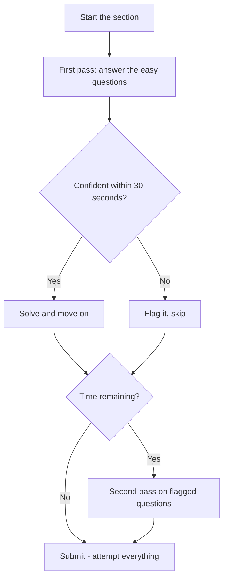

<!-- improved -->
# Infosys Mock Test - Full Pattern Simulation (50 Questions)

> This mock simulates the Infosys (InfyTQ / System Engineer) cognitive test.
> Time limits: Quantitative 35 min, Logical Reasoning 25 min, Verbal 15 min. Total: 75 minutes.
> Rule: 60-90 seconds per question. Answers at the bottom - no peeking.
> Each question is tagged Easy / Medium / Hard.

## Infosys Test Pattern - What You Need to Know

| Item | Detail |
|---|---|
| Aptitude section | 20 questions in 35 minutes |
| Logical section | 15 questions in 25 minutes |
| Verbal section | 15 questions in 15 minutes |
| Negative marking | None - wrong answers are not penalised |
| Marking | 1 mark per correct answer |
| Passing | Sectional cut-offs apply; attempt every question |
| Strategy | Answer Easy questions first, skip Hard ones, guess if stuck - never leave blanks |

Suggested time split for quant: Easy 60-75 s, Medium 90-120 s, Hard only if time remains. For verbal, 60 s per question is the budget - do not reread passages more than twice.

## Learning Objectives

- Match the Infosys cognitive split: 20 quant in 35 minutes, 15 logical in 25, 15 verbal in 15.
- Move fast in the verbal section, which is the tightest in this paper.
- Handle arithmetic-heavy quant without a calculator.
- Recognise the recurring Infosys favourites: percentages, work, series, odd one out.
- Score 17+ in quant, 12+ in logical and 12+ in verbal.

## Attempt Strategy

Infosys gives verbal only 15 minutes for 15 questions, which is 60 seconds each — the
fastest section in the paper. If you arrive late from quant, you lose verbal marks you
could have taken. Bank the verbal time first.

## Section 1 - Quantitative Aptitude (20 questions) - 35 minutes

1. 30% of a number is 135. What is the number? (Easy)
2. A single discount equivalent to successive discounts of 20% and 10% is? (Easy)
3. An article is bought for ₹640 and sold for ₹800. What is the profit percentage? (Easy)
4. What is the simple interest on ₹8,000 at 12.5% per annum for 4 years? (Easy)
5. What is the compound interest on ₹12,000 at 10% per annum for 2 years, compounded annually? (Medium)
6. A train 150 m long crosses a pole in 5 seconds. What is its speed in km/hr? (Easy)
7. A car covers a distance at 40 km/hr and returns over the same road at 60 km/hr. What is the average speed? (Easy)
8. A can do a job in 15 days and B can do it in 10 days. Working together, how many days will they take? (Easy)
9. A and B together can finish a job in 12 days. A alone can finish it in 20 days. In how many days can B alone finish it? (Medium)
10. A pipe fills a tank in 8 hours and a leak empties it in 12 hours. If both are open, how long will the tank take to fill? (Easy)
11. If a:b = 2:3 and b:c = 4:5, find a:c. (Easy)
12. A invests ₹50,000 for 12 months and B invests ₹60,000 for 8 months. If the annual profit is ₹27,000, what is B's share? (Medium)
13. In how many ways can 5 different books be arranged on a shelf? (Easy)
14. A committee of 3 members is to be chosen from 8 candidates. In how many ways can this be done? (Medium)
15. Two dice are rolled. What is the probability that the sum is 7? (Easy)
16. Find the next term: 2, 5, 10, 17, 26, ? (Easy)
17. Find the next term: 1, 2, 6, 24, 120, ? (Easy)
18. The average of 5 numbers is 24. If one number 20 is removed, what is the new average? (Easy)
19. The father's age is 4 times the son's age. After 20 years, the father will be twice as old as the son. What is the son's present age? (Medium)
20. 40 litres of a 30% sugar solution is mixed with 20 litres of a 60% sugar solution. What is the sugar concentration of the mixture? (Medium)

## Section 2 - Logical Reasoning (15 questions) - 25 minutes

21. Pointing to a woman, a man says, "Her mother is the only daughter of my father." How is the woman related to the man? (Medium)
22. In a code, "MANGO" is written as "NBMHP". How is "APPLE" written? (Easy)
23. Statements: All cats are dogs. Some dogs are rats.
    Conclusions: I. Some cats are rats. II. Some dogs are cats.
    Which conclusion follows? (Easy)
24. A person walks 2 km North, then 3 km West, then 2 km South. How far is he from the start and in which direction? (Easy)
25. A man travels 6 km East and then 8 km North. What is the shortest distance from the starting point? (Easy)
26. Six friends A, B, C, D, E, F sit in a row facing North. A sits third from the left. B sits to the immediate right of A. C sits at the extreme right. D sits to the immediate left of C. E sits between B and D. Who sits at the extreme left? (Medium)
27. Find the next term: B, D, G, K, P, ? (Easy)
28. Find the next term: 3, 7, 15, 31, 63, ? (Easy)
29. Odd one out: 121, 144, 169, 196, 210 (Easy)
30. Engineer : Blueprint :: Writer : ? (Easy)
31. Pen : Ink :: Brush : ? (Easy)
32. Data sufficiency: Is x > 5?
    (I) x > 3
    (II) x < 10
    Can the question be answered? (Medium)
33. Data sufficiency: What is the mother's age?
    (I) The mother is 25 years older than her daughter.
    (II) The daughter is 12 years old.
    Can the question be answered? (Easy)
34. Input-Output: Input: 64 21 93 47 58. Step 1: 21 64 93 47 58. Step 2: 21 47 64 93 58. What is Step 3? (Easy)
35. Statement: "Fast food is popular among the youth."
    Conclusions: I. Youth prefer fast food over home food. II. Fast food is affordable.
    Which conclusion follows? (Medium)

## Section 3 - Verbal Ability (15 questions) - 15 minutes

36. Choose the synonym of "impartial": A) biased B) neutral C) partial D) emotional (Easy)
37. Choose the antonym of "eager": A) keen B) reluctant C) enthusiastic D) willing (Easy)
38. Fill in the blank: "The meeting ___ postponed until Friday." A) was B) were C) had D) are (Easy)
39. Spot the error: "The two friends (A) could not decide (B) among the two (C) offers (D)." (Medium)
40. Spot the error: "He is one of the (A) best players (B) that has (C) played for (D) the team." (Medium)
41. Correct the sentence: "I have visited the office yesterday." (Easy)
42. Correct the sentence: "The number of students are increasing." (Medium)
43. Para jumble: (a) The app then suggests the fastest route. (b) A user enters the destination. (c) The GPS tracks the current location. (d) Traffic data is merged in real time. What is the correct order? (Medium)
44. Passage: "The monsoon season in India is both a blessing and a challenge. While it replenishes reservoirs and supports agriculture, it also disrupts transport and damages infrastructure. Forecasters now use satellite data and AI models to predict rainfall weeks in advance, helping farmers plan sowing and cities prepare for flooding."
    What are the two ways the monsoon is a challenge? (Medium)
45. How do AI models help farmers according to the passage? (Easy)
46. Passage: "Cryptography is the art of secure communication. Ancient methods replaced letters, but modern cryptography uses mathematical functions that are easy to compute but hard to reverse without a key. Public key encryption, used in every HTTPS connection, lets two strangers exchange secrets over an insecure network."
    What do modern cryptographic functions rely on? (Medium)
47. Where is public key encryption used, according to the passage? (Easy)
48. Arrange the words into a sentence: "innovation / the / is / key / success / to" (Easy)
49. Idiom: "To pull someone's leg" means: A) to help someone B) to tease someone jokingly C) to trip someone D) to criticise someone (Medium)
50. Idiom: "Under the weather" means: A) raining B) feeling unwell C) travelling D) stressed (Easy)

---

## Answer Key

### Section 1 - Quantitative (1-20)

1. 450 (135 x 100/30)
2. 28% (100 -> 80 -> 72, discount 28%)
3. 25% (profit = 160, 160/640 x 100)
4. ₹4,000 (8000 x 12.5 x 4/100)
5. ₹2,520 (CI = 12000 x (1.1^2 - 1) = 12000 x 0.21)
6. 108 km/hr (150 m in 5 s = 30 m/s = 108 km/hr)
7. 48 km/hr (2 x 40 x 60/100)
8. 6 days (15 x 10/25)
9. 30 days (1/12 - 1/20 = 1/30)
10. 24 hours (1/8 - 1/12 = 1/24)
11. 8:15 (a:b = 8:12, b:c = 12:15)
12. ₹12,000 (A:B = 50,000 x 12 : 60,000 x 8 = 5:4; B = 27,000 x 4/9)
13. 120 (5! = 120)
14. 56 (C(8,3) = 8 x 7 x 6/6)
15. 1/6 (favourable pairs (1,6), (2,5), (3,4), (4,3), (5,2), (6,1) = 6 of 36)
16. 37 (differences 3, 5, 7, 9, 11: 26 + 11)
17. 720 (multiply by 2, 3, 4, 5, 6: 120 x 6)
18. 25 (total = 120; minus 20 = 100; 100/4)
19. 10 years (4s + 20 = 2(s + 20); 4s + 20 = 2s + 40; 2s = 20; s = 10; father 40)
20. 40% (sugar = 40 x 0.3 + 20 x 0.6 = 12 + 12 = 24 kg; 24/60 x 100)

### Section 2 - Logical (21-35)

21. Niece (the only daughter of the man's father is his sister; the woman is the sister's daughter)
22. BQQMF (+1 on each letter: A->B, P->Q, P->Q, L->M, E->F)
23. Only II (all cats are dogs gives some dogs are cats; no definite cat-rat link)
24. 3 km West (2 km North and 2 km South cancel)
25. 10 km (6-8-10 Pythagorean triplet)
26. F (arrangement: F, B, A, E, D, C; left extreme = F)
27. V (differences +2, +3, +4, +5, +6: P + 6 = V)
28. 127 (x2 + 1 each step: 63 x 2 + 1)
29. 210 (the only non-perfect square; the rest are 11^2, 12^2, 13^2, 14^2)
30. Manuscript (an engineer creates a blueprint; a writer creates a manuscript)
31. Paint (a pen is used with ink; a brush is used with paint)
32. No (I and II together give 3 < x < 10, which includes values both above and below 5)
33. Yes, both statements together (mother = 12 + 25 = 37)
34. 21 47 58 64 93 (smallest number moves to the front, one per step)
35. Neither follows (popularity does not imply preference over home food or affordability)

### Section 3 - Verbal (36-50)

36. B) neutral
37. B) reluctant
38. A) was (meeting is singular)
39. C ("between" the two offers, not "among" - between is used for two)
40. C (that have played - "one of the best players" takes a plural verb)
41. "I visited the office yesterday." (present perfect cannot be used with a past time marker)
42. "The number of students is increasing." (subject is "the number" - singular)
43. b, c, d, a (user enters destination, GPS tracks location, traffic data merged, app suggests route)
44. It disrupts transport and damages infrastructure
45. AI models help farmers plan sowing (by predicting rainfall weeks in advance)
46. Mathematical functions that are easy to compute but hard to reverse without a key
47. In every HTTPS connection
48. "The key to success is innovation." (alternatively: "Innovation is the key to success.")
49. B) to tease someone jokingly
50. B) feeling unwell

## Score Interpretation

| Section Score | Level | Next Step |
|---|---|---|
| Quant 17+, Logical 12+, Verbal 12+ | Ready | Book the real Infosys test; retake this mock weekly |
| Any section below par | Focus | Re-drill the corresponding 50-question drill file daily |
| Overall below 50% | Rebuild | Revise theory files first, then retake this mock |

## Summary

Infosys tests arithmetic fluency more than cleverness. Almost every quant question here
is a standard type — percentage, work, pipes, ratio, series — solved by a formula you
already know. The differentiator is speed, and the section that punishes slowness hardest
is verbal at 60 seconds per question.

The paper rewards candidates who bank easy verbal marks early instead of spending the
first ten minutes on a single arrangement puzzle.

## Practical Takeaways

- Do the verbal section at a strict 60 seconds per question; it is the tightest budget.
- Drill arithmetic without a calculator — most time is lost to basic multiplication.
- Learn the odd-one-out pattern: perfect squares, prime bases, composite bases.
- Skip any arrangement question that is not resolving within 60 seconds.
- Score each section against its own cut-off and fix the lowest one first.

## Chapter Quiz

**1.** If 40% of a number is 128, then 75% of the same number is:

(A) 220 (B) 240 (C) 250 (D) 260

**2.** A pipe fills a tank in 16 hours and a leak empties it in 24 hours. With both open, the tank fills in:

(A) 40 hours (B) 48 hours (C) 52 hours (D) 56 hours

**3.** Two numbers are in the ratio 5:7. Subtracting 9 from each gives 4:6. The smaller number is:

(A) 35 (B) 40 (C) 45 (D) 50

**4.** Odd one out: 16, 36, 49, 64, 81

(A) 16 (B) 36 (C) 49 (D) 81

**5.** Fill in the blank: "She is allergic ___ peanuts."

(A) from (B) to (C) with (D) of

### Answers

1. **(B)** — number = 128 / 0.40 = 320; 75% of 320 = 240.
2. **(B)** — 1/16 − 1/24 = 3/48 − 2/48 = 1/48, so 48 hours.
3. **(C)** — (5k − 9)/(7k − 9) = 4/6 gives k = 9, so the numbers are 45 and 63.
4. **(C)** — 49 is 7², the only perfect square with a prime base; the rest are 4², 6², 8², 9².
5. **(B)** — the fixed preposition is "allergic to".

## Exercises

1. Run verbal in 12 minutes instead of 15 to build a time buffer.
2. Do 20 arithmetic questions with no calculator and time them.
3. Write the perfect squares to 20² and cubes to 12³ from memory.
4. Take five odd-one-out questions and state the rule before choosing.
5. Re-take the paper and compare the verbal section score specifically.
