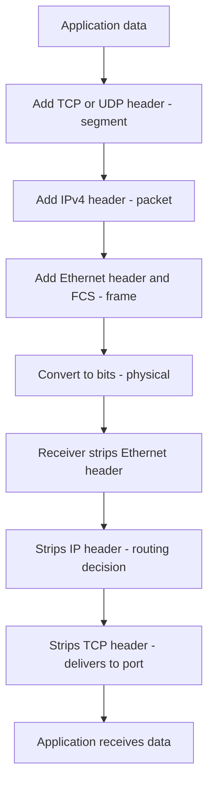
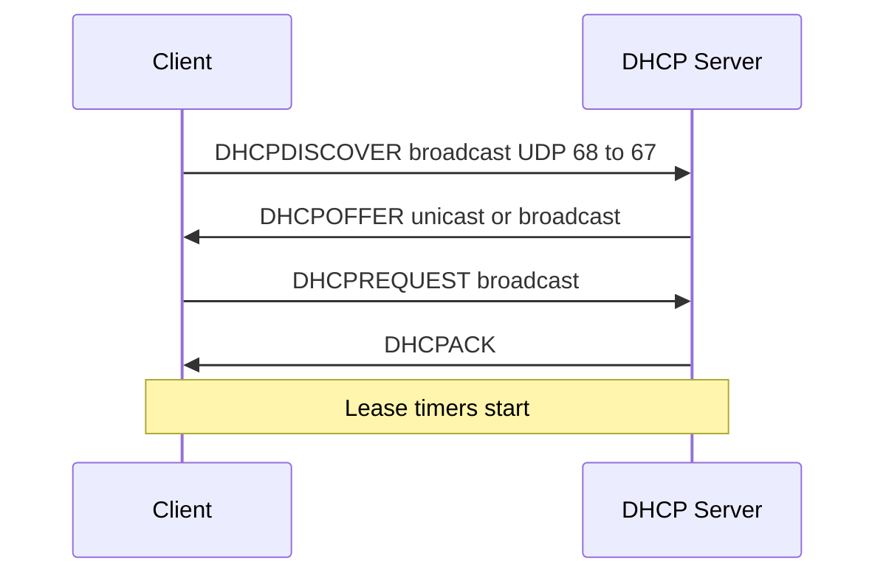

# IP Networks and Addressing

## Learning Objectives

After this chapter you should be able to:

1. Place any protocol, device or PDU on the correct OSI layer and map OSI onto the four-layer TCP/IP model.
2. Trace a packet through encapsulation, naming the header added at each step.
3. Name every field of the 20-byte IPv4 header and say what breaks if that field is wrong.
4. Compute the number and size of fragments when a datagram meets a smaller MTU (L4 numerical).
5. Classify an IPv4 address by class, decide public or private, and convert between dotted decimal, binary and prefix length.
6. Design a fixed-length subnet plan: mask, subnet count, usable hosts, network ID, broadcast ID, host range (L4 numerical).
7. Design a VLSM plan for several host-count requirements without wasting space (L4 numerical).
8. Summarise contiguous prefixes into the shortest covering route (L4 numerical).
9. Compare IPv4 and IPv6 headers, list IPv6 address types and the three transition mechanisms.
10. Explain NAT/PAT, DHCP DORA, DNS resolution, ARP and ICMP at the depth the paper asks.
11. Compare TCP and UDP, describe the three-way handshake, and separate flow control from congestion control.
12. Recall the well-known port numbers that appear in objective questions.

## Introduction

IP/Data Networks carries **15% of the paper, which is 24 marks** of the 160-mark technical part. Every question is a single-mark objective question with four options, and a wrong answer costs 0.25. There is no partial credit and no calculation sheet: the arithmetic is either right in your head or the mark is gone.

The question style in this block is narrow and predictable:

- **Identification.** "Which layer does a switch operate at?", "Which field prevents looping?", "Which record type maps a name to an IPv4 address?" One-line recalls. You know them or you lose them.
- **Discrimination.** Two options are both plausible and differ by one word: TTL versus Hop Limit, flow control versus congestion control, stateful versus stateless. The examiner is testing whether you know the boundary.
- **Numerical.** Subnetting dominates: network ID, broadcast ID, usable hosts, the mask for N subnets, or a VLSM allocation. Mechanical once the method is a reflex, and the most reliable marks in the paper because the answer is verifiable.

For a Computer Science graduate this block is home ground. You have configured subnets and read a TCP header in a lab. The gap is not understanding, it is **precision and speed**: the Fragment Offset unit, the usable hosts on a /31, the DHCP message order. A half-remembered answer costs a mark as surely as no answer.

The target for this block is 22 or more out of 24. The telecom blocks are harder for you than this one, so a leak here cannot be recovered elsewhere. Treat the numericals as a fixed deposit: drill until a /27 takes fifteen seconds and no paper.

## Prerequisites

- Binary fluency: an octet to 8 bits and back, powers of two to 2^16.
- What a router and a switch do, and that the internet is a network of networks.
- Optional but useful: `ping`, `tracert`, `nslookup` on a real machine.
- No telecom background assumed. Everything here is standard IETF material: RFC 791, RFC 8200, RFC 2131, RFC 1034/1035, RFC 826, RFC 9293.

## Key Terminology

- **PDU (Protocol Data Unit)** - the named chunk at each layer: data, segment (TCP) or datagram (UDP), packet, frame, bits.
- **Encapsulation** - wrapping data in a new header as it moves down the stack; each layer treats everything above it as opaque payload.
- **MTU** - Maximum Transmission Unit, the largest payload a link carries; 1500 bytes on standard Ethernet.
- **CIDR** - Classless Inter-Domain Routing, prefix notation such as /26 stating how many leading bits are network bits (RFC 1519).
- **Subnet mask** - 32 bits with contiguous 1s for the network part and 0s for the host part.
- **VLSM** - Variable Length Subnet Masking, different mask lengths inside one block so each subnet is sized to its real need.
- **Network ID / Broadcast ID** - first address of a subnet (host bits all 0) and last (host bits all 1); neither is assignable.
- **NAT / PAT** - Network Address Translation rewrites addresses at a boundary; PAT also rewrites the source port so many hosts share one public address.
- **Default gateway** - the router on the local subnet that receives traffic whose destination is not on-link.
- **ARP** - Address Resolution Protocol, maps a known IPv4 address to an unknown MAC address on the local link (RFC 826).
- **Recursive vs iterative resolution** - a recursive resolver does all the work for the client; an iterative query returns the best referral and the client continues.
- **Three-way handshake** - the SYN, SYN-ACK, ACK exchange that opens a TCP connection and synchronises initial sequence numbers.

## Theory

### 1. The OSI seven layers

Layering exists because a network must solve independent problems - bits on a medium, frames on one link, packets across many links, data to the right process - and each can then be replaced and reasoned about alone. OSI (ISO/IEC 7498-1) is the seven-layer teaching model; TCP/IP (RFC 1122) is the four-layer model actually implemented.

| Layer | Name | PDU | Job | Devices | Protocols |
|---|---|---|---|---|---|
| 7 | Application | Data | Interface to the user process | Host | HTTP, SMTP, DNS, FTP, SIP |
| 6 | Presentation | Data | Syntax, encoding, compression, encryption | Host | TLS, JPEG, ASCII |
| 5 | Session | Data | Dialog control, checkpointing | Host | RPC, NetBIOS, PPTP |
| 4 | Transport | Segment / datagram | End-to-end delivery, ports, reliability | Host | TCP, UDP, SCTP |
| 3 | Network | Packet | Logical addressing, routing between networks | Router, L3 switch | IPv4, IPv6, ICMP, OSPF |
| 2 | Data link | Frame | Framing, MAC addressing, error detection on one link | Switch, bridge, NIC | Ethernet, PPP, 802.11, ARP |
| 1 | Physical | Bits | Voltages, connectors, line coding, bit rate | Hub, repeater, cable | RS-232, 10BASE-T, fibre |

Mnemonic bottom to top: **Please Do Not Throw Sausage Pizza Away**. Top to bottom: **All People Seem To Need Data Processing**.

Two facts the paper repeats. A **switch is layer 2** (forwards on MAC) and a **router is layer 3** (forwards on IP); a "layer 3 switch" is a switch with routing hardware. **ARP sits between 2 and 3**: it travels inside an Ethernet frame with EtherType 0x0806 and carries no IP header, so the honest answer is "layer 2 protocol serving layer 3".

### 2. Encapsulation and overhead

Overhead arithmetic is examinable. A 100-byte payload becomes a 120-byte segment (TCP 20), a 140-byte packet (IPv4 20), a 158-byte frame (Ethernet 14 + FCS 4), and 178 bytes of line time (preamble/SFD 8 + inter-frame gap 12). Overhead on a small payload is about 44% of what goes down the cable, which is why application throughput is always below line rate.

### 3. The TCP/IP model and the mapping

| TCP/IP layer | Maps to OSI | Function | Examples |
|---|---|---|---|
| Application | 5, 6, 7 | Everything the user process needs | HTTP, DNS, DHCP, TLS |
| Transport | 4 | Process-to-process delivery | TCP, UDP |
| Internet | 3 | Host-to-host delivery across networks | IP, ICMP, ARP (edge case) |
| Network access | 1, 2 | Delivery on one physical link | Ethernet, PPP, Wi-Fi |

The asymmetry is examinable: OSI splits application into three layers, TCP/IP collapses the bottom two. TCP/IP has no separate session or presentation layer; those functions live inside the application protocols.

### 4. The IPv4 header (RFC 791)

The header is 20 bytes minimum, 60 maximum, always a multiple of 4.

| Field | Size | Purpose and exam note |
|---|---|---|
| Version | 4 bits | 4 for IPv4, 6 for IPv6 |
| IHL | 4 bits | Header length in 32-bit words; 5 means 20 bytes |
| DSCP + ECN | 8 bits | Formerly Type of Service; QoS marking lives here |
| Total Length | 16 bits | Header plus payload; maximum 65535 bytes |
| Identification | 16 bits | Same value on every fragment of one datagram |
| Flags | 3 bits | Reserved, DF (do not fragment), MF (more fragments) |
| Fragment Offset | 13 bits | Position of this payload, counted in **8-byte units** |
| TTL | 8 bits | Decremented per router; 0 means discard and ICMP Time Exceeded |
| Protocol | 8 bits | 1 ICMP, 6 TCP, 17 UDP, 47 GRE, 50 ESP, 51 AH, 89 OSPF |
| Header Checksum | 16 bits | Header only, recomputed every hop because TTL changes |
| Source Address | 32 bits | Sender |
| Destination Address | 32 bits | Receiver |
| Options + Padding | 0 to 40 bytes | Record route, timestamp, source route; pads to 4 bytes |

**TTL is the loop preventer.** Every router decrements it; at zero the packet is dropped and ICMP Type 11 (Time Exceeded) is returned. `traceroute` sends packets with TTL 1, 2, 3 and collects those replies. **Protocol is the demultiplexing key** for the layer above; its IPv6 equivalent is Next Header.

### 5. Fragmentation (L4 numerical)

If a packet reaches a link whose MTU is smaller and DF is 0, the router splits the payload so that each piece plus a 20-byte header fits the MTU, sets MF on all but the last, and writes the byte offset divided by 8 into Fragment Offset.

- Max payload per fragment = MTU - 20.
- That payload must be a multiple of 8, because the offset counts 8-byte units.
- Fragments = ceiling(payload / max payload per fragment).
- Offset of fragment k = bytes already sent / 8.
- Each fragment repeats the 20-byte header, so fragmentation wastes bandwidth.

Reassembly happens **only at the final destination**. If one fragment is lost the whole datagram is discarded.

### 6. IPv4 classes and private ranges

| Class | First octet | Leading bits | Default mask | Purpose |
|---|---|---|---|---|
| A | 1 to 126 | 0 | /8 | Very large networks |
| B | 128 to 191 | 10 | /16 | Medium networks |
| C | 192 to 223 | 110 | /24 | Small networks |
| D | 224 to 239 | 1110 | none | Multicast |
| E | 240 to 255 | 1111 | none | Reserved |

127.0.0.0/8 is loopback and is not assignable. Private (RFC 1918) blocks, never routed on the internet:

| Block | Prefix | Addresses | Typical use |
|---|---|---|---|
| 10.0.0.0 to 10.255.255.255 | 10.0.0.0/8 | 16,777,216 | Large enterprise, carrier core |
| 172.16.0.0 to 172.31.255.255 | 172.16.0.0/12 | 1,048,576 | Enterprise, labs |
| 192.168.0.0 to 192.168.255.255 | 192.168.0.0/16 | 65,536 | Home and small office |

Other special blocks: 169.254.0.0/16 link-local (APIPA when DHCP fails), 0.0.0.0/8 "this host", 100.64.0.0/10 carrier-grade NAT (RFC 6598), 224.0.0.0/4 multicast, 240.0.0.0/4 reserved.

### 7. CIDR and mask arithmetic (L4 numerical)

A /n prefix means n network bits and 32-n host bits.

- Usable hosts per subnet = 2^(32-n) - 2.
- Equal subnets from a /N block = 2^(n-N).
- Block size in the interesting octet = 256 - mask octet.

| Prefix | Mask | Block size | Usable hosts |
|---|---|---|---|
| /24 | 255.255.255.0 | 256 | 254 |
| /25 | 255.255.255.128 | 128 | 126 |
| /26 | 255.255.255.192 | 64 | 62 |
| /27 | 255.255.255.224 | 32 | 30 |
| /28 | 255.255.255.240 | 16 | 14 |
| /29 | 255.255.255.248 | 8 | 6 |
| /30 | 255.255.255.252 | 4 | 2 |
| /31 | 255.255.255.254 | 2 | 2 on point-to-point links (RFC 3021) |
| /32 | 255.255.255.255 | 1 | 1 (host route) |

### 8. Subnetting method (L4 numerical)

1. Host bits = 32 - prefix; block size = 2^(host bits).
2. Divide the interesting octet by the block size, discard the remainder, multiply back: that is the network ID in that octet.
3. Broadcast = network ID + block size - 1.
4. Host range = network + 1 to broadcast - 1.
5. Mask = the prefix written as four octets.

For prefixes that stop mid-octet (a /12 or /20), work in the octet where the mask stops being 255 or 0.

### 9. VLSM (L4 numerical)

VLSM allocates the largest requirement first, each from the next free address, using the smallest mask that fits. Descending order is mandatory, not stylistic: a large block cannot be carved from space already split into small blocks. Sizing rule: for H hosts, 2^h - 2 >= H, so h = ceil(log2(H + 2)).

| Requirement | Host bits | Prefix | Block |
|---|---|---|---|
| 100 hosts | 7 (126) | /25 | 128 |
| 50 hosts | 6 (62) | /26 | 64 |
| 25 hosts | 5 (30) | /27 | 32 |
| 10 hosts | 4 (14) | /28 | 16 |
| 2 hosts (WAN) | 2 (2) | /30 | 4 |

### 10. Route summarisation (L4 numerical)

Convert the differing octet to binary, find the leftmost bit where the members differ, and keep the common leading bits. Two /24s differing in the last bit give a /23; four consecutive /24s give a /22; eight give a /21. The summary address is the lowest member rounded down to that prefix.

### 11. IPv6 (RFC 8200)

The header is **40 bytes fixed**, eight fields, no checksum, no options in the base header, no router fragmentation.

| Field | Size | Note |
|---|---|---|
| Version | 4 bits | 6 |
| Traffic Class | 8 bits | Same role as IPv4 DSCP |
| Flow Label | 20 bits | Labels a flow for special handling |
| Payload Length | 16 bits | Payload only, header excluded |
| Next Header | 8 bits | Same role as IPv4 Protocol; chains extension headers |
| Hop Limit | 8 bits | Same role as IPv4 TTL, renamed |
| Source Address | 128 bits | |
| Destination Address | 128 bits | |

Extension headers (Hop-by-Hop, Routing, Fragment, Destination Options) are chained through Next Header, so routers skip them quickly.

| Address type | Prefix | Meaning |
|---|---|---|
| Global unicast | 2000::/3 | Routable on the internet |
| Link-local | fe80::/10 | One link only, auto-configured, mandatory |
| Unique local | fc00::/7 | Private equivalent of RFC 1918 |
| Loopback | ::1/128 | Self |
| Unspecified | ::/128 | No address yet |
| Multicast | ff00::/8 | One-to-many |

**IPv6 has no broadcast.** Its functions are carried by multicast (ff02::1 all nodes, ff02::2 all routers); any option naming an IPv6 broadcast address is the wrong answer.

Notation: groups of 4 hex digits separated by colons; leading zeros in a group may be dropped; one run of zero groups may become `::`, **once** per address. `2001:0db8:0000:0000:0000:ff00:0042:8329` becomes `2001:db8::ff00:42:8329`.

Transition mechanisms: **dual stack** (host runs both, picks per destination - preferred), **tunnelling** (IPv6 inside IPv4: 6to4, Teredo, ISATAP), **translation** (NAT64 with DNS64 for IPv6-only hosts reaching IPv4 servers).

### 12. NAT and PAT

| Type | Rewrites | Use |
|---|---|---|
| Static NAT | One private to one public, fixed | Servers that must be reachable |
| Dynamic NAT | Private to a pool of public, one-to-one | Many hosts, enough public addresses |
| PAT / overload | Source IP and source port, many-to-one | Almost every consumer and enterprise edge |

PAT keeps a table of (inside IP, inside port) to (public IP, public port). It breaks end-to-end transparency, so protocols that embed addresses in the payload (FTP active mode, SIP, IPsec AH) need an application gateway or NAT traversal. NAT is why IPv4 survived; it is not a security mechanism, though it incidentally blocks unsolicited inbound connections.

### 13. DHCP and DORA (RFC 2131)

DHCP supplies address, mask, gateway, DNS servers and lease time.

- **DORA** = Discover, Offer, Request, Ack. The client speaks first, to 255.255.255.255 from 0.0.0.0.
- Ports: server 67, client 68.
- Renewal at 50% of lease (T1) unicast to the original server; rebinding at 87.5% (T2) broadcast to any server.
- A relay agent (option 82, giaddr) lets one server serve many subnets, because broadcasts do not cross routers.
- No server means a Windows host self-assigns 169.254.x.x (APIPA).

### 14. DNS (RFC 1034/1035)

| Record | Maps | Example |
|---|---|---|
| A | Name to IPv4 address | www.example.com to 203.0.113.10 |
| AAAA | Name to IPv6 address | www.example.com to 2001:db8::10 |
| CNAME | Name to another name (alias) | mail.example.com to mail.provider.net |
| MX | Domain to mail server, with preference | example.com to 10 mail.example.com |
| NS | Domain to authoritative server | example.com to ns1.example.com |
| PTR | Address to name (reverse) | 10.113.0.203.in-addr.arpa |
| SOA | Zone authority, serial, refresh, retry, expire, minimum | one per zone |
| TXT | Free text: SPF, DKIM, verification | |
| SRV | Service, protocol, port, target | _sip._tcp.example.com |

Resolution is **recursive** (the resolver does all the walking and returns the final answer) or **iterative** (each server returns the best referral - root, then TLD, then authoritative - and the asker continues). The cache chain is browser, OS, stub resolver, recursive resolver, then authoritative; each record's TTL decides how long each cache keeps it. DNS uses **UDP 53** for normal queries and **TCP 53** for zone transfers and oversized responses.

### 15. ARP (RFC 826)

ARP answers "which MAC owns this IPv4 address on my link?" The sender broadcasts a request, the owner replies unicast, and both cache the result for a few minutes. **Gratuitous ARP** is an unsolicited announcement used to detect duplicate addresses and refresh caches after failover. **Proxy ARP** lets a router answer for a host in another subnet. ARP has no authentication, which is why ARP spoofing is the standard first move in a LAN man-in-the-middle attack. IPv6 replaces ARP with Neighbour Discovery over ICMPv6.

### 16. ICMP

ICMP carries control and error messages inside IP (Protocol 1) and has no ports.

| Type | Name | Used by |
|---|---|---|
| 0 | Echo reply | ping |
| 3 | Destination unreachable (codes for net, host, port, fragmentation needed) | Routers, Path MTU Discovery |
| 5 | Redirect | Router pointing a host at a better gateway |
| 8 | Echo request | ping |
| 11 | Time exceeded | traceroute, TTL expiry |

ICMP does not make IP reliable; it only reports problems. Blocking all ICMP breaks Path MTU Discovery and creates "black hole" connections where small packets work and large ones hang.

### 17. TCP versus UDP

| Property | TCP | UDP |
|---|---|---|
| Connection | Connection-oriented, three-way handshake | Connectionless |
| Reliability | Acknowledgements, retransmission | None |
| Ordering | Sequence numbers, in-order delivery | None |
| Header size | 20 bytes minimum | 8 bytes fixed |
| Flow control | Sliding window, receiver advertised window | None |
| Congestion control | Slow start, congestion avoidance, fast recovery | None (application's problem) |
| Speed / overhead | Slower, more overhead | Faster, minimal overhead |
| Typical use | HTTP, SSH, SMTP, FTP, SIP | DNS queries, DHCP, TFTP, RTP, SNMP |

TCP header fields: source port, destination port, sequence number, acknowledgement number, data offset, flags (URG, ACK, PSH, RST, SYN, FIN), window, checksum, urgent pointer.

**Three-way handshake:** the client sends SYN with its initial sequence number, the server replies SYN-ACK with its own ISN and an acknowledgement, the client sends ACK. One RTT spent. Teardown takes four steps (FIN, ACK, FIN, ACK) because each direction closes independently.

**Flow control versus congestion control** is the most confused pair in this block. Flow control protects the **receiver**: the advertised window (rwnd) says how much it can buffer, and the sender keeps no more unacknowledged data in flight than rwnd. Congestion control protects the **network**: the sender's cwnd grows slowly (slow start, doubling per RTT) until loss is detected, then collapses. Effective window = min(rwnd, cwnd). A zero window means "my buffer is full"; a dropped packet means "the network is congested".

### 18. Port numbers worth knowing

| Port | Protocol | Service |
|---|---|---|
| 20 / 21 | TCP | FTP data / control |
| 22 | TCP | SSH, SFTP, SCP |
| 23 | TCP | Telnet |
| 25 | TCP | SMTP |
| 53 | UDP and TCP | DNS |
| 67 / 68 | UDP | DHCP server / client |
| 69 | UDP | TFTP |
| 80 | TCP | HTTP |
| 110 | TCP | POP3 |
| 123 | UDP | NTP |
| 143 | TCP | IMAP |
| 161 / 162 | UDP | SNMP agent / trap |
| 179 | TCP | BGP |
| 389 | TCP/UDP | LDAP |
| 443 | TCP | HTTPS |
| 514 | UDP | Syslog |
| 1812 / 1813 | UDP | RADIUS authentication / accounting |
| 5060 / 5061 | UDP/TCP | SIP / SIP-TLS |

Ports 0 to 1023 are well-known and need privilege to bind; 1024 to 49151 are registered; 49152 to 65535 are ephemeral source ports.

## Worked Examples

### Example 1 - Fixed-length subnetting of a /24 (L4 numerical)

**Question.** Divide 192.168.1.0/24 into at least 6 equal subnets. Give the mask, usable hosts, and the first three subnets.

**Step 1.** Need 2^k >= 6, so k = 3 and the prefix is 24 + 3 = /27.
**Step 2.** Mask = 255.255.255.224; block size = 256 - 224 = 32.
**Step 3.** Host bits = 5, so 2^5 - 2 = 30 usable hosts.

| Subnet | Network | Host range | Broadcast |
|---|---|---|---|
| 1 | 192.168.1.0 | .1 to .30 | 192.168.1.31 |
| 2 | 192.168.1.32 | .33 to .62 | 192.168.1.63 |
| 3 | 192.168.1.64 | .65 to .94 | 192.168.1.95 |

The remaining five start at .96, .128, .160, .192, .224. Two are spare, which is correct: you cannot buy exactly six.

### Example 2 - Reading a host address (L4 numerical)

**Question.** For 172.16.45.200/27, find network ID, broadcast ID, host range and usable hosts.

**Step 1.** /27 gives block size 32.
**Step 2.** 200 / 32 = 6 remainder 8, so the block index is 6 and 6 x 32 = 192.
**Step 3.** Network ID = 172.16.45.192; broadcast = 192 + 32 - 1 = 223.
**Step 4.** Host range = 172.16.45.193 to 172.16.45.222, which is 222 - 193 + 1 = 30 addresses.

Check with the mask: 200 AND 224 = 192 in the last octet. Consistent.

### Example 3 - VLSM design (L4 numerical)

**Question.** From 192.168.10.0/24 allocate Sales 100 hosts, Engineering 50, Accounts 25, and two point-to-point WAN links.

**Step 1.** Size each, largest first: 100 -> 7 bits (126) -> /25; 50 -> 6 bits (62) -> /26; 25 -> 5 bits (30) -> /27; 2 -> 2 bits (2) -> /30.

| Subnet | Prefix | Range | Broadcast |
|---|---|---|---|
| Sales | 192.168.10.0/25 | .1 to .126 | .127 |
| Engineering | 192.168.10.128/26 | .129 to .190 | .191 |
| Accounts | 192.168.10.192/27 | .193 to .222 | .223 |
| WAN 1 | 192.168.10.224/30 | .225 to .226 | .227 |
| WAN 2 | 192.168.10.228/30 | .229 to .230 | .231 |

**Step 2 - check.** Last used is .231, so .232 to .255 (24 addresses) stay free. Allocated 128 + 64 + 32 + 4 + 4 = 232, and 232 + 24 = 256. Balanced.

Had you placed the /30s first, starting at .0, the /25 would no longer fit contiguously.

### Example 4 - Fragmentation (L4 numerical)

**Question.** A 4000-byte IPv4 datagram including its 20-byte header crosses an MTU of 1500 with DF clear. Give fragments, lengths, MF flags and offsets.

**Step 1.** Payload = 4000 - 20 = 3980 bytes.
**Step 2.** Max payload per fragment = 1500 - 20 = 1480 bytes.
**Step 3.** Fragments = ceil(3980 / 1480) = 3, splitting 1480 + 1480 + 1020.
**Step 4.** Offsets in 8-byte units: 0 / 8 = 0, 1480 / 8 = 185, 2960 / 8 = 370.

| Fragment | Total Length | Payload | MF | Offset |
|---|---|---|---|---|
| 1 | 1500 | 1480 | 1 | 0 |
| 2 | 1500 | 1480 | 1 | 185 |
| 3 | 1040 | 1020 | 0 | 370 |

**Step 5 - verify.** 370 x 8 = 2960, and 2960 + 1020 = 3980. The last fragment is short and has MF 0, which is how the receiver knows the datagram is complete.

### Example 5 - Summarisation (L4 numerical)

**Question.** Summarise 10.20.30.0/24 and 10.20.31.0/24 into one route.

**Step 1.** Third octet in binary: 30 = 00011110, 31 = 00011111.
**Step 2.** Bits 0 to 6 are identical, bit 7 differs, so the third octet contributes 7 common bits and the prefix is 8 + 8 + 7 = /23.
**Step 3.** 10.20.30.0 is a valid /23 boundary because 30 is even, so the summary is 10.20.30.0/23.
**Step 4 - verify.** 10.20.30.0/23 covers 10.20.30.0 to 10.20.31.255 and contains both. A /22 would also contain them but is not the shortest covering prefix.

### Example 6 - IPv6 compression (L4 numerical, notation)

**Question.** Compress 2001:0db8:0000:0000:0001:0000:0000:0001.

**Step 1.** Drop leading zeros: 2001:db8:0:0:1:0:0:1.
**Step 2.** Two runs of two zero groups exist; `::` may be used only once, and the leftmost longest run wins.
**Step 3.** Result: 2001:db8::1:0:0:1. Expanding it returns the original address.

A single zero group cannot be compressed, so 2001:db8:0:1:1:1:1:1 stays as written.

## Exam Traps and Common Mistakes

**Trap 1 - Using 255.255.255.255 as a subnet's broadcast.** The broadcast is the last address *of that subnet*: network + block size - 1. For 192.168.1.64/27 it is 192.168.1.95.

**Trap 2 - Reading the mask octet as the block size.** Block size is 256 minus the mask octet. A 255.255.255.192 mask gives blocks of 64, not 192.

**Trap 3 - Forgetting that Fragment Offset counts 8-byte units.** An offset of 185 means 1480 bytes have already been sent. Writing 1480 into the field is the most common fragmentation error.

**Trap 4 - Believing 172.16.0.0/16 is the whole private B space.** It is a /12 covering 172.16.0.0 to 172.31.255.255, so 172.20.5.9 is private. Likewise 192.168.0.0/16 is the private C space, not just 192.168.1.0.

**Trap 5 - Confusing TTL with a timer.** TTL is a hop counter decremented by one per router, not seconds. Its IPv6 name is Hop Limit, and it is unrelated to Total Length.

**Trap 6 - Getting the DHCP order wrong.** The client speaks first: Discover, then Offer, then Request, then Ack. Any option beginning with Offer is wrong, because the server cannot offer before it hears a request.

**Trap 7 - Assuming DNS is UDP only.** Normal queries use UDP 53, but zone transfers and oversized responses use TCP 53.

**Trap 8 - Mixing up flow control and congestion control.** Flow control is the receiver's advertised window protecting its buffer; congestion control is the sender's cwnd protecting the network. "Flow control prevents network congestion" is false.

**Trap 9 - Forgetting IPv6 has no broadcast.** If an option lists broadcast as an IPv6 address type, it is the intended wrong answer; multicast ff02::1 replaces it.

**Trap 10 - Treating /31 and /32 as unusable.** A /31 gives 2 usable addresses on a point-to-point link (RFC 3021) and a /32 is a valid host route. The 2^n - 2 rule applies to ordinary subnets only.

## Summary

- OSI has seven layers, TCP/IP four. Switch is layer 2, router is layer 3, ARP is a layer 2 protocol serving layer 3.
- Encapsulation adds a header per layer; a 100-byte payload becomes a 158-byte Ethernet frame, 178 bytes of line time.
- The IPv4 header is 20 to 60 bytes. TTL stops loops, Protocol demultiplexes, Fragment Offset counts 8-byte units, checksum covers the header only.
- Fragmentation fits the payload to the MTU, sets MF on all but the last fragment, and reassembles only at the destination.
- Classes A to E are read from the first octet; private space is 10/8, 172.16/12 and 192.168/16.
- Subnetting is block arithmetic: block = 2^(host bits), network = address rounded down, broadcast = network + block - 1, hosts = block - 2.
- VLSM allocates largest first with the smallest fitting mask, sizing by 2^h - 2 >= H.
- Summarisation keeps the common leading bits of the members.
- IPv6 has a fixed 40-byte header, 128-bit addresses, no broadcast, and three transition families: dual stack, tunnelling, translation.
- NAT/PAT rewrites addresses and ports; DHCP runs DORA on UDP 67/68; DNS uses A, AAAA, CNAME, MX, NS, PTR, SOA on port 53.
- TCP is reliable, ordered, windowed and congestion-controlled; UDP is minimal and leaves everything to the application.

## Practical Takeaways

- Drill the block sequence 256, 128, 64, 32, 16, 8, 4, 2 until it is automatic; every subnet question is a lookup in it.
- Given a host and mask, compute the network ID first and derive the rest; never work backwards from the options.
- In VLSM, sort requirements descending before writing a single address. This one habit prevents the classic ordering error.
- Memorise the Protocol numbers (1 ICMP, 6 TCP, 17 UDP, 89 OSPF) and ARP's EtherType 0x0806; they appear as one-line questions.
- Keep a one-page port sheet and revise it weekly; these are guaranteed marks.
- On any TCP claim ask "receiver or network?" - that question separates flow control from congestion control every time.
- Verify a subnet answer in five seconds: network AND mask must equal network, broadcast OR mask must equal broadcast.

## Chapter Quiz

**Q1.** Which IPv4 header field prevents a packet circulating forever in a routing loop?

A) Identification

B) Time To Live

C) Fragment Offset

D) Header Checksum

**Answer: B** TTL is decremented by each router; at zero the packet is dropped and ICMP Time Exceeded is returned.

**Q2.** How many usable host addresses does a /27 subnet provide?

A) 30

B) 32

C) 62

D) 14

**Answer: A** 32 - 27 = 5 host bits, so 2^5 - 2 = 30. 32 is the block size and 62 belongs to a /26.

**Q3.** Which DHCP message does a client send first?

A) DHCPOFFER

B) DHCPREQUEST

C) DHCPDISCOVER

D) DHCPACK

**Answer: C** The order is Discover, Offer, Request, Ack; the client must speak first because it has no address yet.

**Q4.** A host is configured with 172.20.5.9. This address is:

A) Public class B

B) Private class B

C) Public class C

D) Link-local

**Answer: B** The first octet 172 is class B, and 172.16.0.0/12 spans 172.16 through 172.31, so 172.20 is inside the private block.

**Q5.** Which IPv6 address type does not exist?

A) Global unicast

B) Link-local

C) Broadcast

D) Multicast

**Answer: C** IPv6 removed broadcast; multicast, for example ff02::1 for all nodes on a link, carries its functions.

## Exercises

**E1 (numerical).** Subnet 10.10.0.0/16 so each subnet supports at least 500 hosts. Give the mask, the subnet count and the first two subnets.

*Expected answer:* 9 host bits give 510 usable hosts, so /23 (255.255.254.0) and 2^7 = 128 subnets; first is 10.10.0.0/23 (hosts 10.10.0.1 to 10.10.1.254, broadcast 10.10.1.255), second is 10.10.2.0/23.

**E2 (numerical).** For 192.168.5.130/26 give the network ID, broadcast ID, host range and usable host count.

*Expected answer:* block 64, 130 falls in block 2, network 192.168.5.128, broadcast 192.168.5.191, hosts .129 to .190, 62 usable.

**E3 (numerical).** From 172.16.8.0/24 allocate VLSM subnets for 60, 28, 12, 2 and 2 hosts.

*Expected answer:* 60 -> 172.16.8.0/26 (.1 to .62); 28 -> 172.16.8.64/27 (.65 to .94); 12 -> 172.16.8.96/28 (.97 to .110); 2 -> 172.16.8.112/30 (.113 to .114); 2 -> 172.16.8.116/30 (.117 to .118). Space .119 to .255 remains free.

**E4 (numerical).** A 3000-byte IPv4 datagram crosses an MTU of 1500 with DF clear. Give fragment lengths, MF bits and offsets.

*Expected answer:* payload 2980, max 1480 each, so payloads of 1480, 1480 and 20; total lengths 1500, 1500 and 40; MF 1, 1, 0; offsets 0, 185, 370.

**E5 (numerical).** Summarise 192.168.16.0/24, 192.168.17.0/24, 192.168.18.0/24 and 192.168.19.0/24 into one prefix.

*Expected answer:* 16 to 19 differ in the last two bits of the third octet, so the common prefix is 22 bits: 192.168.16.0/22, covering 192.168.16.0 to 192.168.19.255.

**E6.** Convert 11000000.10101000.00000001.00001010 to dotted decimal and state its class and scope.

*Expected answer:* 192.168.1.10; class C; private, inside 192.168.0.0/16.

**E7 (numerical).** How many /26 subnets fit inside a /20, and what is the total usable host count across them?

*Expected answer:* 26 - 20 = 6 borrowed bits, so 64 subnets; 62 usable hosts each, so 64 x 62 = 3968 usable addresses.

**E8.** Compress 2001:0db8:0000:0000:0001:0000:0000:0001 and explain why only one `::` is allowed.

*Expected answer:* 2001:db8::1:0:0:1. A second `::` would make the number of omitted zero groups ambiguous, so the notation permits exactly one.

## Next

Chapter 2 follows the addressed packet across the network: routing protocols and metrics, switching and VLANs, MPLS label operations, and QoS treatment at each hop.
