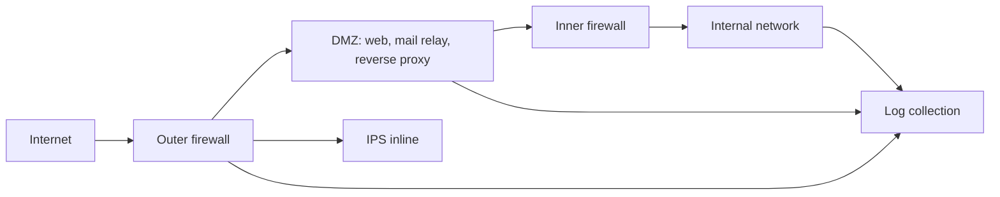

# Network Security and Caching

## Learning Objectives

After this chapter you should be able to:

1. Match each common attack to the layer it exploits and the control that stops it.
2. Distinguish packet-filter, stateful, application-proxy and next-generation firewalls by what each can see.
3. Separate IDS from IPS by placement and action, and explain false positives and false negatives.
4. Design a DMZ and justify why public servers sit between two policy points.
5. Compare site-to-site and remote-access VPNs, and tunnel versus transport mode.
6. Explain IPsec AH versus ESP, the role of IKE, and why ESP survives NAT while AH does not.
7. Walk the TLS 1.2 and TLS 1.3 handshakes and state what each round trip buys.
8. Read an X.509 certificate and describe chain validation and revocation.
9. Explain 802.1X with EAP and RADIUS, and the difference between RADIUS and TACACS+.
10. Compute cache hit ratio, effective latency and the break-even ratio (L4 numerical).
11. Compare forward and reverse proxies, and L4 versus L7 load balancing.
12. Describe a telecom operator's security obligations in generic, defensible terms.

## Introduction

This is the third and last chapter of **IP/Data Networks, 15% of the paper, 24 marks**. Single-mark objective questions, four options, minus 0.25 for a wrong answer.

The questions here are mostly **definition boundaries and mechanism identification**:

- "Which IPsec protocol provides confidentiality?" (ESP, not AH)
- "Where is an IPS placed?" (inline, in the traffic path)
- "Which device hides the servers from the client?" (reverse proxy)
- "Which record type proves domain control for mail?" (TXT, via SPF/DKIM)

Arithmetic appears in four places, and all four are simple: cache hit ratio, IPsec and tunnel overhead against the MTU, DMZ subnet allocation, and load-balancer capacity. Each is a mark you can take in under a minute.

Two warnings. First, security vocabulary is where invented options sound most convincing - "stateful packet filter" and "application-level stateful inspection" are both plausible until you know which term belongs to which generation. Learn the four firewall types as a sequence, not as a list of adjectives. Second, this chapter touches regulation. The paper may ask which body handles incident response (CERT-In) or which body regulates tariffs (TRAI). Learn the body and its function; do not memorise clause numbers, and do not trust any source that quotes them loosely.

The target for the whole block is 22 or more out of 24, and this chapter is the cheapest of the three to secure because so much of it is naming, not computing.

## Prerequisites

- Chapter 1: TCP/IP headers, ports, NAT and DNS.
- Chapter 2: how packets are forwarded, and where a policy point can be inserted.
- Symmetric versus asymmetric cryptography at the level of "one shared key" versus "public and private pair".
- No legal background needed; the regulatory section is written to be answered from first principles.

## Key Terminology

- **Spoofing** - forging a source identity, whether IP address, MAC address, DNS answer or email sender.
- **MITM (man-in-the-middle)** - an attacker positioned between two parties who can read, alter or relay their traffic.
- **DDoS** - distributed denial of service, many sources exhausting bandwidth, connection state or application capacity.
- **Stateful inspection** - a firewall that keeps a connection table so return traffic is permitted without an explicit rule.
- **DMZ** - a screened subnet holding public-facing servers, isolated from the internal network by a second policy point.
- **SA (Security Association)** - the one-way IPsec agreement of algorithms, keys and SPI that both peers apply.
- **AH / ESP** - IPsec Authentication Header (integrity only) and Encapsulating Security Payload (confidentiality plus integrity).
- **PKI** - Public Key Infrastructure: the CAs, policies and formats that let a party verify a public key belongs to a name.
- **802.1X** - port-based network access control: authenticate before the port passes traffic.
- **AAA** - Authentication (who), Authorization (what may they do), Accounting (what did they do).
- **Cache hit ratio** - the fraction of requests served from cache rather than from the origin.
- **CDN** - Content Delivery Network: a set of edge locations that serve cached content close to users.

## Theory

### 1. The threat landscape

Attacks are best grouped by what they break: identity, confidentiality, availability or input handling.

| Attack | Mechanism | Primary control |
|---|---|---|
| IP spoofing | Forged source address; used for reflection and to bypass address ACLs | Ingress and egress filtering (BCP 38), uRPF |
| MAC spoofing | Forged source MAC to impersonate a host or reach another VLAN | Port security, 802.1X, dynamic ARP inspection |
| ARP spoofing | Poisoned ARP cache redirects local traffic through the attacker | Dynamic ARP inspection, static ARP for gateways |
| MITM | Attacker relays traffic between two parties | TLS with certificate validation, HSTS, mutual auth |
| DNS cache poisoning | Forged records inserted into a resolver's cache | DNSSEC, randomised query IDs and ports |
| DDoS volumetric | Flood of bits to saturate the uplink | Scrubbing, anycast, upstream filtering |
| DDoS state exhaustion | SYN flood fills the connection table | SYN cookies, rate limits, stateful firewall tuning |
| DDoS application | Valid-looking requests that consume CPU or database time | WAF, rate limiting, bot detection |
| Phishing | Deceptive message harvesting credentials | Mail authentication (SPF, DKIM, DMARC), user training, MFA |
| SQL injection | Malicious input reaching a query | Parameterised queries, WAF signatures, least privilege |
| Ransomware | Encryption of data after lateral movement | Segmentation, backups, patching, EDR |

Note the pattern: most attacks are defeated by a control at a different layer from the attack. ARP spoofing is a layer 2 attack answered at layer 2 (DAI) and at layer 7 (TLS pinning). A question that offers "firewall" as the answer to ARP spoofing is offering the wrong layer.

**Amplification and reflection** deserve their own line because they explain why DDoS is cheap. The attacker spoofs the victim's address and sends a small query to an open resolver or NTP server; the server sends a much larger response to the victim. The amplification factor is response size divided by request size, so a 60-byte DNS query producing a 3,000-byte answer is a factor of 50.

### 2. Firewalls

| Generation | Sees | State | Strength | Weakness |
|---|---|---|---|---|
| Packet filter (stateless ACL) | 5-tuple: source and destination IP, source and destination port, protocol | None | Very fast, cheap, line rate | No context; must open return traffic explicitly; fooled by fragmentation tricks |
| Stateful inspection | 5-tuple plus the connection table | Per-flow | Return traffic allowed automatically; can reassemble fragments | Memory and CPU per flow; state table is itself a target |
| Application proxy / gateway | Full layer 7 content, terminating and re-originating the connection | Per-connection, two TCP stacks | Deep protocol enforcement, hides internal hosts | High latency, protocol-specific, scaling cost |
| NGFW | 5-tuple, application identity, user identity, content, threat signatures | Per-flow plus per-application | Application-aware policy, integrated IPS, TLS inspection | Cost, complexity, TLS inspection breaks pinning and privacy |

A packet filter answers "may this packet pass?" A stateful firewall answers "is this packet part of an allowed conversation?" A proxy answers "is this application request legitimate?" An NGFW answers all three plus "who is the user and what application is this really?"

**Rule evaluation is first-match, top-down.** The first rule that matches decides, and a trailing implicit deny drops everything unmatched. Order therefore matters more than content: a permit-any rule placed above a specific deny makes the deny dead text.

### 3. IDS versus IPS

| Aspect | IDS | IPS |
|---|---|---|
| Placement | Out of band, fed by a SPAN port or TAP | Inline, in the forwarding path |
| Action | Detect and alert | Detect and block, drop, reset or quarantine |
| Effect on traffic | None | Adds latency; a false positive can break legitimate traffic |
| Failure mode | Blind if the mirror is misconfigured | Becomes a network outage if it fails closed |
| Detection methods | Signature, anomaly, policy | Signature, anomaly, reputation |

Both suffer **false positives** (alerting on benign traffic) and **false negatives** (missing real attacks). A signature IDS cannot see an attack it has no signature for; an anomaly IDS needs a baseline, and baselines drift. This is why production uses both signature and behavioural detection, and why an IPS is deployed with a bypass path.

### 4. DMZ and segmentation

A **DMZ** is a screened subnet. Public servers (web, mail relay, reverse proxy, DNS) sit in it, reachable from the internet through the outer firewall and reachable from the internal network only through the inner firewall. If a public server is compromised, the attacker still faces a second policy point.

Segmentation generalises the idea: management plane on its own VLAN, servers grouped by function, OT and building systems separated from IT, and east-west traffic filtered rather than assumed trustworthy. The design principle is **least privilege between zones**, not just at the perimeter.

### 5. VPN types

| Type | Connects | Typical technology |
|---|---|---|
| Site-to-site | Two networks, gateways build the tunnel | IPsec, often over MPLS or the internet |
| Remote access | One user device to the corporate network | IPsec client, SSL/TLS VPN, WireGuard |
| Clientless SSL VPN | A browser to internal web apps | TLS reverse proxy with portal |
| Overlay | Sites or hosts over any underlay | WireGuard, IPsec, SD-WAN tunnels |

Protocol notes: **PPTP** is obsolete and its authentication is broken. **L2TP** provides no encryption by itself and is paired with IPsec. **SSL/TLS VPN** rides TCP 443 and passes most firewalls. **WireGuard** is modern, small and fast, but has no built-in dynamic address assignment. **Split tunnelling** sends only corporate prefixes into the tunnel and the rest direct to the internet - cheaper, but it removes the corporate inspection point.

### 6. IPsec

IPsec is a framework, not a single protocol. Two protocols do the work:

| Aspect | AH (protocol 51) | ESP (protocol 50) |
|---|---|---|
| Confidentiality | No, payload is cleartext | Yes, encryption |
| Integrity and authentication | Yes, covers the IP header fields that do not change | Yes, covers the ESP payload |
| Anti-replay | Yes, sequence number | Yes, sequence number |
| NAT traversal | Fails, because AH protects the source address | Works with NAT-T on UDP 4500 |
| Typical use | Rare, where authentication without encryption is required | Almost everything |

Two modes:

- **Transport mode** keeps the original IP header and protects only the payload. Host to host, or host to gateway.
- **Tunnel mode** encapsulates the entire original packet inside a new IP header. Gateway to gateway, and the mode used for site-to-site VPNs.

**IKE** (Internet Key Exchange) negotiates the SAs: UDP **500**, moving to UDP **4500** when NAT traversal is detected. IKEv1 ran phase 1 (build the ISAKMP SA) and phase 2 (build the IPsec SAs); IKEv2 (RFC 7296) does it in fewer exchanges and is the current standard. Each SA is one-way, identified by an **SPI**, and lists the algorithms and keys. **Perfect forward secrecy** ensures a compromised long-term key cannot decrypt past sessions.

### 7. TLS handshake

TLS runs above TCP and provides confidentiality, integrity and server authentication (optionally client authentication).

**TLS 1.2, full handshake, two round trips:**

1. ClientHello: version, cipher suites, client random, SNI, supported extensions.
2. ServerHello, Certificate, ServerKeyExchange, ServerHelloDone: chosen cipher suite, server random, certificate chain.
3. ClientKeyExchange, ChangeCipherSpec, Finished: key material, then the first encrypted record.
4. ChangeCipherSpec, Finished from the server. Application data may now flow.

**TLS 1.3, one round trip:** the client sends its key share in ClientHello, the server replies with its key share and an encrypted certificate, and application data can follow immediately. Resumption supports **0-RTT**, at the cost of replay risk for early data.

TLS 1.3 removed RSA key transport (so **forward secrecy is mandatory**), removed CBC-mode and RC4 ciphers, and removed compression. A cipher suite name such as TLS_AES_128_GCM_SHA256 states the AEAD and the hash; the key exchange is negotiated separately.

| Feature | TLS 1.2 | TLS 1.3 |
|---|---|---|
| Handshake round trips | 2 | 1 (0 with resumption) |
| Forward secrecy | Optional | Mandatory (ECDHE) |
| Certificate | Sent in clear | Encrypted |
| Legacy ciphers | CBC, RC4, 3DES allowed | Removed |
| Renegotiation | Possible | Removed |

### 8. Certificates and PKI

An X.509 v3 certificate binds a subject name to a public key, signed by a CA. Fields that matter: version, serial number, signature algorithm, issuer, validity (notBefore, notAfter), subject, subject public key info, and extensions.

Extensions carry the operational meaning: **SAN** (subject alternative names, the field browsers actually match), **key usage** and **extended key usage** (server auth, client auth), **basic constraints** (is this a CA?), **CRL distribution points** and **AIA** (where to fetch revocation and issuer data).

Validation walks the chain: leaf, intermediate, root. At each step the verifier checks the signature, the validity window, the name, the key usage and the revocation status, and it stops at a root already in the trust store. **Revocation** is published as a **CRL** (a signed list, periodically fetched) or queried live with **OCSP**; **OCSP stapling** lets the server attach a recent response so the client does not call the CA. Short-lived certificates are increasingly used to sidestep revocation latency entirely.

A **CSR** (PKCS#10) is the request that carries the public key and identity to the CA for signing. Formats: PEM is base64 text, DER is binary, PKCS#12 bundles key and certificate.

### 9. 802.1X and AAA

802.1X is port-based access control with three roles:

- **Supplicant** - the client wanting access.
- **Authenticator** - the switch or access point, which holds the port closed until authentication succeeds.
- **Authentication server** - usually RADIUS, which holds the credentials and policy.

EAP runs between supplicant and authenticator inside EAPOL frames, and is carried to the server inside RADIUS. Common methods: **EAP-TLS** (certificates on both sides, strongest), **PEAP** (server certificate, then an inner method such as MSCHAPv2), **EAP-TTLS** (server certificate, tunnel for legacy auth). **MAB** (MAC authentication bypass) covers devices with no supplicant, at the cost of trusting a spoofable identifier.

| Protocol | Transport | Encrypts | Model |
|---|---|---|---|
| RADIUS | UDP 1812 authentication, 1813 accounting | Password field only | Combined AAA in one exchange |
| TACACS+ | TCP 49 | Entire payload | Separate authentication, authorization, accounting |

RADIUS is the standard for network access (Wi-Fi, VPN, 802.1X); TACACS+ is common for device administration because it separates authorisation per command.

### 10. Caching (L4 numerical)

A cache stores a copy closer to the requester. The economics are simple: a hit is served in microseconds to milliseconds, a miss pays the full origin cost.

- **Hit ratio** h is the fraction served from cache.
- **Effective latency** = h x hit latency + (1 - h) x miss latency.
- **Break-even ratio**: the h at which the cache is worth its cost, found by solving the same equation for the target latency.

Freshness is controlled by TTL and by response headers: `Cache-Control: max-age`, `s-maxage` for shared caches, `private` versus `public`, `no-store`, `no-cache` (revalidate before use) and `stale-while-revalidate`. Validation uses conditional requests: the client sends `If-None-Match` with an ETag or `If-Modified-Since`, and the origin answers **304 Not Modified** with no body when nothing changed.

Caches exist at many layers: browser, OS, explicit or transparent proxy, reverse proxy, CDN edge, DNS resolver, and ARP. Each has its own TTL and its own invalidation story, and stale entries at any layer produce the same class of bug: a user sees yesterday's content or yesterday's address.

### 11. CDN architecture

A CDN is a cache hierarchy with a global routing layer.

- **Edge PoP** - many locations near users, each holding a cache and TLS termination.
- **Origin shield / mid-tier** - a second cache layer that collapses many edge misses into one origin request.
- **Routing** - either DNS-based (the resolver returns the nearest PoP address, with a short TTL) or **anycast** (many PoPs announce the same address and the network delivers to the nearest).
- **Origin** - the customer's server, protected from load spikes and some DDoS by the edge.

Benefits are latency (shorter RTT and fewer round trips), bandwidth cost, absorption of volumetric attacks, and TLS offload. The costs are cache consistency (purge APIs, versioned URLs) and a more complex debugging path, because a problem may exist at only one PoP.

### 12. Forward versus reverse proxy

| Aspect | Forward proxy | Reverse proxy |
|---|---|---|
| Sits in front of | Clients | Servers |
| Who configures it | The client, or the network transparently | Nobody on the client side; DNS points at it |
| Hides | The client from the server | The servers from the client |
| Typical use | Egress control, content filtering, user caching, anonymity | Load balancing, TLS termination, WAF, caching, compression |
| Knows about | Many destinations | One or a few origin services |

The one-line distinction: a forward proxy represents the **client** to the world; a reverse proxy represents the **server** to the world.

### 13. Load balancers

| Aspect | Layer 4 | Layer 7 |
|---|---|---|
| Sees | IPs, ports, TCP flags | URLs, headers, cookies, TLS SNI |
| Decision basis | Connection tuple | Request content |
| Performance | Very high, few CPU cycles | Lower, needs parsing |
| Features | NAT, DSR, simple persistence | Content routing, TLS termination, WAF, rewriting |
| Health check | TCP connect | HTTP status on a health path |

Algorithms: **round robin**, **weighted round robin** (for unequal servers), **least connections**, **least response time**, **source IP hash** (crude persistence), and **consistent hashing** (keeps a key on the same server when the pool changes).

Operational essentials: **health checks** remove a failed member automatically; **session persistence** (sticky sessions) keeps a user on one server when state is local; **connection draining** lets in-flight requests finish before removal; an **HA pair** with a floating address (VRRP) removes the balancer as a single point of failure; **DSR** returns traffic directly from the server to the client for very high throughput.

### 14. Security obligations of a telecom operator

An operator is both a target and a chokepoint, so obligations come from three directions. Learn the body and its function, not clause text.

- **CERT-In** is India's national nodal agency for cyber incident response. It issues advisories and vulnerability notes, coordinates response, empanels auditing organisations, and operates under the IT Act. Its 2022 directions require organisations to report specified incidents to CERT-In within a short defined window (six hours), to maintain logs securely for a defined retention period (180 days) within India, and to synchronise clocks to a trusted source. Those two numbers are the ones worth remembering; anything more specific should be checked against the current direction rather than memorised.
- **DoT licence conditions** require the licensee to keep the network secure, to maintain logs and records, to provide lawful interception capability in accordance with law, to route traffic within the licensed service area as permitted, to verify subscribers (KYC), and to submit to security audits by agencies approved by DoT. Licence conditions also require prior approval for certain equipment and for interconnection arrangements.
- **TRAI** regulates tariffs, interconnection and quality of service, and publishes QoS benchmarks; it is not the security regulator, and questions that place security with TRAI are testing exactly that distinction.

Supporting standards an operator is expected to follow in practice: ISO/IEC 27001 for the management system, the ITU-T X.805 and X.800 security architecture models, and 3GPP TS 33.xyz for mobile-network-specific security. A telecom security answer is usually correct if it names the body, the obligation, and the direction of the duty - operator to regulator - without inventing clause numbers.

## Worked Examples

### Example 1 - Cache hit ratio and effective latency (L4 numerical)

**Question.** A cache serves 80% of requests in 5 ms; the remaining 20% take 60 ms from the origin. Find the effective latency, the speedup, and the hit ratio needed to keep latency at or below 30 ms.

**Step 1 - formula.** Effective latency = h x hit + (1 - h) x miss.
**Step 2 - substitute.** 0.8 x 5 + 0.2 x 60 = 4 + 12 = 16 ms.
**Step 3 - speedup.** 60 / 16 = 3.75 times faster than no cache.
**Step 4 - break-even.** h x 5 + (1 - h) x 60 <= 30, so 5h + 60 - 60h <= 30, so -55h <= -30, so h >= 0.545.

**Step 5 - interpretation.** About 55% is the floor for a 30 ms target. Below that the cache costs more than it saves, which is the arithmetic behind "cache what is popular, not what is large".

### Example 2 - IPsec overhead against the MTU (L4 numerical)

**Question.** A 1500-byte path carries a TCP/IPv4 packet with a 20-byte TCP header. Compare AH tunnel mode and ESP tunnel mode.

**Step 1 - AH tunnel overhead.** New outer IP header 20 bytes plus AH header 24 bytes (with a 96-bit ICV) = 44 bytes.
**Step 2 - inner capacity.** 1500 - 44 = 1456 bytes for the inner IP packet.
**Step 3 - MSS.** 1456 - 40 (inner IP 20 + TCP 20) = **1416 bytes**.
**Step 4 - ESP tunnel overhead.** Outer IP 20 + ESP header 8 + IV 16 + pad length and next header 2 + ICV 12 = 58 bytes, plus padding of 0 to 15 bytes to reach the cipher block boundary.
**Step 5 - MSS with ESP.** 1500 - 58 = 1442 for the inner packet, so MSS = 1442 - 40 = **1402 bytes**.
**Step 6 - padding check.** A 1400-byte payload plus 2 trailer bytes is 1402; the next 16-byte boundary is 1408, so 6 bytes of padding are added, giving 1464 bytes on the wire - still under 1500.

**Step 7 - conclusion.** ESP costs about 14 bytes more than AH but provides confidentiality, which is why AH is rarely deployed. Both reduce MSS, and forgetting that is a classic cause of "ping works, large transfers hang".

### Example 3 - DMZ subnet allocation (L4 numerical)

**Question.** 203.0.113.0/24 is available. Allocate a DMZ for 40 hosts, an internal segment for 100 hosts, and one /30 transit link.

**Step 1 - size each.** 40 hosts needs 6 bits (62 usable) = /26; 100 hosts needs 7 bits (126 usable) = /25; transit = /30.

| Segment | Prefix | Range | Broadcast |
|---|---|---|---|
| DMZ | 203.0.113.0/26 | .1 to .62 | .63 |
| Transit | 203.0.113.64/30 | .65 to .66 | .67 |
| Internal | 203.0.113.128/25 | .129 to .254 | .255 |

**Step 2 - check.** DMZ uses 0 to 63, transit 64 to 67, internal 128 to 255, leaving 68 to 127 free - exactly the growth space a DMZ needs for a second public service.

**Step 3 - why not put internal in 64/26.** It would fit, but placing the internal segment at a higher boundary and the public segment at the lowest keeps the numbering readable and leaves a contiguous hole for expansion.

### Example 4 - Firewall rule evaluation (L4 numerical)

**Question.** Rules in order: 1 permit tcp any host 203.0.113.10 eq 443; 2 deny tcp any host 203.0.113.10 eq 22; 3 permit tcp any host 203.0.113.10 eq 80; 4 deny ip any any. Evaluate four packets.

| Packet | Matched rule | Result |
|---|---|---|
| To 203.0.113.10 port 443 | 1 | Permit |
| To 203.0.113.10 port 22 | 2 | Deny |
| To 203.0.113.10 port 8080 | 4 | Deny |
| To 203.0.113.11 port 443 | 4 | Deny |

**Step 1 - first match wins.** Each packet stops at the first matching rule; later rules are never consulted.
**Step 2 - the fourth packet.** Rule 1 names .10 specifically, so .11 does not match it and falls to the implicit deny.
**Step 3 - the lesson.** A deny placed after a broad permit is dead text. Order rules from most specific to most general, and put the explicit deny last.

### Example 5 - Load balancer capacity (L4 numerical)

**Question.** Peak load is 2,000 requests per second. Each server handles 600 rps at the 70% utilisation target. How many servers, and what happens if one fails?

**Step 1 - servers needed.** 2,000 / 600 = 3.33, so 4 servers at 500 rps each (83% of capacity).
**Step 2 - N+1 for redundancy.** 5 servers at 400 rps each (67%).
**Step 3 - one failure.** 4 remain at 500 rps each, which is 83% - still serving, but with little headroom for a traffic spike.
**Step 4 - two failures.** 3 remain at 667 rps each, above the 600 rps limit, so the service degrades.

**Step 5 - conclusion.** Size for peak plus one failure at or below the target utilisation: 2,000 / (600 x 0.7) would be wrong; the correct form is ceil(2,000 / 600) + 1 = 5, then confirm the post-failure load stays under 100%.

### Example 6 - DDoS arithmetic (L4 numerical)

**Question.** A botnet of 2,000 hosts each sends 5 Mbps at a victim with a 1 Gbps uplink. Separately, an open DNS resolver gives a 50x amplification. Quantify both.

**Step 1 - direct flood.** 2,000 x 5 Mbps = 10,000 Mbps = 10 Gbps.
**Step 2 - oversubscription.** 10 Gbps against 1 Gbps is 10 times the link capacity, so essentially no legitimate traffic passes.
**Step 3 - reflection.** 2,000 hosts sending 1 Mbps of queries with 50x amplification produce 2,000 x 1 x 50 = 100,000 Mbps = 100 Gbps.
**Step 4 - implication.** A 1 Gbps link cannot be defended at the edge; the traffic must be dropped upstream by the ISP or a scrubbing centre, or absorbed by anycast across many PoPs.

**Step 5 - the control that matters.** Closing open resolvers (and NTP, memcached and CLDAP) removes the amplifier, which is why BCP 38 ingress filtering and open-resolver audits are the cheapest DDoS defences available.

### Example 7 - TLS handshake round trips (L4 numerical)

**Question.** RTT is 40 ms. Compare the time to first byte for a new connection under TLS 1.2, TLS 1.3, and TLS 1.3 with 0-RTT resumption.

**Step 1 - TLS 1.2.** TCP handshake 1 RTT + TLS handshake 2 RTT = 3 RTT = 120 ms before any application byte.
**Step 2 - TLS 1.3.** TCP 1 RTT + TLS 1 RTT = 2 RTT = 80 ms.
**Step 3 - 0-RTT resumption.** TCP 1 RTT, then early data in the first flight = 40 ms.
**Step 4 - saving per new connection.** 40 ms for 1.2 to 1.3, and 80 ms for 1.2 to 0-RTT.
**Step 5 - at scale.** Over 100,000 new connections per hour the 1.3 upgrade removes 40 ms x 100,000 = 4,000 seconds of cumulative user waiting, which is why protocol version is a performance decision, not only a security one.

## Exam Traps and Common Mistakes

**Trap 1 - Saying AH provides confidentiality.** AH authenticates and protects integrity but does not encrypt. Only ESP provides confidentiality.

**Trap 2 - Placing an IPS out of band.** An IPS must be inline to block; an IDS is fed by a SPAN port or TAP and can only alert.

**Trap 3 - Confusing transport and tunnel mode.** Transport mode keeps the original IP header (host to host); tunnel mode wraps the whole packet in a new IP header (gateway to gateway).

**Trap 4 - Thinking a stateful firewall inspects layer 7.** Statefulness is about connection tracking, not content. Only a proxy or an NGFW reads the application payload.

**Trap 5 - Believing a forward proxy hides the server.** A forward proxy hides the client from the server. Hiding the server is the reverse proxy's job.

**Trap 6 - Treating a CDN as only a latency trick.** A CDN also terminates TLS, absorbs volumetric attacks, collapses origin load and changes your cache-consistency problem.

**Trap 7 - Forgetting that TLS 1.3 removed RSA key transport.** Forward secrecy is mandatory in 1.3, so a question offering static RSA key exchange as a 1.3 feature is wrong.

**Trap 8 - Naming TRAI as the security regulator.** TRAI regulates tariff, interconnection and QoS. Incident response is CERT-In; licence security conditions are DoT.

**Trap 9 - Assuming a certificate's CN is what is validated.** Modern clients match the **SAN** extension; CN alone is not sufficient and is deprecated for hostname matching.

**Trap 10 - Believing 802.1X authenticates the device only.** 802.1X authenticates a supplicant, which may be a user, a device or both, depending on the EAP method and the policy.

## Summary

- Attacks are grouped by what they break; the control usually sits at a different layer from the attack.
- Packet filter sees 5-tuples, stateful keeps a connection table, proxy terminates at layer 7, NGFW adds application and user identity.
- IDS is passive and alerts; IPS is inline and blocks; both trade false positives against false negatives.
- A DMZ is a screened subnet between two policy points, so a compromised public server still faces the inner firewall.
- Site-to-site VPNs connect networks, remote-access VPNs connect users; tunnel mode wraps the whole packet.
- AH gives integrity only; ESP gives confidentiality plus integrity and survives NAT with NAT-T on UDP 4500.
- TLS 1.2 needs two handshake round trips, TLS 1.3 one, and 1.3 mandates forward secrecy.
- PKI validation walks leaf to root, checking signature, validity, name (SAN), key usage and revocation via CRL or OCSP.
- 802.1X has supplicant, authenticator and authentication server; RADIUS is UDP 1812/1813, TACACS+ is TCP 49.
- Effective cache latency is h x hit + (1 - h) x miss; the break-even ratio is where that meets the target.
- A CDN is a cache hierarchy plus a routing layer, giving latency, cost and DDoS benefits at the price of consistency.
- Forward proxy fronts clients, reverse proxy fronts servers; L4 balances connections, L7 balances requests.
- CERT-In handles incident response and sets reporting and log-retention duties; DoT sets licence security conditions; TRAI sets tariff and QoS.

## Practical Takeaways

- Learn the firewall generations as a sequence of increasing visibility; most questions ask which generation can see what.
- Remember AH versus ESP as one sentence: "AH proves it, ESP hides it".
- Keep the three TLS numbers: 1.2 is 2 RTT, 1.3 is 1 RTT, 0-RTT is resumption only and replays early data.
- For any proxy question, ask who is being protected - the client (forward) or the server (reverse).
- Compute cache maths with the single formula h x hit + (1 - h) x miss and never with intuition; the break-even ratio is a common question.
- Treat DMZ addressing as ordinary subnetting; the security content is placement, the marks are arithmetic.
- When a regulatory question appears, answer with the body plus its function, and refuse to guess clause numbers.

## Chapter Quiz

**Q1.** Which IPsec protocol provides confidentiality of the payload?

A) AH

B) ESP

C) IKE

D) GRE

**Answer: B** ESP encrypts the payload as well as authenticating it; AH provides integrity and authentication but no encryption.

**Q2.** An IPS differs from an IDS mainly because it:

A) Uses signatures

B) Is placed inline and can block traffic

C) Only inspects encrypted traffic

D) Replaces the firewall

**Answer: B** An IPS sits in the forwarding path and can drop or reset; an IDS receives a copy of traffic and only alerts.

**Q3.** Which device hides the identity of the backend servers from the client?

A) Forward proxy

B) Reverse proxy

C) NAT router

D) IDS

**Answer: B** A reverse proxy represents the servers to the world; a forward proxy represents the client.

**Q4.** A cache has a 70% hit ratio, hits cost 4 ms and misses cost 50 ms. What is the effective latency?

A) 17.8 ms

B) 18.4 ms

C) 27 ms

D) 35 ms

**Answer: A** 0.7 x 4 + 0.3 x 50 = 2.8 + 15 = 17.8 ms.

**Q5.** Which body is India's national nodal agency for cyber incident response?

A) TRAI

B) DoT

C) CERT-In

D) MeitY

**Answer: C** CERT-In coordinates incident response and issues advisories; DoT sets licence conditions and TRAI regulates tariff and QoS.

## Exercises

**E1 (numerical).** A cache with 90% hit ratio serves hits in 2 ms; misses cost 80 ms. Compute effective latency, the speedup over no cache, and the hit ratio needed for a 20 ms target.

*Expected answer:* 0.9 x 2 + 0.1 x 80 = 1.8 + 8 = 9.8 ms; speedup 80 / 9.8 = 8.16x; for 20 ms, h x 2 + (1 - h) x 80 <= 20 gives 78h >= 60, so h >= 0.769, about 77%.

**E2 (numerical).** An ESP tunnel uses AES-CBC with a 16-byte IV and a 12-byte ICV. Compute the overhead for a 1,000-byte payload and the resulting packet size on a 1500-byte MTU.

*Expected answer:* 20 (outer IP) + 8 (ESP header) + 16 (IV) + 2 (pad length, next header) + 12 (ICV) = 58 bytes; 1,000 + 2 = 1,002, padded to 1,008 (6 bytes of padding), so 1,008 + 58 = 1,066 bytes, well under 1500.

**E3 (numerical).** From 198.51.100.0/24 allocate a DMZ for 25 hosts, a partner segment for 60 hosts and two /30 transit links.

*Expected answer:* DMZ 198.51.100.0/27 (.1 to .30); partner 198.51.100.64/26 (.65 to .126); transit 198.51.100.32/30 and 198.51.100.36/30. Space .128 to .255 remains free.

**E4 (numerical).** Rules: 1 permit tcp any host 10.0.0.5 eq 443; 2 deny tcp any host 10.0.0.5 eq 23; 3 permit ip any any. Evaluate packets to 10.0.0.5:443, 10.0.0.5:23, 10.0.0.5:80 and 10.0.0.6:23.

*Expected answer:* permit, deny, permit (rule 3), permit (rule 3). The last two show that a broad permit placed last makes the earlier denies useless for any other host.

**E5 (numerical).** Peak load 4,500 rps, each server rated 900 rps at 75% target utilisation. How many servers with N+1, and what is the utilisation after one failure?

*Expected answer:* 4,500 / 900 = 5 servers, plus 1 spare = 6; after a failure 5 remain at 900 rps each, which is 100% utilisation - no headroom, so 7 servers is the safer answer.

**E6.** Explain why AH fails across a NAT device while ESP does not.

*Expected answer:* AH's integrity check covers the IP header including the source address, which NAT rewrites, so the check fails at the receiver. ESP protects only the payload and, with NAT-T, is encapsulated in UDP 4500 so the addresses can be translated.

**E7.** A user reports stale content after an update. Name three cache layers that could be responsible and the header or mechanism that fixes each.

*Expected answer:* Browser cache (Cache-Control max-age or a hard reload), CDN edge (purge API or a versioned URL), DNS resolver cache (lower the record TTL before the change). Any of the three can serve yesterday's answer.

**E8.** State the difference between RADIUS and TACACS+ in transport, encryption scope and AAA model, and give the usual deployment for each.

*Expected answer:* RADIUS is UDP 1812/1813, encrypts only the password field, and combines AAA in one exchange; it is used for network access control. TACACS+ is TCP 49, encrypts the whole payload, and separates the three A functions; it is used for device administration.

## Next

Block 1 is complete. Chapter 4 opens Emerging Technologies with IoT and M2M architecture, LPWAN and NB-IoT, edge computing, cloud service models and data-centre design.
