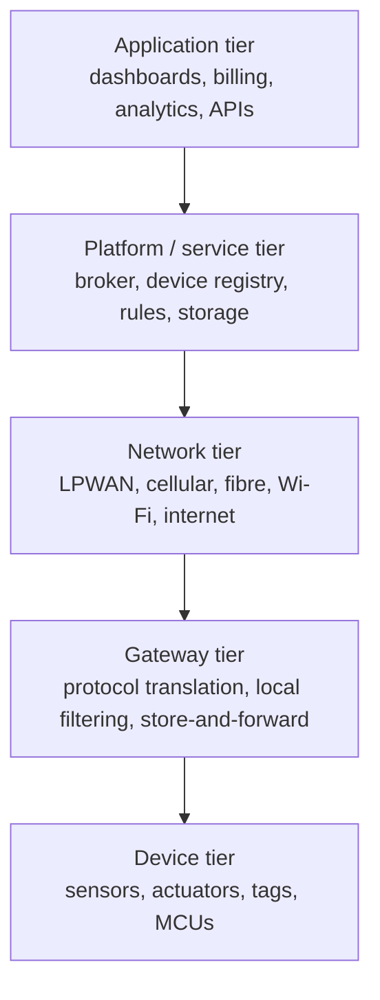
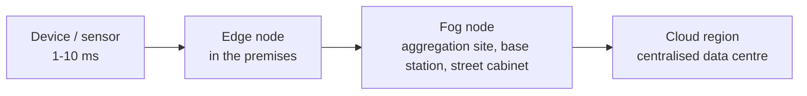

# ch04 - IoT, M2M, Cloud and Data Centres

## Learning Objectives

After this chapter you will be able to:

1. Draw the ITU-T Y.2060 IoT reference model and place any named component (sensor, gateway, broker, application server) in the correct layer.
2. Distinguish M2M from IoT using five concrete criteria rather than a vague "IoT is bigger".
3. Choose a radio technology (NB-IoT, LTE-M, LoRa, Sigfox, Zigbee, BLE, Z-Wave) for a stated range, rate, power and mobility requirement, and justify the choice in one line.
4. Explain the protocol difference between MQTT and CoAP, including transport, interaction pattern and the role of the broker.
5. Separate edge, fog and cloud by latency budget and by where compute physically sits.
6. Identify IaaS, PaaS and SaaS from a one-sentence description, and public, private, hybrid and community from a deployment description.
7. Compare type 1 and type 2 hypervisors, and virtual machines against containers, using isolation and density arguments.
8. Read a data-centre specification (tier, redundancy, PUE, cooling) and say what it does and does not guarantee.
9. Solve the four numerical families this chapter generates: PUE and energy cost, end-to-end latency, consolidation ratio, and availability-to-downtime conversion.

## Introduction

Emerging Technologies is a 15 percent block, which on a 200-question paper is about 24 questions, and this chapter plus ch05 covers it. Roughly half of that block - IoT architecture, M2M, connectivity, cloud models, virtualisation and data centres - is the material here.

This is the highest marks-per-hour block on the paper for a Computer Science graduate, and it is routinely under-studied for three reasons.

First, candidates assume "emerging technology" means "current affairs", so they read news instead of architecture. The paper does not ask what was announced last month; it asks which layer a gateway belongs to, which hypervisor type runs on bare metal, and which cloud model leaves the operating system with the customer.

Second, the vocabulary is deliberately fuzzy in marketing and precise in standards. "Edge" and "fog" are used interchangeably in vendor decks and are different layers in NIST's model; "IoT platform" can mean a broker, a device manager, or an application enablement layer. The exam uses the standards vocabulary.

Third, most of this is *conceptual comparison*, answerable in 25 seconds if you have internalised six or seven tables and not at all if you have only read prose. That is why this chapter is built around tables. Almost none of it needs mathematics beyond multiplication, and the numerical families drill to reflex in an afternoon: this chapter plus ch05 should return 12 to 16 marks, more than Project Management for less reading.

## Prerequisites

- OSI and TCP/IP layers (ch01). You need to say "MQTT is an application-layer protocol over TCP" without hesitation.
- Basic packet switching and IP addressing (ch01, ch02). NB-IoT and LTE-M are cellular packet services.
- Client-server versus publish-subscribe thinking. If you have used a message queue or a webhook, you already have the mental model.
- Comfort with percentages, ratios and unit conversion (kW to kWh, minutes per year).

Nothing here requires electronics, RF design, or cloud certification depth: physical details (sensor drift, CRAC units, chirp modulation) are awareness level - recognise the term, know its purpose, do not derive it.

## Key Terminology

| Term | Meaning | Exam hook |
|---|---|---|
| IoT | Interconnection of physical and virtual things over an interoperable ICT infrastructure, per ITU-T Y.2060 | Definition questions; the phrase "physical and virtual" |
| M2M | Machine-to-machine communication, typically point-to-point, often proprietary, no internet requirement | Compared against IoT |
| Gateway | Protocol and network translator between a local sensor network and the wide area | Placed at the network edge of the device domain |
| NB-IoT | Narrowband IoT, 3GPP cellular LPWAN, 180 kHz carrier in licensed spectrum | Licensed, operator-managed, deep indoor coverage |
| LoRa / LoRaWAN | Chirp spread spectrum physical layer / the MAC and network layer on top of it | Unlicensed ISM band, own gateways, Class A/B/C |
| MQTT | Publish-subscribe messaging over TCP, brokered, OASIS standard | Broker, topic, QoS 0/1/2 |
| CoAP | Constrained Application Protocol, request-response over UDP, REST-like | UDP, confirmable messages, DTLS |
| Edge computing | Compute at or near the data source, inside or beside the local network | Millisecond latency, local autonomy |
| Fog computing | Intermediate layer between edge devices and cloud, per NIST SP 800-191 | Not a synonym for edge |
| Hypervisor | Software layer that creates and runs virtual machines on a host | Type 1 bare metal, type 2 hosted |
| PUE | Power Usage Effectiveness = total facility power / IT equipment power | Always >= 1; lower is better |
| Tier (I-IV) | Uptime Institute topology classification of data-centre redundancy | Tier III maintainable, Tier IV fault tolerant |

## Theory

### 1. What IoT is, in the words the exam uses

ITU-T Recommendation Y.2060 (2012) defines the Internet of Things as "a global infrastructure for the information society, enabling advanced services by interconnecting (physical and virtual) things based on existing and evolving interoperable information and communication technologies."

Three phrases in that sentence are question material:

- **"physical and virtual things"** - a thing is not necessarily a device; a virtual entity (a room, a shipment, an account) is represented by one or more devices.
- **"existing and evolving"** - IoT runs on ordinary IP and cellular networks; it does not require a new internet.
- **"interoperable"** - the value is in cross-domain interoperation, exactly what M2M lacked.

Y.2060 also lists four high-level capabilities that appear as distractors: identification-based connectivity, thing-related services, virtualisation and "things" as a service. If an option says "IoT requires IPv6 only" or "IoT requires a new physical layer", it is wrong.

### 2. The IoT reference architecture

There are two models worth knowing: the standards model (four horizontal layers plus two cross-cutting capability sets) and the deployment model (device, gateway, network, application) that the exam more often uses when it asks "where does this component sit".

**ITU-T Y.2060 model:**

1. **Device layer** - sensors, actuators, tags, and the local connectivity to reach them.
2. **Network layer** - access and core transport: cellular, fibre, LPWAN, Wi-Fi, and the IP routing between.
3. **Service support and application support layer** - generic support (data storage, processing, broker, device management) and specific support (the common functions a family of applications needs).
4. **Application layer** - the actual service: smart metering, fleet tracking, cold-chain monitoring.

Cross-cutting, and always drawn as vertical bars in the diagram: **management capabilities** (fault, configuration, accounting, performance, security management) and **security capabilities** (authentication, authorisation, privacy protection, and the integrity/confidentiality of data and signalling).

The most common exam error is to forget that management and security are *cross-cutting*, not a fifth layer.

**Deployment model (four tiers):**



The gateway tier exists for four reasons, each a possible question:

| Gateway function | Why the device cannot do it |
|---|---|
| Protocol translation | A Zigbee or Modbus device does not speak IP or MQTT |
| Aggregation and filtering | Sending every raw sample wastes WAN capacity and battery |
| Store and forward | The WAN link is intermittent; the gateway buffers until it recovers |
| Local security boundary | Devices are physically reachable; the gateway is the only outbound path |

A **gateway** translates and forwards; an **edge node** computes. One box often does both, which is why vendors blur the terms, but when the exam separates them, gateway means "the door" and edge means "the brain next to the door".

A mapping you should be able to produce instantly:

| IoT tier | Closest OSI/TCP-IP idea | Typical protocol |
|---|---|---|
| Device | Layers 1-2, plus a constrained application stack | IEEE 802.15.4, BLE, Modbus, 1-Wire |
| Gateway | Layers 2-3 plus application translation | 6LoWPAN, MQTT-SN, Modbus TCP |
| Network | Layers 3-4 | IPv4/IPv6, UDP, TCP, NB-IoT, LTE-M |
| Platform | Layer 7 middleware | MQTT, AMQP, CoAP, HTTP/REST |
| Application | Above the model | REST/JSON, gRPC, webhooks |

### 3. Sensors and actuators

A **sensor** converts a physical quantity into an electrical signal; an **actuator** converts an electrical command into physical action. The signal chain on the device side is: physical quantity -> sensing element -> signal conditioning (amplify, filter) -> ADC -> microcontroller -> protocol stack.

Sensor characteristics the paper can ask you to identify:

| Characteristic | Meaning | Failure mode if ignored |
|---|---|---|
| Range | Minimum to maximum measurable value | Saturation, clipped readings |
| Sensitivity | Output change per unit input (mV per deg C, for example) | Weak signal, noise-dominated |
| Resolution | Smallest change the sensor can distinguish | Quantisation step too coarse |
| Accuracy | Closeness of the reading to the true value | Systematic error in every sample |
| Precision / repeatability | Spread of repeated readings under identical conditions | Noisy but unbiased data |
| Linearity | Deviation of the response from a straight line | Calibration table needed |
| Hysteresis | Different reading on rising and falling input | Error that flips with direction |
| Drift | Slow change in output over time with constant input | Requires recalibration |
| Response time | Time to reach a stated fraction of final value | Missed transients |
| Selectivity / cross-sensitivity | Response to the intended quantity only | Humidity corrupting a temperature reading |

Actuator families, at awareness level: electromechanical relay (on/off switching of mains loads), solenoid valve (fluid control), stepper and servo motor (positioning), linear actuator (push/pull), piezo actuator (micro-positioning, buzzers), and variable frequency drive (motor speed).

Two practical points decide many scenario questions. **Sampling rate is a design decision, not a maximum**: a temperature sensor at 1 Hz produces 86,400 readings per day per node, which is why gateways aggregate and LPWAN payloads are tens of bytes. **Actuation needs a safety default**: if the link dies, does the valve fail open or fail closed? That fail-safe question is why industrial IoT keeps local control loops rather than closing them through the cloud.

### 4. IoT communication models

Four models are standard vocabulary. Learn the names and the distinguishing feature.

| Model | Path | Characteristic | Example |
|---|---|---|---|
| Device-to-device (D2D) | Device <-> device directly | No broker, no cloud; often Bluetooth or Zigbee | Light switch controlling a lamp |
| Device-to-cloud (D2C) | Device <-> cloud service | Device has its own WAN link and IP stack | NB-IoT water meter posting to a utility platform |
| Device-to-gateway (D2G) | Device <-> gateway <-> application server | Gateway translates and aggregates | Zigbee sensors behind a home hub |
| Device-to-gateway-to-application-layer (D2G2A, back-end data sharing) | Device <-> gateway <-> application <-> other applications | Data shared across application providers via open APIs | Smart-city data reused by transport and utility apps |

D2G2A is the model that makes IoT different from M2M, because it implies a shared, standards-based data layer rather than a private pipe.

### 5. M2M versus IoT

M2M is the ancestor. It is machine-to-machine telemetry, usually a closed system built for one purpose, often over a private APN or serial link, with no IP end to end and no expectation that a third party will consume the data.

| Dimension | M2M | IoT |
|---|---|---|
| Scope | Point-to-point, single application | Many-to-many, multi-application |
| Connectivity | Often private APN, serial, proprietary RF | IP-based, internet-reachable, standards |
| Addressing | Device ID or SIM identity, not necessarily IP | IP addressable (often IPv6, 6LoWPAN) |
| Data use | Telemetry for one back end | Shared via APIs, analytics, third parties |
| Intelligence | Centralised in the application | Distributed: edge, fog, cloud, device |
| Scale | Thousands of devices | Millions to billions |
| Standards | Vendor and industry specific | Open, layered, ITU-T and IETF driven |
| Example | Vending machine reporting stock over GSM | Smart city where the same data feeds traffic, utility and billing systems |

One-line answer for a one-mark question: **M2M is a subset pattern of IoT - a direct, purpose-built machine link - while IoT adds IP, cloud, scale and data sharing.**

### 6. Connectivity: LPWAN and short range

IoT radios are chosen on four axes: range, data rate, energy per bit, and whether the spectrum is licensed. No technology wins all four; that is the entire trade-off the examiner tests.

**LPWAN family (wide area, low rate, long battery):**

| Feature | NB-IoT | LTE-M (eMTC) | LoRa (with LoRaWAN) | Sigfox |
|---|---|---|---|---|
| Standard body | 3GPP (Rel-13) | 3GPP (Rel-13) | LoRa Alliance (MAC), Semtech PHY | Sigfox (proprietary) |
| Spectrum | Licensed cellular | Licensed cellular | Unlicensed ISM sub-GHz | Unlicensed ISM sub-GHz |
| Channel width | 180 kHz | 1.4 MHz | 125/250/500 kHz | Ultra narrowband, about 100 Hz |
| Peak rate | Tens of kbps | Around 1 Mbps | 0.3 to 50 kbps depending on spreading factor | About 100 bps |
| Range | Deep indoor, about 10-15 km rural | Similar to LTE | 2-5 km urban, 10-15 km rural | 10-40 km rural |
| Mobility / handover | Limited | Yes, including voice-capable | No (device is static or slow) | No |
| Battery life | Years | Years (less than NB-IoT) | Years | Years |
| Network owner | Mobile operator | Mobile operator | Private or public LoRaWAN operator | Sigfox network operator |
| Best fit | Meters, sensors, deep basements | Wearables, trackers, asset mobility | Campus and municipal sensing, private networks | Very low-volume telemetry |
| Weakness | Low rate, not for voice | Higher cost and power than NB-IoT | Duty-cycle limits, self-built coverage | Message count and payload caps |

Two facts worth memorising: NB-IoT can be deployed **in-band** (inside an LTE carrier), **guard-band**, or **standalone** (reusing GSM spectrum); and LoRa's long range comes from **chirp spread spectrum**, which trades data rate for processing gain.

**Short range (local area):**

| Feature | Zigbee | Bluetooth Low Energy | Z-Wave | Wi-Fi (2.4/5 GHz) |
|---|---|---|---|---|
| PHY standard | IEEE 802.15.4 | Bluetooth 4.0 onward | ITU-T G.9959 (Silicon Labs) | IEEE 802.11 |
| Band | 2.4 GHz | 2.4 GHz | Sub-GHz (868/908 MHz) | 2.4 and 5 GHz |
| Rate | 250 kbps | 1-2 Mbps | About 100 kbps | Mbps to Gbps |
| Topology | Mesh (coordinator, router, end device) | Star, plus BLE mesh | Mesh | Star (BSS) |
| Power | Very low | Very low | Very low | High |
| Typical use | Home automation, sensors | Wearables, beacons, phone accessories | Home automation, locks, lighting | Cameras, high-rate local links |
| Note | Needs a coordinator to form the network | Advertising plus GATT; mesh added later | Interoperability certified, sub-GHz avoids Wi-Fi congestion | Not an LPWAN; mains power assumed |

Other names you should recognise without depth: **RFID** (passive tag, reader-powered, identification only), **NFC** (13.56 MHz, centimetre range, payment and pairing), **6LoWPAN** (IPv6 over 802.15.4 with header compression), **Thread** (IPv6 mesh on 802.15.4), **WirelessHART and ISA-100** (industrial sensing).

A useful selection rule: mains power and high rate -> Wi-Fi; battery with local mesh -> Zigbee or Z-Wave; body-worn paired to a phone -> BLE; municipal scale, operator-managed, deep indoor -> NB-IoT; moving asset needing handover -> LTE-M; private network with no operator dependency -> LoRaWAN; tiny payloads at extreme range with message caps -> Sigfox.

### 7. MQTT and CoAP

These are the two application protocols the syllabus names. They are not competitors in the same niche; they encode two different interaction patterns.

**MQTT** is publish-subscribe over TCP. Devices connect to a **broker**; they publish to a **topic** and subscribe to topic filters. The broker decouples publisher from subscriber, so neither needs to know the other's address.

- Topic hierarchy is slash-separated: `plant/line2/temp`. Wildcards: `+` matches one level, `#` matches the remaining levels.
- **QoS 0** - at most once, fire and forget. **QoS 1** - at least once, duplicates possible. **QoS 2** - exactly once, four-way handshake, highest overhead.
- **Retained message** - the broker stores the last value on a topic and delivers it immediately to new subscribers. This is how a dashboard shows current state without waiting.
- **Last Will and Testament** - the broker publishes a pre-registered message if the client disconnects abnormally. This is the standard "device offline" alarm.
- **Keepalive** - periodic ping; a silent client is declared dead after 1.5 times the interval. Ports: 1883 plain, 8883 over TLS; MQTT-SN adapts it to UDP for constrained networks.

**CoAP** is request-response over UDP, modelled on REST: GET, POST, PUT, DELETE on a resource URI. It is designed for devices that cannot afford a TCP handshake or a full HTTP stack.

- Messages are **confirmable** (ACK required, retransmitted) or **non-confirmable** (best effort).
- **Observe** (RFC 7641) lets a client register interest and receive notifications - CoAP's answer to publish-subscribe.
- **Block-wise transfer** moves large payloads in chunks.
- Security is **DTLS** over UDP, unlike MQTT's TLS over TCP; discovery uses `/.well-known/core`.

| Dimension | MQTT | CoAP |
|---|---|---|
| Transport | TCP | UDP |
| Pattern | Publish-subscribe via broker | Request-response, client-server |
| Standard | OASIS | IETF (RFC 7252) |
| Default ports | 1883 / 8883 (TLS) | 5683 / 5684 (DTLS) |
| Header overhead | 2-byte fixed header plus topic | 4-byte fixed header, compact options |
| Security | TLS | DTLS |
| Many-to-many fan-out | Native | Needs observe plus a broker or proxy |
| Best fit | Telemetry fan-in, dashboards, command downlink | Constrained devices, REST integration, low overhead |
| Weakness | Broker is a single point of failure unless clustered; TCP cost on lossy links | No native broker semantics; reliability is per message |

Other protocols to recognise: **AMQP** (robust queuing, heavier, enterprise back ends), **HTTP/REST** (universal but verbose and request-response), **DDS** (real-time industrial publish-subscribe), **Modbus and BACnet** (fieldbuses bridged by gateways).

### 8. Edge, fog and cloud

The three tiers differ in *where* compute happens, and therefore in latency, bandwidth cost and autonomy. NIST's fog computing conceptual model (SP 800-191) places fog between the edge and the cloud; it is a layer, not a synonym.



| Dimension | Edge | Fog | Cloud |
|---|---|---|---|
| Location | On or beside the device (PLC, gateway, camera, phone) | Between edge and cloud: cell site, street cabinet, enterprise aggregation point | Central or regional data centre |
| Latency | Sub-millisecond to about 10 ms | About 10-50 ms | About 50-200 ms depending on distance |
| Compute capacity | Small: MCU to small server | Medium: several nodes, virtualised | Very large, elastic |
| Bandwidth to backhaul | Minimal, data reduced locally | Moderate, aggregates many edges | High |
| Autonomy if WAN fails | Full | Partial, can serve its subtree | None |
| Typical workload | Threshold alarms, motion detection, safety interlocks | Local analytics, caching, protocol normalisation, VNF hosting | Model training, long-term storage, billing, dashboards |
| Ownership | Customer | Often the operator (telco edge) | Cloud provider or telco |
| Cost model | Capex on device | Capex plus site opex | Opex, pay per use |

Why edge exists, in one sentence: **physics and bandwidth**. A control loop that must close in 20 ms cannot tolerate a 60 ms round trip to a distant region, and a site generating 2 Gbps of video cannot backhaul all of it. This is also the commercial argument for **MEC** (multi-access edge computing) in 5G: the operator already owns the cell site, the power and the backhaul, so it can host a customer's latency-critical application there.

### 9. Cloud service models

NIST SP 800-145 defines three service models and five essential characteristics (on-demand self-service, broad network access, resource pooling, rapid elasticity, measured service). The exam asks you to classify, so classify by **what the customer manages**.

| Model | Customer manages | Provider manages | Telecom-flavoured example | One-line test |
|---|---|---|---|---|
| IaaS | OS, middleware, runtime, application, data | Virtualisation, servers, storage, network | Operator private cloud renting VMs and block storage to enterprise customers; a VNF host | "I rent the machine and install my own OS" |
| PaaS | Application and data only | Runtime, middleware, OS, infrastructure | Managed database, container platform, message queue for an OSS microservice | "I push code, the platform runs it" |
| SaaS | Nothing but configuration and its own data | Everything | Hosted CRM, webmail, a billing suite delivered as a service, a contact-centre product | "I log in through a browser" |

Three additions appear as distractors: **FaaS / serverless** (event-triggered functions, a finer-grained PaaS), **XaaS** (an umbrella term, not a distinct model), and **on-premises** (not cloud under NIST, because there is no provider-managed pooling, though virtualised self-service on-premises is loosely called private cloud).

### 10. Deployment models

| Model | Who shares the infrastructure | Pros | Cons | Telecom example |
|---|---|---|---|---|
| Public | Many unrelated tenants | Elastic, low capex, global reach | Data residency, multi-tenancy risk, less control | Operator's consumer cloud services hosted by a hyperscaler |
| Private | One organisation | Control, compliance, predictable performance | Capex, idle capacity, needs skills | Telco core network cloud inside the operator's own DC |
| Hybrid | Mix of private and public, connected | Sensitive data private, burst public | Integration, network cost, two toolchains | BSS on private cloud, analytics and CDR archive on public |
| Community | Several organisations with a shared concern | Cost shared, common compliance baseline | Governance, limited elasticity | A shared cloud for a group of PSUs or a sector regulator's ecosystem |

The classification question is almost always "who shares the resource pool", not "where the servers are". A private cloud can be hosted in a third-party facility; it is still private if the pool serves one tenant.

### 11. Virtualisation and hypervisors

Virtualisation inserts a layer that multiplexes one physical host into several isolated execution environments. The layer that does this for VMs is the **hypervisor** (virtual machine monitor). Its jobs: partition CPU, memory, storage and I/O; trap and emulate privileged instructions; provide virtual devices; isolate guests from each other.

| Dimension | Type 1 (bare metal) | Type 2 (hosted) |
|---|---|---|
| Runs on | Hardware directly | An existing host operating system |
| Also called | Native hypervisor | Hosted hypervisor |
| Performance | Near native, lower overhead | Higher overhead, extra scheduling layer |
| Typical use | Data centres, telco cloud, production | Developer laptops, testing, demos |
| Examples | VMware ESXi, Microsoft Hyper-V (server role), KVM, Xen | VirtualBox, VMware Workstation, Parallels |
| Management | Central platform (vCenter, OpenStack) | Desktop application |
| Security surface | Smaller; guest cannot reach host OS | Larger; host OS is an attack surface |
| Exam trap | "Runs on top of Windows" is false for ESXi and KVM | "Runs inside the OS" is the defining feature |

Terminology that earns marks: **full virtualisation** (unmodified guest, binary translation or hardware assist), **paravirtualisation** (modified guest, hypercalls - Xen's classic mode), **hardware-assisted virtualisation** (Intel VT-x, AMD-V), **live migration** (move a running VM between hosts), **snapshot**, **VM sprawl**, **nested virtualisation**. Telcos care because NFV (ch05) hosts VNFs as VMs on commercial servers: the hypervisor is the layer that turns a firewall or an EPC into a software image.

### 12. Containers versus virtual machines

A container is process isolation, not machine virtualisation. Linux **namespaces** give each container its own view of PIDs, network, mounts, hostname, IPC and users; **cgroups** limit and account for CPU, memory and I/O. The kernel is shared.

| Dimension | Virtual machine | Container |
|---|---|---|
| Isolation unit | Whole guest OS | Process group |
| Kernel | One per VM | Shared host kernel |
| Boot time | Tens of seconds to minutes | Milliseconds to seconds |
| Image size | GB | MB to hundreds of MB |
| Density per host | Tens | Hundreds |
| Isolation strength | Strong (hardware boundary) | Weaker (kernel boundary, mitigated by seccomp, user namespaces) |
| Live migration | Mature | Harder, stateless design preferred |
| Orchestration | vCenter, OpenStack | Kubernetes, Docker Swarm |
| Best fit | Heterogeneous OS, strong tenancy, VNFs with kernel dependencies | Microservices, cloud-native network functions (CNFs), CI/CD |
| Telco example | Classic VNF appliance image | 5G core microservices in pods |

The exam wording to watch: containers "share the host kernel" - that single phrase distinguishes the two, and it is also the reason containers are not automatically a substitute for VMs in a multi-tenant regulated environment.

### 13. Data-centre design

A data centre is judged on four things: availability topology, power, cooling, and the network/cabling layout.

**13.1 Tiers (Uptime Institute topology).** The tier describes the *design topology* - how much redundancy and concurrent maintainability is built in - not a measured uptime guarantee. The classic design-intent availability figures:

| Tier | Design intent | Redundancy | Concurrently maintainable | Fault tolerant | Nominal availability | Downtime per year |
|---|---|---|---|---|---|---|
| I | Basic capacity | None (N) | No | No | 99.671% | About 28.8 hours |
| II | Redundant capacity components | N+1 components | No | No | 99.741% | About 22.0 hours |
| III | Concurrently maintainable | N+1, dual paths | Yes | No | 99.982% | About 1.6 hours |
| IV | Fault tolerant | 2N or 2(N+1) | Yes | Yes | 99.995% | About 0.4 hours (26 minutes) |

The distinction that decides most questions: **Tier III lets you maintain any component without shutting down the load; Tier IV additionally survives an unplanned failure of a component without affecting the load.** Tier III is maintainable, Tier IV is fault tolerant.

**13.2 Redundancy notation.**

| Notation | Meaning | Example |
|---|---|---|
| N | Exactly the capacity needed | One 500 kW UPS for a 500 kW load |
| N+1 | One spare unit beyond need | Two 500 kW UPS modules for 500 kW |
| 2N | Two complete independent systems | Two 500 kW UPS, each able to carry the whole load |
| 2(N+1) | Two full systems, each with a spare | Four modules in two independent pairs |
| Concurrently maintainable | Any single component can be serviced with load running | Dual-corded racks, A and B power paths |

**13.3 Power distribution chain.** Utility HT supply -> transformer -> main LV panel -> **ATS** (automatic transfer switch) with **diesel generator** backup -> **UPS** (battery, rides through the generator start) -> **PDU / busway** -> rack **PDU** (A and B feeds) -> dual-corded servers. The UPS covers the seconds between mains loss and generator pick-up; the generator covers long outages; the ATS decides which source feeds the load. **STS** (static transfer switch) does the same job at rack level, faster.

**13.4 Cooling.** Heat removal is by air or liquid. Air systems use **CRAC** (direct expansion refrigerant) or **CRAH** (chilled water coil) units, with **hot aisle / cold aisle** separation and **containment** to stop supply and return air mixing. **Free cooling** (air-side or water-side economiser) uses outside conditions when they are cool enough. **Liquid cooling** (direct-to-chip, immersion) handles racks above roughly 20-30 kW where air can no longer move enough heat.

ASHRAE recommended inlet conditions are roughly 18-27 deg C; running colder than necessary wastes energy. Humidity control matters for static and condensation, not for comfort.

**13.5 PUE.**

```
PUE = total facility power / IT equipment power
```

A PUE of 1.0 is theoretically perfect (no overhead). Well-designed modern facilities target roughly 1.2-1.4; older enterprise rooms often run 1.8-2.0 or worse. PUE is measured at a point in time and varies with load, so annualised PUE is the honest figure. **DCiE** is its reciprocal, expressed as a percentage.

**13.6 Rack and row architecture.** Standard racks are 19 inches wide (EIA-310) and commonly 42U tall, where 1U = 44.45 mm. Network design choices:

| Pattern | Description | Trade-off |
|---|---|---|
| ToR (top of rack) | One switch per rack | Short copper runs, more switches and uplinks |
| EoR (end of row) | One switch pair per row, cabling back to it | Fewer switches, long cable runs, harder moves |
| MoR (middle of row) | Switch pair in the row centre | Balanced cable length |
| Spine-leaf | Every leaf switch to every spine | Predictable east-west latency, used in cloud DCs |

Also at awareness level: structured cabling with fibre trunk between rows, cable containment and labelling, **VESDA** early smoke detection, clean-agent fire suppression (never water on live equipment), **EPO** emergency power off, biometric access and CCTV, and **DCIM** software for asset, capacity and power tracking.

### 14. Telecom data-centre use cases

| Workload | Why it lives in a DC | Placement trend |
|---|---|---|
| 4G EPC / 5G core (SBA) | Centralised signalling, high reliability | Telco cloud, private, often distributed to regional DCs |
| IMS (VoLTE/VoWiFi) | Session control, real-time | Central DC, geo-redundant pair |
| OSS/BSS and billing | Data-intensive, compliance | Private or hybrid cloud |
| CDN and caching | Content proximity | Many small edge sites plus a central origin |
| Analytics and CDR archive | Batch, storage-heavy | Public or hybrid cloud |
| Disaster recovery | Geographic separation | Second DC in a different seismic and flood zone |
| MEC | Latency-critical applications | Cell site or aggregation site, not central DC |
| Colocation and wholesale | Revenue from space, power, cross-connects | Operator DCs with meet-me rooms |

The design consequence: telecom DCs are built for **reliability and regulated data**, hyperscale DCs for **cost per compute unit**. That is why telcos run modest PUE targets in owned facilities and increasingly rent hyperscale capacity for analytics.

## Worked Examples

### Example 1 - PUE and annual energy cost (L4 numerical)

A data centre has an IT load of 500 kW and a measured PUE of 1.8. A cooling retrofit is expected to bring PUE to 1.4. Electricity costs Rs 8 per kWh.

```
Step 1 - facility power
before: 500 kW x 1.8 = 900 kW total
after:  500 kW x 1.4 = 700 kW total
saving: 200 kW of overhead

Step 2 - annual energy (365 x 24 = 8760 h)
200 kW x 8760 = 1,752,000 kWh per year

Step 3 - annual cost
1,752,000 x 8 = Rs 14,016,000 = about Rs 1.40 crore per year
```

Step 4 - sanity check. The IT load itself consumes 500 x 8760 = 4,380,000 kWh, so overhead falls from 3,504,000 kWh to 1,752,000 kWh - a 50 percent cut in overhead for a 22 percent PUE improvement. Note the leverage: **overhead is the only part PUE improvement touches.**

### Example 2 - Edge versus cloud for a control loop (L4 numerical)

A factory control loop must complete within 50 ms. One-way delays: sensor to gateway 4 ms, gateway to edge node 6 ms, gateway to cloud region 35 ms. Processing takes 8 ms wherever it runs. The actuator path mirrors the sensor path.

Step 1 - both paths, one way plus return.

```
                      edge    cloud
sensor -> gateway       4        4
gateway -> node         6       35
processing              8        8
node -> gateway         6       35
gateway -> actuator     4        4
total                  28       86   (ms)
```

Step 2 - verdict. 28 ms meets the 50 ms budget with 22 ms of margin for jitter and retries; 86 ms misses it by 36 ms. No amount of application optimisation recovers 36 ms of propagation delay, so the workload must run at the edge.

Step 3 - bandwidth. A site producing 40 Mbps of raw video but only 2 Mbps of events after local inference cuts backhaul by 95 percent.

### Example 3 - Virtualisation consolidation ratio (L4 numerical)

An operator runs 120 single-function appliances. Each is 2U, has 4 cores and 16 GB RAM, and averages 12 percent CPU utilisation. The target platform is a 32-core, 512 GB host, with a policy of maximum 70 percent CPU and 80 percent memory allocation.

```
Step 1 - VNFs per host by CPU (70 percent policy)
usable cores = 32 x 0.70 = 22.4
22.4 / 4 vCPU per VNF = 5.6 -> 5 VNFs

Step 2 - by memory (80 percent policy)
usable RAM = 512 x 0.80 = 409.6 GB
409.6 / 16 = 25.6 -> 25 VNFs

Step 3 - CPU binds, so 5 per host
hosts = ceil(120 / 5) = 24, plus N+1 = 25 hosts

Step 4 - footprint
before: 120 x 2U = 240U = about 6 racks of 42U
after:  25 x 1U = 25U = under 1 rack
```

Step 5 - the honest caveat. Average utilisation of 12 percent does not mean 5 VNFs is safe for peaky workloads; that is why the 70 percent policy exists. Without it, the arithmetic would allow 8 VNFs per host by CPU, and the first traffic burst would cause contention.

### Example 4 - Availability to downtime, and Merkle proof size (L4 numerical)

Part A. Convert 99.982 percent availability to minutes per year.

```
minutes per year = 365 x 24 x 60 = 525,600
unavailability = 100 - 99.982 = 0.018 percent = 0.00018
downtime = 525,600 x 0.00018 = 94.6 minutes per year
```

That is about 1.6 hours, which matches the Tier III design-intent figure. For Tier IV at 99.995 percent: 525,600 x 0.00005 = 26.3 minutes.

Part B. A block holds 4096 transactions. How large is a Merkle proof that a given transaction is in the block?

```
tree height = log2(4096) = 12
proof = 12 sibling hashes x 32 bytes = 384 bytes
```

Compare with sending all 4096 transactions at roughly 250 bytes each, about 1 MB. The proof is roughly 2700 times smaller, which is the point of hash chaining: verify inclusion without holding the data.

## Exam Traps and Common Mistakes

1. **"Fog is just another word for edge."** NIST defines fog as an intermediate layer between the edge and the cloud. If the option says fog *is* the device layer, it is wrong.
2. **"A gateway is an edge server."** A gateway's defining job is protocol and network translation; an edge node's is computation. Many products do both, but the exam separates the functions.
3. **"LoRa is a cellular technology."** LoRa is unlicensed chirp spread spectrum, usually privately deployed. NB-IoT and LTE-M are the licensed cellular LPWANs. Confusing the two is the single most common error in this section.
4. **"MQTT runs over UDP."** MQTT is TCP (1883/8883); MQTT-SN is the UDP variant. CoAP is the UDP one.
5. **"CoAP has no reliability."** CoAP has confirmable messages with retransmission; it simply puts reliability at the message layer instead of the transport layer.
6. **"A type 2 hypervisor is the data-centre choice."** Type 1 is bare metal and is what ESXi, Hyper-V server and KVM provide in production. Type 2 runs inside an OS and is for desktops and testing.
7. **"Containers are more secure because they are smaller."** Containers share the host kernel, so the isolation boundary is weaker than a VM's hardware boundary. Smaller image is not stronger isolation.
8. **"Tier III means fault tolerant."** Tier III is concurrently maintainable. Tier IV adds fault tolerance. The words are not interchangeable.
9. **"Higher PUE is better."** PUE is overhead divided by useful load; 1.0 is perfect and values above 2 mean you are spending more on cooling and losses than on computing.
10. **"PaaS means you manage the OS but not the hardware."** That is IaaS. PaaS means you manage only the application and its data.
11. **"Private cloud means on-premises."** It means a resource pool serving one organisation; it can be hosted elsewhere.
12. **"IoT needs IPv6."** IPv6 helps at scale and 6LoWPAN compresses it, but IoT deployments run on IPv4, non-IP LPWAN and proprietary links today. The claim is a distractor.

## Summary

IoT is an architecture, not a device. ITU-T Y.2060 gives four layers - device, network, service support and application support, application - with management and security cutting across all of them. In deployment terms that becomes device, gateway, network, platform, application, and the gateway is the translation, aggregation and security boundary.

M2M is the closed, point-to-point ancestor; IoT adds IP, cloud, scale and data sharing, and the D2G2A model is where the difference becomes visible. Connectivity is a four-way trade-off between range, rate, energy and licensing: NB-IoT and LTE-M in licensed cellular spectrum, LoRa and Sigfox in unlicensed ISM, Zigbee, BLE and Z-Wave for local mesh and body-area links.

At the application layer, MQTT is brokered publish-subscribe over TCP with QoS levels, retained messages and last-will; CoAP is REST-like request-response over UDP with confirmable messages and DTLS. Edge, fog and cloud are a latency and bandwidth hierarchy, not marketing tiers.

Cloud is classified by what the customer manages: IaaS keeps the OS, PaaS keeps only the app, SaaS keeps only configuration. Deployment is classified by who shares the pool. Virtualisation is the layer beneath: type 1 on bare metal for production, type 2 hosted for desktops, containers for density at the cost of isolation strength.

Data centres are specified by tier topology, redundancy notation, power chain, cooling strategy and PUE. Tier III is maintainable, Tier IV is fault tolerant, and PUE is the ratio that tells you how much of your electricity bill is overhead.

## Practical Takeaways

- Memorise the Y.2060 four layers plus two cross-cutting capability sets; draw it in 20 seconds.
- Keep one comparison table in your head per pair: M2M vs IoT, NB-IoT vs LoRa, MQTT vs CoAP, edge vs fog vs cloud, IaaS vs PaaS vs SaaS, type 1 vs type 2, VM vs container.
- For any radio question, ask the four axes first: range, rate, power, licensed or unlicensed.
- Never write "fog = edge" or "Tier III = fault tolerant" in an answer or a note.
- Drill PUE, latency, consolidation and availability arithmetic until each takes under 60 seconds.
- When a question describes a component, first place it in a layer, then answer.

## Chapter Quiz


**Q1.** In the ITU-T Y.2060 IoT reference model, security capabilities are best described as:

A) The fourth layer above the application layer

B) A cross-cutting capability set spanning all layers

C) A function of the gateway only

D) Part of the network layer

**Answer: B** Y.2060 draws management and security as vertical capabilities across the four horizontal layers, not as a fifth layer.

**Q2.** A utility wants deep-indoor smart meters with 12-year battery life, operator-managed coverage and no need for voice or handover. The best fit is:

A) LTE-M

B) NB-IoT

C) LoRaWAN

D) Zigbee

**Answer: B** NB-IoT is licensed, designed for deep indoor penetration and very low rate, and does not carry the mobility and cost overhead of LTE-M. LoRaWAN would require the utility to build coverage.

**Q3.** A protocol uses a broker, topic hierarchies and three quality-of-service levels over TCP. It is:

A) CoAP

B) MQTT

C) AMQP over UDP

D) Modbus

**Answer: B** Broker, topics and QoS 0/1/2 over TCP are the MQTT signature. CoAP is request-response over UDP.

**Q4.** A customer rents virtual machines, installs their own operating system, and manages the database themselves. The service model is:

A) SaaS

B) PaaS

C) IaaS

D) FaaS

**Answer: C** Managing the OS is the IaaS boundary; in PaaS the provider owns the runtime and OS.

**Q5.** A data centre can service any single power or cooling component without interrupting the load, but a second simultaneous failure would cause an outage. It is:

A) Tier II

B) Tier III

C) Tier IV

D) Tier I

**Answer: B** Concurrent maintainability is Tier III. Fault tolerance against an unplanned failure is the extra requirement for Tier IV.

## Exercises

1. Draw the Y.2060 model and the five-tier deployment model side by side, then place these on both: MQTT broker, Zigbee coordinator, NB-IoT modem, billing application, device registry.
2. Write a 150-word answer to "Is M2M a subset of IoT?" using at least four of the comparison dimensions.
3. A cold-chain logger must report every 15 minutes for 5 years on one battery, indoors, across a 40 km municipal area. Pick a radio and defend the choice against two alternatives.
4. Compute the annual energy cost of a 250 kW IT load at PUE 2.0 and at PUE 1.35, at Rs 7.50 per kWh. State the saving in rupees and in percent.
5. A control loop needs 30 ms end to end. Given 5 ms device-to-gateway, 10 ms gateway-to-fog, 45 ms gateway-to-cloud, and 6 ms processing, decide where to place the logic and show the arithmetic for both options.
6. You have 60 appliances of 2U, 4 cores, 8 GB, at 15 percent average CPU. Hosts are 24 cores and 256 GB, with 75 percent CPU and 80 percent memory policies. Find the host count with N+1.
7. Convert Tier II and Tier IV nominal availability into minutes of downtime per year and check both against the table.
8. Explain in five lines why a container is not automatically an acceptable substitute for a VM in a multi-tenant regulated telco cloud.

## Next

Chapter 5 continues the Emerging Technologies block with the programmable network: SDN's three planes and OpenFlow, NFV and the ETSI MANO framework, network slicing, blockchain, and what AI actually delivers in telecom operations. The two chapters share one 24-mark block, so treat them as a single unit for revision - ch04 supplies the infrastructure vocabulary that ch05's virtualisation and slicing arguments depend on.
