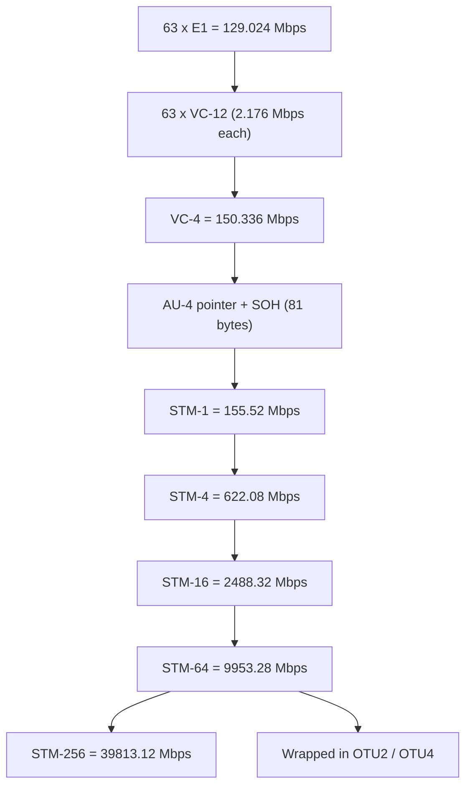
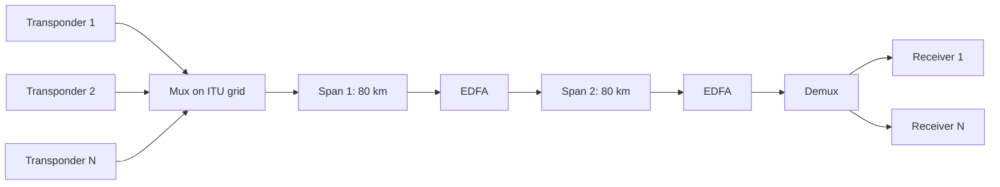

# 08 - Optical Fibre, DWDM and OTN

## Learning Objectives

1. Describe core, cladding and coating, and distinguish single-mode from multimode, step from graded index.
2. State the three windows and explain why 1550 nm wins for long haul.
3. Convert dB/km to span loss in dB, and to received power in dBm, without mixing units.
4. Explain modal, chromatic and PMD, and compute the distance limit each imposes (L4).
5. Pair sources with detectors correctly (LED/PIN, laser/PIN, laser/APD).
6. Reproduce the SDH hierarchy and compute rates and E1 capacity (L4).
7. Describe the SDH frame, virtual containers and pointer justification at awareness level.
8. Explain DWDM, the C/L bands and the ITU-T grid, and count channels from band width (L4).
9. Place EDFAs, state their gain bands, and explain why they made DWDM economic.
10. Explain OTN containers, OTU wrapping and FEC, and why OTN carries SDH and Ethernet.
11. Compare protection schemes (1+1, 1:1, MSP, SNCP, ring, mesh).
12. Build a link budget and an OSNR estimate and decide whether a span closes (L4).

## Introduction

Transmission Infrastructure is **15% of the paper = 24 questions**. It is the block most CSE graduates skip because "it is physics", and that is a measurable mistake.

It is the most winnable 24 marks on the paper for three reasons:

- About a third are **L1 recall**: lowest-loss window, 9 um core, STM-16 rate, what EDFA stands for. These are flashcards.
- Another third are **L2 comparisons**: SMF vs MMF, LED vs laser, PIN vs APD, 1+1 vs 1:1, SDH vs OTN. All are two-column tables in this chapter.
- The rest are **L4 numericals from four formula families only**: span loss, SDH rate, DWDM channel count, link budget with margin.

You do not need Maxwell's equations, just the numbers, the units, and the habit of writing both down. This is also the block where a wrong answer is usually a **unit error**, not a knowledge gap. A candidate who writes "0 dBm - 17 dB = -17 dBm" gets the mark; one who writes "17 dBm" does not. Unit discipline alone is worth 2 to 4 marks, which is why it has a dedicated section.

## Prerequisites

- **Logarithms**: log10(2) = 0.301, log10(3) = 0.477, log10(10) = 1. Needed for dB.
- **Prefixes**: k = 10^3, M = 10^6, G = 10^9, T = 10^12, m = 10^-3, u = 10^-6, n = 10^-9.
- **One wave equation**: c = f x lambda, with c = 3 x 10^8 m/s in vacuum (about 2 x 10^8 m/s in glass).
- **Ratio thinking**: 3 dB is a factor of 2 in power; 10 dB is a factor of 10. That is the whole toolkit.

## Key Terminology

| Term | Meaning |
|---|---|
| **Core / cladding / coating** | Light path (8-10 um SMF, 50 or 62.5 um MMF) / lower-index trap (125 um) / plastic protection (250 um) |
| **SMF / MMF** | Single-mode (one mode, no modal dispersion, long haul) / multimode (many modes, short reach) |
| **Step / graded index** | Abrupt index step / gradual index fall across the core (graded cuts modal dispersion) |
| **Attenuation** | Loss per kilometre in dB/km; Rayleigh scattering plus absorption |
| **Chromatic dispersion** | Wavelength-dependent speed; ps/(nm x km); limits bit rate x distance |
| **PMD** | Polarisation mode dispersion; random birefringence; ps/sqrt(km) |
| **DWDM** | Dense WDM; many wavelengths on one fibre at 100 or 50 GHz spacing |
| **EDFA** | Erbium-doped fibre amplifier; optical gain in C-band (and L-band) |
| **SDH / STM-N** | Synchronous Digital Hierarchy (G.707); STM-1 = 155.52 Mbps, N = 1,4,16,64,256 |
| **VC / TU / AU** | Virtual Container / Tributary Unit / Administrative Unit: SDH payload envelopes and pointers |
| **OTN / ODU / OTU** | Optical Transport Network (G.709); containers and their line-rate wrappers with FEC |
| **OSNR** | Optical signal-to-noise ratio in dB, referenced to 0.1 nm (12.5 GHz); a ratio, never dBm |

## Theory

### 1. Fibre structure: core, cladding, coating

An optical fibre is a glass cylinder inside a glass cylinder inside a plastic jacket: coating 250 um, cladding 125 um, core 9 um (SMF).

- **Core**: the light path, 8-10 um in SMF and 50 or 62.5 um in MMF.
- **Cladding**: slightly lower refractive index (n2 < n1). Light striking the boundary beyond the critical angle `theta_c = arcsin(n2/n1)` is totally internally reflected and stays in the core. 125 um is standard for both fibre types, so the same connectors and cleavers work on each.
- **Coating**: polymer, usually 250 um, for protection and colour coding. It carries no light and is stripped before splicing.

The number to remember: SMF is **9/125** (core/cladding, um); MMF is **50/125** or **62.5/125**. A question that says "9 um core" is asking about single-mode.

### 2. Single-mode vs multimode, step vs graded index

| Feature | Single-mode | Multimode |
|---|---|---|
| Core | 8-10 um | 50 or 62.5 um |
| Modes | 1 | Hundreds |
| Modal dispersion | None | Dominant limit |
| Source | Laser (DFB) | LED or VCSEL |
| Wavelength | 1310 / 1550 nm | 850 / 1300 nm |
| Loss | 0.2-0.35 dB/km | 2.5-3.5 dB/km at 850 nm |
| Reach / use | 10-100+ km; metro, core, FTTH feeder | 300 m to 2 km; data centre, campus |

**Step index**: the index jumps at the boundary, long zig-zag rays arrive late, and modal dispersion is large (about 20 MHz x km). **Graded index**: the index falls smoothly toward the cladding, so off-axis rays travel faster in the outer region and catch up; dispersion drops by roughly an order of magnitude and OM3 reaches about 2000 MHz x km, OM4 about 4700 MHz x km at 850 nm.

SMF is step index by construction, but with one mode there is nothing to spread, so the distinction does not apply. **Why SMF wins at distance**: no modal dispersion and lower loss. The price is sub-micron connector alignment and more expensive lasers.

### 3. The three windows, and why 1550 nm wins

Two mechanisms dominate silica loss: **Rayleigh scattering**, which varies as 1/lambda^4 and punishes short wavelengths, and **infrared absorption**, which rises past about 1600 nm. An OH (water) peak near 1383 nm split the spectrum into windows historically; modern low-water-peak G.652.D is usable from 1260 to 1625 nm.

| Window | Wavelength | Loss (SMF) | Loss (MMF) | Why it matters |
|---|---|---|---|---|
| First | 850 nm | n/a | 2.5-3.5 dB/km | Cheap LED/VCSEL, short reach |
| Second | 1310 nm | 0.35 dB/km | 0.5-1.0 dB/km | **Zero chromatic dispersion** in G.652 |
| Third | 1550 nm | **0.20 dB/km** | n/a | Lowest loss, EDFA band, DWDM |

**Why 1550 nm wins for long haul:**

1. **Lowest attenuation**: 0.2 versus 0.35 dB/km. Over 100 km that is 20 dB versus 35 dB, a 15 dB gap equal to 30x the power.
2. **EDFA amplification** works in the C-band, 1530-1565 nm. Nothing comparable exists at 1310 nm, so a 1310 nm system must regenerate every 40-60 km.
3. **DWDM fits**: the C-band is about 4 THz wide, enough for 40-80 channels.

**The catch**: G.652 has zero dispersion at 1310 nm and about **17 ps/(nm x km)** at 1550 nm. Long haul solves this with dispersion-compensating fibre, fibre Bragg gratings, or coherent DSP. The exam line is: "1550 nm has the lowest loss but the highest dispersion in standard fibre; 1310 nm has zero dispersion but higher loss." Both halves are true.

### 4. Attenuation in dB/km (L4 numerical)

Attenuation is a ratio per unit length, so it is **dB/km**, never dBm/km.

```
Loss (dB) = attenuation (dB/km) x length (km)
```

| Fibre / wavelength | Attenuation |
|---|---|
| G.652 at 1310 nm | 0.35 dB/km |
| G.652 at 1550 nm | 0.20-0.22 dB/km |
| G.652 at 1625 nm | 0.25 dB/km |
| OM3 at 850 nm | 3.0 dB/km |
| OM3 at 1300 nm | 1.0 dB/km |

Other contributors: fusion splice 0.05-0.1 dB, mechanical splice 0.2-0.5 dB, connector pair 0.3-0.5 dB, macrobend loss below the minimum bend radius (G.657 is bend-insensitive). A real span is never just fibre:

```
60 km x 0.22 dB/km = 13.20 dB
30 splices x 0.10 =  3.00 dB
2 connector pairs x 0.50 = 1.00 dB
total = 17.20 dB
```

The "2 connectors" are the patch cords at each end. Most lost marks in this family come from counting one connector instead of two.

### 5. Dispersion: the real distance limit (L4 numerical)

Loss says how much power arrives; dispersion says whether the pulses are still distinguishable when they do. A span can have plenty of power and still fail because the bits have smeared.

#### 5.1 Modal dispersion (MMF only)

Different modes take different path lengths and arrive at different times. It is **absent in SMF by definition**, reduced but not removed by graded index, and the reason MMF stops at a few hundred metres at 10 Gbps. If a question asks which dispersion single-mode eliminates, the answer is modal - and only modal.

#### 5.2 Chromatic dispersion (CD)

Different wavelengths travel at different speeds, and a laser has finite spectral width `delta_lambda`:

```
delta_t = D x L x delta_lambda      (D in ps/(nm x km), L in km, delta_lambda in nm)
```

The link closes while broadening stays a fraction `epsilon` of the bit period `T = 1/B`:

```
D x L x delta_lambda <= epsilon / B    =>    B x L <= epsilon / (D x delta_lambda)
```

For G.652 at 1550 nm, D = 17 ps/(nm x km) and a directly modulated DFB has effective width about 0.01 nm, so `B x L <= 0.1 / (17 x 0.01) = 588 Gbps x km`. That gives about 58 km at 10 Gbps and 235 km at 2.5 Gbps. At 1310 nm, D is approximately zero in G.652, so only loss limits the span - the entire reason 1310 nm survived as a metro wavelength.

#### 5.3 Polarisation mode dispersion (PMD)

Real fibre is not perfectly circular, so the two polarisation axes travel at slightly different speeds. The delay grows with the square root of distance because the imperfections are random:

```
delta_t_PMD = PMD_coefficient x sqrt(L)     (coefficient in ps/sqrt(km))
L <= (epsilon / (B x PMD))^2
```

Modern G.652 is below 0.1 ps/sqrt(km); old installed fibre can be 0.5 or worse. At 10 Gbps with epsilon = 0.1 and PMD = 0.1, L <= 10,000 km; at 40 Gbps, L <= 625 km. This is why upgrading old fibre from 10G to 40G often fails even when the loss budget is fine, and why coherent receivers changed upgrade economics.

| Dispersion | Where | Depends on | Units | Fix |
|---|---|---|---|---|
| Modal | MMF only | Core size, profile, NA | ns/km | Use SMF; graded index helps |
| Chromatic | All fibre | D, length, laser width | ps/(nm x km) | DCF, FBG, coherent DSP, 1310 nm |
| PMD | All fibre | Fibre quality, length | ps/sqrt(km) | Better fibre, coherent DSP, shorter spans |

### 6. Optical sources and detectors

| Source | Wavelength | Width | Power | Cost | Used with |
|---|---|---|---|---|---|
| LED | 850 / 1300 nm | Wide (~50 nm) | Low | Very low | MMF, short reach |
| FP laser | 1310 / 1550 nm | 1-5 nm | Moderate | Low | Short/medium SMF |
| DFB laser | 1310 / 1550 nm | <0.1 nm | Moderate-high | Medium | Long haul, DWDM |
| Tunable laser | Any ITU channel | Very narrow | Moderate | High | ROADM networks |
| VCSEL | 850 nm | Moderate | Low | Very low | MMF data centres |

A wide spectrum is tolerable on MMF because modal dispersion already dominates, but on SMF the chromatic limit scales with spectral width, so long haul needs a narrow DFB. A DFB is a laser with a grating that selects one longitudinal mode, which is why it is the standard DWDM source.

| Detector | Gain | Noise | Bias | Use |
|---|---|---|---|---|
| **PIN** | None | Low | Low voltage | Short/medium reach, cheap |
| **APD** | Internal, about 10x (10 dB) | Higher (excess noise) | High, tens of volts | Long haul, low light |

An APD buys roughly **5-10 dB of sensitivity** for a high bias supply and a noisier output. That is why it appears in long-haul receivers, not consumer ONTs.

### 7. Connectors and splices

| Item | Loss | Removable | Where |
|---|---|---|---|
| Fusion splice | 0.05-0.1 dB | No | Permanent cable joints |
| Mechanical splice | 0.2-0.5 dB | No | Field repair |
| Connector pair | 0.3-0.5 dB | Yes | Ports, patch panels, ODF |

Types: **SC** (square push-pull), **LC** (small form factor), **FC** (screw-on, test gear), **ST** (bayonet, legacy). Polish: PC, UPC, and **APC** (angled 8 deg, lower back-reflection). Return loss is a separate spec: APC about -60 dB, UPC about -50 dB. High reflection destabilises lasers and degrades analogue video, which is why FTTH uses APC/APC (green) connectors. Splices beat connectors on loss and reflection; connectors beat splices on flexibility. A link budget counts both.

### 8. Units discipline: dB, dBm, dBm/Hz

Most lost marks here are unit errors, not concept errors.

**dB is a ratio**, with no absolute reference. Gains and losses are in dB and they **add**. 3 dB is a factor of 2 in power; 10 dB is a factor of 10; 20 dB is a factor of 100.

**dBm is an absolute power** referenced to 1 mW: `P(dBm) = 10 x log10( P(mW) / 1 mW )`. Learn the ladder: 1 mW = 0 dBm, 10 mW = +10, 100 mW = +20, 1 W = +30, 1 uW = -30, 1 nW = -60.

**Rules that never break:**

1. `dBm + dB = dBm`. (0 dBm - 17 dB = -17 dBm.)
2. `dBm - dBm = dB`. (Received power minus sensitivity equals margin.)
3. `dBm + dBm` is **meaningless**: convert to mW, add, convert back. (0 dBm + 0 dBm = +3.01 dBm, not 0.)
4. `dB - dB = dB`; `dB x dB` is meaningless.
5. **dBW = dBm - 30.** +20 dBm = -10 dBW.
6. `dB/km` and `dB/sqrt(km)` are coefficients, never levels. Never write dBm/km.

**dBm/Hz** is power spectral density. Its exam use is OSNR, measured in a **0.1 nm reference bandwidth = 12.5 GHz** at 1550 nm. That equality is where the number comes from.

Exam habit: write the unit after every number, every step. It costs five seconds and catches the error before you bubble the wrong option.

### 9. SDH hierarchy (L4 numerical)

SDH (ITU-T G.707) is a synchronous TDM hierarchy built from one number: **STM-1 = 155.52 Mbps**.



| Level | Multiplier | Rate | Description |
|---|---|---|---|
| STM-1 | 1 | 155.52 Mbps | "155 Meg" |
| STM-4 | 4 | 622.08 Mbps | "622 Meg" |
| STM-16 | 16 | 2488.32 Mbps | "2.5 G" |
| STM-64 | 64 | 9953.28 Mbps | "10 G" |
| STM-256 | 256 | 39,813.12 Mbps | "40 G" |

**Why 155.52 and not 150?** The frame carries 2430 bytes every 125 us: 2430 x 8 / 125 us = 155.52 Mbps. The 125 us is the 8 kHz sampling period of the telephone network, because SDH was built to carry E1s. That sentence explains the odd number, and it gets asked.

**E1 capacity**: one STM-1 carries 63 E1, so STM-4 = 252, STM-16 = 1008, STM-64 = 4032. Payload efficiency is 63 x 2.048 = 129.024 of 155.52 Mbps = **83%**; the rest is overhead, pointers and justification.

**SONET mapping** (awareness): STS-1 = 51.84 Mbps, STS-3 = 155.52 = STM-1, so **STM-N = OC-3N**. STM-16 = OC-48.

### 10. The SDH frame and virtual containers

An STM-1 frame is a **9 row x 270 column** block of bytes sent row by row, left to right, every 125 us. The first 9 columns are overhead: **RSOH** (3 x 9 = 27 bytes, terminated at every regenerator), the **AU pointer** (9 bytes), and **MSOH** (5 x 9 = 45 bytes, passes through regenerators, terminated at multiplexers, carries the APS bytes K1/K2). The remaining 261 columns are payload: 261 x 9 = 2349 bytes = 150.336 Mbps.

The **AU pointer** locates the start of the VC-4 inside the payload. This enables **pointer justification**: the payload floats within the frame, so network clocks need not be perfectly aligned. That is the mechanism that lets SDH absorb plesiochronous inputs without slip.

| Container | Payload | Client |
|---|---|---|
| C-12 / VC-12 | 2.048 Mbps | E1 |
| C-3 / VC-3 | 34.368 or 44.736 Mbps | E3 / DS3 |
| C-4 / VC-4 | 139.264 Mbps (carries 63 x E1) | E4 |
| VC-4-4c | 4 x VC-4 | 622 Mbps client |
| VC-4-64c | 64 x VC-4 | 10 Gbps client |

**E1 multiplex path**: E1 -> C-12 -> VC-12 -> TU-12 -> TUG-2 (3 x TU-12) -> TUG-3 (7 x TUG-2) -> VC-4 (3 x TUG-3) -> AU-4 -> AUG -> STM-N. That is 3 x 7 x 3 = **63 E1 per VC-4**.

**Concatenation** matters because a 10 Gbps client split across 64 separate VC-4s cannot be switched as one unit. VC-4-64c gives one contiguous container; OTN later solved the same problem more cleanly with ODUflex.

### 11. DWDM principles (L4 numerical)

WDM puts multiple wavelengths on one fibre. **CWDM** uses wide 20 nm spacing, few channels, no amplification, metro reach. **DWDM** uses 100 or 50 GHz spacing, many channels, amplification, long haul.



Each channel is an independent wavelength and the fibre is shared, so capacity scales with **channel count**, not with a faster single laser. DWDM "multiplies the fibre" without digging.

| Band | Wavelength | Approximate frequency | Amplifier |
|---|---|---|---|
| **C (conventional)** | **1530-1565 nm** | **191.7-196.1 THz** | **EDFA** |
| **L (long)** | **1570-1610 nm** | **186.3-191.1 THz** | **L-band EDFA** |
| O, E, S, U | outside 1530-1610 nm | - | none practical |

C-band carries most traffic because the standard EDFA works there. L-band doubles capacity when C is full, at the cost of a second amplifier type. Together C+L gives about 8 THz, which is why "C+L" appears in capacity discussions.

The **ITU-T G.694.1 grid** is anchored at **193.1 THz** (1552.52 nm) with spacings of 12.5, 25, 50 and 100 GHz: `f(channel n) = 193.1 THz + n x spacing`. Spacing converts to wavelength at 1550 nm by `delta_lambda = lambda^2 x delta_f / c`, which gives (1.55e-6 m)^2 x 1e11 Hz / 3e8 m/s = 8.0e-10 m. So **100 GHz = 0.8 nm**, **50 GHz = 0.4 nm**, **25 GHz = 0.2 nm** at 1550 nm. That conversion is a standard one-mark question.

Channel count is band width divided by spacing. C-band edges are 1530 nm = 196.08 THz and 1565 nm = 191.69 THz, a band of 4.39 THz. At 100 GHz, 4.39 / 0.1 = 43.9, so 44 slots fit; at 50 GHz, 4.39 / 0.05 = 87.8, so 87 slots fit. Practice quotes **40 channels at 100 GHz** and **80 at 50 GHz**, because band edges are avoided and guard bands kept. If the question gives edges, divide and round **down**; if it just says "C-band at 100 GHz", answer **40** and note 44 as the theoretical maximum.

**Capacity check**: 40 x 10 Gbps = 400 Gbps per fibre pair; 80 x 100 Gbps at 50 GHz = 8 Tbps. Per channel at 50 GHz, 100 Gbps is **2 bit/s/Hz**, a figure worth recognising.

### 12. EDFA amplifiers

An EDFA is erbium-doped fibre pumped by a 980 nm or 1480 nm laser. Signal photons at 1530-1565 nm stimulate emission, so the signal is amplified optically with no electronic conversion.

| Parameter | Typical value |
|---|---|
| Gain band | C: 1530-1565 nm; L: 1570-1610 nm |
| Gain | 20-30 dB |
| Noise figure | 4-6 dB |
| Output power | +17 to +23 dBm per stage |
| Pumps | 980 nm, 1480 nm |

**Why it made DWDM economic**: before EDFA, every wavelength needed its own regenerator every 40-60 km, so 40 channels meant 40 regenerators per site. One EDFA boosts all 40 channels at once, so cost per bit falls by the channel count. That sentence answers "why did DWDM take off".

**The cost**: an EDFA amplifies noise as well as signal and adds amplified spontaneous emission, so OSNR degrades with every amplifier and a 20-span chain is harder than one long span. It also cannot amplify 1310 nm, which is why 1310 nm stayed a metro window. **Raman amplification** uses stimulated Raman scattering in the transmission fibre itself, works in any band, and is used on very long submarine spans, usually with EDFA.

### 13. OTN (ITU-T G.709)

SDH was designed for voice, Ethernet for packets, and DWDM needed a common wrapper with strong error correction. OTN is that wrapper.

| Container | Rate | Typical client |
|---|---|---|
| ODU0 | 1.244 Gbps | 1G Ethernet |
| ODU1 | 2.498 Gbps | 2.5G, STM-16 |
| ODU2 | 10.037 Gbps | 10G Ethernet, STM-64 |
| ODU3 | 40.319 Gbps | 40G, STM-256 |
| ODU4 | 104.134 Gbps | 100G Ethernet |
| OTU1 | 2.666 Gbps | ODU1 + overhead + FEC |
| OTU2 | 10.709 Gbps | ODU2 + overhead + FEC |
| OTU3 | 43.018 Gbps | ODU3 + overhead + FEC |
| OTU4 | 111.810 Gbps | ODU4 + overhead + FEC |

**The two-rate trap**: ODU2 is 10.037 and OTU2 is 10.709 Gbps. "OTU2 line rate" means 10.709; the 6.7% difference is overhead plus FEC.

**Frame and FEC**: 4 rows x 4080 columns of bytes, with 16 overhead and 256 FEC columns for OTU2. Reed-Solomon RS(255,239) adds 7% overhead and gives about **5-6 dB coding gain**; stronger GFEC and oFEC variants give more. That gain is why OTN reaches further than raw SDH on the same fibre.

**Why OTN wraps SDH and Ethernet**: the client is mapped into an ODU and carried without inspection, so any protocol can be transported; ODU1/2/3 multiplex into a higher ODU, so one 100G wavelength carries a mix of 10G and 40G clients (grooming); strong FEC extends span length; tandem connection monitoring gives per-operator performance data across domains; and the OTU is the standard signal that actually rides the coloured wavelength.

**OTN vs SDH in one line**: SDH multiplexes timeslots and stops at 40G; OTN multiplexes containers, adds FEC, and goes to 100G and beyond.

### 14. Protection schemes

Protection means recovering within **50 ms**, the threshold at which a voice call does not drop.

| Scheme | Level | Mechanism | Protection path | Speed | Capacity cost |
|---|---|---|---|---|---|
| **1+1** | Path or line | Permanent bridge; receiver picks better signal | Always carrying traffic | <50 ms, hitless | 100% dedicated |
| **1:1** | Path or line | Protection idle or carrying extra traffic; APS switches | Idle until failure | <50 ms | 100%, reusable |
| **MSP** | Multiplex section | Linear protection of the whole STM-N span; APS via K1/K2 | 1+1 or 1:1 | <50 ms | As above |
| **SNCP** | Path (VC-4/VC-12) | Dual feed over disjoint routes; sink selects; no protocol | Dual feed | <50 ms | 100% |
| **MS-SPRING / BLSR** | Ring | Ring wrap at nodes adjacent to failure | Ring half | <50 ms | 50% (2-fibre) |
| **Mesh restoration** | Network | Control plane (GMPLS/ASON) computes a new path | Any | 100 ms to seconds | Shared |

**Distinctions examiners test:**

- **1+1 vs 1:1**: 1+1 is permanently bridged and needs no signalling, so it is hitless but wastes 100%. 1:1 needs APS but can carry low-priority extra traffic on the protection path.
- **MSP vs SNCP**: MSP protects a **section** (whole STM-N between two nodes). SNCP protects a **path** (individual VC-4 or VC-12) over any topology, including mesh, because it needs no ring.
- **Ring vs mesh**: rings give deterministic 50 ms recovery with simple hardware but need 50% or 100% spare capacity; mesh is capacity-efficient but depends on a control plane and is slower.
- **Protection vs restoration**: protection is pre-planned and fast; restoration is computed after the failure and slower but more efficient.

### 15. Link budget and OSNR (L4 numerical)

A link budget is one subtraction chain:

```
P_rx (dBm) = P_tx (dBm) - fibre loss (dB) - splice loss (dB)
             - connector loss (dB) + amplifier gain (dB)

margin (dB) = P_rx (dBm) - sensitivity (dBm)
```

The link closes if margin >= the requirement, typically 3 dB for ageing and repairs, 6 dB on critical routes. **Power margin** is today's headroom against a fixed sensitivity; **system margin** is the allowance for future splices and ageing.

Every amplifier adds ASE, so OSNR degrades span by span:

```
OSNR_total (dB) = P_ch (dBm) + 58 - NF (dB) - 10 x log10(N)
```

where P_ch is per-channel power **at the amplifier input**, NF the noise figure, N the number of spans, and 58 dB is the constant `-10 x log10(h x nu x B_ref)` for 0.1 nm at 1550 nm. You do not derive it; you use it.

Consequences: doubling per-channel power gives **+3 dB**; doubling span count gives **-3 dB**; a 1 dB better noise figure is worth 1 dB. OSNR is a ratio, so **dB, never dBm**. Typical requirements: 15-16 dB for 10 Gbps OOK with FEC, 13-15 dB for 100 Gbps coherent PM-QPSK, 20+ dB for unprotected 10G without FEC.

## Worked Examples

### Example 1: Span loss with splices and connectors

60 km of G.652 at 1550 nm, 0.22 dB/km, one fusion splice every 2 km at 0.1 dB, one connector pair at each end at 0.5 dB per pair.

```
fibre loss  = 60 km x 0.22 dB/km        = 13.20 dB
splices     = 60 km / 2 km = 30, 30 x 0.10 dB = 3.00 dB
connectors  = 2 x 0.50 dB               =  1.00 dB
total span loss                         = 17.20 dB
```

The answer is in **dB**, not dBm: it is a loss, a ratio.

### Example 2: Link budget, then maximum reach

Transmitter 0 dBm, sensitivity -28 dBm, required margin 3 dB, same span as Example 1.

```
P_rx   = 0 dBm - 17.20 dB = -17.20 dBm
margin = -17.20 dBm - (-28 dBm) = 10.80 dB
```

The link closes with 10.8 dB against a 3 dB requirement. Now reverse it - maximum reach at exactly 3 dB margin:

```
available = 0 dBm - (-28 dBm) - 3 dB = 25 dB
connectors take 1.00 dB, leaving 24.00 dB for fibre + splices
splice rate = 1 per 2 km = 0.5/km, so 0.5 x 0.10 = 0.05 dB/km
total = 0.22 + 0.05 = 0.27 dB/km
L = 24.00 dB / 0.27 dB/km = 88.9 km
```

About **88.9 km** - but at 10 Gbps the chromatic limit from Example 5 is about 59 km, so the real answer is 59 km. **The shorter limit wins**, and checking both is what makes the answer correct rather than merely plausible.

### Example 3: SDH rate and E1 capacity from STM level

Find the rate and E1 capacity of STM-16.

```
rate        = 16 x 155.52 Mbps = 2488.32 Mbps
E1 capacity = 16 x 63 = 1008 E1
payload     = 1008 x 2.048 Mbps = 2064.384 Mbps
efficiency  = 2064.384 / 2488.32 = 83.0%
```

**2488.32 Mbps and 1008 E1.**

### Example 4: DWDM channel count and capacity

C-band 1530-1565 nm at 100 GHz spacing. Channel count and capacity at 10 Gbps per channel.

```
f(1530) = 3e8 / 1530e-9 = 196.08 THz
f(1565) = 3e8 / 1565e-9 = 191.69 THz
band    = 4.39 THz
N = 4.39e12 / 100e9 = 43.9  ->  43 intervals, 44 slots
engineered with guard bands: 40 channels
capacity = 40 x 10 Gbps = 400 Gbps per fibre pair
```

At 50 GHz: 4.39e12 / 50e9 = 87.8, engineered to 80 channels; at 100 Gbps each that is **8 Tbps**. Halving spacing doubles channel count but tightens filter and laser tolerances - the real engineering trade.

### Example 5: Chromatic dispersion distance limit

G.652 at 1550 nm, D = 17 ps/(nm x km), laser width 0.01 nm, tolerance 0.1 bit.

```
allowed at 10 Gbps  = 0.1 / 10e9  = 10 ps
L = 10 ps / (17 x 0.01) = 10 / 0.17 = 58.8 km

allowed at 2.5 Gbps = 0.1 / 2.5e9 = 40 ps
L = 40 / 0.17 = 235.3 km
```

10 Gbps reaches about **59 km**, 2.5 Gbps about **235 km**. At 2.5 Gbps the loss limit (about 90 km) binds first; at 10 Gbps dispersion binds first. That is why 10G metro spans need compensation and 2.5G spans usually do not.

### Example 6: OSNR over an amplifier chain

10 channels launched at 0 dBm each, span loss 20 dB, so -20 dBm per channel at each EDFA input. NF = 6 dB.

```
8 spans:  OSNR = -20 + 58 - 6 - 10 log10(8)
               = -20 + 58 - 6 - 9.03 = 22.97 dB
16 spans: OSNR = -20 + 58 - 6 - 12.04 = 19.96 dB
```

If the receiver needs 20 dB, the 16-span design misses by 0.04 dB. Fixes in cost order: raise per-channel power by 1 dB (watch fibre nonlinearity), cut the noise figure by 1 dB, or add a regenerator. Note the arithmetic: **doubling span count costs 3 dB**, because OSNR is logarithmic.

## Exam Traps and Common Mistakes

1. **Adding dBm to dBm.** "0 dBm + 3 dBm = 3 dBm" is wrong: 1 mW + 2 mW = 3 mW = 4.77 dBm. Only dB adds. In a budget you add losses in dB to a level in dBm and the result stays dBm.
2. **Writing a loss in dBm.** Attenuation is dB/km, span loss is dB, received power and sensitivity are dBm, margin is dB. A span loss ending in dBm is a lost mark even with the right number.
3. **STM-16 = 2500 Mbps.** It is 2488.32. STM-64 is 9953.28, not 10,000. "2500" is a deliberate distractor.
4. **Assuming 1550 nm has low dispersion because it has low loss.** In G.652 the zero-dispersion point is 1310 nm; 1550 nm carries about 17 ps/(nm x km).
5. **Saying SMF has "no dispersion".** It has no **modal** dispersion. Chromatic and PMD remain. This is the most common wrong answer in the block.
6. **Counting one connector.** Two connector pairs at 0.5 dB is 1.0 dB. Likewise splice count is length divided by splice spacing, not "one splice".
7. **Mixing ODU and OTU.** ODU2 = 10.037, OTU2 = 10.709 Gbps. OTU is always higher because it includes FEC and overhead.
8. **Treating 1+1 and 1:1 as synonyms.** 1+1 is permanently bridged, hitless, protocol-free, and wastes 100%. 1:1 uses APS and can reuse the protection path for extra traffic.
9. **Forgetting 50 GHz halves the wavelength gap.** 100 GHz = 0.8 nm, 50 GHz = 0.4 nm, 25 GHz = 0.2 nm at 1550 nm.
10. **Treating OSNR as a power level.** It is a ratio in dB; doubling spans costs 3 dB rather than halving a number.
11. **Stopping at the loss budget.** A span can pass loss and fail dispersion; compute both and take the smaller reach. And a standard EDFA is C-band only, which is why 1310 nm stayed unamplified.

## Summary

Fibre is a core-cladding waveguide: 9/125 um single-mode for distance, 50/125 or 62.5/125 multimode for short reach. Graded index reduces modal dispersion in MMF but only single-mode eliminates it. The windows are 850 nm (MMF, cheap), 1310 nm (zero chromatic dispersion in G.652) and 1550 nm (0.2 dB/km, EDFA band, DWDM band). 1550 nm wins long haul on loss and amplification and pays in chromatic dispersion.

Loss arithmetic multiplies a coefficient by distance and adds splices and connectors. Dispersion arithmetic limits bit rate times distance: modal in MMF only, chromatic in all fibre, PMD growing as sqrt(L). Sources pair with detectors by reach: LED/PIN for short MMF, DFB laser with PIN or APD for long SMF.

SDH is a synchronous TDM hierarchy anchored at STM-1 = 155.52 Mbps, built from a 9 x 270 byte frame every 125 us, carrying 63 E1 per VC-4. DWDM multiplies capacity by wavelength count on the G.694.1 grid (100 GHz = 0.8 nm), with C and L bands amplified by EDFA. OTN wraps clients in ODU1-ODU4 containers with strong FEC, adds grooming and tandem monitoring, and is what actually rides the wavelength. Protection trades capacity cost against recovery speed, with 50 ms as the target. Link budgets and OSNR decide whether the arithmetic closes.

## Practical Takeaways

- Memorise four number sets: 9/125 and 50/125; 0.35 and 0.2 dB/km; 155.52 x 1/4/16/64/256; 2.488/1.244 for GPON.
- Write units at every step. dB adds; dBm does not; dBm - dBm = dB.
- For any L4 question compute the loss limit **and** the dispersion limit, then take the smaller.
- 100 GHz = 0.8 nm at 1550 nm; channel count = band width in Hz / spacing, rounded down.
- EDFA is C-band (and L-band); it explains DWDM economics and why 1310 nm stayed metro.
- 1+1 = permanent bridge, hitless, 100% capacity cost; 1:1 = APS with a reusable protection path.
- OSNR: +3 dB per doubling of channel power, -3 dB per doubling of span count.

## Chapter Quiz


**Q1.** The bit rate of STM-4 is:

A) 155.52 Mbps

B) 622.08 Mbps

C) 2488.32 Mbps

D) 9953.28 Mbps

**Answer: B** 4 x 155.52 = 622.08 Mbps. Option (c) is STM-16, (d) is STM-64.

**Q2.** Which window has the lowest attenuation in standard single-mode fibre?

A) 850 nm

B) 1310 nm

C) 1550 nm

D) 1625 nm

**Answer: C** About 0.2 dB/km at 1550 nm versus 0.35 at 1310 nm. 850 nm is a multimode window with far higher loss.

**Q3.** Which dispersion is eliminated by using single-mode instead of multimode fibre?

A) Chromatic

B) Modal

C) Polarisation mode

D) Waveguide

**Answer: B** One mode propagates, so nothing arrives at different times. Chromatic and PMD remain.

**Q4.** At 1550 nm, a DWDM spacing of 50 GHz corresponds to approximately:

A) 0.8 nm

B) 0.4 nm

C) 0.2 nm

D) 1.6 nm

**Answer: B** delta_lambda = lambda^2 x delta_f / c gives 0.4 nm; 100 GHz would be 0.8 nm.

**Q5.** In SDH, 1+1 protection is characterised by:

A) A protection path idle until failure, with APS signalling

B) A permanent bridge to both paths, receiver selecting the better signal

C) Ring wrapping at the two nodes adjacent to the failure

D) Restoration computed by a control plane after the failure

**Answer: B** 1+1 is permanently bridged, hitless and protocol-free. (a) is 1:1, (c) is ring protection, (d) is mesh restoration.

## Exercises

1. A 40 km span uses 0.22 dB/km fibre, a splice every 4 km at 0.1 dB, and two connector pairs at 0.5 dB each. Compute total span loss in dB. *(Numerical)*
2. A transmitter launches 0 dBm into the span above; sensitivity is -26 dBm. Compute received power in dBm and the margin in dB. Does it close with a 3 dB requirement? *(Numerical)*
3. A DWDM system uses 1530-1565 nm at 50 GHz. Compute the channel slots, the engineered channel count, and total capacity at 100 Gbps per channel. *(Numerical)*
4. G.652 at 1550 nm has D = 17 ps/(nm x km) and the laser width is 0.02 nm. Find the dispersion-limited reach at 10 Gbps with 0.1 bit tolerance. *(Numerical)*
5. An 8-span link has -19 dBm per channel at each amplifier input and NF = 5 dB. Compute OSNR, then state the OSNR if the span count doubles. *(Numerical)*
6. Explain in under 100 words why 1550 nm is used for long haul despite its higher chromatic dispersion. Mention loss and amplification.
7. Draw the SDH multiplex path from E1 to STM-1, mark where pointer justification occurs, and explain why pointers are needed at all.
8. A carrier must protect a 10 Gbps client over a two-fibre ring. Compare SNCP and MS-SPRING on capacity cost and recovery mechanism, and say which protects the client end to end.

## Next

Chapter 09 follows the same fibre into the access network: PON, GPON and EPON line rates, split-ratio arithmetic, FTTH topologies, OLT-ONT provisioning, and the media comparison that decides between copper, fibre, microwave and satellite. If this chapter was the backbone, the next one is the last mile - and it carries its own L4 family, the split-ratio power budget, worth 2 to 3 questions by itself.
