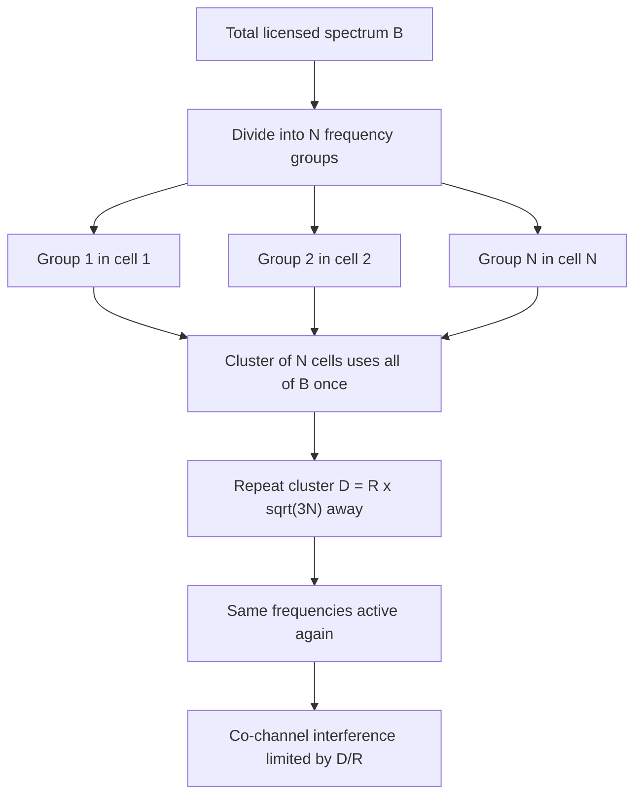
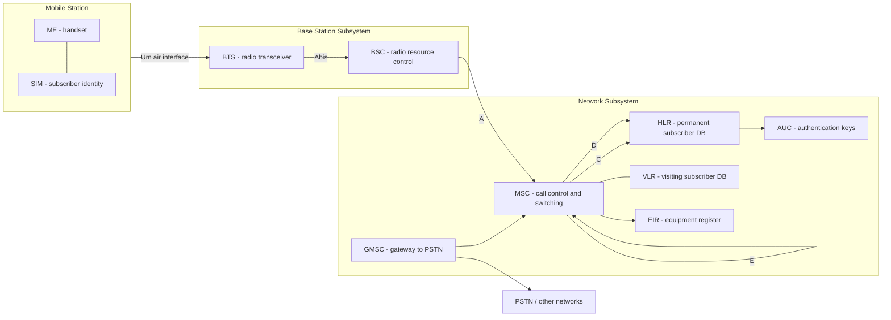
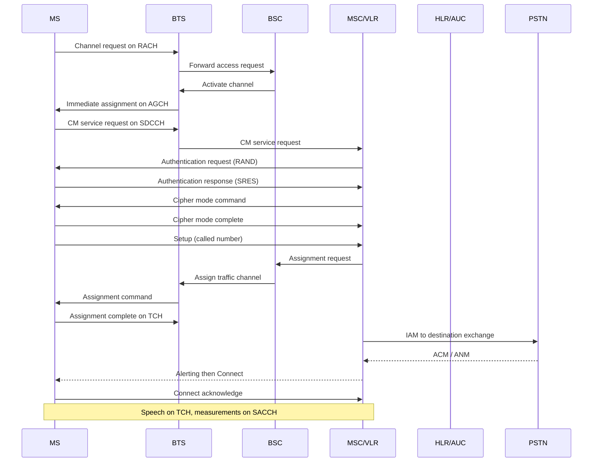
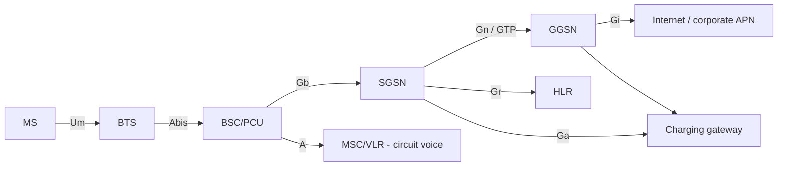

# 12 - Cellular Concepts, GSM and UMTS

## Learning Objectives

After this chapter you will be able to:

1. Define cell, sector, cluster, reuse factor and reuse distance, and compute `D = R x sqrt(3N)` for any cluster size.
2. Convert a licensed band into carriers, channels per cell and traffic channels per cell (L4 numerical).
3. Distinguish hard and soft handover, and explain when each is used.
4. Draw the GSM architecture and assign a responsibility to every element from MS to GMSC.
5. Explain the GSM air interface: 200 kHz carriers, TDMA with 8 slots, the 4.615 ms frame, burst types and logical channels.
6. Trace a GSM mobile-originated call as a sequence of signalling steps.
7. Explain GPRS/EDGE packet attach and PDP context activation using SGSN and GGSN.
8. Explain WCDMA spreading, the 3.84 Mcps chip rate, OVSF versus scrambling codes, and why UMTS needs soft handover.
9. State at awareness level what HSPA and HSPA+ added over Release 99 UMTS.

## Introduction

Wireless Technologies is 15% of the paper, that is **24 questions and 24 marks**. For a Computer Science graduate this is the hardest block, because nothing in a CSE degree prepares you for it: there is no analogy in operating systems or databases for a BSC, an AUC or an OVSF code tree. It is also the block where the paper is most predictable. The setters reuse the same fifteen or so question shapes: which node holds subscriber data, what a given channel carries, what the reuse distance is for N = 7, why SC-FDMA is used in the uplink, what the chip rate is.

Two consequences for your preparation:

- **Facts are worth more than depth.** A candidate who can name the responsibility of nine core-network elements and quote the GSM frame duration will outscore a candidate who understands WCDMA modulation but cannot name the RNC's job.
- **The numericals are easy marks.** There are only about six formulas in the whole block, and they are all one line of arithmetic. Chapters 12 to 14 drill them.

Difficulty note: expect roughly 40% direct recall (element to function, channel to purpose), 35% conceptual comparison (hard versus soft handover, GSM versus UMTS, SA versus NSA), and 25% numerical. The numerical 25% is the part most candidates abandon, which is exactly why it is worth taking.

This chapter covers 2G and 3G. Chapter 13 covers LTE and 5G, chapter 14 covers antennas, propagation, satellite and backhaul.

## Prerequisites

- **Chapter 10** for modulation basics: QPSK, QAM, bits per symbol, and why higher-order modulation needs a better SNR.
- **Chapter 11** for FDMA, TDMA, CDMA and duplexing (FDD versus TDD). GSM is FDD + TDMA/FDMA; UMTS is FDD + CDMA.
- **Chapter 01** for the idea of an addressing and subscriber database, which makes HLR/VLR intuitive.
- Arithmetic: square roots, powers of ten, decibels. `log10(2) = 0.301`, `log10(3) = 0.477`, `10 log10(2) = 3 dB`.

## Key Terminology

| Term | Meaning |
|---|---|
| Cell | The radio coverage area of one base station (or one sector of it), the unit of frequency planning. |
| Sector | A subdivision of a cell served by a directional antenna, typically 3 sectors of 65 deg or 6 sectors of 33 deg. |
| Cluster | A group of N cells that between them use the entire allocated spectrum exactly once. |
| Reuse factor N | Number of cells per cluster. N = 1, 3, 4, 7, 9, 12, 13, 16, 19 ... (values of `i^2 + ij + j^2`). |
| Reuse distance D | Distance between the centres of two cells using the same frequency group: `D = R x sqrt(3N)`. |
| Co-channel interference | Interference from another cell transmitting on the same carrier at the same time. |
| Handover (handoff) | Transfer of an active connection from one cell or channel to another without dropping the call. |
| BTS | Base Transceiver Station: the radio equipment and antennas at the cell site. |
| BSC | Base Station Controller: manages several BTSs, owns radio resource and handover decisions. |
| MSC | Mobile Switching Centre: circuit-switched call control and switching for mobiles. |
| HLR / VLR | Home / Visitor Location Register: permanent subscriber profile / temporary visiting copy. |
| PDP context | Packet Data Protocol context: the GPRS/UMTS session record that gives a mobile an IP address and a path to a GGSN. |
| Spreading factor (SF) | Ratio of chip rate to symbol rate in CDMA; SF 128 means 128 chips per symbol. |
| OVSF code | Orthogonal Variable Spreading Factor code: channelisation code that separates users within one cell. |

## Theory

### 1. Why cellular exists, and what a cell really is

A single high-power transmitter can cover a city, but it cannot serve more than a few dozen simultaneous calls, because the spectrum is finite. The cellular idea solves capacity, not coverage: divide the area into many small cells, give each cell a fraction of the spectrum, and reuse that same fraction in cells far enough away that the interference is tolerable.

Three quantities describe the plan:

- **Cell radius R** - the distance from the cell centre to the edge (for a hexagon, the circumradius).
- **Cluster size N** - how many cells share the spectrum before it repeats.
- **Reuse distance D** - how far apart co-channel cells are.

The geometry of a hexagonal grid gives the standard relation:

```
D / R = sqrt(3N)          and therefore        D = R x sqrt(3N)
```

N is not arbitrary. Only values of the form `N = i^2 + i*j + j^2` tile a hexagon grid, where i and j are non-negative integers with i >= j. That produces N = 1, 3, 4, 7, 9, 12, 13, 16, 19, 21, 28 ... Values such as 2, 5, 6, 8, 10, 11, 14, 15 are **not** valid cluster sizes, and a question that offers N = 5 as an option is offering a wrong answer.



### 2. Co-channel interference and the C/I ratio (L4 numerical)

Co-channel cells are the ones reusing your frequency. In a hexagonal plan the first tier has **6** co-channel cells. With a path-loss exponent `n` (2 in free space, 3 to 4 in a typical urban cell), the carrier-to-interference ratio at the cell edge is:

```
C/I = (D/R)^n / 6 = (sqrt(3N))^n / 6
```

Two lessons fall straight out of this formula:

- Increasing N increases D/R, and because of the exponent, C/I improves fast. N = 7 with n = 4 gives about 18.7 dB; N = 4 gives about 13.8 dB.
- The **reuse factor trades capacity against quality**. Small N means more spectrum per cell (more capacity) but more interference.

Typical planning targets: analogue AMPS needed about 18 dB, GSM planning guides use roughly 9 to 12 dB co-channel C/I depending on whether frequency hopping and discontinuous transmission are used, and WCDMA is designed to work at much lower C/I because it is interference-limited and uses soft handover plus power control instead of a hard reuse plan. 3GPP does not mandate one C/I number; any figure quoted in an exam is a planning target, not a standard.

### 3. Capacity arithmetic (L4 numerical)

The chain from spectrum to subscribers is always the same four steps:

1. **Carriers available** = allocated bandwidth / carrier spacing.
2. **Carriers per cell** = carriers available / N (rounded down, because a cell gets whole carriers).
3. **Traffic channels per cell** = carriers per cell x timeslots per carrier (8 in GSM, minus one for signalling in practice).
4. **Subscribers** = traffic channels / offered traffic per subscriber in Erlang (an Erlang-B table or the simple approximation below).

For a first estimate, one traffic channel carries about 0.7 to 0.8 Erlang at 2% blocking, and a busy-hour subscriber generates about 0.025 Erlang (25 mErlang). So one GSM traffic channel supports roughly 30 subscribers at 2% blocking.

Sectorisation and cell splitting are the two physical levers that raise capacity without new spectrum:

- **Sectorisation** replaces one omnidirectional antenna with 3 (or 6) directional ones. Interferers seen by a 120 deg sector antenna fall from 6 to about 2, so C/I improves by `10 log10(6/2) = 4.8 dB`, which permits a tighter reuse plan. Practical capacity gain is about 2.5 to 3 times, not the ideal 3.
- **Cell splitting** halves the radius. Area per cell falls by 4, so the number of cells (and the capacity) rises by 4. Transmit power must fall by `10 n log10(2)`, about 12 dB for n = 4.

### 4. Handover

A handover transfers an active connection. The two families are:

| Property | Hard handover | Soft handover |
|---|---|---|
| Rule | Break before make | Make before break |
| Radios during transfer | One at a time | Two or more simultaneously |
| Used by | GSM, GPRS, LTE (usually), and all TDD systems | UMTS/WCDMA, and CDMA2000 |
| User impact | Short interruption, audible click possible | Seamless, no interruption |
| Network cost | Cheaper, one radio | Costs extra radio capacity (softer handover between sectors of one NodeB is cheaper) |
| Trigger | Rx level and quality thresholds, timing advance, hysteresis | Ec/Io and RSCP thresholds, active set update |

Handover decision inputs in GSM: downlink Rx level, downlink quality (bit error rate), timing advance (distance), and power budget. A **hysteresis margin** (typically 3 dB) plus a **time-to-trigger** prevents ping-pong, the rapid back-and-forth handover between two cells whose signals are nearly equal.

Related terms you must not confuse: **handover** is an active call moving; **cell reselection** is an idle mobile choosing a new cell; **roaming** is using another operator's network.

### 5. GSM architecture

GSM splits into three parts: the Mobile Station (MS), the Base Station Subsystem (BSS), and the Network Subsystem (NSS) plus the Operation Support Subsystem (OSS).



Element-responsibility table - memorise this column by column, it is the single most examined table in the block:

| Element | Full form | Domain | Responsibility | Typical exam hook |
|---|---|---|---|---|
| MS | Mobile Station | Radio | The handset plus SIM; provides the user's radio access and holds the subscriber identity (IMSI) in the SIM. | "Which entity holds the IMSI?" |
| BTS | Base Transceiver Station | Radio access | Transmits and receives on the air interface; handles modulation, channel coding, ciphering on the radio path, and measurement reporting. | "Which node does the MS talk to first?" |
| BSC | Base Station Controller | Radio access | Controls several BTSs; allocates radio channels, manages handover between its own BTSs, manages power control. | "Handover within a BSS is decided by ..." |
| MSC | Mobile Switching Centre | Circuit core | Call setup, release, routing and switching for circuit-switched calls; interfaces to the PSTN; hosts or is co-located with the VLR. | "Which node switches a voice call?" |
| GMSC | Gateway MSC | Circuit core | The MSC that interrogates the HLR to find the called subscriber's current MSC; the entry point from the PSTN. | "Incoming call from PSTN enters at ..." |
| HLR | Home Location Register | Database | Permanent subscriber database: subscription, services, and the address of the current VLR/MSC. | "Where is the subscriber profile stored permanently?" |
| VLR | Visitor Location Register | Database | Temporary copy of the profile for subscribers in its area, plus the TMSI and location area; avoids querying HLR on every call. | "Which database makes the HLR unnecessary per call?" |
| AUC | Authentication Centre | Security | Holds the Ki (subscriber key) and generates authentication triplets (RAND, SRES, Kc) for the VLR/MSC. | "Which element generates triplets?" |
| EIR | Equipment Identity Register | Security | Holds IMEI lists: white, grey and black; blocks stolen handsets. | "Which register blocks a stolen phone?" |
| OSS / OMC | Operation Support Subsystem | Management | Fault, configuration, performance, security and accounting management of the network. | "Which subsystem does O and M?" |

The distinction that decides marks: **HLR is permanent and central, VLR is temporary and local, AUC holds the key, EIR holds the handset identity.** An AUC question answered with "HLR" is wrong; an EIR question answered with "AUC" is wrong.

### 6. The GSM air interface

GSM is an FDD/TDMA system. Numbers to know cold:

| Parameter | Value |
|---|---|
| Carrier spacing | 200 kHz |
| Access | FDMA plus TDMA, 8 timeslots per carrier |
| Modulation | GMSK, 1 bit per symbol |
| Symbol (bit) rate | 270.833 kbit/s |
| Timeslot duration | 576.9 us (156.25 bits) |
| Frame duration | 4.615 ms (8 slots) |
| Traffic multiframe | 26 frames = 120 ms |
| Control multiframe | 51 frames = 235.4 ms |
| Duplex | FDD, 45 MHz separation in the 900 MHz band |
| Bands (typical) | 900 MHz: 890-915 uplink / 935-960 downlink; 1800 MHz: 1710-1785 / 1805-1880 |

Why 270.833 kbit/s? Because the frame must be 4.615 ms, which is 1/216.7 s, and 8 slots of 156.25 bits fit in that period. The number is a design choice that also allows 26 frames to equal exactly 120 ms for the SACCH and 51 frames to align with the 235 ms control cycle.

A **burst** is what is transmitted in one timeslot. Types:

- **Normal burst** - 114 information bits plus 26-bit training sequence plus tail bits and guard period; carries traffic and most signalling.
- **Frequency correction burst (FB)** - an unmodulated carrier offset, used by the mobile to find the FCCH and correct its oscillator.
- **Synchronisation burst (SB)** - carries the training sequence and the frame number (FN) so the mobile can align to the frame clock.
- **Access burst** - short burst with a long guard period, used on the RACH because the mobile does not yet know its timing advance.
- **Dummy burst** - fills a slot when nothing else is transmitted.

Logical channels - know which are broadcast, which are common control, which are dedicated:

| Channel | Type | Carries |
|---|---|---|
| FCCH | Broadcast | Frequency correction; tells the mobile "tune here, this is a GSM carrier". |
| SCH | Broadcast | Synchronisation: frame number and base station identity code (BSIC). |
| BCCH | Broadcast | System information: cell identity, neighbouring cells, channel configuration. |
| PCH | Common control | Paging: alerts an idle mobile to an incoming call. |
| RACH | Common control | Random access: the mobile's first uplink request for a channel. |
| AGCH | Common control | Access grant: assigns a dedicated channel in reply to RACH. |
| SDCCH | Dedicated control | Standalone dedicated control channel: call setup signalling, location update, SMS. |
| SACCH | Dedicated control | Slow associated control: measurement reports and power/timing commands. |
| FACCH | Dedicated control | Fast associated control: in-band signalling stolen from a traffic channel during handover. |
| TCH/F, TCH/H | Traffic | Full-rate (13 kbps speech, 22.8 kbit/s channel rate) and half-rate speech/data. |

The logic of a call: the mobile first listens to **FCCH, SCH, BCCH**, then sends **RACH**, receives **AGCH** (assignment), uses **SDCCH** for authentication and setup, then moves to **TCH** for speech. Measurement reports flow on **SACCH** during the call.

### 7. GSM mobile-originated call setup



Mobile-terminated calls add one step at the front: the GMSC interrogates the HLR with the MSISDN, the HLR asks the serving VLR for a roaming number (MSRN), and the call is routed to that MSC, which pages the mobile on PCH.

### 8. GPRS and EDGE: adding packets to GSM

GSM Release 97/98 added a packet core alongside the circuit core. Two new nodes matter:

- **SGSN (Serving GPRS Support Node)** - the packet equivalent of the serving MSC. It tracks the mobile's routing area, performs authentication, and forwards user packets between the radio network and the gateway. It is the **mobility anchor for packet data**.
- **GGSN (Gateway GPRS Support Node)** - the gateway to external packet networks (internet, corporate APN). It allocates or anchors the IP address and is the **IP anchor point**.

Two procedures are examined:

1. **GPRS attach** - the mobile registers with the SGSN, which fetches the profile from the HLR (via Gr interface) and creates a mobility management context. After attach the mobile is reachable for paging but has no IP address yet.
2. **PDP context activation** - the mobile requests an APN; the SGSN selects a GGSN, and a GTP tunnel is created between SGSN and GGSN. Only now does the mobile get an IP address and can send packets.

EDGE (Enhanced Data rates for GSM Evolution) keeps the 200 kHz carrier and TDMA structure but changes the modulation from GMSK to **8PSK**, giving 3 bits per symbol, and adds nine modulation-and-coding schemes (MCS-1 to MCS-9). Peak per timeslot rises to 59.2 kbit/s with MCS-9, so a full 8-slot carrier is about 473 kbit/s gross; real handsets use 4 to 5 slots, giving the familiar "up to about 236 to 296 kbit/s" figure, and marketing quotes around 384 kbit/s. EDGE is often called a "2.75G" system.



### 9. UMTS and WCDMA

UMTS (3GPP Release 99) replaced TDMA with **CDMA**, specifically Wideband CDMA in a 5 MHz carrier, with a chip rate of **3.84 Mcps**. All users transmit at the same time and in the same 5 MHz band; they are separated by codes and by power control.

Two code layers do two different jobs:

| Code | Length | Job | Why it must be so |
|---|---|---|---|
| Channelisation (OVSF) | SF 4 to 256 uplink, 4 to 512 downlink | Separates physical channels **within one cell**; orthogonal, so no intra-cell interference. | Orthogonality only holds if the codes stay aligned in time, which the network can guarantee inside one cell. |
| Scrambling | 10 ms frame, Gold code, 3.84 Mcps | Separates **cells and users**; not orthogonal, but has good cross-correlation. | Cells are not synchronised, so orthogonality between cells is impossible; low cross-correlation is enough. |

The OVSF code tree: a code of spreading factor SF has two children of SF x 2. If a code is in use, none of its ancestors or descendants may be used (they are not orthogonal). This is the classic exam point: **OVSF codes are orthogonal but the code tree is capacity-limited by its branching rule.**

Spreading arithmetic: symbol rate = chip rate / SF. With SF 128, `3.84e6 / 128 = 30 ksps`; with QPSK (2 bits per symbol) the raw rate is 60 kbit/s, which comfortably carries a 12.2 kbit/s AMR voice call after coding and control overhead. Lower SF means higher data rate but fewer codes available and more interference generated - the central trade-off of WCDMA.

Radio access network elements:

- **NodeB** - the 3G base station: RF, spreading and despreading, inner-loop fast power control (1500 Hz).
- **RNC (Radio Network Controller)** - owns radio resource management, admission control, outer-loop power control, and **soft handover combining**. It connects to the circuit core over Iu-CS (to the MSC server) and to the packet core over Iu-PS (to the SGSN).
- **CSG/GGSN/SGSN** - the packet core is inherited from GPRS with the SGSN upgraded to support Iu-PS.

**Soft handover** is a direct consequence of CDMA: because every cell shares the same frequency, the mobile can be connected to two or three NodeBs at once. The set of cells currently serving the mobile is the **active set**. The RNC combines the copies using maximum ratio combining, so soft handover gives a **macroscopic diversity gain** and removes the "break" of a hard handover. The cost is that the mobile occupies radio capacity in every cell of its active set, and the extra links add interference. **Softer handover** is the same idea between sectors of one NodeB, handled inside the NodeB.

### 10. HSPA and HSPA+ (awareness level)

- **HSDPA (Release 5)** added a **shared high-speed downlink channel (HS-DSCH)**, adaptive modulation and coding (QPSK and 16QAM), hybrid ARQ (HARQ), and scheduling in the NodeB rather than the RNC. Peak: **14.4 Mbit/s** per 5 MHz carrier.
- **HSUPA (Release 6)** did the same for the uplink with E-DCH: **5.76 Mbit/s** peak, 2 ms TTI, NodeB scheduling.
- **HSPA+ (Release 7 onward)** added **64QAM** downlink and **16QAM** uplink, **2x2 MIMO**, higher-order modulation with improved receivers, and later **dual-cell / dual-carrier** operation. Quoted peaks of 21, 42 and 84 Mbit/s refer to specific feature combinations; 21 Mbit/s is single-carrier 64QAM, 42 Mbit/s adds 2x2 MIMO.

The exam usually asks only: what does the "H" in HSDPA stand for (High Speed), where is the scheduler (NodeB), and what is the peak of HSDPA (14.4 Mbit/s). Do not spend study time on HS-SCCH/HS-DPCCH channel details.

## Worked Examples

### Example 1 - Reuse distance (L4 numerical)

A GSM network uses a 7-cell reuse pattern with a cell radius of 2 km. Find the reuse distance and the co-channel reuse ratio.

```
q = D/R = sqrt(3N) = sqrt(21) = 4.583
D = R x q = 2 km x 4.583 = 9.17 km
```

Answer: **D = 9.17 km**, q = 4.58. Sanity check: D must exceed 3R (that is 6 km) and be under 5R (10 km) for N = 7.

### Example 2 - Carriers and traffic channels per cell (L4 numerical)

An operator holds 25 MHz of uplink spectrum in the 900 MHz band, with 200 kHz carriers and a reuse factor of 7. How many carriers and traffic channels per cell?

```
Carriers total      = 25 MHz / 0.2 MHz = 125
Carriers per cell   = floor(125 / 7) = 17
Timeslots per cell  = 17 x 8 = 136
Traffic channels    = 136 - 1 (BCCH carrier signalling) = 135, or 17 - 1 = 16 carriers for traffic
```

Answer: **125 carriers, 17 per cell, 136 timeslots, about 135 usable traffic channels.** Note the rounding: 125/7 = 17.86, and you cannot have 0.86 of a carrier, so the cluster uses 7 x 17 = 119 carriers and 6 carriers are spare for a later cell split.

### Example 3 - Comparing N = 4 and N = 7 (L4 numerical)

Same 25 MHz band. Compare capacity and C/I (assume n = 4, 6 interferers).

```
N = 4: carriers/cell = floor(125/4) = 31; channels = 31 x 8 = 248
       q = sqrt(12) = 3.464; C/I = 3.464^4 / 6 = 144 / 6 = 24.0 = 13.8 dB
N = 7: carriers/cell = 17; channels = 136
       q = 4.583; C/I = 4.583^4 / 6 = 441 / 6 = 73.5 = 18.7 dB
```

Answer: N = 4 gives **82% more channels** but **4.9 dB less C/I**. That is the whole reuse trade-off in one line, and it is the expected answer shape for any "why not always use N = 1" question.

### Example 4 - GSM frame and slot timing (L4 numerical)

Verify the GSM timeslot duration from the bit rate, and find the frame rate.

```
Slot = 156.25 bits / 270.833 kbit/s = 576.9 us
Frame = 8 x 576.9 us = 4.615 ms
Frame rate = 1 / 4.615 ms = 216.7 frames per second
Bit duration = 1 / 270.833 kbps = 3.69 us
Traffic multiframe = 26 x 4.615 ms = 120 ms
```

Answer: **576.9 us slot, 4.615 ms frame, 216.7 frames/s.** A question that says "the GSM frame is 4.615 ms and contains 8 slots; what is the slot duration" wants 577 us, not 4.615/8 ms written as 0.577 ms without units.

### Example 5 - WCDMA spreading (L4 numerical)

A 12.2 kbit/s AMR voice call uses spreading factor 128 in the uplink. Find the symbol rate and the raw chip-limited bit rate.

```
Symbol rate = 3.84e6 chips/s / 128 = 30,000 symbols/s = 30 ksps
QPSK: 2 bits per symbol -> 60 kbit/s raw
Coding and control overhead consume the difference to 12.2 kbit/s
```

Answer: **30 ksps, 60 kbit/s raw.** If the SF were 64, the symbol rate would double to 60 ksps and the raw rate to 120 kbit/s - twice the data rate, but twice the interference per user.

### Example 6 - Cell splitting gain (L4 numerical)

A cell of radius 2 km is split into cells of radius 1 km. Find the capacity gain and the required transmit power change (n = 4).

```
Area ratio = (2/1)^2 = 4  -> 4 times as many cells -> 4x capacity
Power change = 10 x n x log10(R_old/R_new) = 10 x 4 x log10(2) = 12.0 dB
```

Answer: **4x capacity, 12 dB less transmit power per cell.** In practice operators split only congested cells and keep the umbrella cell, which is why real gain is below the theoretical 4x.

### Example 7 - EDGE throughput (L4 numerical)

EDGE uses 8PSK at 270.833 ksps on a 200 kHz carrier. Find the gross bit rate per carrier and the peak per timeslot with MCS-9 (59.2 kbit/s), and the rate for a 4-slot handset.

```
8PSK = 3 bits/symbol
Gross per carrier = 270.833 ksps x 3 = 812.5 kbit/s
Per timeslot (ideal) = 812.5 / 8 = 101.6 kbit/s; MCS-9 delivers 59.2 kbit/s
4 slots = 4 x 59.2 = 236.8 kbit/s
```

Answer: **812.5 kbit/s gross per carrier, 59.2 kbit/s per slot with MCS-9, 236.8 kbit/s on a 4-slot handset.**

## Exam Traps and Common Mistakes

1. **Reuse factor versus reuse distance.** N is a count of cells (dimensionless, e.g. 7); D is a distance in km. A question asking "reuse distance for N = 7, R = 2 km" wants 9.17 km, not 7 or 14.
2. **Invalid cluster sizes.** N must satisfy `i^2 + ij + j^2`. N = 5, 6, 8, 10, 11, 14, 15 cannot tile a hexagonal grid. If an option set contains 5 and 7, the intended answer is 7.
3. **SGSN versus GGSN.** SGSN is mobility and serving; GGSN is the IP gateway and anchor. "Which node assigns the IP address to a GPRS mobile?" is GGSN. "Which node tracks the routing area?" is SGSN.
4. **HLR versus VLR versus AUC.** HLR permanent, VLR temporary, AUC holds Ki and makes triplets. VLR exists so that the HLR is not queried on every call.
5. **BSC versus MSC.** The BSC does radio resource and intra-BSS handover; the MSC does call switching and inter-MSC handover. A question about "handover between two BSCs" is still an MSC-level (anchor) procedure.
6. **FCCH versus SCH.** FCCH is frequency correction (an unmodulated tone), SCH is synchronisation (frame number, BSIC). Both are broadcast, but only SCH carries the frame number.
7. **RACH direction.** RACH is uplink, from mobile to network, and is the *first* message of a call. AGCH is the downlink reply.
8. **OVSF versus scrambling codes.** OVSF separates channels in one cell (orthogonal, code-tree limited); scrambling separates cells (not orthogonal, cross-correlation). Reversing them is the most common 3G error.
9. **Hard versus soft handover.** Soft handover is a CDMA property (same frequency everywhere). LTE, which is also OFDMA, normally uses hard handover, so "soft handover is used in 4G" is false.
10. **HSPA peak figures.** 14.4 Mbit/s is HSDPA (Release 5), not HSPA+; 42 Mbit/s is dual-carrier/MIMO HSPA+, not plain HSDPA.

## Summary

- A cellular network reuses spectrum across a cluster of N cells; co-channel cells are `D = R x sqrt(3N)` apart, with valid N of the form `i^2 + ij + j^2`.
- C/I at the cell edge is `(sqrt(3N))^n / 6`; smaller N means more capacity and worse quality.
- Capacity per cell = (bandwidth / carrier spacing / N) x timeslots per carrier, rounded down at the carrier step.
- Sectorisation improves C/I by about 4.8 dB (6 interferers to 2) and gives roughly 2.5 to 3 times capacity; cell splitting to half radius gives 4 times cells and needs 12 dB less power.
- GSM: 200 kHz carriers, 8-slot TDMA, 4.615 ms frames, GMSK at 270.833 kbit/s; BSS (BTS + BSC) plus NSS (MSC, GMSC, HLR, VLR, AUC, EIR).
- Broadcast channels (FCCH, SCH, BCCH) let an idle phone find and read the cell; RACH/AGCH/SDCCH set up a call; TCH carries speech; SACCH carries measurements.
- GPRS adds SGSN (serving, mobility) and GGSN (gateway, IP anchor); attach gives reachability, PDP context gives an IP address.
- UMTS uses 5 MHz WCDMA at 3.84 Mcps; OVSF channelisation inside a cell, scrambling between cells; RNC controls the NodeBs and combines soft handover legs.
- HSPA moves scheduling into the NodeB and adds HARQ and adaptive modulation: 14.4 Mbit/s downlink, 5.76 Mbit/s uplink; HSPA+ adds 64QAM, MIMO and multi-carrier.

## Practical Takeaways

- When a numerical asks for capacity, always write the four-step chain (carriers, per cell, timeslots, Erlang) so partial credit is visible and rounding errors are caught.
- Learn the element table by responsibility, not by acronym expansion. The exam asks "which node does X", not "expand GGSN".
- For any "why is this design like this" question in 2G/3G, the answer is usually one of: spectrum is scarce, interference must be controlled, or the mobile's power and timing are unknown at the start.
- Keep a one-page channel map: broadcast (FCCH, SCH, BCCH), common control (PCH, RACH, AGCH), dedicated (SDCCH, SACCH, FACCH), traffic (TCH).
- If a question quotes a peak rate with no context, check whether it is per carrier, per timeslot, or per handset. The three differ by roughly 8x and 2x.

## Chapter Quiz


**Q1.** A cellular system has cluster size N = 7 and cell radius 3 km. The reuse distance is:

A) 7.9 km

B) 13.7 km

C) 21 km

D) 9 km

**Answer: B** `D = R x sqrt(3N) = 3 x sqrt(21) = 3 x 4.583 = 13.75 km`. Option A is sqrt(7) x 3 (wrong formula), C is N x R, D is 3R.

**Q2.** Which GSM element generates the authentication triplets (RAND, SRES, Kc)?

A) HLR

B) VLR

C) AUC

D) EIR

**Answer: C** The Authentication Centre holds Ki and produces triplets on request; the VLR stores and uses them, and the HLR is the subscriber profile database.

**Q3.** In UMTS, codes that separate different cells from one another are:

A) OVSF channelisation codes

B) Scrambling codes

C) Walsh codes

D) Gold sequences used as channelisation codes

**Answer: B** Scrambling codes separate cells and users; OVSF channelisation codes separate physical channels inside one cell. (Gold sequences are the family used for scrambling, but the role is what is being asked.)

**Q4.** A GPRS mobile is attached but has no IP address. What is missing?

A) IMSI

B) PDP context activation

C) Authentication

D) A VLR entry

**Answer: B** Attach gives mobility management and paging reachability; only PDP context activation creates the GTP tunnel and allocates the IP address via the GGSN.

**Q5.** Soft handover is possible in UMTS mainly because:

A) It uses TDMA with frequency hopping

B) All cells use the same 5 MHz carrier, so the mobile can receive two cells at once

C) The RNC has spare hardware

D) The core network is packet switched

**Answer: B** A single frequency reuse factor of 1 means neighbouring cells are not distinguished by frequency, so simultaneous links are physically possible and the RNC can combine them. Packet core (D) is unrelated.

## Exercises

**E1.** For N = 3, 4, 7, 9 and 12, tabulate `q = sqrt(3N)` and the reuse distance for R = 1.5 km.
*Answer:* q = 3.00, 3.46, 4.58, 5.20, 6.00; D = 4.50, 5.20, 6.87, 7.79, 9.00 km.

**E2.** A 20 MHz downlink band uses 200 kHz carriers and N = 4. Find carriers per cell and traffic channels per cell, and state how many carriers remain unused in the cluster.
*Answer:* 100 carriers; 100/4 = 25 per cell; 200 timeslots; cluster uses 100 carriers, none unused. With N = 7, 98 used and 2 spare, 14 carriers per cell, 112 timeslots.

**E3.** A GSM cell has 16 carriers and 2% blocking. Using 0.75 Erlang per traffic channel, estimate the supported busy-hour subscribers at 25 mErlang each.
*Answer:* 16 x 8 = 128 timeslots, less 1 for BCCH = 127; 127 x 0.75 = 95.25 Erlang; 95.25 / 0.025 = 3810 subscribers.

**E4.** A WCDMA uplink uses SF 64 with QPSK. Find the symbol rate and raw bit rate, and say what happens to the number of available codes if SF drops to 32.
*Answer:* 3.84e6/64 = 60 ksps, 120 kbit/s raw. At SF 32, 120 ksps and 240 kbit/s, but only half as many orthogonal codes are available at that level and each user's interference contribution doubles.

**E5.** With n = 3.5 and 6 interferers, compute C/I in dB for N = 3 and N = 7.
*Answer:* N = 3: q = 3.0, 3.0^3.5 = 46.8, /6 = 7.8 = 8.9 dB. N = 7: 4.583^3.5 = 192.6, /6 = 32.1 = 15.1 dB.

**E6.** Explain in three sentences why the GSM access burst has a longer guard period than the normal burst.
*Answer:* At first access the mobile does not know its distance from the BTS, so its transmission can arrive late or early relative to the slot. The long guard period absorbs that timing uncertainty without overlapping the neighbouring slot. After the network measures the delay it sends a timing advance, and subsequent normal bursts fit the slot exactly.

**E7.** A network has 3-sector sites with 6 interferers reduced to 2. Compute the C/I improvement and state the practical capacity gain.
*Answer:* `10 log10(6/2) = 4.8 dB`. Practical capacity gain is about 2.5 to 3 times, because of sector overlap, softer-handover overhead and uneven traffic distribution.

## Next

Chapter 13 continues the wireless block into LTE and 5G: the EPS architecture and its element table, OFDMA versus SC-FDMA, resource blocks and the throughput arithmetic, bearers and QCI, VoLTE and CS fallback, 5G NR numerology, the service-based 5G core, network slicing, MEC and the SA versus NSA comparison. Read it immediately after this chapter while the 2G/3G element tables are still fresh, because the exam deliberately mixes generations in single questions ("which node corresponds to the MME in the 3G core?").
