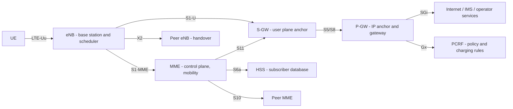
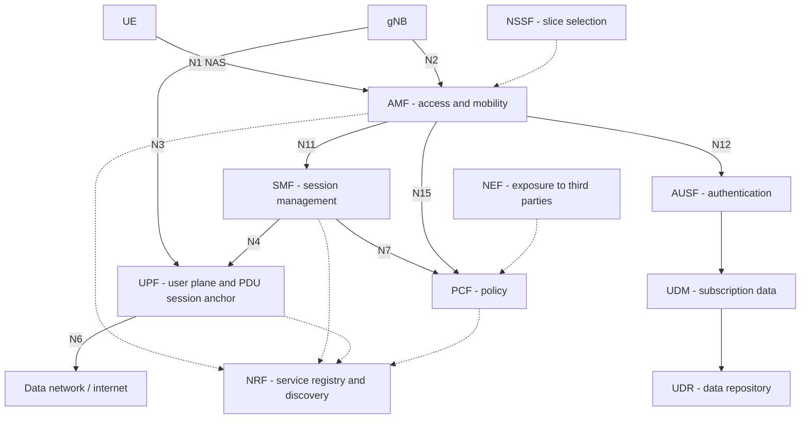
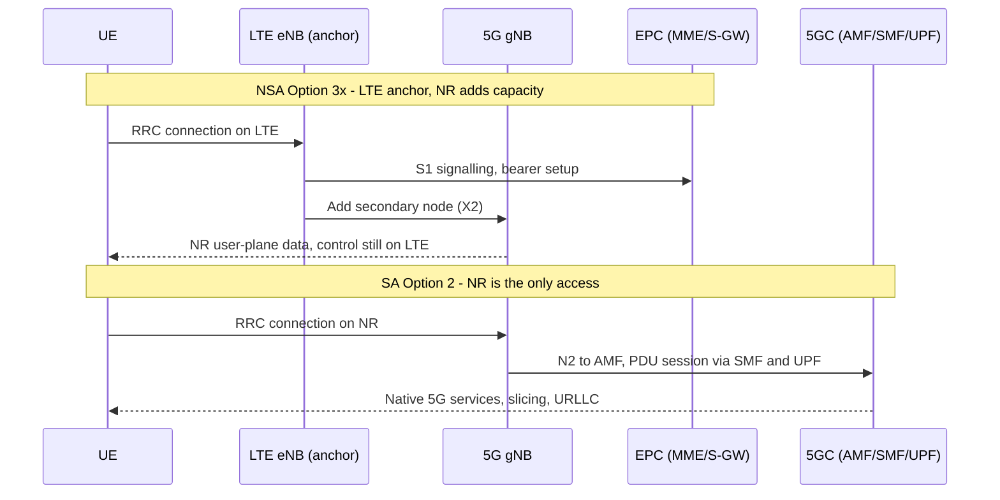

# 13 - LTE, the Evolved Packet Core and 5G

## Learning Objectives

After this chapter you will be able to:

1. Name every element of the LTE/EPS architecture and state its single responsibility, and map each 4G element to its 3G and 5G counterpart.
2. Explain why LTE uses OFDMA in the downlink and SC-FDMA in the uplink.
3. Compute resource blocks, resource elements and peak throughput for a given LTE bandwidth (L4 numerical).
4. Explain EPS bearers, the default versus dedicated bearer, and what a QCI value describes.
5. Explain how VoLTE is carried over IMS and what CS fallback is for.
6. List the LTE-Advanced features at awareness level: carrier aggregation, higher-order MIMO, 256QAM, CoMP.
7. Compute 5G NR slot duration, symbols per slot and slots per subframe for any numerology (L4 numerical).
8. Explain massive MIMO, beamforming and the mmWave trade-off.
9. Name the 5G core (5GC) service-based elements and their responsibilities.
10. Compare SA and NSA deployment, and match eMBB, URLLC and mMTC to their ITU requirements.

## Introduction

This chapter carries the largest share of the Wireless block, because 4G and 5G questions are cheap for a setter to write: they are all "which node does what" and "which band is FR2". The paper typically asks 6 to 9 questions from this material out of the 24 wireless marks, and it mixes generations deliberately. A single question can offer MME, SGSN, AMF and RNC as options for "which element handles mobility management in 4G" - so you must hold all three element tables in your head at once, not one at a time.

The good news for a CSE graduate: the 5G core is a **service-based architecture**, which is conceptually the same move as microservices - each network function is a service with a REST-style API registered in a discovery function. If you understand service registries and API gateways, you already understand NRF and SBA. The 5G RAN is the harder half, but its arithmetic (subcarrier spacing, slots, resource blocks) is pure multiplication and division.

Difficulty note: about 50% recall and comparison, 30% conceptual ("why SC-FDMA"), 20% numerical. The numerical questions are almost always about resource blocks, slot timing or peak throughput, all of which are drilled below.

## Prerequisites

- **Chapter 12** for the 2G/3G element tables. This chapter assumes you can already place MSC, SGSN, GGSN, NodeB and RNC.
- **Chapter 11** for OFDM: subcarriers, cyclic prefix, why multipath is handled in the frequency domain.
- **Chapter 10** for QAM orders: QPSK 2 bits, 16QAM 4, 64QAM 6, 256QAM 8 bits per symbol.
- **Chapter 07** for IMS: P-CSCF, I-CSCF, S-CSCF and SIP registration.

## Key Terminology

| Term | Meaning |
|---|---|
| eNB (eNodeB) | The LTE base station: radio transmission plus most radio resource management, including the scheduler. |
| EPC | Evolved Packet Core: the all-IP core of LTE (MME, S-GW, P-GW, HSS, PCRF). |
| EPS bearer | The logical packet pipe from the UE to the P-GW, with a defined QoS; the unit of QoS treatment in LTE. |
| Default bearer | The always-on bearer created at attach; gives the UE its IP address. |
| Dedicated bearer | An additional bearer for a specific flow (for example voice) with different QoS. |
| QCI | QoS Class Identifier: a scalar that indexes a standardised table of latency, loss and priority. |
| Resource block (RB) | 180 kHz of spectrum (12 subcarriers x 15 kHz) over one slot; the unit of scheduling in LTE. |
| Resource element (RE) | One subcarrier for one OFDM symbol; the smallest time-frequency unit. |
| SC-FDMA | Single-Carrier FDMA: DFT-precoded OFDMA used in the LTE uplink to reduce peak-to-average power ratio. |
| SCS | Subcarrier spacing. LTE uses 15 kHz; 5G NR uses 15, 30, 60, 120 and 240 kHz. |
| Numerology | The 5G term for a set of transmission parameters (SCS, slot length, cyclic prefix), indexed by `mu`. |
| Network function (NF) | A 5G core element implemented as a service with a standardised API (AMF, SMF, UPF ...). |
| Network slicing | Partitioning one physical 5G network into isolated logical networks, each with its own QoS and resources. |
| MEC | Multi-access Edge Computing: compute placed at the RAN edge to cut latency and backhaul load. |
| NSA / SA | Non-Standalone / Standalone: 5G radio anchored on LTE core, versus 5G radio with a 5G core. |

## Theory

### 1. LTE and the EPS architecture

LTE was designed around one idea: **flatten the hierarchy and make everything packet-switched**. The 3G hierarchy (BTS -> BSC -> RNC -> MSC/SGSN) had too many nodes in the user path. LTE removes the controller entirely: the eNB connects directly to the core, and the user plane never passes through a call-control node.



Element-responsibility table (learn the "one line" column verbatim):

| Element | Full form | Plane | Responsibility | One-line memory hook |
|---|---|---|---|---|
| eNB | Evolved NodeB | Both | Radio transmission, scheduling, HARQ, radio resource management, header compression and ciphering; decides handover, forwards data during handover. | "Everything the RNC and NodeB used to do, in one box." |
| MME | Mobility Management Entity | Control | Attach and detach, authentication, paging, bearer setup signalling, tracking area updates, idle-mode UE reachability, selection of S-GW and P-GW. | "The brain: no user data passes through it." |
| S-GW | Serving Gateway | User | Terminates the S1-U interface, anchors the user plane for inter-eNB handover, buffers downlink data for idle UEs. | "Local mobility anchor for the radio side." |
| P-GW | Packet Data Network Gateway | User | Connects to external PDNs, allocates the UE IP address, enforces policy and charging, is the IP anchor for the session. | "The GGSN of LTE." |
| HSS | Home Subscriber Server | Control/database | Holds subscription data, authentication vectors, and the identity of the serving MME; the evolution of HLR plus AUC. | "HLR and AUC merged." |
| PCRF | Policy and Charging Rules Function | Control | Decides QoS and charging policy per flow and pushes it to the P-GW over Gx; the policy decision point. | "Decides the rules; the P-GW enforces them." |
| SPR | Subscription Profile Repository | Database | Optional store of subscriber profile data used by the PCRF. | "PCRF's data source." |
| OCS/OFCS | Online/Offline Charging System | Control | Real-time credit control (online) and CDR collection (offline). | "Prepaid versus postpaid billing." |

The mapping question appears every year. Memorise it as a chain:

| Function | 2G/3G | 4G | 5G |
|---|---|---|---|
| Radio base station | BTS / NodeB | eNB | gNB |
| Radio controller | BSC / RNC | none (functions moved into eNB) | none (moved into gNB and CU/DU split) |
| Mobility and session control | MSC/VLR, SGSN | MME | AMF |
| User-plane serving anchor | SGSN (data) | S-GW | UPF (with SMF controlling it) |
| Gateway to external IP | GGSN | P-GW | UPF plus SMF (PGW-C/PGW-U equivalents) |
| Subscriber database | HLR + AUC | HSS | UDM + UDR + AUSF |
| Policy | none / basic | PCRF | PCF |

### 2. LTE radio: OFDMA downlink, SC-FDMA uplink

**Downlink: OFDMA.** The eNB spreads its power over many narrow subcarriers, each 15 kHz wide, and assigns groups of them to users per 1 ms subframe. OFDMA gives frequency-selective scheduling (give a user the subcarriers where its channel is good), easy handling of multipath through the cyclic prefix, and scalability from 1.4 MHz to 20 MHz by changing the number of subcarriers.

**Uplink: SC-FDMA.** The UE is battery-powered and power-limited. Plain OFDMA has a high **peak-to-average power ratio (PAPR)**, because many subcarriers add up coherently, so the power amplifier must back off and wastes power and coverage. SC-FDMA applies a DFT precoder before the IFFT, spreading each user's symbols across the assigned subcarriers, which produces a single-carrier-like signal with a much lower PAPR. The price is less scheduling flexibility in frequency and slightly worse spectral efficiency; the benefit is roughly 2 to 3 dB of link budget at the cell edge and cheaper amplifiers.

The exam phrasing is always: "Why does LTE use SC-FDMA in the uplink?" Answer: to reduce PAPR and therefore UE power consumption and amplifier cost, at the cost of some spectral efficiency.

Numbers to know:

| Parameter | LTE value |
|---|---|
| Subcarrier spacing | 15 kHz |
| Resource block | 180 kHz = 12 subcarriers x 15 kHz |
| Slot | 0.5 ms (7 OFDM symbols, normal cyclic prefix) |
| Subframe (scheduling unit) | 1 ms = 2 slots = 14 symbols |
| Radio frame | 10 ms = 10 subframes |
| Channel bandwidths | 1.4, 3, 5, 10, 15, 20 MHz |
| RBs at 20 MHz | 100 |
| Modulation | QPSK, 16QAM, 64QAM (256QAM from Release 12) |
| Duplex | FDD and TDD |

Resource-element arithmetic: one RB per subframe = `12 subcarriers x 14 symbols = 168 RE`. Not all are usable: cell-specific reference signals, the PDCCH control region (1 to 3 symbols), synchronisation signals and the PBCH consume roughly 20 to 25%, which is why a 20 MHz 2x2 system peaks near 150 Mbit/s rather than 200.

### 3. MIMO in LTE

LTE was the first cellular standard to make MIMO mandatory rather than optional. Two gains are distinguished:

- **Spatial multiplexing (SM):** send different data streams on different antennas; throughput multiplies by `min(Nt, Nr)` in rich scattering. 2x2 gives 2 layers, 4x4 gives 4.
- **Transmit diversity:** send the same data coded across antennas; improves reliability at the cell edge, no rate gain.

LTE defines transmission modes (TM1 to TM10) that select between these, and the eNB chooses the mode and the rank based on channel feedback (CQI, PMI, RI) reported by the UE. Release 10 added 8x8 downlink MIMO; practical handsets use 2x2 or 4x4 because of size and power.

### 4. EPS bearers and QoS (QCI at awareness)

An EPS bearer is a one-way packet pipe with an agreed QoS. A UE typically has:

- a **default bearer** created at attach, non-guaranteed bit rate, carrying whatever is not otherwise classified, and
- zero or more **dedicated bearers**, guaranteed or non-guaranteed, for specific flows such as VoLTE media.

Each bearer maps to a **QCI**, which indexes a standardised table (3GPP TS 23.203) of resource type, priority, packet delay budget and packet error loss rate. The values you should recognise:

| QCI | Resource type | Typical use | Delay budget | Loss rate |
|---|---|---|---|---|
| 1 | Guaranteed bit rate | Conversational voice (VoLTE) | 100 ms | 1e-2 |
| 2 | Guaranteed bit rate | Conversational video | 150 ms | 1e-3 |
| 5 | Guaranteed bit rate | IMS signalling (SIP) | 100 ms | 1e-6 |
| 6 | Non-GBR | Video buffered streaming, TCP | 300 ms | 1e-6 |
| 9 | Non-GBR | Default internet bearer | 300 ms | 1e-6 |
| 65 | GBR (Release 15) | Mission-critical push-to-talk voice | 75 ms | 1e-2 |

The point of the QCI table is that the network does not need to inspect packets deeply: the bearer already encodes the treatment. A question may ask "which QCI is used for VoLTE voice" - the answer is QCI 1.

### 5. VoLTE and CS fallback

LTE is packet-only; there is no circuit domain. Voice therefore has two possible routes:

1. **VoLTE over IMS.** The UE registers with IMS over the LTE bearer, using a dedicated APN (commonly `ims`). SIP signalling runs on QCI 5, the voice media on QCI 1. Because IMS is SIP-based, voice becomes just another application flow, which enables VoWiFi, video calling and rich services. VoLTE also needs **semi-persistent scheduling** and **TTI bundling / ROHC** to keep the 20 ms voice packet stream efficient, and **eSRVCC** to hand the call to a 2G/3G circuit network if LTE coverage ends.
2. **CS fallback (CSFB).** The UE is attached to LTE for data, but when a voice call starts or arrives, it falls back to 2G/3G to make the call, then returns to LTE. The MME and the MSC communicate over the **SGs** interface. CSFB adds call setup delay (typically a second or more) and the UE loses LTE data during the call.

The exam distinction: **VoLTE = voice as packet data over IMS; CSFB = voice on the legacy circuit network, LTE used only for data.**

### 6. LTE-Advanced

LTE-Advanced (Release 10 and later) is the ITU "4G" submission. At awareness level:

- **Carrier aggregation (CA):** combine up to 5 component carriers into 100 MHz; each carrier can have a different bandwidth, and aggregation can be contiguous or non-contiguous, in the same band or across bands. This is how LTE reaches gigabit rates.
- **Higher-order MIMO:** 8x8 downlink, 4x4 uplink.
- **CoMP (Coordinated Multi-Point):** several eNBs coordinate transmission so that a cell-edge user sees useful signal instead of interference; joint transmission and coordinated scheduling are the two forms.
- **Heterogeneous networks (HetNet) and eICIC:** small cells under a macro layer, with almost-blank subframes to protect edge users from interference.
- **256QAM** (Release 12): 8 bits per symbol, needs a high SNR, useful in small cells.
- **LAA / LWA:** use unlicensed 5 GHz spectrum, aggregated with licensed carriers.

Peak-rate ladder to remember: LTE Cat 4 = 150.8 Mbit/s (20 MHz, 2x2, 64QAM); Cat 6 = 301.5 (2 carriers); Cat 9 = 452.2 (3 carriers); Cat 16 approaches 1 Gbit/s with 256QAM and higher MIMO. These are 3GPP UE category figures, not operator claims.

### 7. 5G NR: bands, numerology and slots (L4 numerical)

5G NR has two frequency ranges:

| Range | Frequencies | Character | Typical SCS |
|---|---|---|---|
| FR1 (sub-6 GHz) | 410 MHz to 7.125 GHz | Better coverage and penetration, 100 MHz max carrier in early releases | 15, 30, 60 kHz |
| FR2 (mmWave) | 24.25 GHz to 52.6 GHz | Wide bandwidth (400 MHz per carrier), short range, high path loss | 60, 120 kHz |

NR makes the subcarrier spacing a **variable** rather than a constant. It is defined by the numerology index `mu`:

```
SCS = 15 kHz x 2^mu
slots per subframe (1 ms) = 2^mu
slot duration = 1 ms / 2^mu
```

| mu | SCS | Slots per 1 ms subframe | Slot duration | Symbols per slot |
|---|---|---|---|---|
| 0 | 15 kHz | 1 | 1 ms | 14 |
| 1 | 30 kHz | 2 | 0.5 ms | 14 |
| 2 | 60 kHz | 4 | 0.25 ms | 14 |
| 3 | 120 kHz | 8 | 0.125 ms | 14 |
| 4 | 240 kHz | 16 | 0.0625 ms | 14 |

Note that a slot is always **14 OFDM symbols** (normal cyclic prefix); what changes is how long those symbols take. Higher SCS means shorter symbols, which suits the wider bandwidths and lower latency of mmWave, but also shorter channel delay spread tolerance, hence the extended cyclic prefix option at 60 kHz.

Two more NR features worth a mark each: **mini-slots** (2, 4 or 7 symbols) allow a transmission to start without waiting for a slot boundary, which is how URLLC gets low latency; and **bandwidth parts** let one carrier be divided into sub-bands with different numerologies, so an operator can serve eMBB and URLLC traffic in the same carrier.

Resource blocks work as in LTE: 12 subcarriers, so an RB is `12 x SCS` wide - 180 kHz at 15 kHz SCS, 360 kHz at 30 kHz. A 100 MHz carrier at 30 kHz therefore holds about 273 RBs (3GPP TS 38.101-1), and a 400 MHz carrier at 120 kHz about 264 RBs.

### 8. Massive MIMO, beamforming and mmWave trade-offs

- **Massive MIMO:** tens to hundreds of antenna elements at the gNB (for example 64T64R), serving many users in the same time-frequency resource by spatial separation. It gives array gain, spatial multiplexing for multiple users (MU-MIMO) and interference suppression.
- **Beamforming:** focusing energy into a narrow beam. Three types matter: **analogue/RF beamforming** (phase shifters, one beam at a time, cheap), **digital beamforming** (one RF chain per element, many simultaneous beams, expensive, high power) and **hybrid beamforming** (the practical mmWave compromise, a few RF chains each driving a sub-array).
- **Beam management** is a 5G-specific procedure: the gNB and UE sweep beams to find a good pair, then track it. In FR2 this replaces the cell-wide broadcast of lower bands, because a wide beam would waste the link budget.

mmWave trade-offs, stated as a comparison you can reproduce in an answer:

| Property | Sub-6 GHz (FR1) | mmWave (FR2) |
|---|---|---|
| Bandwidth per carrier | 100 MHz typical | 400 MHz |
| Path loss | Lower | Higher (about 18 dB more at 28 GHz than 3.5 GHz, free space) |
| Penetration (buildings, foliage) | Moderate | Very poor; blocked by walls, glass, even the hand |
| Cell radius | Kilometres | Hundreds of metres, often line-of-sight |
| Antenna size for the same gain | Large | Small (gain scales with aperture in wavelengths) |
| Best use | Coverage layer | Capacity hotspots, fixed wireless access, stadiums |

The physics that saves mmWave is the last row: at 28 GHz the wavelength is about 10.7 mm, so a 64-element array fits in a handset-sized panel and delivers large array gain to compensate the path loss. That is why the correct exam answer to "does mmWave have worse coverage" is "yes, higher path loss and blockage, partly offset by much higher antenna gain and wider bandwidth".

### 9. The 5G core: service-based architecture

The 5GC replaces point-to-point interfaces with a **service-based architecture (SBA)**: every network function exposes HTTP/2 APIs, registers itself in the NRF, and consumers discover it by name. Control-plane functions are stateless where possible, with state stored in the UDR.



| Network function | Responsibility | 4G equivalent |
|---|---|---|
| AMF | Registration, connection and mobility management, NAS ciphering, paging, access authentication coordination; terminates N1 and N2. | MME (control plane) |
| SMF | PDU session establishment, modification and release, UE IP allocation, selection of UPF, QoS flow control. | MME plus P-GW control plane (PGW-C) |
| UPF | Packet routing and forwarding, QoS enforcement, traffic measurement, the anchor for mobility between RATs; can be placed at the edge. | S-GW plus P-GW user plane (PGW-U) |
| NRF | Service registry: NFs register their profiles and discover each other by service name. | None (new in 5G) |
| AUSF | Authenticates the UE using 5G-AKA or EAP-AKA', with the UDM providing the authentication vector. | HSS authentication part |
| UDM | Manages subscription data and generates authentication data; front end to the UDR. | HSS |
| UDR | Stores subscription, policy and exposure data; the unified data repository. | HSS/SPR data stores |
| NSSF | Selects the network slice instance for the UE based on requested S-NSSAI, subscription and load. | None (new in 5G) |
| PCF | Policy decisions: QoS, charging, slice policy, access and mobility policy. | PCRF |
| NEF | Exposes network capabilities (QoS, location, events) to third-party applications through APIs. | SCEF (partly) |
| AF | Application function: an application (for example an operator's own service) that interacts with the core for policy. | AF in the PCRF model |
| CHF | Converged charging: online and offline charging in one function. | OCS/OFCS |

The 5G QoS model replaces EPS bearers with **QoS flows**: a PDU session contains one or more QoS flows, each with a 5QI (the 5G equivalent of QCI) and an optional guaranteed flow bit rate. This is finer-grained than LTE's bearer model, and a favourite comparison question.

### 10. Network slicing and MEC

**Network slicing** creates multiple logical networks on one physical infrastructure. Each slice has an identifier (S-NSSAI = SST plus SD), its own set of NFs (or shared NFs with slice-specific configuration), its own QoS and its own lifecycle management. Standardised slice/service types (3GPP TS 23.501) are eMBB (SST 1), URLLC (SST 2) and MIoT (SST 3). Isolation can be logical (shared hardware, separate resources) or physical; most deployments are logical, which is why a slicing question with "physically separate networks" as an option is a trap.

**MEC (Multi-access Edge Computing)**, standardised by ETSI ISG MEC, places compute and storage inside or next to the RAN. The 5G mechanism is **uplink classifier / local breakout**: the UPF (or a local UPF) steers selected traffic to an application hosted at the edge, so the packets never traverse the national core. Benefits: latency in the single-digit milliseconds, backhaul savings, and local data sovereignty. It is the standard answer to "how do you get 5 ms end-to-end for an industrial robot".

### 11. SA versus NSA



| Property | NSA (Option 3x) | SA (Option 2) |
|---|---|---|
| Anchor | LTE eNB carries RRC signalling | gNB is the only access node |
| Core | EPC (MME, S-GW, P-GW) | 5GC (AMF, SMF, UPF) |
| Voice | VoLTE on LTE; NR is data-only | VoNR over 5G, or EPS fallback |
| Latency | Limited by LTE control plane | Full 5G latency, URLLC possible |
| Slicing, MEC, network exposure | Not available end to end | Native |
| Deployment speed and cost | Faster and cheaper: reuse existing LTE and EPC | Requires 5G core and NR coverage |
| Handset complexity | Dual connectivity (EN-DC) | Single connection |

The exam answer: NSA was the early deployment path because it reuses the LTE core and coverage; SA is required for the full 5G feature set (slicing, URLLC, MEC, network exposure). "NSA is not real 5G" is a marketing statement, not a technical one - the radio is genuinely NR.

### 12. 5G use-case classes

ITU-R IMT-2020 defines three usage scenarios with quantified requirements:

| Class | Requirement (IMT-2020) | Example |
|---|---|---|
| eMBB | 20 Gbit/s peak downlink, 10 Gbit/s uplink, 100 Mbit/s experienced | 4K/8K video, AR/VR, fixed wireless access |
| URLLC | 1 ms user-plane latency, 99.999% reliability | Factory automation, remote surgery, smart grid protection |
| mMTC | 1 million devices per square km, 10-year battery, low cost | Metering, sensors, asset tracking |

A single question often asks which class needs 1 ms latency (URLLC) or which needs 1e6 devices/km2 (mMTC). Do not mix them with the IMT-Advanced (4G) targets, which were 1 Gbit/s stationary and 100 Mbit/s mobile.

## Worked Examples

### Example 1 - Resource blocks in an LTE carrier (L4 numerical)

How many resource blocks does a 20 MHz LTE carrier have, and how many resource elements in one subframe?

```
RB bandwidth = 12 subcarriers x 15 kHz = 180 kHz
20 MHz / 180 kHz = 111.1 -> 100 RB (guard bands consume the rest)
RE per RB per subframe = 12 x 14 = 168
Total RE per subframe = 100 x 168 = 16,800
```

Answer: **100 RB, 16,800 RE per 1 ms subframe.**

### Example 2 - LTE peak throughput (L4 numerical)

Compute the peak downlink rate for 20 MHz, 2x2 MIMO, 64QAM, ignoring overhead, then apply a realistic 75% efficiency.

```
Bits per RE at 64QAM = 6
RE per subframe = 16,800
Layers = 2
Bits per subframe = 16,800 x 6 x 2 = 201,600
Rate = 201,600 bits / 1 ms = 201.6 Mbit/s
At 75% efficiency = 151.2 Mbit/s
```

Answer: **201.6 Mbit/s theoretical, about 151 Mbit/s practical** - which is exactly the Cat 4 figure of 150.8 Mbit/s. This is why the overhead assumption matters: never quote 201.6 as "the LTE peak" in an answer that mentions Cat 4.

### Example 3 - Carrier aggregation (L4 numerical)

An LTE-A UE aggregates 3 carriers of 20 MHz with 2x2 MIMO and 64QAM. Estimate the peak, and compare with the Cat 9 figure.

```
Per carrier (from Example 2, practical) = 151 Mbit/s
3 carriers = 453 Mbit/s
Cat 9 = 452.2 Mbit/s  (agrees)
Aggregated bandwidth = 3 x 20 = 60 MHz
Spectral efficiency = 452.2 / 60 = 7.5 bit/s/Hz
```

Answer: **about 452 Mbit/s over 60 MHz, 7.5 bit/s/Hz.** The maximum CA configuration in Release 10 is 5 carriers = 100 MHz.

### Example 4 - 5G slot timing (L4 numerical)

For SCS of 15, 30, 60 and 120 kHz, find the slot duration, the number of slots per 10 ms frame, and the OFDM symbol duration (14 symbols per slot).

```
mu = 0: 1 ms slot,   10 slots/frame,  symbol = 1 ms / 14   = 71.4 us
mu = 1: 0.5 ms slot, 20 slots/frame,  symbol = 0.5 / 14    = 35.7 us
mu = 2: 0.25 ms slot, 40 slots/frame, symbol = 0.25 / 14   = 17.9 us
mu = 3: 0.125 ms slot, 80 slots/frame, symbol = 0.125 / 14 = 8.93 us
```

Answer: the table above. Note the doubling pattern: each step of mu halves every duration and doubles the count. A 10 ms frame always has 10 subframes; only the slots per subframe change.

### Example 5 - 5G throughput from resource blocks (L4 numerical)

A 100 MHz FR1 carrier at 30 kHz SCS has 273 RBs, 4 layers, 256QAM and 80% efficiency. Estimate the peak.

```
RE per slot = 273 x 12 x 14 = 45,864
Slot duration at 30 kHz = 0.5 ms -> 2000 slots per second
Bits per slot = 45,864 x 8 bits x 4 layers = 1,467,648
Rate = 1,467,648 x 2000 = 2.94 Gbit/s
At 80% = 2.35 Gbit/s
```

Answer: **about 2.35 Gbit/s** from one 100 MHz carrier. Reaching the IMT-2020 20 Gbit/s peak needs several hundred MHz and eight layers, which is why mmWave (400 MHz per carrier) exists.

### Example 6 - mmWave path-loss penalty (L4 numerical)

Compare free-space path loss at 3.5 GHz and 28 GHz for the same distance.

```
Delta = 20 log10(28 / 3.5) = 20 log10(8) = 18.1 dB
At 1 km, 3.5 GHz: FSPL = 32.45 + 20log10(3500) + 20log10(1) = 103.3 dB
At 100 m, 28 GHz: FSPL = 32.45 + 20log10(28000) + 20log10(0.1) = 101.4 dB
```

Answer: **18.1 dB more loss at 28 GHz for equal distance**, but shrinking the cell from 1 km to 100 m recovers 20 dB, which is why mmWave cells are small. The residual gap is closed by array gain.

### Example 7 - Latency budget for URLLC (L4 numerical)

A URLLC service needs 1 ms air-interface latency. With 30 kHz SCS, a slot is 0.5 ms and a mini-slot can be 2 symbols. Can a single transmission fit, and what does HARQ add?

```
Symbol = 35.7 us; 2-symbol mini-slot = 71.4 us
Transmission + processing + ACK at 30 kHz: roughly 0.2 to 0.4 ms
HARQ retransmission adds at least one round trip, typically ~0.5 ms or more
```

Answer: **a single mini-slot transmission fits inside 1 ms; one HARQ retransmission typically does not**, which is why URLLC uses conservative coding (reliability by design rather than by retransmission) and why 120 kHz SCS (8.93 us symbols) is attractive for the most demanding cases.

## Exam Traps and Common Mistakes

1. **MME carries no user data.** If an option says "the MME forwards user packets", it is wrong; the S-GW and P-GW do that. The MME is pure control plane.
2. **S-GW versus P-GW.** S-GW anchors the radio side and buffers for idle UEs; P-GW is the IP anchor, allocates the address, and connects to external networks. "Allocates the UE IP address" is always P-GW (in 5G, the SMF allocates it and the UPF carries it).
3. **SC-FDMA is uplink only.** Downlink is OFDMA. An option that swaps them is the most common LTE radio question.
4. **RB is 180 kHz, not 15 kHz.** 15 kHz is the subcarrier spacing; 12 subcarriers make one RB. Questions exploit this constantly.
5. **Slot versus subframe.** LTE subframe = 1 ms = 2 slots of 0.5 ms. In 5G the subframe is still 1 ms, but the slot shrinks with SCS.
6. **Slots per subframe direction.** SCS 30 kHz means **2** slots per 1 ms subframe (slot = 0.5 ms), not 0.5 slots. If your answer is a fraction, you have inverted it.
7. **AMF is not MME and SMF is not S-GW.** AMF = mobility (like MME), SMF = session management (like the P-GW control plane), UPF = user plane (like S-GW plus P-GW user plane). The clean 4G-to-5G mapping is the most examined 5G table.
8. **NRF is not a database of subscribers.** It is a service registry for network functions. Subscriber data lives in UDM/UDR.
9. **NSA uses the EPC, not the 5GC.** Option 3x anchors on LTE and the EPC; only SA uses AMF/SMF/UPF. Slicing and URLLC are SA features.
10. **mmWave is not "better coverage".** It is more bandwidth, worse propagation, smaller cells, and needs beamforming. FR2 starts at 24.25 GHz, not 6 GHz.
11. **VoLTE is not CSFB.** VoLTE carries voice as packets over IMS with QCI 1; CSFB sends the call to 2G/3G over SGs.
12. **5G QoS uses flows, not bearers.** A PDU session contains QoS flows with 5QI values.

## Summary

- EPS = eNB + EPC (MME, S-GW, P-GW, HSS, PCRF); the controller layer is gone, and the eNB connects directly to the core over S1.
- MME is control only; S-GW is the local user-plane anchor; P-GW is the IP anchor and policy enforcement point; HSS is HLR+AUC; PCRF decides policy.
- LTE downlink is OFDMA (scheduling flexibility, multipath tolerance); uplink is SC-FDMA (low PAPR, better UE power and coverage).
- RB = 180 kHz = 12 x 15 kHz; 1 ms subframe = 14 symbols = 168 RE per RB; 20 MHz = 100 RB; 2x2 64QAM peaks at about 151 Mbit/s practical.
- QoS is carried by EPS bearers, each with a QCI; QCI 1 is conversational voice, QCI 5 is IMS signalling, QCI 9 is the default internet bearer.
- VoLTE runs SIP over IMS (QCI 5 signalling, QCI 1 media); CSFB falls back to 2G/3G over SGs.
- LTE-A adds carrier aggregation (5 x 20 MHz), higher MIMO, 256QAM and CoMP, reaching 450 Mbit/s (Cat 9) and beyond.
- 5G NR: FR1 410 MHz-7.125 GHz, FR2 24.25-52.6 GHz; SCS = 15 x 2^mu kHz; slots per subframe = 2^mu; 14 symbols per slot.
- Massive MIMO plus beamforming (analogue, digital, hybrid) supply the array gain that makes mmWave usable; mmWave buys bandwidth at the cost of coverage and blockage.
- 5GC is a service-based architecture: AMF (mobility), SMF (session), UPF (user plane), NRF (registry), AUSF/UDM/UDR (identity and data), NSSF (slice selection), PCF (policy).
- Slicing, MEC and URLLC are native to SA; NSA reuses the EPC and LTE anchor and is the cheaper first step.
- IMT-2020: eMBB 20 Gbit/s peak, URLLC 1 ms and 99.999%, mMTC 1e6 devices/km2.

## Practical Takeaways

- Build one mapping table on a single sheet: 3G -> 4G -> 5G for base station, controller, mobility, user plane, gateway, database and policy. Most 4G/5G marks come from that table.
- For any throughput question, write the chain: RE per RB, RB count, bits per symbol, layers, subframes per second, then efficiency. Partial credit and error detection both improve.
- Remember that 1 ms is the constant in both LTE and 5G: LTE subframe and 5G subframe are both 1 ms, and only the slot count changes.
- When a question says "which element", answer with the function, not the acronym expansion. "The element that allocates the IP address" -> P-GW (or SMF in 5G).
- Treat every "why" question as a trade-off question: PAPR versus spectral efficiency (SC-FDMA), coverage versus bandwidth (mmWave), cost and speed versus features (NSA versus SA), latency versus centralisation (MEC).

## Chapter Quiz


**Q1.** Which EPS element allocates the IP address to the UE and anchors the connection to external packet networks?

A) MME

B) S-GW

C) P-GW

D) PCRF

**Answer: C** The P-GW is the IP anchor and the gateway to external PDNs. The S-GW is the local mobility anchor, the MME is control plane only, and the PCRF supplies policy rules.

**Q2.** LTE uses SC-FDMA in the uplink primarily to:

A) Increase peak spectral efficiency

B) Reduce peak-to-average power ratio and UE power consumption

C) Support 8x8 MIMO

D) Avoid the need for a cyclic prefix

**Answer: B** DFT precoding spreads symbols across subcarriers, producing a single-carrier-like low-PAPR signal, which lets the UE amplifier run efficiently. It actually costs some spectral efficiency and scheduling flexibility.

**Q3.** In 5G NR with 60 kHz subcarrier spacing, the slot duration and slots per 1 ms subframe are:

A) 0.5 ms, 2

B) 0.25 ms, 4

C) 0.125 ms, 8

D) 1 ms, 1

**Answer: B** `mu = 2` for 60 kHz, so slot = 1/2^2 = 0.25 ms and slots per subframe = 4. Option A is 30 kHz, C is 120 kHz.

**Q4.** Which 5G core function is a service registry that lets network functions discover each other?

A) UDM

B) NSSF

C) NRF

D) NEF

**Answer: C** The NRF holds NF profiles and handles discovery. UDM is subscription data, NSSF selects slices, NEF exposes capabilities to third parties.

**Q5.** Network slicing and end-to-end URLLC are available in which deployment?

A) NSA Option 3x only

B) SA Option 2

C) Both equally

D) Only with CS fallback

**Answer: B** Slicing needs slice-aware 5GC functions (NSSF, SMF, PCF) and end-to-end QoS; NSA rides on the EPC, which has no slicing. URLLC's 1 ms target also depends on the 5G control plane and core.

## Exercises

**E1.** A 10 MHz LTE carrier: how many RBs, and what is the theoretical peak with 2x2 MIMO and 64QAM?
*Answer:* 50 RB; RE per subframe = 50 x 168 = 8,400; 8,400 x 6 x 2 = 100,800 bits/ms = 100.8 Mbit/s theoretical, about 75 Mbit/s practical.

**E2.** Compute the practical peak for 5x20 MHz carrier aggregation with 4x4 MIMO and 64QAM (assume 75% efficiency).
*Answer:* Per 20 MHz with 4 layers: 16,800 x 6 x 4 = 403,200 bits/ms = 403.2 Mbit/s; at 75% = 302.4; times 5 carriers = 1.51 Gbit/s.

**E3.** For 120 kHz SCS, find the slot duration, the number of slots in a 10 ms frame and the symbol duration.
*Answer:* mu = 3; slot = 0.125 ms; 80 slots per frame (800 per second); symbol = 0.125/14 = 8.93 us.

**E4.** A PDU session carries a voice flow on 5QI 1 and a file download on 5QI 9. Explain in two sentences how the network treats them differently.
*Answer:* 5QI 1 is a guaranteed-bit-rate flow with a 100 ms delay budget and 1e-2 loss, so the SMF and UPF reserve resources and schedule it with priority. 5QI 9 is non-GBR with a 300 ms budget, so it gets best-effort treatment and absorbs whatever capacity remains.

**E5.** Why does 5G place a UPF at the network edge for MEC, and what does that change about the latency path?
*Answer:* With a local UPF, traffic is steered out at the edge (uplink classifier/local breakout) instead of travelling to the central core and back. The path loses the backhaul and core transit time, which is what brings end-to-end latency into the single-digit millisecond range; the cost is more distributed UPF instances to manage.

**E6.** State three technical reasons an operator might start with NSA rather than SA.
*Answer:* It reuses the existing LTE coverage and EPC, so only new NR radios and spectrum are needed; dual connectivity gives an immediate capacity boost to LTE users; and handsets and core equipment were available earlier. The trade-off is no slicing, no end-to-end URLLC and no native 5G voice.

**E7.** A 400 MHz FR2 carrier at 120 kHz SCS has 264 RBs. Estimate the peak with 8 layers and 256QAM at 80% efficiency.
*Answer:* RE per slot = 264 x 168 = 44,352; slot = 0.125 ms so 8,000 slots/s; bits/s = 44,352 x 8 x 8 x 8,000 = 22.7 Gbit/s; at 80% = 18.2 Gbit/s, close to the IMT-2020 20 Gbit/s target.

## Next

Chapter 14 closes the wireless block with the physical layer that everything above depends on: antenna gain and EIRP, free-space path loss, fading, link budgets, MIMO and beamforming, satellite orbits and their latency, and the backhaul options that connect cells to the core. It contains the highest-value numerical formulas in the whole block, because FSPL, EIRP and link budget each appear in several question shapes and are pure arithmetic.
