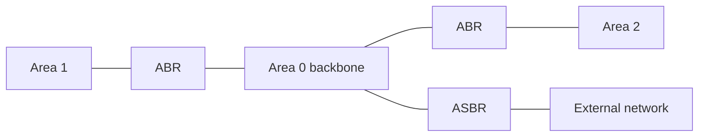
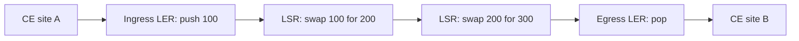

# Routing, Switching and MPLS

## Learning Objectives

After this chapter you should be able to:

1. Separate the control plane from the data plane and say which protocol lives in which.
2. Choose between static and dynamic routing for a given topology and justify the choice.
3. Rank competing routes by administrative distance, then by metric, and predict which one is installed (L4 numerical).
4. Compare RIP, OSPF and BGP on algorithm, scope, metric and convergence, and identify which is intra-AS and which is inter-AS.
5. Compute an OSPF cost from interface bandwidth and pick the lowest-cost path (L4 numerical).
6. Explain OSPF areas, the ABR and ASBR roles, LSA types at awareness level, and the DR/BDR election.
7. Explain BGP autonomous systems, eBGP versus iBGP, and the path attributes that decide best path.
8. Summarise contiguous prefixes and apply longest-prefix-match to a forwarding decision (L4 numerical).
9. Describe MAC learning, flooding and aging, and the difference between collision and broadcast domains.
10. Compute 802.1Q tag arithmetic and explain access versus trunk ports (L4 numerical).
11. Explain STP root election, port roles and states, and why RSTP converges faster.
12. Describe MPLS label stack, LER/LSR/LSP, push-swap-pop, MPLS VPN and MPLS-TP.
13. Distinguish classification, marking, policing, shaping and queuing, and compute DSCP and token-bucket values (L4 numerical).

## Introduction

This block is part of **IP/Data Networks, 15% of the paper, 24 marks**, shared with chapters 1 and 3. Single-mark objective questions, four options, minus 0.25 for a wrong answer.

The questions in this chapter have a different flavour from chapter 1. There is less arithmetic and more **role identification and boundary testing**:

- "Which protocol is used between autonomous systems?" (BGP)
- "Which device learns MAC addresses and floods unknown unicast?" (switch)
- "Which MPLS operation removes a label at the egress?" (pop)
- "Which QoS mechanism delays excess traffic instead of dropping it?" (shaping)

The arithmetic that does appear is short and formulaic: OSPF cost, administrative distance ranking, longest prefix match, summarisation, VLAN tag size, DSCP to ToS byte, token bucket size. Each has a fixed method, so each is a mark you can bank.

Two areas deserve extra care because they are where CSE candidates lose marks. **MPLS** is not taught in most computer science networks courses, and the examiner likes label operations because they are crisp and unambiguous. **QoS** terminology is easy to half-learn: policing and shaping are both "rate limiting" until you know that one drops and the other delays.

The trap in this block is over-confidence. You know Ethernet and you know OSPF from a lab, but the paper asks the textbook definition, not what your lab happened to do. Answer the definition.

## Prerequisites

- Chapter 1: IPv4 addressing, subnetting, longest prefix match, ARP and Ethernet framing.
- The idea that a router forwards per packet and a switch forwards per frame.
- No configuration experience needed; every command mentioned is illustrative only.

## Key Terminology

- **Control plane** - the protocols that build the forwarding table: routing protocols, ARP, STP.
- **Data plane (forwarding plane)** - the per-packet lookup and rewrite that moves traffic, usually in hardware.
- **Administrative distance (AD)** - a local trust rating 0 to 255 for a route source; lower is preferred, and it is compared only between routes to the *same* prefix.
- **Metric** - the cost a routing protocol assigns to a path, compared only within one protocol.
- **Autonomous System (AS)** - a set of networks under one administrative and routing policy, identified by an AS number.
- **LSA (Link State Advertisement)** - the OSPF record describing a router's links and neighbours, flooded within an area.
- **DR / BDR** - Designated Router and Backup Designated Router, elected on a multi-access OSPF segment to reduce adjacencies.
- **Broadcast domain** - the set of ports reached by one broadcast frame; a VLAN is one broadcast domain.
- **STP** - Spanning Tree Protocol (IEEE 802.1D), which blocks redundant links to keep a loop-free layer 2 topology.
- **LSP (Label Switched Path)** - the ordered sequence of label operations a packet follows through an MPLS domain.
- **FEC (Forwarding Equivalence Class)** - the group of packets that share one label and therefore one path.
- **DSCP** - Differentiated Services Code Point, the 6-bit QoS marking in the IP header (RFC 2474).

## Theory

### 1. Routing versus switching, and the two planes

A **switch** forwards a frame using a destination MAC address looked up in a CAM table built by learning. A **router** forwards a packet using a destination IP address looked up in a routing table built by routing protocols and static configuration.

Every network device splits into a **control plane** that decides and a **data plane** that executes. OSPF, BGP, STP, ARP and LDP are control plane. The lookup-and-forward step is data plane, and on modern hardware it runs in an ASIC at line rate. A failure in the control plane does not immediately stop forwarding, because the already-installed table keeps working - which is why "the routing protocol is down but traffic still flows" is a real symptom, not a contradiction.

### 2. Static versus dynamic routing

| Aspect | Static | Dynamic |
|---|---|---|
| Configuration | Manual entry per prefix | Protocol learns and updates |
| Reacts to failure | No, unless a floating static or tracked route exists | Yes, reconverges |
| Overhead | None | CPU, memory, bandwidth for updates |
| Scalability | Small, stable, stub networks | Large, changing networks |
| Security | Only what you typed is advertised | Requires authentication and filtering |
| Predictability | Total | Depends on timers and topology |

Static routes are right for stub networks, default routes to an ISP, and floating statics that stand by as a backup with a deliberately worse AD. Dynamic routing is right when the topology changes faster than a human can edit it.

### 3. Administrative distance and metrics

AD is a Cisco convention (other vendors use "preference") and is **locally significant**: it is never carried in a routing update. Among routes to the same prefix, the lowest AD wins; among routes from the same protocol, the lowest metric wins.

| Route source | Default AD |
|---|---|
| Connected interface | 0 |
| Static route | 1 |
| eBGP | 20 |
| EIGRP (internal) | 90 |
| IGRP | 100 |
| OSPF | 110 |
| IS-IS | 115 |
| RIP | 120 |
| EGP | 140 |
| iBGP | 200 |
| Unusable / unreachable | 255 |

| Protocol | Metric | Meaning |
|---|---|---|
| RIP | Hop count | Routers crossed, 15 maximum |
| OSPF | Cost | Reference bandwidth divided by interface bandwidth |
| EIGRP | Composite | Bandwidth and delay by default, plus load and reliability optionally |
| IS-IS | Cost | Interface cost, wide metrics available |
| BGP | Path attributes | Policy first, AS_PATH length among them |

The critical ordering rule: **longest prefix match happens first, then AD, then metric.** A /24 learned by RIP beats a /16 learned by OSPF for a destination inside the /24, even though OSPF has the better AD, because AD is only consulted between routes to the *same* prefix.

### 4. RIP

RIP is a **distance vector** protocol: each router tells its neighbours what it knows, and knowledge propagates hop by hop.

- Metric is hop count; **15 is the maximum, 16 means unreachable**.
- RIPv1 is classful and broadcasts; RIPv2 is classless, carries the mask, multicasts to 224.0.0.9, and supports MD5 authentication. RIPng does the same for IPv6.
- Runs over **UDP port 520**.
- Timers: update every 30 s, hold-down 180 s, flush 240 s.
- Loop defences: split horizon (do not advertise a route back out of the interface it arrived on), poison reverse (advertise it back with metric 16), triggered updates, and a hop limit.
- Its weakness is slow convergence and **count to infinity**, which the hop limit only bounds rather than solves.

### 5. OSPF

OSPF is a **link state** protocol. Every router floods LSAs describing its own links, each router builds an identical link state database for its area, and each runs Dijkstra's shortest path first to compute a tree.

- IP **protocol number 89**, multicast **224.0.0.5** (all OSPF routers) and **224.0.0.6** (all DR/BDR).
- Hello 10 s and dead interval 40 s on broadcast and point-to-point; 30 s and 120 s on NBMA.
- **Cost = reference bandwidth / interface bandwidth**, integer, minimum 1. Default reference is 100 Mbps, so anything 100 Mbps or faster costs 1 unless the reference is raised.
- **Areas** limit flooding. Area 0 is the backbone; every other area must connect to it. An **ABR** sits on two areas, an **ASBR** redistributes external routes.

| LSA type | Originated by | Carries |
|---|---|---|
| 1 Router | Every router | Its links and neighbours, within an area |
| 2 Network | DR | The multi-access segment and attached routers |
| 3 Summary | ABR | Inter-area prefixes |
| 4 ASBR summary | ABR | Location of the ASBR |
| 5 External | ASBR | Redistributed external prefixes |
| 7 NSSA external | ASBR in an NSSA | External prefixes inside a not-so-stubby area |

**DR and BDR election** happens on multi-access segments so that N routers form 2N adjacencies instead of N(N-1). The winner is the highest interface **priority** (default 1; 0 means never), then the highest **router ID**. The election is not pre-emptive: a new router with a better priority does not displace the existing DR until it fails. Neighbour states run Down, Init, 2-Way, ExStart, Exchange, Loading, Full.

### 6. BGP

BGP is a **path vector** protocol and the only inter-domain routing protocol in operational use. It runs over **TCP 179**, uses 4-byte AS numbers (RFC 6793), and its job is policy, not shortest path.

- **eBGP** runs between routers in different ASes; **iBGP** runs between routers in the same AS and requires either a full mesh or route reflectors.
- **Loop prevention**: a router rejects any update whose AS_PATH already contains its own AS number.
- iBGP does not change NEXT_HOP by default and does not re-advertise routes learned from one iBGP peer to another, which is why a full mesh or reflector is needed.

| Attribute | Type | Effect |
|---|---|---|
| ORIGIN | Well-known mandatory | How the route entered BGP: IGP, EGP, incomplete |
| AS_PATH | Well-known mandatory | ASes traversed; shorter is preferred; also loop detection |
| NEXT_HOP | Well-known mandatory | Address of the next hop into the destination |
| LOCAL_PREF | Well-known discretionary | Local preference, higher wins, iBGP only, not sent to eBGP peers |
| MED | Optional non-transitive | Hint to a neighbouring AS about preferred entry point, lower wins |
| COMMUNITY | Optional transitive | Tags routes for policy grouping |
| ATOMIC_AGGREGATE | Well-known discretionary | Marks a route as summarised |

Cisco best-path order, abbreviated: highest **weight**, then highest **LOCAL_PREF**, then locally originated, then shortest **AS_PATH**, then lowest **ORIGIN** (IGP beats EGP beats incomplete), then lowest **MED**, then eBGP over iBGP, then lowest IGP metric to the next hop, then lowest router ID.

### 7. Longest prefix match and summarisation (L4 numerical)

A forwarding table can hold overlapping prefixes. The router picks the **most specific match**: the longest prefix that contains the destination. A default route 0.0.0.0/0 matches everything and therefore wins only when nothing more specific does.

Summarisation (aggregation) replaces many specific prefixes with one covering prefix, shrinking tables and hiding detail. The rule: convert the differing octet to binary, keep the common leading bits, and require the result to be a valid boundary (the network address must have all summarised bits zero).

Summarisation must not blackhole: if the covering prefix includes addresses that are not actually reachable, traffic to them is dropped. That is why a set of prefixes that is not aligned cannot always be summarised into one entry.

### 8. Switching and MAC learning

A switch builds its CAM (content-addressable memory) table from the **source MAC** of every frame it receives, recording MAC plus port plus VLAN.

- **Known unicast** - destination in the table, forward out that one port.
- **Unknown unicast** - flood out every port in the VLAN except the ingress port.
- **Broadcast and multicast** - flood within the VLAN.
- Entries age out, 300 s by default on many platforms, so a move is relearned.

Switching modes differ in when forwarding starts: **store-and-forward** receives the whole frame and checks the FCS before forwarding (higher latency, drops corrupt frames); **cut-through** forwards after reading the 6-byte destination MAC (lowest latency, forwards corrupt frames); **fragment-free** waits for 64 bytes so that collision fragments are discarded.

A **collision domain** is the set of devices that can collide; a switch port is its own collision domain, a hub is one shared domain. A **broadcast domain** is the set of ports a broadcast reaches; a VLAN defines one, and only a router (or L3 switch) separates two.

### 9. VLANs and 802.1Q (L4 numerical)

A VLAN is a logical LAN implemented on shared hardware. It gives separate broadcast domains, separate policy, and topology independence from physical location.

- **Access port** - belongs to one VLAN, frames leave untagged.
- **Trunk port** - carries many VLANs, frames are tagged with 802.1Q.

The 802.1Q tag is **4 bytes** inserted after the source MAC:

| Field | Size | Meaning |
|---|---|---|
| TPID | 16 bits | 0x8100, marks the frame as tagged |
| PCP | 3 bits | Priority 0 to 7, used by QoS (also called CoS or 802.1p) |
| DEI | 1 bit | Drop eligible indicator |
| VID | 12 bits | VLAN identifier, 0 and 4095 reserved, so 1 to 4094 usable |

A standard Ethernet frame grows from 1518 to **1522 bytes** when tagged; QinQ (802.1ad) adds a second tag for 1526. The **native VLAN** on a trunk is sent untagged, and both ends must agree on it or traffic leaks between VLANs.

Inter-VLAN routing is done by router-on-a-stick (one physical link with 802.1Q subinterfaces) or by an L3 switch with a switched virtual interface per VLAN.

### 10. STP and RSTP

Redundant layer 2 links create broadcast storms, MAC table instability and duplicate frames, because Ethernet has no TTL. **STP (802.1D)** removes the loop logically by blocking ports.

- **Root bridge election**: lowest **bridge ID** wins, where bridge ID = 2-byte priority (default 32768, adjustable in steps of 4096) followed by the 6-byte MAC address.
- Each non-root switch picks one **root port** (lowest cost path to the root). Each segment has one **designated port** forwarding toward the root. Everything else is blocked.
- **Path cost** (802.1D-2004): 10 Mbps 2,000,000; 100 Mbps 200,000; 1 Gbps 20,000; 10 Gbps 2,000.
- **Port states**: blocking, listening (15 s), learning (15 s), forwarding, disabled. Convergence is therefore 30 to 50 s.
- BPDUs are sent every 2 s; max age is 20 s; forward delay is 15 s.

**RSTP (802.1w)** keeps the same election but replaces the states with discarding, learning and forwarding, adds **edge ports** and **alternate/backup roles**, and uses a proposal-agreement handshake, so convergence is typically under a second. Rapid PVST+ and MSTP are the common deployments. **BPDU guard** disables an edge port that receives a BPDU, preventing a rogue switch from becoming root.

### 11. Link aggregation

Link aggregation (IEEE 802.3ad, now 802.1AX) bundles several physical links into one logical link, with **LACP** negotiating the bundle.

- Increases aggregate bandwidth and provides link redundancy with sub-second failover.
- One flow never exceeds one member link's speed, because hashing pins a flow to a member.
- All members must have the same speed, duplex and VLAN configuration.

### 12. MPLS

MPLS forwards on a **label** instead of an IP lookup. A label is a fixed 32-bit shim header:

| Field | Size | Meaning |
|---|---|---|
| Label | 20 bits | 0 to 1,048,575; values 0 to 15 are reserved |
| TC (EXP) | 3 bits | Traffic class, QoS |
| S | 1 bit | Bottom of stack, 1 means last label |
| TTL | 8 bits | Copied from the IP TTL and decremented per hop |

Roles: a **LER** (label edge router) sits at the edge and pushes or pops; an **LSR** in the core swaps; a **CE** is the customer edge router; a **PE** is the provider edge. A **FEC** is the set of packets that get the same label, usually a destination prefix.

Three label operations, and the exam asks them directly:

- **Push** - add a label at the ingress LER.
- **Swap** - replace the incoming label with the outgoing one at each LSR.
- **Pop** - remove the label at the egress. **Penultimate hop popping (PHP)** lets the second-to-last router pop so the last router does a plain IP lookup, saving one operation.

Labels are distributed by **LDP** (TCP/UDP 646) or by **RSVP-TE** for traffic engineering. **MPLS VPN** (RFC 4364) builds per-customer **VRFs** on the PE, separates customers with a **route distinguisher** (RD, 8 bytes, making otherwise identical prefixes unique) and controls import/export with **route targets** (RT). **MPLS-TP** is the transport profile: statically provisioned, OAM-rich, protection-switching oriented, and independent of IP routing protocols.

MPLS adds 4 bytes per label, so a 1500-byte packet becomes 1504 with one label and 1512 with three.

### 13. QoS: classification and marking

QoS exists because bandwidth, buffer and delay are finite, and because voice and video cannot tolerate what file transfer ignores. The pipeline is classify, mark, police or shape, queue, and drop or schedule.

- **Classification** identifies traffic: by ACL, by port, by DSCP, by NBAR/deep inspection, or by VLAN CoS.
- **Marking** writes the class into the header so downstream devices need not re-classify. Layer 3 uses **DSCP (6 bits)**; Layer 2 uses **CoS/PCP (3 bits)**.
- The **trust boundary** is the point where markings become trusted; typically the access switch port or the WAN edge.

DSCP occupies the top 6 bits of the former ToS byte, so ToS = DSCP x 4. The **IP precedence** field it replaced was 3 bits.

| DSCP name | Value | Typical use |
|---|---|---|
| Default (BE) | 0 | Best effort |
| CS6 | 48 | Network control |
| EF | 46 | Voice bearer, low loss low delay |
| AF41 | 34 | Interactive video, class 4 drop 1 |
| AF31 | 26 | Call signalling |
| AF11 | 10 | Bulk data, class 1 drop 1 |

AF names encode class and drop precedence: AFxy has DSCP 8x + 2y.

### 14. QoS: policing, shaping, queuing and dropping

| Aspect | Policing | Shaping |
|---|---|---|
| Action on excess | Drop, or remark down | Buffer and delay |
| Buffer needed | None | Yes, and it costs memory and delay |
| Effect on traffic | Immediate loss | Smooths the rate, no loss until buffer fills |
| Typical placement | Ingress of a provider, to enforce a contract | Egress toward a slower link |
| Token bucket | Single or dual bucket | Single or dual bucket, with a queue |

Both use a token bucket: tokens accrue at the **committed information rate (CIR)**; a burst of **Bc** bytes may pass per interval **Tc**; **Bc = CIR x Tc**.

**Queuing** decides which packet leaves next when the interface is busy: FIFO (no QoS), priority queuing (strict, starves others), WFQ (fair per flow), CBWFQ (class-based weights), and **LLQ** (low latency queuing, a strict priority class inside CBWFQ, the standard home for voice).

**Congestion avoidance** decides what to drop before the queue is full: tail drop (drop everything new when full) versus **WRED** (drop probabilistically, earlier for higher drop precedence), which avoids global synchronisation.

## Worked Examples

### Example 1 - OSPF cost and path selection (L4 numerical)

**Question.** Reference bandwidth is the default 100 Mbps. Path A is R1 to R2 over 100 Mbps, then R2 to R3 over 10 Mbps. Path B is R1 to R4 and R4 to R3, both 1 Gbps. Which path is installed?

**Step 1 - formula.** Cost = reference bandwidth / interface bandwidth, truncated to an integer, minimum 1.

**Step 2 - path A.** 100 / 100 = 1, and 100 / 10 = 10. Total = 11.
**Step 3 - path B.** 100 / 1000 = 0.1, which truncates to 0 and is raised to the minimum of 1. Total = 1 + 1 = 2.
**Step 4 - decision.** Path B wins with cost 2 versus 11.

**Step 5 - raise the reference.** With `auto-cost reference-bandwidth 10000` (10 Gbps): 100 Mbps costs 100, 1 Gbps costs 10, 10 Mbps costs 1000. Path A = 1100, path B = 20, so the answer does not change but the numbers now distinguish fast links. This is exactly why operators raise the reference on all routers at once - a mixed setting produces inconsistent costs.

### Example 2 - Administrative distance ranking (L4 numerical)

**Question.** A router has four routes to 10.1.1.0/24: static (AD 1), eBGP (AD 20), OSPF (AD 110), RIP (AD 120). Which is installed, and what happens if the static is removed?

**Step 1.** All four are the same prefix, so AD decides: the lowest is static at 1.
**Step 2.** The static route is installed and the others are held as backups in the table, not used.
**Step 3.** Remove the static: eBGP at 20 becomes best.
**Step 4.** If eBGP also fails, OSPF at 110, then RIP at 120.

**Step 5 - the trap.** AD is local. The static route's AD of 1 is not advertised anywhere; a neighbour may prefer a different path entirely. Never reason about AD across routers.

### Example 3 - Longest prefix match (L4 numerical)

**Question.** A packet is destined for 10.1.2.3. The table holds 0.0.0.0/0 (static, AD 1), 10.0.0.0/8 (OSPF, AD 110), 10.1.0.0/16 (RIP, AD 120) and 10.1.2.0/24 (RIP, AD 120). Which route is used?

**Step 1.** Test each prefix for containment. All four contain 10.1.2.3.
**Step 2.** Apply longest prefix match: /24 is longer than /16, /8 and /0.
**Step 3.** Install 10.1.2.0/24, the RIP route, even though it has the worst AD of the specific candidates.

**Step 4 - the rule.** Specificity beats trust. AD is consulted only among routes to an identical prefix, and a default route is the last resort by definition, not by AD.

### Example 4 - Summarisation, aligned and unaligned (L4 numerical)

**Question (a).** Summarise 172.16.0.0/24, 172.16.1.0/24, 172.16.2.0/24 and 172.16.3.0/24.

**Step 1.** Third octet: 0 = 00000000, 1 = 00000001, 2 = 00000010, 3 = 00000011.
**Step 2.** They differ in the last two bits only, so 6 bits of the third octet are common and the prefix is 8 + 8 + 6 = /22.
**Step 3.** 172.16.0.0 is a valid /22 boundary (third octet divisible by 4), so the summary is 172.16.0.0/22, covering 172.16.0.0 to 172.16.3.255.

**Question (b).** Summarise 10.1.4.0/24, 10.1.5.0/24 and 10.1.6.0/24.

**Step 1.** Third octet: 4 = 00000100, 5 = 00000101, 6 = 00000110, 7 = 00000111.
**Step 2.** 4 and 5 share 7 bits, so they summarise to 10.1.4.0/23.
**Step 3.** Adding 6 forces the common prefix down to 6 bits, which is 10.1.4.0/22 - but that also covers 10.1.7.0/24, which is not in the list.
**Step 4 - decision.** Use 10.1.4.0/23 plus 10.1.6.0/24, two entries, unless 10.1.7.0/24 is genuinely allocated and reachable, in which case 10.1.4.0/22 is safe. Summarising over unallocated space blackholes traffic.

### Example 5 - 802.1Q tag arithmetic (L4 numerical)

**Question.** A 1518-byte Ethernet frame carries VLAN 100 with PCP 5 on a trunk. Give the tagged frame size, the tag bytes and the maximum number of VLANs.

**Step 1 - size.** The tag is 4 bytes, so 1518 + 4 = 1522 bytes. With QinQ, 1526.
**Step 2 - VID range.** 12 bits give 4096 values; VID 0 (priority tagging) and 4095 (reserved) are excluded, so **4094 usable VLANs**.
**Step 3 - TCI.** PCP 5 = 101 binary in the top 3 bits, so 5 x 4096 = 20480 = 0xA000. DEI 0 adds nothing. VID 100 = 0x064.
**Step 4 - tag.** TCI = 0xA000 + 0x064 = 0xA064, and the full tag is 0x8100A064 (TPID then TCI).

**Step 5 - check.** 0xA064 = 41060 decimal. Divide by 4096: 10 remainder 100. PCP 5 shifted left by 13 is 0xA000, which matches 10 x 4096 = 40960. Consistent.

### Example 6 - DSCP and token bucket (L4 numerical)

**Question (a).** What ToS byte values correspond to DSCP 46 (EF), 34 (AF41) and 48 (CS6)?

**Step 1.** ToS = DSCP x 4, because DSCP occupies the 6 most significant bits.
**Step 2.** 46 x 4 = 184 = 0xB8. 34 x 4 = 136 = 0x88. 48 x 4 = 192 = 0xC0.

**Question (b).** A policer enforces CIR 10 Mbps with Tc = 125 ms. What is Bc, and what happens to a 200,000-byte burst in one interval?

**Step 1.** Bc = CIR x Tc = 10,000,000 bits/s x 0.125 s = 1,250,000 bits.
**Step 2.** In bytes: 1,250,000 / 8 = 156,250 bytes.
**Step 3.** Burst 200,000 bytes exceeds Bc by 200,000 - 156,250 = 43,750 bytes.
**Step 4.** A policer drops or remarks those 43,750 bytes; a shaper of the same rate would queue them and release them in later intervals.

### Example 7 - MPLS label arithmetic (L4 numerical)

**Question.** A packet of 1500 bytes traverses an LSP with three labels on the stack at the ingress, and four hops (ingress LER, two LSRs, egress LER). Give the label range, the on-wire size, and the number of label operations.

**Step 1 - label space.** 20 bits give 2^20 = 1,048,576 values, 0 to 1,048,575; 0 to 15 are reserved, so 1,048,560 are assignable by LDP/RSVP.
**Step 2 - size.** 4 bytes per label: 1500 + 12 = 1512 bytes at the ingress, which exceeds a 1500-byte MTU and requires either a larger MTU or fragmentation.
**Step 3 - operations.** Push at the ingress, swap at each of the two LSRs, pop at the egress: 1 + 2 + 1 = 4 operations.
**Step 4 - PHP variant.** If the penultimate LSR pops, the egress receives a plain IP packet and performs no label operation, so the egress does an IP lookup instead.

## Exam Traps and Common Mistakes

**Trap 1 - Applying AD before longest prefix match.** Specificity wins first. A /24 from RIP beats a /16 from OSPF; AD only breaks ties between identical prefixes.

**Trap 2 - Thinking AD is propagated.** Administrative distance is local to one router. It never appears in an update, so comparing ADs across two routers is meaningless.

**Trap 3 - Saying RIP's maximum metric is 16.** The maximum usable metric is 15; 16 is the value that means infinity, that is, unreachable.

**Trap 4 - Calling OSPF a distance vector protocol.** OSPF is link state and runs Dijkstra. Distance vector is RIP, IGRP and EIGRP's origin; BGP is path vector.

**Trap 5 - Believing the DR election is pre-emptive.** A router with a higher priority that joins later does not take over; the existing DR keeps the role until it fails or OSPF is restarted.

**Trap 6 - Forgetting that iBGP needs a full mesh or reflectors.** iBGP does not re-advertise routes learned from one iBGP peer to another, so a partial mesh leaves unreachable prefixes.

**Trap 7 - Swapping policing and shaping.** Policing drops or remarks excess immediately; shaping buffers and delays it. If the option says "delays", it is shaping.

**Trap 8 - Saying a VLAN tag is 3 bytes or that 4096 VLANs are usable.** The tag is 4 bytes and the usable range is 1 to 4094, because 0 and 4095 are reserved.

**Trap 9 - Counting the tagged frame as 1514 bytes.** The FCS is included in the 1518-byte maximum; adding a tag gives 1522, not 1518.

**Trap 10 - Describing MPLS as encryption or as a routing protocol.** MPLS is a forwarding mechanism using labels; it is neither encrypted nor a routing protocol. Labels are distributed by LDP or RSVP-TE, and routing is still done by OSPF or BGP underneath.

**Trap 11 - Assuming STP converges in a second.** Classic 802.1D takes 30 to 50 s; only RSTP converges in the sub-second range.

## Summary

- Switch forwards on MAC, router forwards on IP; control plane builds the table, data plane uses it.
- AD ranks route sources locally; metric ranks paths within one protocol; longest prefix match is applied first.
- RIP is distance vector over UDP 520, hop count 15 maximum, 16 unreachable, slow to converge.
- OSPF is link state over IP protocol 89, cost = reference bandwidth / bandwidth, areas limit flooding, DR/BDR cut adjacencies.
- BGP is path vector over TCP 179, uses AS_PATH for loop prevention and policy attributes such as LOCAL_PREF and MED for selection.
- Summarisation keeps common leading bits; over-summarising unallocated space blackholes traffic.
- A switch learns source MACs, floods unknown unicast, and ages entries; a VLAN is a broadcast domain.
- 802.1Q adds a 4-byte tag, taking a frame from 1518 to 1522 bytes, with 4094 usable VLANs.
- STP blocks redundant ports after electing the lowest bridge ID as root; RSTP converges far faster with three states.
- Link aggregation bundles links for capacity and redundancy but never speeds up a single flow beyond one member.
- MPLS forwards on a 32-bit label (20 label, 3 TC, 1 S, 8 TTL) with push, swap and pop; VPNs use VRF, RD and RT.
- QoS classifies, marks (DSCP 6 bits, CoS 3 bits), polices or shapes, then queues; LLQ carries voice, WRED avoids tail-drop synchronisation.

## Practical Takeaways

- Learn the AD table as a single ordered list; most AD questions are answered by reciting it.
- Remember one formula for OSPF cost and one fact about the reference bandwidth: raising it is required on every router at once.
- For any "which route is used" question, sort by prefix length first, then by AD, then by metric - in that order, every time.
- When summarising, always check the boundary: if the network address is not a multiple of the block size, the summary is invalid.
- Keep the three MPLS operations in order of the path: push at ingress, swap in the core, pop at egress; PHP moves the pop one hop early.
- Memorise policing versus shaping as one sentence: "policing drops now, shaping waits".
- Know the four DSCP numbers you will actually be asked: 0 default, 46 EF voice, 34 AF41 video, 48 CS6 control.

## Chapter Quiz

**Q1.** Which protocol is used to exchange routing information between autonomous systems?

(a) OSPF (b) RIP (c) BGP (d) IS-IS

**Answer: (c).** BGP is the inter-domain path vector protocol; OSPF and IS-IS are intra-domain and RIP is a small intra-domain distance vector protocol.

**Q2.** A router has an OSPF route (AD 110) and a static route (AD 1) to the same /24 prefix. Which is installed?

(a) OSPF, because it is dynamic (b) Static, because AD is lower (c) Both, load balanced (d) Neither until a tie-break

**Answer: (b).** For identical prefixes the lowest administrative distance wins, and 1 is lower than 110.

**Q3.** With the default reference bandwidth of 100 Mbps, what is the OSPF cost of a 10 Mbps interface?

(a) 1 (b) 10 (c) 100 (d) 1000

**Answer: (b).** Cost = 100 / 10 = 10. A 1 Gbps interface would cost 1 after the minimum-value rule.

**Q4.** Which MPLS operation is performed by a core LSR?

(a) Push (b) Swap (c) Pop (d) Encrypt

**Answer: (b).** The ingress LER pushes, core LSRs swap the incoming label for the outgoing one, and the egress pops.

**Q5.** Which QoS mechanism buffers excess traffic rather than dropping it?

(a) Policing (b) Shaping (c) Tail drop (d) WRED

**Answer: (b).** Shaping queues the excess and releases it later, adding delay instead of loss; policing drops or remarks immediately.

## Exercises

**E1 (numerical).** Reference bandwidth 100 Mbps. Path A: 1 Gbps then 100 Mbps. Path B: 10 Mbps then 10 Mbps then 100 Mbps. Compute both costs and state which path OSPF installs.

*Expected answer:* Path A = 1 + 1 = 2; Path B = 10 + 10 + 1 = 21. Path A is installed.

**E2 (numerical).** A router holds these routes to 192.168.7.0/24: RIP (AD 120, 2 hops), OSPF (AD 110, cost 30), iBGP (AD 200, AS_PATH 3), static (AD 1). Rank them and state what is installed after the static is withdrawn.

*Expected answer:* static, OSPF, RIP, iBGP. After withdrawal OSPF is installed, then RIP, then iBGP.

**E3 (numerical).** Destination 172.16.9.5. Table: 172.16.0.0/16 via OSPF, 172.16.9.0/24 via RIP, 0.0.0.0/0 via static. Which is used and why?

*Expected answer:* 172.16.9.0/24 via RIP, because longest prefix match is applied before administrative distance.

**E4 (numerical).** Summarise 192.168.20.0/24, 192.168.21.0/24, 192.168.22.0/24 and 192.168.23.0/24. Then state whether 192.168.20.0/24 through 192.168.22.0/24 can form one prefix.

*Expected answer:* The first set gives 192.168.20.0/22 (20 is divisible by 4, a valid boundary). The second set cannot: 20, 21 and 22 need a /22 that would also cover 23, so use 192.168.20.0/23 plus 192.168.22.0/24.

**E5 (numerical).** A trunk carries VLAN 200 with PCP 6. Give the frame size for a 1518-byte untagged frame, the TCI value and the full 4-byte tag.

*Expected answer:* 1522 bytes; TCI = 6 x 4096 + 200 = 24776 = 0x60C8; tag = 0x810060C8.

**E6 (numerical).** A shaper is configured with CIR 20 Mbps and Tc 10 ms. Compute Bc in bits and bytes, and state how much of a 40,000-byte burst is delayed.

*Expected answer:* Bc = 20,000,000 x 0.010 = 200,000 bits = 25,000 bytes; 40,000 - 25,000 = 15,000 bytes are queued and released later.

**E7.** Three switches have bridge IDs 32768:AA, 4096:BB and 32768:CC. Which becomes root, and what happens if 8192:DD joins later?

*Expected answer:* 4096:BB becomes root, because 4096 is the lowest priority. 8192:DD does not take over, because STP election is not pre-emptive; it becomes root only if the current root fails.

**E8.** Explain why an MPLS LSP with three labels on a 1500-byte MTU link can drop traffic, and give two remedies.

*Expected answer:* Three labels add 12 bytes, so the packet becomes 1512 bytes and exceeds the 1500-byte MTU. Remedies: raise the MTU on the path (jumbo frames), or reduce the IP MTU/MSS so the encapsulated packet fits.

## Next

Chapter 3 secures the network you have just built: firewalls, IDS and IPS, IPsec and TLS, identity and AAA, and the caching and CDN layer that sits in front of the servers.
