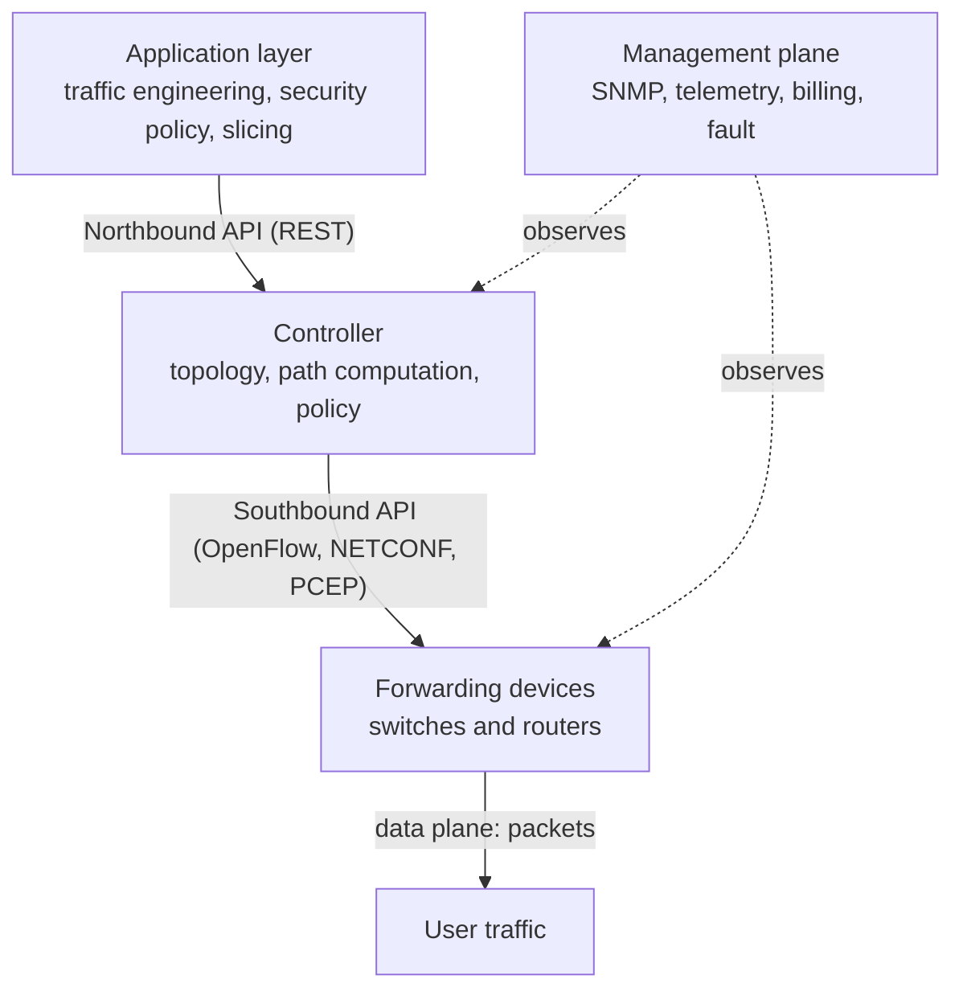
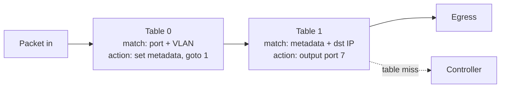
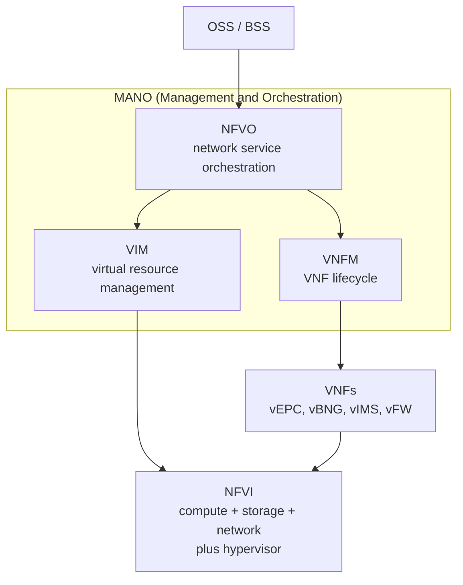
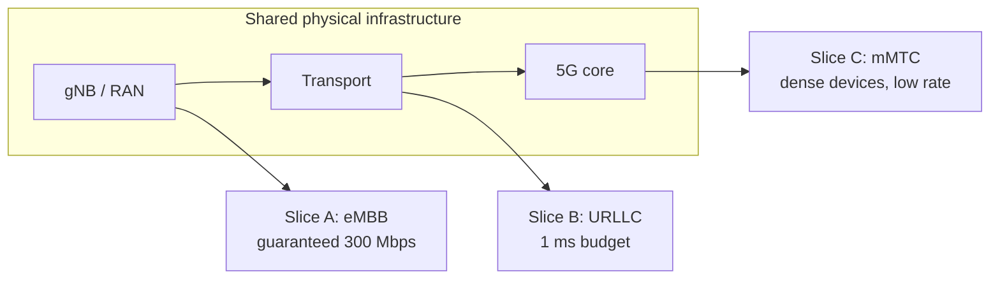

# ch05 - SDN, NFV, Slicing, Blockchain and AI

## Learning Objectives

After this chapter you will be able to:

1. Name the three planes of a network and say exactly what SDN centralises and what it does not.
2. Explain the OpenFlow match-action model and trace a packet through a two-table pipeline.
3. Separate southbound from northbound APIs and place a controller, an orchestrator and an application correctly.
4. Draw the ETSI NFV framework (NFVI, VNF, MANO with NFVO, VNFM and VIM) and assign a named function to each block.
5. Describe the VNF lifecycle from onboarding to scaling to termination, and state which MANO component owns each step.
6. Compare SDN and NFV on five axes, and explain why they are complementary rather than competing.
7. Define a network slice by its isolation dimensions and compute whether a given slice mix fits a given cell.
8. Explain hash chaining, why a distributed ledger resists tampering, and how PoW and PoS differ.
9. Separate the four telecom AI use cases that genuinely ship from the marketing claims around them.
10. Solve the numerical families this chapter generates: consolidation ratio, container density, latency budget, slice capacity and ledger growth.

## Introduction

Emerging Technologies is a 15 percent block, about 24 questions on a 200-question paper, and ch04 covers roughly half of it. This chapter covers the other half: the operational technologies (SDN, NFV, slicing) and the two headline technologies the syllabus names explicitly (blockchain and AI).

For a Computer Science graduate this is the second-best block on the paper per hour spent, after IP networks. The reasons are the same ones that make ch04 fast: almost everything is *architecture and comparison*, answerable in 20 seconds once the tables are in your head, and the arithmetic is multiplication and division.

There is one important warning. This is the block where exam setters and marketing departments use the same words to mean different things.

- "Software defined" in a vendor brochure often means "we added a REST API". In the exam it means a separated control plane with centralised decision-making.
- "Network slicing" in a press release often means "a VLAN with a nice name". In the exam it means end-to-end resource and isolation guarantees across RAN, transport and core.
- "AI-powered network" in a keynote means almost nothing. In the exam it means a named technique applied to a named problem, such as forecasting, classification or anomaly detection.

So this chapter is built the way the paper asks: planes, blocks, interfaces, lifecycles and tables. Get those right and this chapter plus ch04 returns 14 to 18 marks. Get them fuzzy and you will lose marks to plausible-sounding distractors, which is exactly how this block is designed.

## Prerequisites

- OSI and TCP/IP layering, and the idea of a forwarding table (ch01).
- Routing versus switching, and the control-plane versus data-plane split (ch02). If that split is not automatic for you, re-read ch02 section 1 before continuing.
- Cloud service models and virtualisation (ch04). NFV is virtualisation applied to network functions, so the hypervisor material is a prerequisite, not a parallel topic.
- Basic probability and percentages for the AI section, and hashing at the level of "a fixed-length fingerprint of any input".

## Key Terminology

- **Data plane (forwarding plane):** the function that moves a packet from an ingress port to an egress port, at line rate, per packet.
- **Control plane:** the function that decides *where* packets should go: routing protocols, path computation, policy. It is the brain, not the muscle.
- **Management plane:** the function that configures, monitors and bills the device. It is not the control plane, and conflating them is the most common SDN error in exams.
- **Southbound API:** the interface between a controller and the forwarding devices it programs (for example OpenFlow).
- **Northbound API:** the interface between a controller and the applications or orchestrators above it (usually REST).
- **Flow table:** an ordered set of match-action rules installed in a switch; a packet is matched against them and the first match wins.
- **NFV:** Network Functions Virtualisation, the decoupling of a network function (firewall, EPC, BNG, IMS core) from dedicated hardware so it runs as software on commodity servers.
- **VNF:** Virtual Network Function, the software implementation of one network function.
- **NFVI:** NFV Infrastructure, the compute, storage and network pool plus the virtualisation layer that hosts VNFs.
- **MANO:** Management and Orchestration, the ETSI framework that onboards, deploys, scales and heals VNFs.
- **Network slice:** an end-to-end logical network with its own resources, topology, QoS and management, running on a shared physical infrastructure.
- **Distributed ledger:** a replicated, append-only record kept by many parties, where agreement on the next entry requires consensus rather than a central authority.

## Theory

### 1. Why SDN exists

A traditional router does three jobs in one box: it discovers topology (control), it computes paths (control), and it forwards packets (data). This works, and it has one structural consequence: **every forwarding decision is local, and no device has a global view.**

Three problems follow, and each is an exam question in disguise.

| Problem | What it looks like in practice | What SDN changes |
|---|---|---|
| Per-device configuration | 400 routers, 400 CLI sessions, 400 chances for a typo | One controller, one policy, pushed down |
| Slow convergence of policy | A new traffic-engineering rule takes a maintenance window | Controller recomputes and installs flows in seconds |
| Vendor lock-in | Each vendor's control plane has its own features | Forwarding is standardised; the brain is software you can replace |

The core idea is a single sentence you should be able to write from memory: **SDN separates the control plane from the data plane and centralises the control plane in software, so the network is programmed through an interface instead of configured device by device.**

### 2. The three planes, drawn



Three things in that diagram are worth memorising as exam facts.

1. The **northbound API is abstract and application-facing**; it is not standardised by a single body in the way OpenFlow is.
2. The **southbound API is device-facing** and OpenFlow is its most-quoted example.
3. The **management plane is still separate**. SDN does not merge management into control; a controller that also polls SNMP counters is doing two jobs, and the exam may test whether you know they are distinct.

### 3. OpenFlow and the match-action model

OpenFlow's contribution is not "a protocol"; it is a **standardised flow table**. A switch holds one or more tables, each with rules of the form:

```
match(fields) -> action
```

| Match field (examples) | Action (examples) |
|---|---|
| Ingress port | Forward to port N |
| Ethernet source/destination | Drop |
| VLAN id | Send to controller |
| IPv4 source/destination | Modify field (rewrite VLAN, decrement TTL) |
| TCP/UDP ports | Enqueue to a specific queue (QoS) |
| MPLS label | Group action (multicast, ECMP) |

Two rules govern behaviour, and both are frequently examined:

1. **First match wins.** Tables are ordered by priority; the packet takes the highest-priority matching rule.
2. **Table miss has a defined behaviour**, usually "send to controller" or "drop". The choice is a policy decision, and it is where a badly designed SDN network melts its controller.

A two-table pipeline, traced:



**Why this matters for the exam:** the difference between "the switch decides" and "the controller decides" is the whole point of SDN, and the flow table is the mechanism. If a question says "the switch forwards using locally computed routes", it is describing a traditional router, not an SDN switch.

### 4. Controllers and APIs

| Item | Role | Examples |
|---|---|---|
| Controller | Maintains global topology, computes paths, installs flows | ONOS, OpenDaylight, Ryu, Floodlight |
| Southbound protocol | Controller to device | OpenFlow, NETCONF/YANG, PCEP, gNMI |
| Northbound API | Controller to application | REST/JSON, often proprietary |
| Application | The intent: TE, firewall, slice manager | Written by the operator or a vendor |

**Controller placement is a real design question**, not a detail. A single controller is a single point of failure and a latency bottleneck; a cluster needs a distributed data store and a leader election. That is why production controllers are clusters (ONOS was designed as a distributed system from the start) and why "the controller is centralised" means *logically* centralised, not physically single.

### 5. Where SDN actually landed

Full SDN, with every switch speaking OpenFlow to one brain, is rare in operator networks. What did land is narrower and more useful:

| Deployment form | What is centralised | Typical use |
|---|---|---|
| Data-centre SDN | Fabric control, overlay tunnels | VM mobility, multi-tenancy |
| SD-WAN | Path selection across WAN links | Branch traffic steering, policy by application |
| Segment routing | Path expressed as a label or SID stack | Traffic engineering without per-flow state |
| Transport SDN | Path computation over optical layer | Bandwidth on demand, restoration |

**SD-WAN in one line:** the control plane picks the best path per application across multiple WAN transports (MPLS, broadband, LTE), using live quality measurements instead of static routing. That sentence answers most SD-WAN questions.

### 6. NFV: the ETSI framework

NFV asks a different question from SDN. SDN asks *who decides where packets go*. NFV asks *what hardware the function runs on*.

The ETSI NFV architectural framework has three blocks and one orchestrator.



| Block | Owns | Answers the question |
|---|---|---|
| **NFVI** | The resource pool and the virtualisation layer | "What can a VNF run on?" |
| **VNF** | One network function as software | "What is the function itself?" |
| **NFVO** | Network services made of several VNFs | "How do VNFs combine into a service?" |
| **VNFM** | One VNF's lifecycle | "How does this VNF start, scale and heal?" |
| **VIM** | Virtual resources | "Which host, which network, which volume?" |

The distinction between NFVO and VNFM is the single most examinable point in NFV. **NFVO thinks in services; VNFM thinks in one VNF.** A question that says "which entity decides that a firewall VNF needs two more instances" is answered by VNFM for the instance count and NFVO for whether the service still meets its SLA.

### 7. VNF lifecycle

| Stage | What happens | Owner |
|---|---|---|
| Onboarding | VNF package (image + descriptor) loaded into the catalogue | NFVO |
| Instantiation | Resources requested and VNF brought up | VNFM with VIM |
| Configuration | Day-1 parameters applied | VNFM |
| Scaling | Scale out or in, horizontally or vertically | VNFM, triggered by NFVO policy |
| Healing | Failed instance replaced or restarted | VNFM |
| Migration | Instance moved to another host | VIM |
| Termination | Resources released | VNFM |

**Two exam traps live here.** First, *scaling out* means more instances; *scaling up* means a bigger instance. Second, the **VNF descriptor (VNFD)** is the machine-readable definition of the VNF, and it is not the same thing as the image.

### 8. SDN versus NFV

| Axis | SDN | NFV |
|---|---|---|
| Question answered | Where do packets go, and who decides | What hardware does the function run on |
| Main change | Control and data plane separation | Software and hardware decoupling |
| Unit | Flow, path, policy | VNF, network service |
| Key standard body | ONF (OpenFlow) | ETSI (NFV ISG) |
| Typical benefit | Programmability, global view | Cost, elasticity, faster rollout |
| Typical risk | Controller failure, scale of state | Performance loss, operational complexity |

They are complementary: a VNF still needs to be connected, and SDN is a good way to connect it. A service chain of vFW -> vDPI -> vBNG is NFV; steering traffic through that chain with flow rules is SDN.

### 9. Network slicing

A slice is an end-to-end logical network on shared infrastructure, with guarantees. The guarantees come from **isolation in four dimensions**:

| Dimension | What is isolated | Mechanism |
|---|---|---|
| Radio | PRBs, time slots, beams | RAN slicing, scheduler policy |
| Transport | Bandwidth, queues, paths | VLAN, MPLS, segment routing, FlexE |
| Core | Compute, sessions, addresses | Separate UPF/AMF instances or shared with policy |
| Management | FCAPS per slice | Slice manager, SLA monitoring |

**Slicing is not VLANs.** A VLAN separates traffic; a slice guarantees a service level and is *managed* as a product. The exam distinction: VLAN = isolation primitive, slice = isolation plus SLA plus lifecycle.



Slice-as-a-service means the operator exposes slice creation to an enterprise with an SLA, and the enterprise does not see the underlying network. That is a commercial model, not a new protocol.

### 10. Blockchain

Blockchain is a **distributed ledger with hash chaining and consensus**. Break it into four claims, because exam distractors attack them one at a time.

1. **Hash chaining.** Each block contains the hash of the previous block. Change one transaction in block 100 and its hash changes, so block 101's stored parent hash no longer matches, and so on to the head. Tampering is *detectable*, not impossible.
2. **Replication.** Many nodes hold the chain. A single node cannot rewrite history alone.
3. **Consensus.** Nodes agree on the next block by a rule: proof of work (spend computation), proof of stake (lock economic value), or a permissioned protocol such as PBFT-style voting.
4. **Smart contracts.** Code stored on the chain that executes deterministically when a transaction calls it. It is a program with the ledger as its state.

| Property | Public (permissionless) | Permissioned (consortium) |
|---|---|---|
| Who can read | Anyone | Invited parties |
| Who can write | Anyone who pays the cost | Authorised nodes |
| Consensus | PoW or PoS | Voting, PBFT-style, RAFT variants |
| Throughput | Low to moderate | Higher |
| Identity | Pseudonymous | Known and accountable |
| Typical telecom use | Rare | Roaming settlement, SLA, supply chain |

**The telecom reality check:** operators do not need a public chain. They need a shared, auditable record between a small number of known parties (operators, clearing houses, vendors). That is a *permissioned* ledger, and any exam question that pairs "telecom operator" with "anonymous public mining" is a distractor.

### 11. AI and ML in telecom operations

The syllabus phrase is usually "AI/ML applications in telecom". Answer it as a table of problem, technique and evidence, not as enthusiasm.

| Use case | Technique class | What it actually improves | Honest limit |
|---|---|---|---|
| Predictive maintenance | Regression, survival analysis | Fewer site visits, earlier alarm correlation | Needs labelled failure history |
| Self-organising networks (SON) | Rule-based plus optimisation | Coverage and capacity tuning, handover parameters | Rules still dominate; ML tunes them |
| Traffic forecasting | Time-series models | Capacity planning, energy saving windows | Accuracy degrades at behaviour change |
| Churn prediction | Classification | Retention targeting | Correlation is not causation |
| Anomaly detection | Unsupervised, autoencoders | Fault and intrusion detection | False positives cost operator time |
| Energy saving | Optimisation plus forecasting | Sleep modes, cell switch-off | Coverage trade-off |
| AIOps | Clustering, correlation | Alarm noise reduction, root cause hints | Root cause still needs an engineer |

Two sentences worth carrying into the exam:

- **AI in telecom is mostly supervised learning on network telemetry, applied to forecasting, classification and anomaly detection.** It is not autonomy.
- **The bottleneck is labelled data and trust, not model choice.** A model that cannot explain itself does not get to change a live network.

### 12. The numerical families in this block (L4 numerical)

Five families generate almost every calculation this block can ask.

| Family | Formula | Typical question |
|---|---|---|
| Consolidation ratio | (physical cores x utilisation) / (vCPU per function x functions) | How many servers replace 24 appliances |
| Container density | usable memory / (image + app memory) | Containers per host versus VMs per host |
| Latency budget | sum of segment latencies against the slice target | Is MEC required |
| Slice capacity | cell capacity x guaranteed share, minus headroom | Does the slice mix fit |
| Ledger growth | blocks per year x block size | Storage per year |

## Worked Examples

### Example 1 - NFV consolidation (L4 numerical)

A regional site runs 24 single-purpose appliances. Each appliance is specified as 2 physical cores and 8 GB of RAM, and the average utilisation is 15 percent. The operator will replace them with VNFs on servers of 32 cores and 256 GB of RAM, keeping **N+1 redundancy**, a CPU design limit of 70 percent and a memory design limit of 80 percent.

**Step 1 - reserved capacity, not average.** Virtual machines reserve their allocation, so the design must cover the full request, not the 15 percent average.

```
required vCPU  = 24 x 2      = 48 vCPU
required RAM   = 24 x 8 GB   = 192 GB
```

**Step 2 - apply the design limits.**

```
CPU-limited servers = 48 / (32 x 0.70) = 48 / 22.4  = 2.14 -> 3 servers
RAM-limited servers = 192 / (256 x 0.80) = 192 / 204.8 = 0.94 -> 1 server
```

The binding constraint is CPU: 3 servers.

**Step 3 - add N+1.**

```
3 + 1 = 4 servers
```

**Answer: 4 servers**, a consolidation ratio of 24 appliances to 4 servers, or 6 to 1.

**Note on the 15 percent.** That number is the reason NFV pays: the hardware is idle most of the time, and pooling removes the idleness. But it does *not* let you size at 15 percent, because a VNF reserves what it is given. Sizing at average utilisation is the classic over-commit mistake and it produces a network that collapses at peak.

### Example 2 - Container density versus VM density (L4 numerical)

A host has 64 GB of RAM with 8 GB reserved for the operating system and system services. Each application needs 200 MB of RAM. A virtual machine costs 512 MB of hypervisor and guest-OS overhead; a container costs 20 MB of runtime overhead.

**Step 1 - usable memory.**

```
usable = 64 GB - 8 GB = 56 GB = 56 x 1024 MB = 57,344 MB
```

**Step 2 - per-instance cost.**

```
VM:        200 + 512 = 712 MB
Container: 200 + 20  = 220 MB
```

**Step 3 - density.**

```
VMs        = 57,344 / 712 = 80.5  -> 80 instances
Containers = 57,344 / 220 = 260.6 -> 260 instances
```

**Step 4 - ratio.**

```
260 / 80 = 3.25x
```

**Answer: about 260 containers against 80 VMs, a factor of 3.25.** The reason is entirely the duplicated guest OS, which is what a container does not carry.

### Example 3 - Latency budget and the MEC decision (L4 numerical)

A URLLC slice must deliver application-to-application latency of **5 ms** or better. The chain is: device to gNB 1.2 ms, RAN processing 0.8 ms, transport to the core 2.4 ms, core user plane 0.6 ms, application server 1.5 ms.

**Step 1 - sum the chain.**

```
1.2 + 0.8 + 2.4 + 0.6 + 1.5 = 6.5 ms
```

**Step 2 - compare with the target.**

```
6.5 ms > 5.0 ms   -> budget exceeded by 1.5 ms
```

**Step 3 - test the MEC fix.** Moving the application to an edge site collocated with the core user plane removes the 2.4 ms transport leg and the 0.6 ms core leg, and replaces them with 0.4 ms of local switching.

```
1.2 + 0.8 + 0.4 + 1.5 = 3.9 ms
```

**Answer: the centralised design fails by 1.5 ms; the edge design passes with 1.1 ms of margin.** This is the arithmetic behind every MEC business case: it is not about compute, it is about removing a transport leg.

### Example 4 - Slice capacity (L4 numerical)

A 5G cell has 1,000 Mbps of usable capacity. Three slices are configured with guaranteed shares of 40, 30 and 20 percent, and the operator keeps 10 percent unallocated as headroom. Slice A carries eMBB traffic that peaks at 450 Mbps; slice B is URLLC with a 250 Mbps peak; slice C is mMTC at 120 Mbps.

**Step 1 - convert shares to guarantees.**

```
A: 1000 x 0.40 = 400 Mbps
B: 1000 x 0.30 = 300 Mbps
C: 1000 x 0.20 = 200 Mbps
headroom       = 100 Mbps
```

**Step 2 - compare each peak with its guarantee.**

```
A: 450 > 400  -> exceeds by 50 Mbps
B: 250 < 300  -> 50 Mbps spare
C: 120 < 200  -> 80 Mbps spare
```

**Step 3 - test the total.** Total peak demand is 450 + 250 + 120 = 820 Mbps, which is below 1,000, so the *cell* has room. But slice A is over its own guarantee.

**Answer:** the cell is not oversubscribed, but slice A breaches its SLA. Two legitimate fixes: raise A's share to 45 percent and cut C's (C has 80 Mbps of slack), or let A borrow from the shared headroom under a policy that preempts C. **Guarantees are per slice; capacity is per cell; the exam will test whether you confuse the two.**

### Example 5 - Ledger growth (L4 numerical)

A permissioned ledger is used for roaming settlement. It commits one block every 10 seconds. Each block carries 200 transaction records of 250 bytes, and the block header plus signatures add 400 bytes.

**Step 1 - block size.**

```
payload = 200 x 250 = 50,000 bytes
total   = 50,000 + 400 = 50,400 bytes
```

**Step 2 - blocks per year.**

```
blocks/day  = 86,400 / 10 = 8,640
blocks/year = 8,640 x 365 = 3,153,600
```

**Step 3 - annual growth.**

```
3,153,600 x 50,400 bytes = 1.589 x 10^11 bytes
                        = 158.9 GB per year
```

**Step 4 - replicated storage.** With 12 nodes each holding a full copy:

```
158.9 x 12 = 1,907 GB, about 1.9 TB per year
```

**Answer: about 159 GB of ledger per year, 1.9 TB across twelve full nodes.** This is the arithmetic that decides whether a design prunes, shards or snapshots. A public chain with a 10-minute block and large blocks is a different problem, but the method is identical.

### Example 6 - Virtualisation overhead (L4 numerical)

A vBNG handles 40 Gbps on bare metal using 24 cores. In virtual form it needs 8 percent more CPU for the virtual switch and hypervisor path, and the operator wants 30 percent headroom on the server.

**Step 1 - effective core requirement.**

```
24 x 1.08 = 25.92 cores -> 26 cores
```

**Step 2 - add 30 percent headroom.**

```
26 / 0.70 = 37.1 -> 38 cores
```

**Step 3 - servers of 16 cores.**

```
38 / 16 = 2.375 -> 3 servers
```

**Answer: 3 servers of 16 cores.** Note what the overhead did: without it, 24 / 0.70 = 34.3, still 3 servers. The overhead mattered for the core count but not the server count, which is a useful reminder that rounding to whole servers absorbs small percentages.

## Exam Traps and Common Mistakes

- **Confusing the management plane with the control plane.** SNMP polling, configuration, billing and fault management are the management plane. Path computation and forwarding decisions are the control plane. A question about "centralised configuration" is not automatically a question about SDN.
- **Saying SDN centralises the data plane.** It centralises the *control* plane. Packets are still forwarded locally, at line rate, by the switch. Any option claiming a central controller forwards every packet is wrong.
- **Treating OpenFlow as the only southbound API.** NETCONF/YANG, PCEP and gNMI are also southbound. OpenFlow is the most quoted, not the only one.
- **Swapping NFVO and VNFM.** NFVO orchestrates a network service across VNFs; VNFM manages one VNF's lifecycle. If the question mentions "network service descriptor", the answer is NFVO.
- **Confusing NFVI with the VIM.** NFVI is the resource pool plus virtualisation layer (what exists). The VIM is the management function that allocates from it (who decides).
- **Saying NFV requires SDN.** It does not. NFV can be deployed with traditional networking; SDN makes it easier to connect and chain VNFs. The two are complementary, not dependent.
- **Treating a VLAN as a network slice.** A VLAN isolates traffic. A slice isolates resources *and* carries an SLA *and* has a lifecycle. The exam regularly offers "VLAN" as the distractor for "slice".
- **Saying a blockchain makes data unchangeable.** It makes tampering *detectable* and *expensive*. A majority of hash power or stake can rewrite history; a permissioned ledger relies on trusted validators, not on immutability by physics.
- **Assuming telecom wants a public chain.** Settlement and identity use cases need known participants. Permissioned is the answer.
- **Describing AI as autonomous network operation.** Current deployments are supervised models on telemetry, used for forecasting, classification and anomaly detection, with humans approving changes.
- **Sizing NFV at average utilisation.** VMs reserve allocation. Average utilisation explains why NFV saves money; it does not set the server count.
- **Forgetting N+1.** Consolidation questions almost always include redundancy in the wording. If the answer has no spare server, re-read the question.

## Summary

SDN separates the control plane from the data plane and centralises the control plane in software, with a southbound API to devices and a northbound API to applications; OpenFlow's contribution is a standardised match-action flow table. NFV decouples a network function from its hardware, and the ETSI framework splits into NFVI, VNF and MANO, where NFVO thinks in services, VNFM in one VNF, and the VIM in virtual resources. A network slice is isolation plus SLA plus lifecycle, guaranteed in radio, transport, core and management. Blockchain is hash chaining plus replication plus consensus, and telecom's realistic version is permissioned. AI in telecom is supervised learning on telemetry for forecasting, classification and anomaly detection, and the limit is labelled data and trust rather than model choice. The block's arithmetic reduces to five families: consolidation, density, latency budget, slice capacity and ledger growth.

## Practical Takeaways

- One sentence for SDN: control separated and centralised, forwarding still local.
- One sentence for NFV: function decoupled from hardware, managed by MANO.
- NFVO = service, VNFM = one VNF, VIM = resources, NFVI = the pool.
- OpenFlow = match-action, first match wins, table miss is a policy decision.
- Slice = isolation in four dimensions plus an SLA plus a lifecycle. Not a VLAN.
- Blockchain = hash chain plus replication plus consensus. Detectable tampering, not impossible tampering.
- Telecom blockchain is permissioned, because the participants are known.
- AI in telecom = forecasting, classification, anomaly detection on telemetry. Not autonomy.
- Size NFV at reserved capacity with N+1, never at average utilisation.

## Chapter Quiz

**Q1.** In an SDN architecture, the component that computes paths and installs forwarding rules is the:
(a) data plane (b) control plane (c) management plane (d) forwarding table
**Answer: (b).** Path computation and rule installation are control-plane functions. The forwarding table is the control plane's output, not the decider.

**Q2.** Which ETSI NFV entity owns the lifecycle of a single VNF instance, including scaling it out?
(a) NFVO (b) VNFM (c) VIM (d) NFVI
**Answer: (b).** The VNF Manager handles one VNF's instantiation, scaling and healing. NFVO decides at the service level and the VIM allocates resources.

**Q3.** A 5G cell of 800 Mbps allocates guaranteed shares of 50 percent and 30 percent to two slices, keeping 20 percent unallocated. Slice 1 peaks at 500 Mbps. Which statement is correct?
(a) The cell is oversubscribed (b) Slice 1 exceeds its guarantee of 400 Mbps (c) Slice 2 must be shut down (d) The headroom covers slice 1 automatically
**Answer: (b).** 50 percent of 800 is 400 Mbps, so a 500 Mbps peak breaches slice 1's guarantee even though total demand of 500 plus slice 2's peak may fit in the cell.

**Q4.** In a permissioned blockchain used for inter-operator settlement, consensus is typically achieved by:
(a) proof of work (b) proof of stake (c) voting among authorised validators (d) a central bank
**Answer: (c).** Known participants with accountable identities use voting or PBFT-style protocols; mining is unnecessary and unwanted.

**Q5.** An operator replaces 30 appliances of 4 cores each with VNFs on 24-core servers, at a 75 percent CPU design limit with N+1 redundancy. The minimum server count is:
(a) 5 (b) 6 (c) 7 (d) 8
**Answer: (c).** Required 120 vCPU; 120 / (24 x 0.75) = 120 / 18 = 6.67 -> 7 servers before redundancy, and N+1 would give 8 only if the question asked for spare capacity beyond the design limit. Read carefully: 6.67 rounds to 7, and N+1 is already satisfied because 7 servers carry 168 cores against a 120-core requirement.

## Exercises

1. Draw the ETSI NFV framework from memory and label NFVO, VNFM, VIM, NFVI and one VNF. Then write one sentence for each that a non-specialist would understand.
2. A data centre hosts 48 appliances of 2 cores and 16 GB RAM, average utilisation 12 percent. Servers are 40 cores and 512 GB, with a 65 percent CPU limit, an 80 percent memory limit and N+1 redundancy. How many servers? **Answer: 48 x 2 = 96 vCPU; 96 / (40 x 0.65) = 3.69 -> 4; RAM 768 / 409.6 = 1.88 -> 2; binding is CPU, so 4 + 1 = 5 servers.**
3. A host has 128 GB with 16 GB reserved. Applications need 300 MB each. VM overhead is 640 MB, container overhead is 25 MB. Compute both densities and the ratio. **Answer: 114,688 MB usable; VMs 114,688 / 940 = 122; containers 114,688 / 325 = 352; ratio 2.89x.**
4. A URLLC slice targets 4 ms end to end. Chain: 1.0 ms radio, 0.7 ms RAN, 1.8 ms transport, 0.5 ms core, 1.2 ms application. Does it pass? If not, what must move, and what is the new latency if the application moves to the edge and the transport leg becomes 0.3 ms? **Answer: 5.2 ms, fails by 1.2 ms; edge design gives 1.0 + 0.7 + 0.3 + 1.2 = 3.2 ms.**
5. Explain in under 80 words why "the controller is centralised" does not mean "the controller is a single machine".
6. A ledger commits a block every 5 seconds with 400 transactions of 180 bytes plus a 500-byte header, replicated on 8 nodes. Compute per-node annual growth and total storage. **Answer: block 72,500 bytes; 6,307,200 blocks per year; 457 GB per node; 3.66 TB total.**
7. Name three telecom AI use cases that are genuinely deployed and, for each, the data the model needs and the failure mode when that data is missing.
8. A vendor claims a "blockchain-based" system guarantees data can never be altered. Write the two-sentence correction you would give a procurement committee.

## Next

Block 2 is complete. Chapter 6 opens Wireline Technologies with the PSTN, PCM and E1 framing, the NGN architecture that replaced circuit switches, and the SS7 and SIP signalling stacks that every call in the network still depends on.
