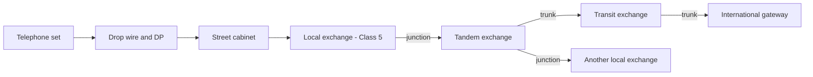
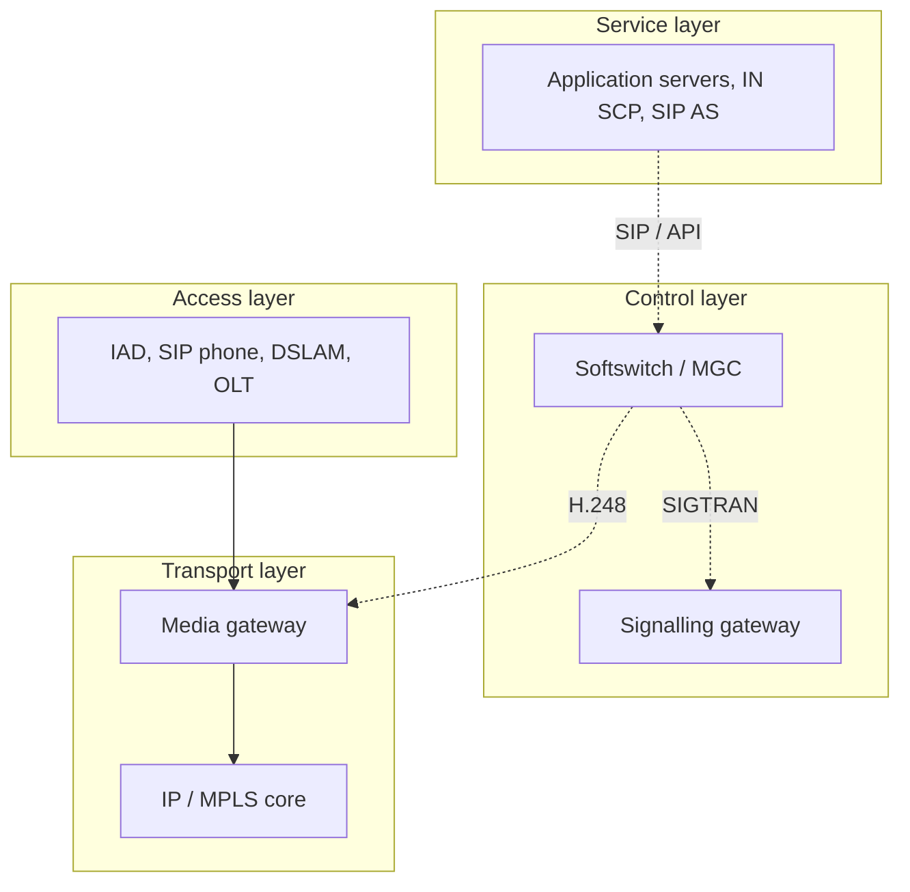
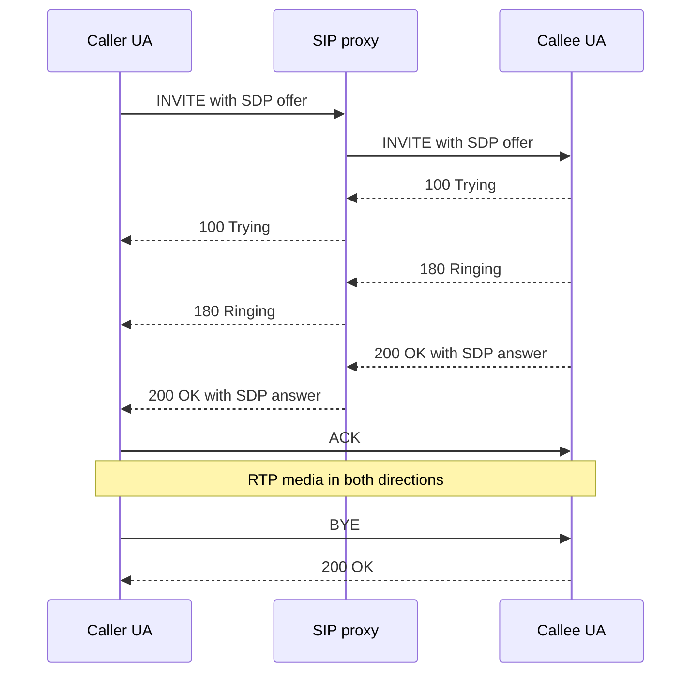

# 06 - PSTN, NGN and Signalling: From Local Loop to SIP

## Learning Objectives

After this chapter you will be able to:

1. Describe the PSTN from the subscriber's telephone to the international gateway, naming each element and the interface between them.
2. Place local, tandem and transit exchanges in the switching hierarchy and state what each one does with a call.
3. Compute PCM bit rates, E1 frame rates, timeslot counts, payload rates and voice-channel capacity without a calculator taking more than 40 seconds. (L4 numerical)
4. Explain the four-layer NGN model and why separating call control from bearer transport changed network economics.
5. Map every SS7 protocol level (MTP1 to MAP) to the function it performs and the node that hosts it.
6. Read a SIP call flow: identify methods, response classes, transactions, dialogs, and the SDP offer/answer.
7. Explain Megaco/H.248 and MGCP gateway control, and how a softswitch uses them.
8. Apply numbering-plan and least-cost-routing logic to a routing decision.

## Introduction

Wireline Technologies is 15% of the SET paper: 24 questions out of 200, worth 24 marks, about 22 minutes of the 180 available. Within the block, this chapter covers the half that a computer science graduate has never formally studied - the telephone network and its signalling - while chapter 07 covers IMS and broadband access.

The questions in this half are almost entirely structural. Four shapes recur:

| Shape | Typical wording | Frequency |
|---|---|---|
| Element responsibility | "Which node provides dial tone and line supervision?" | ~40% |
| Layer / stack mapping | "Point-code routing is performed by which level?" | ~25% |
| Protocol behaviour | "Which method ends an established SIP dialog?" | ~20% |
| Numerical | "An E1 frame carries how many bits?" | ~15% |

Notice what is *not* asked: you will not be asked to configure an exchange, dimension an SS7 link set, or debug a real call. You are asked whether you know what each box does and which protocol sits where. Learn the tables cold, drill the numerical families, and this is 20+ marks. The paper mixes old and new - a Class 5 exchange in one question, a P-CSCF in the next - because the Indian network is mid-migration and the exam tests the whole estate.

## Prerequisites

- Basic idea of circuit switching versus packet switching (a path reserved for the whole call versus datagrams routed per packet).
- Sampling theorem and quantisation from signals and systems: fs > 2 x fmax, and n bits gives 2^n levels.
- The OSI idea of layering, so that "MTP3 is layer 3" means something.
- Elementary client-server thinking, which is all SIP really is.
- Comfort with powers of two and with unit prefixes: k = 10^3 in transmission, Ki = 2^10 in storage.

## Key Terminology

| Term | Meaning | Exam hook |
|---|---|---|
| Local loop | The two-wire copper pair from the subscriber premises to the local exchange | Carries voice (300-3400 Hz), DC loop current and signalling |
| Class 5 exchange | Local exchange (end office); terminates subscriber lines | Provides dial tone, metering, call features |
| Class 4 exchange | Tandem / trunk exchange; no subscribers | Pure transit switching |
| Junction | Link between a local exchange and its tandem | Short haul, intra-city |
| Trunk | Link between tandem, transit or international exchanges | Long haul, carries many circuits |
| PCM | Pulse code modulation: sample, quantise, encode | 8000 samples/s x 8 bits = 64 kbps |
| DS0 / timeslot | One 64 kbps voice channel inside a multiplex | 30 usable in an E1 |
| E1 | 2.048 Mbps European/Indian primary multiplex | 32 timeslots, TS0 framing, TS16 signalling |
| CAS / CCS | Channel-associated vs common-channel signalling | CAS steals bits in each voice channel; CCS uses a separate path |
| SS7 | Signalling System No. 7, the common-channel signalling suite | Out-of-band, packet-switched, database-capable |
| Point code | SS7 address of a signalling point | 14-bit ITU-T (3-8-3); national variants exist |
| Softswitch / MGC | Media gateway controller; call control in NGN | Decides, does not carry media |
| Media gateway | Converts bearer between TDM and IP | Carries media, obeys the MGC |

## Theory

### 1. The PSTN from end to end

The public switched telephone network is a circuit-switched voice network built on four physical ingredients: the subscriber line, the local exchange, the trunk network, and the signalling system that controls the trunks.

A call starts at the telephone set, which is a two-wire analogue device powered by the exchange. Off-hook draws DC loop current, which the exchange detects as a service request. The exchange returns dial tone, the subscriber dials (DTMF in modern networks, pulse in legacy ones), and the exchange translates the digits into a destination and a route.



The elements and their jobs:

| Element | Position | Responsibility |
|---|---|---|
| Telephone / NT | Customer premises | Analogue voice, on-hook/off-hook, DTMF |
| Drop wire and DP | Last 100-300 m | Connects premises to the cable network |
| Street cabinet | Distribution point | Cross-connection between feeder and distribution cables |
| Local exchange (LE) | End office | Line termination, dial tone, digit analysis, local switching, metering, call features |
| Tandem exchange | Intra-city hub | Concentrates junction traffic between LEs; no subscribers |
| Transit exchange | Long distance | Switches trunk traffic between tandems and gateways |
| International gateway | Network edge | Interconnects with other countries' carriers, handles ILD accounting |
| Trunk / junction | Between exchanges | Carries multiplexed 64 kbps circuits (E1, STM-N, microwave) |

The local loop is the most expensive part of the network per unit of capacity: it is dedicated to one subscriber and is mostly cable and labour. And the local exchange is the only exchange with subscribers attached; everything above it is pure switching.

### 2. Hierarchy of switching

Telephone networks are hierarchical because a full mesh of exchanges is uneconomic: with n exchanges you would need n(n-1)/2 routes. Hierarchy concentrates traffic so that each level carries only the flows it must.

The classic five-level North American hierarchy was Class 5 (local), Class 4 (tandem), Class 3 (primary), Class 2 (sectional), Class 1 (regional). Indian practice, and the vocabulary the exam uses, is three levels plus a gateway:

| Level | Name | Traffic handled | Subscribers attached |
|---|---|---|---|
| 1 | Local exchange (LE), Class 5 | Originating and terminating local calls, first-choice routing | Yes |
| 2 | Tandem (TDX / TAX), Class 4 | LE-to-LE traffic within a city or short-distance charging area | No |
| 3 | Transit (TXC), Class 3 | Tandem-to-tandem and long-distance traffic | No |
| Edge | International gateway (IGW) | Incoming and outgoing international calls | No |

Rules that the paper tests:

- A local call between two subscribers on the same LE never leaves that LE.
- A call between two LEs in the same city goes LE -> tandem -> LE.
- A long-distance call goes LE -> tandem -> transit -> tandem -> LE, unless direct high-usage trunks exist.
- A call to another country always exits through an international gateway.
- Overload and failure handling is hierarchical: a route overflows upward, never downward.

Real networks add direct high-usage trunks between busy pairs, with the hierarchical route kept as the overflow path - the origin of "route list" thinking (section 11).

### 3. PCM applied to telephony (L4 numerical)

Telephony digitisation follows one recipe everywhere, and the numbers are the most reliably examined arithmetic in the block.

1. **Band-limit** the speech to 300-3400 Hz, then allow a 4 kHz channel including guard bands.
2. **Sample** at 8000 samples per second. This satisfies Nyquist for a 4 kHz channel with margin (8000 > 2 x 3400).
3. **Quantise** each sample to 8 bits, giving 256 levels.
4. **Compand** using A-law (ITU-T G.711, used in Europe and India) or mu-law (North America and Japan). Companding gives small signals more levels and large signals fewer, so the signal-to-quantisation-noise ratio stays roughly constant at about 38 dB across the speech dynamic range instead of collapsing for quiet talkers.
5. **Encode** into a 64 kbps stream. That stream is one DS0, one timeslot, one voice channel.

The arithmetic chain to memorise:

```
sample rate      = 8000 samples/s
bits per sample  = 8
channel rate     = 8000 x 8 = 64 000 bit/s = 64 kbps
sample interval  = 1/8000 s = 125 us
bit interval     = 1/64000 s = 15.625 us
```

Two consequences that appear as questions:

- 64 kbps is the *channel* rate, not the E1 rate. An E1 is 32 such channels.
- The 125 us sample interval is also the E1 frame duration, because an E1 frame is exactly one sample of all 32 channels. This is not a coincidence; it is the design.

For uniform quantisation, signal-to-quantisation-noise ratio is approximately `6.02n + 1.76 dB`, which for n = 8 gives 49.8 dB at full scale. Companding trades that peak figure for a flat ~38 dB across a 40 dB input range, which is why telephony sounds acceptable for both loud and quiet speakers.

### 4. E1 and T1 framing (L4 numerical)

An E1 is a 32-timeslot TDM frame repeated 8000 times per second.

| Field | Value | Note |
|---|---|---|
| Timeslots per frame | 32 | Numbered 0 to 31 |
| Bits per timeslot | 8 | One PCM sample |
| Bits per frame | 32 x 8 = 256 | |
| Frames per second | 8000 | Matches the PCM sample rate |
| Bit rate | 256 x 8000 = 2 048 000 bit/s | 2.048 Mbps |
| Frame duration | 125 us | |
| Bit duration | 1/2.048e6 = 488 ns | |
| Timeslot duration | 8 x 488 ns = 3.9 us | |
| Voice channels | 30 | TS1-TS15 and TS17-TS31 |

The two reserved timeslots are the whole point of the framing question:

- **TS0** carries frame alignment. Frames alternate between the frame alignment signal (FAS, the pattern 0011011 in bits 2-8) and the not-FAS word, which carries the remote alarm indication and the CRC-4 check bits when CRC-4 multiframe is enabled. Without TS0 the receiver cannot find frame boundaries.
- **TS16** carries signalling. With channel-associated signalling (CAS), TS16 of each frame carries the four ABCD bits for two voice channels, so 15 frames cover 30 channels; frame 0 of the 16-frame multiframe carries the multiframe alignment signal. With common-channel signalling (CCS), TS16 is used as a single 64 kbps message channel carrying SS7 or ISDN PRI D-channel data for all 30 channels.

That gives the standard exam contrast:

| | E1 (Europe, India) | T1 (North America, Japan) |
|---|---|---|
| Rate | 2.048 Mbps | 1.544 Mbps |
| Frame | 32 x 8 bits = 256 | 24 x 8 + 1 framing bit = 193 |
| Frame rate | 8000/s | 8000/s |
| Voice channels | 30 | 24 |
| Signalling | TS16 (CAS) or common channel | Robbed bit (CAS) or common channel |
| Line code | HDB3 | AMI or B8ZS |
| Impedance | 120 ohm twisted pair (or 75 ohm coax) | 100 ohm twisted pair |

Higher-order multiplexing in the plesiochronous digital hierarchy: E2 = 8.448 Mbps (4 x E1), E3 = 34.368 Mbps (4 x E2), E4 = 139.264 Mbps (4 x E3). These are not exact multiples because each level adds justification and control bits - which is why SDH was created, and why STM-1 at 155.52 Mbps carries 63 E1s synchronously.

### 5. NGN: the four-layer model

The next generation network is defined by ITU-T as a packet-based network able to provide telecommunication services, including voice, using multiple broadband, QoS-enabled transport technologies, in which service-related functions are independent of the underlying transport technologies.

Read that definition carefully, because three exam answers hide inside it: **packet-based**, **QoS-enabled**, **service independent of transport**.

The architecture is usually drawn as four horizontal layers:



| Layer | Function | Typical equipment |
|---|---|---|
| Access | Adapts the subscriber's medium (copper, fibre, wireless) to packet transport | Access gateway, IAD, DSLAM, OLT, SIP phone |
| Transport | Moves media packets with QoS | Media gateways, IP/MPLS routers, optical transport |
| Control | Call and session control, gateway control, signalling interworking | Softswitch (MGC), signalling gateway |
| Service | Service logic and data | Application server, IN SCP, feature server, provisioning |

The layer that matters most for questions is the split between control and transport, because that split is the entire reason NGN exists.

### 6. Softswitch, media gateway and signalling gateway

A **softswitch** (also called a media gateway controller, call agent, or call server) is a general-purpose server that performs the call control that used to live inside a Class 4 or Class 5 switch: digit analysis, routing, charging, service triggering, and gateway control. It carries no media. It tells gateways what to do over a control protocol, usually Megaco/H.248.

A **media gateway (MG)** sits between two bearer technologies and converts between them: TDM 64 kbps channels on one side, RTP packets on the other. It also does echo cancellation, tone generation, announcements, conferencing bridging, and fax/modem relay.

A **signalling gateway (SG)** terminates SS7 at the MTP2/MTP3 level and hands the signalling messages to the softswitch over IP, typically using SIGTRAN (SCTP transport plus M3UA or M2UA adaptation). It exists because a softswitch with an IP backplane cannot directly terminate a 64 kbps SS7 signalling link.

| Element | Carries media? | Speaks to | Protocol |
|---|---|---|---|
| Softswitch / MGC | No | Media gateways, signalling gateways, application servers | H.248, SIP, SIGTRAN |
| Media gateway | Yes | Softswitch (control), both bearer networks | H.248, RTP, E1 |
| Signalling gateway | No | Softswitch, SS7 network | M3UA/SCTP, MTP2/MTP3 |
| Application server | No (except MRF media) | Softswitch | SIP, INAP, APIs |

A useful sentence for the exam: *the softswitch decides, the media gateway forwards, the signalling gateway translates.*

### 7. Why NGN replaced the Class 4 and Class 5 switch

A Class 5 switch is a monolithic machine: switching fabric, call control, service logic, charging and O&M all inside one chassis, dimensioned for a fixed number of subscribers and a fixed number of trunks. Scaling means buying another chassis. Adding a service means a software load on every exchange. Transport is 64 kbps per call, reserved whether or not anyone speaks.

NGN broke that monolith in five places:

1. **Control separated from bearer.** Capacity is added by adding gateways (cheap, commodity) without touching call control; control is added by adding servers.
2. **Statistical multiplexing.** A voice call is roughly 20-40 kbps of packets with silence suppression, not a reserved 64 kbps circuit. Long-haul transport cost per call falls sharply.
3. **Service creation moved to application servers.** A new feature is deployed once, centrally, not as a software upgrade on hundreds of exchanges.
4. **One network for voice and data.** No separate overlay for signalling, management and voice; the IP/MPLS core carries all of it.
5. **Open interfaces.** SIP, H.248, Parlay/OSA and web APIs let third parties and internal teams build services without touching switch code.

The cost is that NGN inherits IP's problems: QoS has to be engineered rather than assumed, power and cooling move into every remote site, security becomes a voice issue, and a single softswitch failure can take out a large area unless it is clustered. Exams like the trade-off question "a disadvantage of NGN compared with TDM" - the answer is usually QoS dependence or single point of failure.

### 8. The SS7 protocol stack

SS7 (Signalling System No. 7, ITU-T Q.700 series) is a packet-switched, out-of-band common-channel signalling system. One 64 kbps signalling link can control thousands of voice circuits, which is why it replaced per-channel signalling.

It is a stack, and the exam asks which layer does what:

| Level | Name | Function | OSI-ish |
|---|---|---|---|
| MTP1 | Message Transfer Part level 1 | Physical signalling data link, 64 kbps, E1 timeslot, G.703 electrical interface | Layer 1 |
| MTP2 | MTP level 2 | Framing, error detection (CRC-16), error correction by retransmission, flow control on one link | Layer 2 |
| MTP3 | MTP level 3 | Signalling network functions: point-code routing, message discrimination and distribution, network management (link/route failure, congestion) | Layer 3 |
| SCCP | Signalling Connection Control Part | End-to-end routing beyond MTP3's node addressing: global title translation, connectionless (class 0/1) and connection-oriented (class 2/3) service | Layer 3+ |
| TCAP | Transaction Capabilities Application Part | Dialogue and component handling for non-circuit applications; carries database queries | Layer 7 |
| ISUP | ISDN User Part | Circuit-related call setup, supervision and release on trunks | Layer 7 |
| TUP | Telephone User Part | Older analogue-era trunk signalling; largely superseded by ISUP | Layer 7 |
| INAP | Intelligent Network Application Part | IN services: freephone, prepaid, VPN, number portability queries; runs over TCAP | Layer 7 |
| MAP | Mobile Application Part | GSM/UMTS mobility: location update, authentication, HLR/VLR interrogation, SMS routing; runs over TCAP | Layer 7 |

Two structural facts generate most of the questions:

- **MTP3 routes to a node (point code). SCCP routes to an application or a database (global title, subsystem number).** If a question mentions 800-number translation, HLR lookup or number portability, the answer involves SCCP and TCAP, not plain MTP3.
- **ISUP is for circuits; TCAP is for databases.** ISUP sets up a voice path. TCAP asks a question and gets an answer, with no circuit involved.

ISUP call messages, in order, are worth memorising as a sequence:

```
IAM  Initial Address Message   - called number, calling number, circuit identity code
SAM  Subsequent Address Message - additional digits (overlap sending)
ACM  Address Complete Message  - destination reached, ringing started
ANM  Answer Message            - called party answered, charging starts
REL  Release                   - either side clears, carries a cause value
RLC  Release Complete          - circuit returned to idle
```

Additional messages worth recognising: CPG (call progress), SUS/RES (suspend/resume), BLO/BLA (blocking), UBL/UBA (unblocking), GRS/GRA (circuit group reset), CQM (circuit group query).

Signalling points and their roles:

| Node | Role |
|---|---|
| SP | Signalling point: any node with a point code |
| SSP | Service switching point: an exchange that can trigger IN services |
| STP | Signalling transfer point: routes SS7 messages between links, no call control |
| SCP | Service control point: hosts IN service logic and data |
| HLR / VLR | Mobile databases reached via MAP over TCAP |

A point code is the SS7 address of a signalling point. ITU-T defines a 14-bit international code structured 3-8-3 (zone, area/network, signalling point); national networks use 14-bit or 24-bit (8-8-8) variants. Links between signalling points are classified A (access), B (bridge), C (cross), D (diagonal), E (extended) and F (fully associated); STP pairs are normally connected by C links.

For NGN, SS7 is carried over IP by **SIGTRAN**: SCTP provides the reliable transport, and adaptation layers map the SS7 users - M3UA for MTP3 users, M2UA/M2PA for MTP2, IUA for ISDN, SUA for SCCP.

### 9. SIP in depth

SIP (Session Initiation Protocol, RFC 3261) creates, modifies and terminates sessions. It is text-based, HTTP-like, and deliberately does not carry media: SDP describes the media, RTP carries it.

**Methods.**

| Method | Purpose | Trap |
|---|---|---|
| INVITE | Establish a session | Also used to change a session (re-INVITE) |
| ACK | Confirm receipt of a final response to INVITE | For 2xx it is a separate transaction; for non-2xx it belongs to the INVITE transaction |
| BYE | Terminate an established dialog | Cannot cancel a ringing INVITE |
| CANCEL | Cancel a pending INVITE before a final response | Has no effect after 200 OK |
| REGISTER | Bind a public address (AOR) to a contact URI | Registrar writes to the location service |
| OPTIONS | Query capabilities, keepalive | Does not create a dialog |

Extensions you should recognise: INFO (mid-dialog data), PRACK (reliable provisional responses, 100rel), UPDATE (modify session before answer), MESSAGE (instant message), SUBSCRIBE/NOTIFY (events), REFER (transfer).

**Response classes.**

| Class | Meaning | Examples |
|---|---|---|
| 1xx | Provisional, not final | 100 Trying, 180 Ringing, 183 Session Progress |
| 2xx | Success | 200 OK, 202 Accepted |
| 3xx | Redirection | 301 Moved Permanently, 302 Moved Temporarily |
| 4xx | Client error | 401 Unauthorized, 403 Forbidden, 404 Not Found, 486 Busy Here, 487 Request Terminated, 488 Not Acceptable Here |
| 5xx | Server error | 500 Server Internal Error, 503 Service Unavailable |
| 6xx | Global failure | 600 Busy Everywhere, 603 Decline, 604 Does Not Exist Anywhere |

**Transaction versus dialog.** This distinction is the single most examined SIP concept.

- A **transaction** is one request plus all responses to it, ending with a final response. It is identified by the top Via `branch` parameter (plus the method for ACK/CANCEL matching).
- A **dialog** is a peer-to-peer relationship between two user agents, created by a 2xx to INVITE. It is identified by the triple Call-ID + local tag + remote tag, where the tags come from the From and To headers. A dialog lasts until BYE.

So one INVITE transaction creates one dialog, which may contain many transactions (re-INVITE, INFO, UPDATE, BYE).

**Headers that carry the identity:**

```
INVITE sip:bob@example.com SIP/2.0
Via: SIP/2.0/UDP 10.1.1.5:5060;branch=z9hG4bK776asdhds
Max-Forwards: 70
From: "Alice" <sip:alice@example.com>;tag=1928301774
To: <sip:bob@example.com>
Call-ID: a84b4c76e66710@10.1.1.5
CSeq: 314159 INVITE
Contact: <sip:alice@10.1.1.5:5060>
Content-Type: application/sdp
Content-Length: 142
```

**Dialog-forming flow** with a proxy:



**SDP offer/answer (RFC 3264).** The offer appears in the INVITE body; the answer appears in the 200 OK. Each media line gives media type, port, protocol and payload types, with attributes for codec, packetisation and direction:

```
m=audio 49172 RTP/AVP 0 8 101
c=IN IP4 10.1.1.5
a=rtpmap:0 PCMU/8000
a=rtpmap:8 PCMA/8000
a=sendrecv
```

The answer must select a subset of the offered formats and must not add new ones. A 488 (Not Acceptable Here) means no common codec.

**Server roles.**

| Role | Behaviour | Key point |
|---|---|---|
| Proxy server | Receives a request and forwards it on behalf of the client; may be stateful or stateless; can fork to several contacts | Stays in the signalling path only if it Record-Routes |
| Redirect server | Answers with 3xx and lets the caller retry the new address | Does not forward, does not stay in path |
| Registrar | Accepts REGISTER and updates the location service | Pairs with a proxy that queries that location service |
| B2BUA | Back-to-back user agent: terminates the signalling on both sides | Full control, but breaks end-to-end semantics; used by IMS and PBX borders |
| Location service | Database of AOR-to-contact bindings | Not a SIP entity itself, but queried by proxies |

Default ports: 5060 for UDP/TCP, 5061 for TLS. Secure variant `sips:` requires TLS hop by hop.

### 10. Megaco/H.248 and MGCP

Both protocols let a controller drive a media gateway. They are the "southbound" of the NGN control layer.

**Megaco/H.248** (ITU-T H.248, IETF Megaco, RFC 3525) is the mainstream choice in carrier NGN. Its model has two abstractions:

- **Termination**: a source or sink of media - a TDM timeslot, an RTP stream, an announcement player.
- **Context**: an association of terminations that describes a connection (a call leg pair). An empty context is a null context.

Commands, all issued by the MGC to the MG: Add, Modify, Subtract, Move, AuditValue, AuditCapabilities, Notify, ServiceChange. The MG can send Notify (for example an off-hook event) and ServiceChange (registration or failure) upward.

**MGCP** (RFC 3435) is the simpler, earlier cousin: endpoints and connections instead of terminations and contexts, with commands CreateConnection, ModifyConnection, DeleteConnection, NotificationRequest, AuditEndpoint, AuditConnection and RestartInProgress. It uses SDP to describe connections and is common in smaller deployments and residential gateways.

| | Megaco/H.248 | MGCP |
|---|---|---|
| Origin | ITU-T + IETF joint | IETF, derived from SGCP and IPDC |
| Model | Terminations and contexts | Endpoints and connections |
| Deployment | Carrier-class NGN, large MGs | Residential gateways, smaller deployments |
| Transport | UDP, TCP or SCTP; text or binary encoding | UDP typically, text encoding |
| Media description | H.248 descriptors (local/remote) | SDP |

Neither protocol carries media, and neither does call routing. They are device control, not signalling.

### 11. Numbering and call routing

**E.164** is the international public numbering plan: a country code of 1-3 digits followed by a national significant number, with the total capped at 15 digits. India's country code is 91. Within India, mobile numbers are 10 digits beginning 6-9; fixed-line numbers combine an STD code of 2-4 digits with a subscriber number so that the total is 10 digits.

Routing a call is a four-step process inside the exchange or softswitch:

1. **Digit collection and analysis.** With overlap sending, routing can begin before all digits arrive; with en-bloc sending, the full number arrives in one message.
2. **Translation.** The dialled digits plus the originating context produce a destination identifier: a trunk group, a point code, a SIP URI, or a service trigger.
3. **Route selection.** A route list is walked in priority order. Each entry has a trunk group, a priority, and often a time-of-day band.
4. **Seizure and signalling.** The chosen circuit is seized and an IAM (or SIP INVITE) is sent. If the attempt fails with a defined cause, the next route in the list is tried.

**Least-cost routing (LCR)** orders route lists by cost per minute while respecting a quality floor, usually measured as ASR (answer-seizure ratio). Variants worth knowing:

| Technique | Rule |
|---|---|
| Time-of-day routing | Different route list per tariff band |
| Overflow routing | Primary route first, secondary on congestion or failure |
| Percentage routing | Split traffic across carriers by percentage for commercial or resilience reasons |
| Cause-based reroute | Retry on specific causes (congestion, no circuit) but not on "number unobtainable" |
| Prefix-based routing | Longest-prefix match on the dialled number, as in IP routing |

The trap: LCR is not "cheapest always". A cheap route with a poor answer-seizure ratio produces failed calls, repeats and customer complaints, so the cost comparison is per successful call, not per attempt.

## Worked Examples

### Example 1 - E1 frame arithmetic

**Question.** An E1 frame is 32 timeslots of 8 bits, repeated 8000 times per second. Find the bit rate, the frame duration, the duration of one bit, and the payload rate available for voice.

**Solution.**

```
bits per frame   = 32 x 8 = 256 bit
frame rate       = 8000 frame/s
bit rate         = 256 x 8000 = 2 048 000 bit/s = 2.048 Mbps
frame duration   = 1/8000 = 125 us
bit duration     = 1/2 048 000 = 0.488 us = 488 ns
timeslot         = 8 x 488 ns = 3.9 us
voice payload    = 30 x 64 kbps = 1.92 Mbps
overhead share   = 2/32 = 6.25%
```

**Exam read.** The 2.048 Mbps figure is not a round number chosen by committee: it is exactly 32 x 64 kbps, which is exactly 32 x 8000 x 8. Any question that gives you two of the three (channels, sample rate, bits) lets you derive the third.

### Example 2 - Voice channels in an STM-1 (L4 numerical)

**Question.** An STM-1 link at 155.52 Mbps is used to carry E1s, and each E1 provides 30 voice channels. How many voice channels can it carry?

**Solution.**

```
E1s per STM-1     = 155.52 / 2.048 = 75.9 -> 63 in practice
                    (STM-1 payload is sized for 63 x E1 with section/pointer overhead)
voice channels    = 63 x 30 = 1890
payload rate used = 63 x 2.048 = 129.024 Mbps
```

**Exam read.** The naive division gives 75, but the standards answer is 63, because STM-1 carries a VC-4 payload of 150.336 Mbps and E1s are mapped as TU-12s with pointers. If the options include both 75 and 63, the intended answer is 63 x 30 = 1890. If a question gives you only the raw rate and asks for "E1 equivalents", read the wording: "theoretical" means 75, "standard mapping" means 63.

### Example 3 - Dimensioning E1s from subscriber traffic (L4 numerical)

**Question.** A local exchange serves 5000 subscribers, each generating 0.05 Erlang of traffic in the busy hour. How many E1s are needed to carry this traffic at full utilisation?

**Solution.**

```
total traffic    = 5000 x 0.05 = 250 Erlang
one E1           = 30 channels = 30 Erlang if fully occupied
E1s required     = 250 / 30 = 8.33 -> 9 E1
```

**Exam read.** Nine E1s is a lower bound. Real dimensioning uses Erlang B: to hold 250 Erlang at 1% blocking you need more circuits than the traffic figure, because of random arrival. If a question says "ignoring blocking" or "at 100% utilisation", divide; if it mentions a blocking grade of service, expect a table or a stated margin.

### Example 4 - SS7 ISUP message walkthrough

**Question.** A subscriber on exchange A dials a subscriber on exchange B, and B answers. List the ISUP messages and state what each carries.

**Solution.**

```
A seizes a circuit, sends IAM  -> CIC, called number, calling number, nature of address
B sends ACM                    -> destination reached, ringing applied
B sends ANM                    -> answer, charging starts at A
   (conversation, 64 kbps path in both directions)
A sends REL                    -> cause value, e.g. normal clearing
B sends RLC                    -> circuit back to idle, ready for reuse
```

**Exam read.** ACM means "the digits worked and the phone is ringing". ANM means "answer and charge". A question that asks when charging starts has ANM as the answer; a question that asks which message returns the circuit to service has RLC. If the caller abandons before answer, the sequence is IAM, ACM, REL, RLC - no ANM.

### Example 5 - SIP INVITE walkthrough

**Question.** Trace a successful SIP call from alice@example.com to bob@example.com through one proxy. Identify the transaction and dialog identifiers, and say when media starts.

**Solution.**

```
1  INVITE (offer)      branch=z9hG4bK1, From tag=111, Call-ID=X, CSeq=1
2  100 Trying          same branch, same Call-ID
3  180 Ringing         same branch
4  200 OK (answer)     To tag=222 now present
5  ACK                 new branch=z9hG4bK2, same Call-ID, same tags
6  RTP both ways
7  BYE                 CSeq=2, same dialog
8  200 OK for BYE
```

- Transaction identifiers: the INVITE transaction is `branch=z9hG4bK1`; the ACK for a 2xx is a *new* transaction (`branch=z9hG4bK2`).
- Dialog identifier: `Call-ID=X` + `From tag=111` + `To tag=222`.
- Media starts after the ACK, because the caller now knows the callee's chosen address and codec.

**Exam read.** The To tag appears only when the callee's user agent answers, so any question about "which message establishes the dialog" points to the 200 OK carrying the To tag. The ACK for a 2xx is end-to-end and does not follow the same path as the INVITE unless Record-Route was used.

### Example 6 - Transaction count for a simple call

**Question.** In the flow above, how many SIP transactions occur, and which message types end them?

**Solution.**

```
INVITE transaction      ends with 200 OK        (1)
ACK transaction         is its own request      (2)
BYE transaction         ends with 200 OK        (3)
```

Three transactions, one dialog. Note that 100 Trying and 180 Ringing do not end the INVITE transaction; only a final response (2xx-6xx) does.

## Exam Traps and Common Mistakes

**Trap 1 - MTP3 is not SCCP.** MTP3 routes on point code, node to node, and handles network management. SCCP adds global title translation and end-to-end (including connection-oriented) routing so that TCAP users can reach databases. "Which layer performs global title translation?" is SCCP, always.

**Trap 2 - MTP2 is not MTP3.** MTP2 is per-link: framing, CRC-16, retransmission, flow control. MTP3 is per-network: routing and management. A question about "error detection on a signalling link" is MTP2; "rerouting around a failed link set" is MTP3.

**Trap 3 - TS0 and TS16 are not both signalling.** TS0 is frame alignment (plus alarm and CRC-4 bits). TS16 is signalling - CAS by default, or the common signalling channel under CCS. An option claiming "TS0 carries signalling and TS16 carries framing" is the classic inversion.

**Trap 4 - 30 channels, not 32.** An E1 has 32 timeslots and 30 voice channels. 32 x 64 kbps = 2.048 Mbps is the line rate; 30 x 64 kbps = 1.92 Mbps is the voice payload. Options often include 2.048 Mbps as "the voice capacity" to catch you.

**Trap 5 - E1 versus T1.** 2.048 Mbps / 32 timeslots / 30 channels / HDB3 / 120 ohm versus 1.544 Mbps / 24 timeslots plus a framing bit / 24 channels / AMI or B8ZS / 100 ohm. India uses E1. Any option that puts 1.544 Mbps in an Indian context is wrong.

**Trap 6 - Softswitch versus media gateway.** The softswitch is control-plane and carries no media; the media gateway carries media and has no service logic. "Which device converts TDM voice to RTP?" is the media gateway. "Which device selects the route?" is the softswitch.

**Trap 7 - CANCEL versus BYE.** CANCEL stops an INVITE that has not yet received a final response. Once the 200 OK arrives, only BYE can end the session. A question about "terminating a call in progress" is BYE.

**Trap 8 - Proxy versus redirect versus registrar.** A proxy forwards. A redirect answers with 3xx. A registrar accepts REGISTER and writes to the location service. A B2BUA terminates and re-originates, which is why it can change SDP and codecs.

**Trap 9 - ISUP, INAP and MAP are different users of the same stack.** ISUP sets up circuits. INAP implements IN services and runs over TCAP. MAP handles mobility and runs over TCAP. A question about "HLR interrogation" is MAP; "freephone translation" is INAP (with SCCP global title translation underneath).

**Trap 10 - Sampling 8000 Hz is not "twice 3400 Hz".** It is twice the 4 kHz channel, and the extra 600 Hz is the guard band. Saying "8000 = 2 x 3400" is a common wrong explanation in options.

## Summary

The PSTN is a hierarchy of circuit switches fed by dedicated copper loops. Local exchanges terminate subscribers; tandems and transits switch trunks; gateways face other countries. Voice becomes 64 kbps through a fixed recipe: 4 kHz channel, 8000 samples/s, 8 bits, companded. Thirty such channels plus TS0 framing and TS16 signalling make a 2.048 Mbps E1, whose 125 us frame is exactly one PCM sample of all channels.

NGN re-implemented that network over packets, splitting call control (softswitch) from bearer (media gateway) from signalling interworking (signalling gateway), with services on application servers. That split is why NGN is cheaper to scale, faster to add services to, and harder to guarantee QoS on.

SS7 is the control network: MTP1-3 move messages reliably between point codes, SCCP extends addressing to applications and databases, TCAP carries dialogues, and ISUP, INAP and MAP are the users. SIP replaced SS7 for session setup in the IP world, keeping the same ideas in text: methods, response classes, transactions identified by branch, dialogs identified by Call-ID and tags, and SDP to negotiate media.

## Practical Takeaways

- Memorise the four numbers: 8000, 8, 64 kbps, 2.048 Mbps. Derive everything else from them.
- Draw the SS7 stack once a week from memory until MTP1-3, SCCP, TCAP, ISUP, INAP, MAP come out in order with a one-line function each.
- Learn SIP by walking one call: INVITE, 100, 180, 200, ACK, RTP, BYE, 200. Then annotate branch, tags, Call-ID and CSeq on that single flow.
- For any element-function question, ask "does it carry media?" That one question separates softswitch, signalling gateway, proxy and media gateway.
- In numerical questions, write the unit chain (bits/frame, frames/s, bit/s) before computing; most errors are unit errors, not arithmetic errors.
- Treat "which replaced what" questions as trade-off questions: control/bearer separation, statistical multiplexing, centralised services, QoS cost.

## Chapter Quiz

**Q1.** In an E1 frame, the timeslot reserved for frame alignment is:
(a) TS0 (b) TS1 (c) TS16 (d) TS31
**Answer: (a).** TS0 carries the frame alignment signal (and the not-FAS word with alarm and CRC-4 bits). TS16 carries signalling, and TS1-TS15 and TS17-TS31 carry voice.

**Q2.** Point-code based routing of SS7 messages across the signalling network is performed by:
(a) MTP1 (b) MTP2 (c) MTP3 (d) TCAP
**Answer: (c).** MTP3 is the signalling network layer: discrimination, distribution and route selection on point code. SCCP adds global title routing above it.

**Q3.** A SIP UA wants to stop an INVITE for which it has received only 180 Ringing. It sends:
(a) BYE (b) CANCEL (c) ACK (d) OPTIONS
**Answer: (b).** CANCEL terminates a pending INVITE transaction before a final response. BYE would be invalid because no dialog is confirmed yet.

**Q4.** A Class 5 exchange is best described as:
(a) A transit switch with no subscribers (b) A local exchange terminating subscriber lines (c) A signalling transfer point (d) An international gateway
**Answer: (b).** Class 5 is the end office: line termination, dial tone, metering and local switching. Class 4 is the tandem/trunk switch.

**Q5.** In an NGN, the device that converts TDM voice channels into RTP packet streams is the:
(a) Softswitch (b) Signalling gateway (c) Media gateway (d) Application server
**Answer: (c).** The media gateway is the bearer interworking function. The softswitch controls it over H.248, and the signalling gateway handles SS7 over IP.

## Exercises

1. **(Numerical)** An E1 uses TS16 for common-channel signalling instead of CAS. How many voice channels remain, what is the new payload rate, and what fraction of the line rate is now overhead?
2. **(Numerical)** A tandem exchange carries 900 Erlang in the busy hour. At 30 channels per E1 and full utilisation, how many E1s are required, and what is the resulting utilisation if you install the next whole number?
3. **(Numerical)** A VoIP gateway packetises G.711 at 20 ms per packet with 40 bytes of RTP/UDP/IPv4 overhead. Compute the packet rate, the payload bit rate, the overhead bit rate and the total bit rate per call.
4. Draw the SS7 stack from memory and, beside each level, write one sentence of function and one node type that hosts it. Then check against the table in section 8.
5. Write a complete SIP INVITE for a call from 022-2345-6789 to 011-4567-8901 through a proxy, including Via, From, To, Call-ID, CSeq, Contact, Content-Type and a two-codec SDP offer. Mark which fields identify the transaction and which identify the dialog.
6. A call to 1800-123-4567 must trigger a freephone service that translates the number to a destination. Name every protocol layer involved from digit analysis to call completion, and say which node hosts each function.
7. Explain in under 150 words why separating call control from bearer transport reduced the cost per call, and name one disadvantage that TDM exchanges did not have.

## Next

Chapter 07 takes the same estate one layer up and one layer out: the IMS core that makes VoLTE possible, and the access network - xDSL, cable and fibre - that connects the subscriber to it. The SS7 and SIP vocabulary from this chapter is assumed there, so do not move on until the stack and the SIP call flow are automatic.
