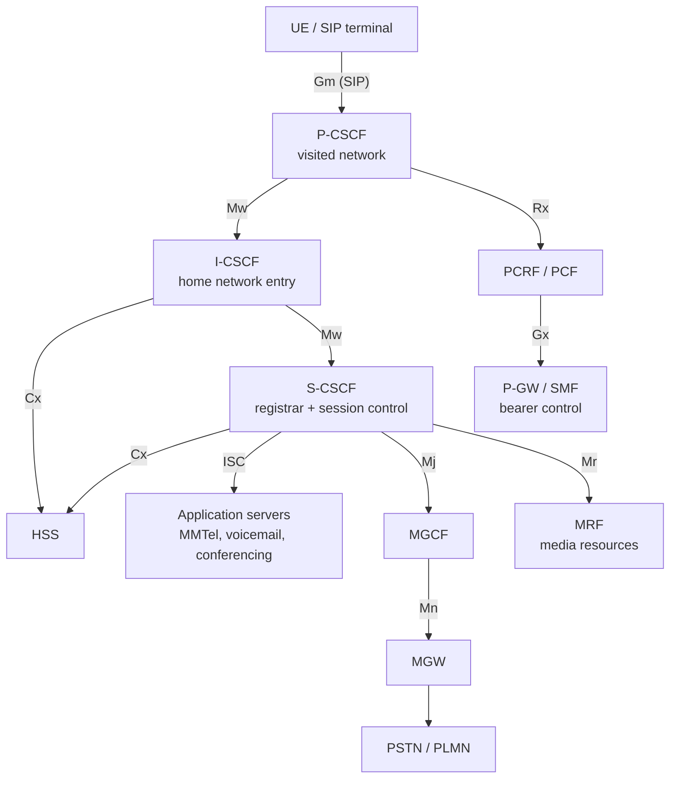
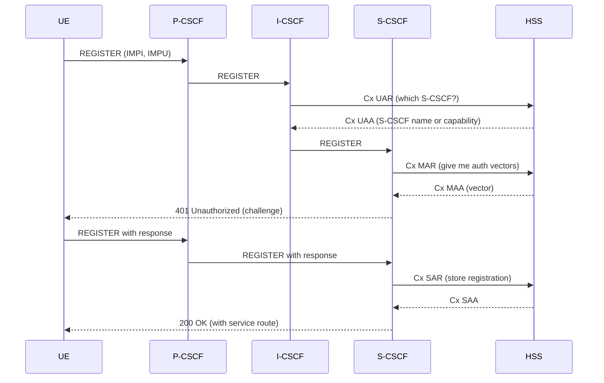
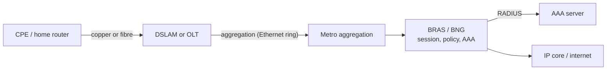

# ch07 - IMS and Broadband Access

## Learning Objectives

After this chapter you will be able to:

1. Draw the IMS architecture and assign each of P-CSCF, I-CSCF, S-CSCF, HSS, SLF, PCRF, MGCF, BGCF and MRF to its correct job.
2. Walk the IMS registration flow message by message and state which interface each query crosses.
3. Explain the difference between IMPI and IMPU and why both exist.
4. Describe a VoLTE call from INVITE to bearer establishment, and contrast it with CS fallback.
5. Place ADSL, ADSL2+, VDSL2 and G.fast on a rate-versus-reach curve with correct band edges.
6. Explain DMT and why subcarrier count matters, with the arithmetic.
7. Describe the broadband access chain: CPE, DSLAM or OLT, aggregation, BRAS/BNG, AAA, and the IP core.
8. Compare FTTH, FTTB, FTTC and FTTN on cost, reach and upgrade path.
9. Solve the numerical families here: subcarrier and band arithmetic, line rate, protocol overhead efficiency, contention ratio and voice packet rate.

## Introduction

Wireline Technologies is a 15 percent block, about 24 questions. ch06 covers the PSTN, PCM/E1, NGN, SS7 and SIP. This chapter covers the two halves of wireline that a Computer Science graduate has usually met only as acronyms: the **IMS core** that carries voice over an all-IP network, and the **broadband access** layer that connects subscribers to it.

Why this block is worth the hours: it is the most *structural* block on the paper. Almost every question is one of four shapes.

- **Element to function:** "Which node authenticates the subscriber?" (S-CSCF with HSS vectors.)
- **Interface or protocol:** "Which interface carries Cx queries?" (I-CSCF and S-CSCF to HSS.)
- **Rate and reach:** "What is the downstream rate of ADSL2+?" or "why does VDSL2 reach less than ADSL2+?"
- **Topology choice:** "Which FTTx variant best fits an apartment block?"

None of these requires deep mathematics. They require that nine boxes in IMS and four letters in FTTx are correctly attached to their meanings. That is a weekend of work for 12 or more marks, and it is the highest-return weekend in the whole technical paper after IP networks.

The one part that does need arithmetic is the access layer, and the arithmetic is the same discipline as ch08 and ch09: bands, bits per symbol, symbols per second, overheads and budgets.

## Prerequisites

- PCM and E1 framing (ch06). IMS replaces the circuit switch, so you need to know what it replaced.
- SIP methods and response classes (ch06). IMS is SIP with a policy and identity layer bolted on.
- IP transport and QoS marking (ch01, ch02). Every IMS interface is SIP or Diameter over IP.
- The idea of a bearer: a transport path with an agreed QoS (ch13 helps, but the concept is enough here).

## Key Terminology

- **IMS:** IP Multimedia Subsystem, the 3GPP architecture that delivers operator-controlled multimedia sessions (voice, video, messaging) over IP with QoS, charging and roaming.
- **P-CSCF:** Proxy CSCF, the first contact point for the terminal; it sits in the visited network and anchors policy and media.
- **I-CSCF:** Interrogating CSCF, the entry point into the home network; it queries the HSS to find which S-CSCF serves the user.
- **S-CSCF:** Serving CSCF, the registrar and session-control brain; it authenticates, applies service triggers and routes sessions.
- **HSS:** Home Subscriber Server, the master database of subscription, identity, authentication vectors and service profile.
- **SLF:** Subscription Locator Function, the index that tells an I-CSCF which HSS holds a given user when there are several.
- **PCRF:** Policy and Charging Rules Function, which authorises QoS for a media stream and instructs the gateway to create a bearer.
- **MGCF:** Media Gateway Controller Function, the IMS-to-PSTN signalling interworking point, controlling an MGW.
- **IMPI:** IP Multimedia Private Identity, the authentication identity, assigned by the operator, never shown to the user.
- **IMPU:** IP Multimedia Public Identity, the identity other parties use (a SIP URI or a tel URI), which can be shared across devices.
- **DMT:** Discrete Multi-Tone, the modulation used by xDSL that splits the copper band into many independent narrow subcarriers.
- **BRAS / BNG:** Broadband Remote Access Server / Broadband Network Gateway, the aggregation point that terminates subscriber sessions, applies policy and routes to the core.
- **FTTx:** Fibre to the x, where x is the termination point: home, building, cabinet or node.

## Theory

### 1. What IMS is for

Before IMS, a mobile operator had two networks: a circuit-switched network for voice (with its own switches, its own signalling and its own billing) and a packet network for data. Voice was reliable and expensive to scale; data was cheap and could not carry a guaranteed-quality call.

IMS is the answer to one question: **can an all-IP network deliver a telephone-grade service with the same control, charging and roaming that the circuit switch gave?** The answer required four things, and each maps to an IMS element.

| Requirement | IMS answer |
|---|---|
| Identify and authenticate the subscriber | IMPI plus HSS authentication vectors, via the S-CSCF |
| Guarantee quality for the media | PCRF policy plus a dedicated bearer |
| Charge per session, not per byte | S-CSCF service triggers plus charging functions |
| Reach the PSTN | MGCF plus MGW, and BGCF for gateway selection |

That table is the reason IMS is not "SIP with extra steps". Plain SIP has no subscriber database, no policy control and no charging hooks.

### 2. The architecture



| Element | Job in one line | Answers the question |
|---|---|---|
| P-CSCF | First SIP hop; compresses headers, applies policy, anchors media | "Who does the terminal talk to first?" |
| I-CSCF | Queries the HSS and routes to the right S-CSCF | "Which server owns this user?" |
| S-CSCF | Registers, authenticates, runs service triggers, routes | "Who controls the session?" |
| HSS | Subscription, identities, authentication vectors, profile | "Where does the truth live?" |
| SLF | Maps user to HSS when several HSSs exist | "Which database?" |
| PCRF | Authorises QoS and charging for the media | "Who guarantees the bearer?" |
| MGCF | SIP to ISUP interworking | "How does IMS reach the PSTN?" |
| BGCF | Chooses the PSTN breakout gateway | "Which gateway?" |
| MRF | Plays tones, mixes conferences, transcodes | "Where does the media processing happen?" |

**Two exam-critical distinctions.**

1. **P-CSCF is in the visited network; I-CSCF and S-CSCF are in the home network.** That is what makes roaming work: the terminal always finds a local proxy, and the home network keeps control of authentication and services.
2. **The I-CSCF is stateless-ish and the S-CSCF is stateful.** The I-CSCF is a router with a database query; the S-CSCF holds registration state and service state.

### 3. Registration, step by step



Read that diagram as four moves.

1. **Discovery.** The terminal sends REGISTER to its P-CSCF, which forwards to the I-CSCF of the home network.
2. **Selection.** The I-CSCF asks the HSS (UAR) which S-CSCF should serve this user, and the HSS answers (UAA).
3. **Challenge.** The S-CSCF asks the HSS for an authentication vector (MAR/MAA), then answers the terminal with a **401** carrying a nonce. The terminal computes a response from its secret and resends REGISTER.
4. **Commit.** The S-CSCF verifies, tells the HSS to store the registration (SAR/SAA), and returns **200 OK** with the Service-Route header so future requests go through the right servers.

**Message count for the exam:** 4 SIP messages (REGISTER, 401, REGISTER, 200) and 6 Diameter messages (UAR, UAA, MAR, MAA, SAR, SAA) in the full flow. If a question says "how many round trips", the answer is 2 for SIP and 3 for Diameter, assuming no retransmission.

### 4. IMPI and IMPU

| | IMPI | IMPU |
|---|---|---|
| What it is | Private identity used for authentication | Public identity others use to reach you |
| Format | `user@operator` (network access identifier) | SIP URI `sip:user@domain` or tel URI `tel:+91...` |
| Visible to others | No | Yes |
| How many | Usually one per subscription | Can be several, and can be shared across devices |
| Stored in | ISIM/USIM and HSS | ISIM/USIM and HSS |

The clean analogy: **IMPI is the username and password; IMPU is your phone number.** One account, possibly several numbers, and the numbers can ring on several devices at once (forking).

### 5. VoLTE and CS fallback

VoLTE is voice carried as IP over the LTE bearer, with IMS providing the call control. It needs three things simultaneously:

1. **An IMS registration** (section 3), without which there is no call control.
2. **A dedicated bearer** with QCI 1 for conversational voice, authorised by the PCRF.
3. **A guaranteed-bit-rate path** end to end, including the radio scheduler.

| | VoLTE | CS fallback |
|---|---|---|
| Voice path | IP, over LTE and IMS | Circuit switched, via 2G/3G |
| Call setup time | Roughly 1 to 2 s with the bearer pre-established | Several seconds, plus the fallback procedure |
| Data during a call | Stays on LTE | Drops to 2G/3G or pauses |
| Needs IMS | Yes | No (but needs a CS network) |
| Battery and spectral efficiency | Better | Worse |

**SRVCC** is the bridge: when the user leaves LTE coverage mid-call, the voice bearer is transferred to the circuit-switched domain without dropping the call. That is the answer to "what happens to a VoLTE call at the cell edge".

### 6. The xDSL family

Copper local loop, three impairments: **attenuation** (rises with frequency and distance), **crosstalk** (other pairs in the same binder) and **noise**. Every DSL variant is a different answer to "how much spectrum can I use before attenuation and crosstalk win".

| Variant | Downstream (typical max) | Upstream | Band edge | Reach at max rate |
|---|---|---|---|---|
| ADSL (G.992.1) | 8 Mbps | 1.0 Mbps | 1.1 MHz | about 3 km |
| ADSL2+ (G.992.5) | 24 Mbps | 1.3 Mbps | 2.2 MHz | about 1.5 km |
| VDSL2 17a (G.993.2) | 100 Mbps | 40 Mbps | 17.7 MHz | about 0.5 to 1 km |
| VDSL2 35b | 300 Mbps | 100 Mbps | 35 MHz | a few hundred metres |
| G.fast (G.9701) | 500 Mbps to 1 Gbps | similar | 106 or 212 MHz | under 250 m |

Two rules to memorise, because they explain the whole table.

1. **More spectrum gives more rate and less reach.** Higher frequencies attenuate faster on the same pair.
2. **Rate is asymmetric because the band is asymmetric.** Downstream gets the wide band; upstream gets a narrow one, because consumer traffic was assumed asymmetric.

### 7. DMT and the subcarrier arithmetic (L4 numerical)

DMT splits the usable band into narrow subcarriers, each modulated independently, and each carrying a number of bits chosen from its measured signal-to-noise ratio. Subcarriers in a bad part of the band carry few or zero bits; good ones carry many.

| Parameter | ADSL | ADSL2+ |
|---|---|---|
| Subcarrier spacing | 4.3125 kHz | 4.3125 kHz |
| Number of subcarriers | 256 | 512 |
| Occupied band | 256 x 4.3125 kHz = 1.104 MHz | 512 x 4.3125 kHz = 2.208 MHz |
| Symbol rate | 4,000 symbols/s | 4,000 symbols/s |
| Bits per subcarrier | 1 to 15 | 1 to 15 |

The rate formula is:

```
rate = subcarriers x average bits per subcarrier x symbol rate
```

With 512 subcarriers, 10 average bits and 4,000 symbols per second, you get 20.48 Mbps, which is why ADSL2+ is advertised at 24 Mbps and delivered at 15 to 20 Mbps in the field. The gap between the arithmetic maximum and the field number is the bit-loading average, and that is the honest answer to "why is my 24 Mbps line giving 17".

### 8. Cable and DOCSIS

Cable uses a shared coaxial tree fed by fibre, hence **HFC** (hybrid fibre coax). DOCSIS is the standard for data over that tree.

| Generation | Technique | Downstream capacity |
|---|---|---|
| DOCSIS 1.x | Single 6 or 8 MHz channel, 64 or 256 QAM | tens of Mbps |
| DOCSIS 3.0 | Channel bonding, several channels together | hundreds of Mbps |
| DOCSIS 3.1 | OFDM with wider channels and higher orders | multi-gigabit |

The structural difference from DSL is worth one line: **DSL is a dedicated pair per subscriber; cable is a shared segment.** That is why cable needs a MAC scheduling layer and why its capacity is a shared pool.

### 9. The broadband access chain



| Stage | What it does | Typical protocol |
|---|---|---|
| CPE | Modem, router, Wi-Fi, NAT | PPPoE client, DHCP |
| Access node | DSLAM for copper, OLT for fibre | VDSL2, GPON |
| Aggregation | Concentrates many access nodes | Ethernet, MPLS |
| BRAS/BNG | Terminates the subscriber session, applies rate limit and policy, assigns address | PPPoE, IPoE, RADIUS |
| AAA | Authenticates the subscriber, returns the service profile | RADIUS, Diameter |
| Core | Routes to the internet and services | IP/MPLS |

**PPPoE versus IPoE.** PPPoE gives per-session authentication and a familiar accounting model, at the cost of 8 bytes of header plus a session-establishment step. IPoE uses DHCP with option 82 or a similar mechanism for identification, which is lighter and better suited to IPTV multicast, but pushes policy onto the access node.

### 10. FTTx

| Variant | Fibre ends at | Remaining copper | Typical rate | Cost |
|---|---|---|---|---|
| FTTH / FTTP | The home | None | 100 Mbps to 1 Gbps and beyond | Highest per home, best long term |
| FTTB | The building | In-building wiring | High, shared by the building | Medium |
| FTTC | The street cabinet | 100 to 500 m of VDSL2 | 40 to 100 Mbps | Medium-low |
| FTTN | The neighbourhood node | Up to 1 km of copper | 20 to 50 Mbps | Lowest |

**The economics in one sentence:** every metre of copper you keep saves civil works now and caps the upgrade path later. FTTC was the compromise that most operators took, and it is now the bottleneck.

### 11. Access, metro and core

| Domain | Job | Typical technology | Failure impact |
|---|---|---|---|
| Access | Connect the subscriber | DSL, PON, cable | One subscriber or one street |
| Metro / aggregation | Concentrate and route between access and core | Ethernet rings, MPLS, OTN | A district or a city |
| Core | Long-haul and interconnection | IP/MPLS, DWDM, OTN | A region or the country |

This three-way split is a favourite question, and the answer is always *scale and blast radius*, not protocol.

## Worked Examples

### Example 1 - DMT band arithmetic (L4 numerical)

**Part (a).** ADSL uses 256 subcarriers at 4.3125 kHz spacing. What band does it occupy?

```
256 x 4.3125 kHz = 1,104 kHz = 1.104 MHz
```

**Part (b).** ADSL2+ uses 512 subcarriers. What band?

```
512 x 4.3125 kHz = 2,208 kHz = 2.208 MHz
```

**Part (c).** If 400 of those 512 subcarriers are usable (the rest are pilot, voice band or too noisy), and they carry an average of 9 bits each at 4,000 symbols per second, what is the payload rate?

```
rate = 400 x 9 x 4,000 = 14,400,000 bit/s = 14.4 Mbps
```

**Answer: 1.104 MHz, 2.208 MHz, and 14.4 Mbps.** Note that 14.4 Mbps is a realistic field rate for a line advertised at 24 Mbps, and the difference is entirely the subcarriers that carry no bits.

### Example 2 - Copper reach from an attenuation budget (L4 numerical)

A VDSL2 service from a cabinet must sustain 50 Mbps. At 17 MHz, the cable attenuates at **1.2 dB per 100 m**. The modem can tolerate **18 dB** of loop loss at that rate.

**Step 1 - convert attenuation to a per-km figure.**

```
1.2 dB per 100 m = 12 dB per km
```

**Step 2 - divide the budget by the loss per km.**

```
reach = 18 dB / (12 dB/km) = 1.5 km
```

**Step 3 - apply a design margin.** Field conditions (bridged taps, crosstalk, ageing) typically consume 20 percent of the budget.

```
usable = 18 x 0.80 = 14.4 dB
reach  = 14.4 / 12 = 1.2 km
```

**Answer: 1.2 km with margin.** This is why FTTC cabinets are placed within about a kilometre of the homes they serve, and it is the arithmetic behind every "fibre to the cabinet" rollout map.

### Example 3 - PPPoE overhead efficiency (L4 numerical)

A PPPoE session carries 1,500-byte IP packets over Ethernet. Compute the line efficiency.

**Step 1 - list every byte added.**

```
IP packet                       1500 bytes
PPPoE header                       6 bytes
PPP protocol id                    2 bytes
Ethernet header (with VLAN tag)   18 bytes
Ethernet FCS                       4 bytes
```

**Step 2 - total on the wire.**

```
1500 + 6 + 2 + 18 + 4 = 1530 bytes
```

**Step 3 - efficiency.**

```
1500 / 1530 = 0.9804 = 98.0 percent
```

**Step 4 - add the physical-layer overhead** (preamble 8 bytes and inter-frame gap 12 bytes, which are not part of the frame but do consume line time):

```
1530 + 20 = 1550 bytes of line time
efficiency = 1500 / 1550 = 96.8 percent
```

**Answer: 98.0 percent at the frame level, 96.8 percent including physical overhead.** On a 100 Mbps line the difference is 3.2 Mbps of throughput, which is more than most people's first guess.

### Example 4 - Contention ratio and uplink sizing (L4 numerical)

A BRAS serves 2,000 subscribers on a 20 Mbps plan with a 1:20 contention ratio. What uplink does the BRAS need, and what does it need if the operator moves to 1:10?

**Step 1 - aggregate subscribed rate.**

```
2,000 x 20 Mbps = 40,000 Mbps = 40 Gbps
```

**Step 2 - apply the contention ratio.**

```
1:20 -> 40 Gbps / 20 = 2 Gbps
1:10 -> 40 Gbps / 10 = 4 Gbps
```

**Step 3 - add headroom for busy hour.** Design at 70 percent utilisation:

```
2 Gbps / 0.70 = 2.86 Gbps -> 2 x 10G ports, or 4 x 1G
4 Gbps / 0.70 = 5.71 Gbps -> 2 x 10G ports
```

**Answer: 2 Gbps at 1:20, 4 Gbps at 1:10, both comfortably served by 10G interfaces.** The contention ratio is the operator's promise about how much of the sum of the plans it actually provisions; it is the single number that decides whether a busy-hour experience is acceptable.

### Example 5 - Voice packet rate over IMS (L4 numerical)

A VoLTE call uses AMR-WB at 12.65 kbps with 20 ms frames. RTP, UDP and IPv4 headers total 40 bytes per packet, and the radio adds a 2-byte PDCP and 2-byte RLC header. Compute the packet rate and the bit rate on the air interface.

**Step 1 - payload per frame.**

```
12,650 bit/s x 0.020 s = 253 bits = 31.6 bytes -> 32 bytes with padding
```

**Step 2 - packets per second.**

```
1 / 0.020 = 50 packets per second
```

**Step 3 - bytes per packet on the air.**

```
32 (payload) + 40 (RTP/UDP/IP) + 2 (PDCP) + 2 (RLC) = 76 bytes
```

**Step 4 - air-interface bit rate.**

```
76 x 8 = 608 bits per packet
608 x 50 = 30,400 bit/s = 30.4 kbps
```

**Answer: 50 packets per second, 30.4 kbps on the air.** The codec is 12.65 kbps; the call is 30.4 kbps. **Header overhead more than doubles voice traffic**, which is exactly why header compression (ROHC) exists and why the radio scheduler counts packets, not bits.

### Example 6 - IMS signalling message count (L4 numerical)

A terminal registers, then places one call to another IMS user in the same network. Count the SIP requests and responses for registration and for call setup (assume 100 Trying and 180 Ringing are suppressed).

**Registration:**

```
REGISTER (1 request)
401 Unauthorized (1 response)
REGISTER with credentials (1 request)
200 OK (1 response)
= 2 requests, 2 responses, 4 messages
```

**Call setup:**

```
INVITE (1 request)
183 Session Progress (1 response)
PRACK (1 request)
200 OK for PRACK (1 response)
UPDATE (1 request)
200 OK for UPDATE (1 response)
180 Ringing (1 response, if not suppressed)
200 OK for INVITE (1 response)
ACK (1 request)
= 4 requests, 5 responses, 9 messages
```

**Answer: 4 messages for registration and about 9 for call setup, so roughly 13 SIP messages to get from power-on to a ringing call.** The count is not the point; the point is that **IMS call setup is a multi-round-trip dialogue, not a single request**, which is why preconditions and bearer establishment are negotiated before the phone rings.

## Exam Traps and Common Mistakes

- **Swapping P-CSCF and I-CSCF.** P is the *proxy* the terminal talks to, in the visited network. I is the *interrogating* query point into the home network. If the question mentions "first contact point", the answer is P-CSCF.
- **Saying the I-CSCF authenticates the user.** It does not. It queries the HSS to select an S-CSCF. Authentication is the S-CSCF's job, using vectors from the HSS.
- **Confusing HSS with SLF.** The HSS holds the data; the SLF is only an index that says which HSS to ask when several exist.
- **Thinking IMS is just SIP.** SIP carries the signalling; IMS adds identity (IMPI/IMPU), a subscriber database (HSS), policy (PCRF) and charging. A question that says "IMS is a SIP proxy" is wrong.
- **Confusing IMPI with IMPU.** IMPI authenticates; IMPU identifies. You can have one IMPI and three IMPUs.
- **Saying VoLTE needs CS fallback.** It is the opposite: CS fallback is the *alternative* to VoLTE, used when IMS voice is not available.
- **Mixing up ADSL2+ and VDSL2 rates.** ADSL2+ is 24 Mbps down on a 2.2 MHz band; VDSL2 17a is about 100 Mbps on a 17.7 MHz band. The band edge is the memory hook.
- **Forgetting that more spectrum means less reach.** Any option claiming VDSL2 reaches further than ADSL2+ at the same rate is wrong.
- **Treating G.fast as a long-reach technology.** It is a sub-250 m technology, designed for FTTB and in-building wiring.
- **Saying cable is dedicated and DSL is shared.** It is the reverse: DSL is a dedicated pair; the cable segment is shared.
- **Assuming the BRAS is a router.** It terminates sessions and applies policy; routing is one of several things it does, and the AAA interaction is the part exams ask about.
- **Believing FTTC is future-proof.** It is the cheapest compromise and the fastest bottleneck. Every metre of retained copper is a rate cap.

## Summary

IMS is the operator-controlled IP multimedia architecture: P-CSCF as the terminal's first hop in the visited network, I-CSCF as the home-network query point, S-CSCF as the registrar and session controller, HSS as the subscriber truth, PCRF as the QoS authoriser, and MGCF/BGCF/MRF for PSTN interworking and media. Registration is a four-message SIP dialogue backed by six Diameter messages, and the private identity authenticates while the public identity is what others dial. VoLTE is IMS voice on a dedicated bearer; CS fallback is the circuit-switched alternative; SRVCC is the bridge between them. On the access side, every DSL variant trades spectrum for reach, DMT turns that spectrum into a bit-loading problem, PPPoE costs about 3 percent of line time, the BRAS and AAA decide what the subscriber is allowed, and FTTx is a decision about how much copper to keep.

## Practical Takeaways

- P-CSCF = first hop and policy anchor; I-CSCF = which S-CSCF; S-CSCF = registrar and control.
- HSS = the data; SLF = the index; PCRF = the QoS authoriser.
- Registration: REGISTER, 401, REGISTER, 200. Six Diameter messages behind it.
- IMPI authenticates, IMPU identifies, and one IMPI can have many IMPUs.
- VoLTE = IMS plus a QCI 1 dedicated bearer. CS fallback = no IMS voice. SRVCC = mid-call transfer.
- ADSL 1.1 MHz, ADSL2+ 2.2 MHz, VDSL2 17a 17.7 MHz, G.fast 106 or 212 MHz. More spectrum, less reach.
- Rate = subcarriers x average bits x symbol rate. That explains the gap between advertised and delivered.
- DSL is dedicated, cable is shared. PPPoE costs about 3 percent.
- FTTH is the only future-proof FTTx variant; everything else is a copper-length decision.

## Chapter Quiz

**Q1.** Which IMS element queries the HSS to determine which S-CSCF should serve a registering user?
(a) P-CSCF (b) I-CSCF (c) MGCF (d) PCRF
**Answer: (b).** The interrogating CSCF performs the UAR/UAA exchange to select the serving CSCF.

**Q2.** An IMS user is authenticated using a private identity while other parties reach them using a public identity. These are:
(a) IMPU and IMPI respectively (b) IMPI and IMPU respectively (c) IMPI and IMPI (d) MSISDN and IMEI
**Answer: (b).** The private identity authenticates; the public identity is the addressable one.

**Q3.** ADSL2+ occupies a band of approximately:
(a) 1.1 MHz (b) 2.2 MHz (c) 17.7 MHz (d) 106 MHz
**Answer: (b).** 512 subcarriers at 4.3125 kHz spacing gives 2.208 MHz. 1.1 MHz is ADSL, 17.7 MHz is VDSL2 17a, 106 MHz is G.fast.

**Q4.** A 1,500-byte packet is carried over PPPoE with a VLAN-tagged Ethernet frame and FCS. The frame-level efficiency is closest to:
(a) 93 percent (b) 96 percent (c) 98 percent (d) 99.5 percent
**Answer: (c).** 1500 / 1530 = 98.0 percent. Including preamble and inter-frame gap it falls to 96.8 percent, which is the trap in option (b).

**Q5.** Which FTTx variant keeps the longest copper segment and therefore caps the achievable rate most?
(a) FTTH (b) FTTB (c) FTTC (d) FTTN
**Answer: (d).** FTTN terminates at a neighbourhood node, leaving up to a kilometre of copper.

## Exercises

1. Draw the IMS architecture from memory with P-CSCF, I-CSCF, S-CSCF, HSS, PCRF, MGCF and MRF, and label the Gm, Mw, Cx and Rx interfaces.
2. A VDSL2 line attenuates at 1.5 dB per 100 m at the highest used frequency, with a 16 dB budget and a 25 percent design margin. What is the maximum reach? **Answer: 15 dB per km; 16 x 0.75 = 12 dB; 12 / 15 = 0.8 km.**
3. ADSL2+ has 512 subcarriers, of which 430 are usable at an average of 8 bits each, with 4,000 symbols per second. Compute the payload rate. **Answer: 430 x 8 x 4,000 = 13.76 Mbps.**
4. A BRAS serves 5,000 subscribers on a 50 Mbps plan at 1:25 contention. Compute the required uplink at 65 percent design utilisation. **Answer: 250 Gbps aggregate; /25 = 10 Gbps; /0.65 = 15.4 Gbps.**
5. A VoLTE call uses AMR-NB at 12.2 kbps with 20 ms frames and 40 bytes of RTP/UDP/IP header. Compute the air-interface bit rate including 4 bytes of radio headers. **Answer: payload 30.5 bytes -> 31; total 75 bytes; 600 bits x 50 = 30 kbps.**
6. Explain in under 100 words why a 24 Mbps ADSL2+ line commonly delivers 15 to 18 Mbps, using the DMT bit-loading argument.
7. Compare FTTC and FTTH for a 200-home apartment complex in one paragraph, naming the cost driver and the upgrade path.
8. A vendor offers "IMS in a box" that terminates SIP and routes calls. Name three functions it must still implement to be a compliant IMS core, and why.

## Next

Block 3 is complete. Chapter 8 opens Transmission Infrastructure with optical fibre, the SDH hierarchy, DWDM and OTN, and the units discipline (dB versus dBm) that every transmission calculation in the paper depends on.
