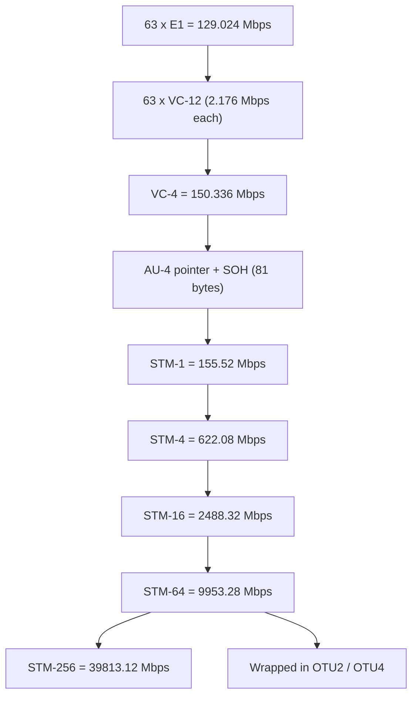
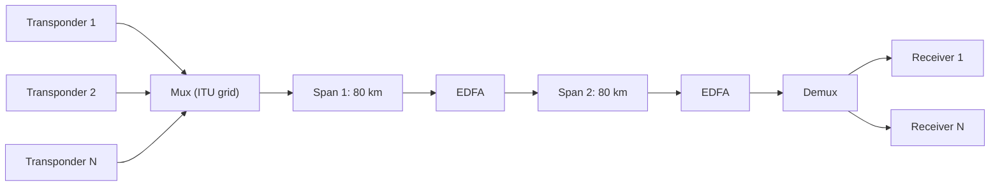

# 08 - Optical Fibre, DWDM and OTN

## Learning Objectives

After this chapter you will be able to:

1. Describe the structure of an optical fibre (core, cladding, coating) and explain total internal reflection.
2. Distinguish single-mode from multimode fibre, and step-index from graded-index, and say which one is used where.
3. State the three transmission windows (850, 1310, 1550 nm) and explain why 1550 nm wins for long haul.
4. Convert between fibre loss in dB/km, total span loss in dB, and received power in dBm without mixing the units.
5. Explain modal, chromatic and polarisation mode dispersion, and compute the distance limit each imposes (L4).
6. Pair optical sources with detectors correctly (LED/PIN, laser/PIN, laser/APD).
7. Reproduce the SDH hierarchy from STM-1 to STM-256 and compute rates and E1 capacity (L4).
8. Describe the SDH frame, virtual containers and pointer justification at awareness level.
9. Explain DWDM, the C-band and L-band, and the ITU-T 50/100 GHz grid, and count channels from band width (L4).
10. Place EDFA amplifiers and state their gain bands and why they made DWDM economic.
11. Explain OTN containers (ODU1 to ODU4), OTU wrapping and FEC, and why OTN carries SDH and Ethernet.
12. Compare protection schemes (1+1, 1:1, MSP, SNCP, ring, mesh) by speed and cost.
13. Build a link budget and an OSNR estimate and decide whether a span closes (L4).

## Introduction

Transmission Infrastructure is **15% of the paper = 24 questions**. It sits between Wireline and Basic Telecommunications in the official block list, and it is the block most CSE graduates skip because "it is physics". That is a mistake with a measurable cost.

Here is why this block is the most winnable 24 marks on the paper:

- Roughly **a third of the questions are L1 recall**: which window is lowest loss, which fibre has a 9 um core, what STM-16 is, what EDFA stands for. These are flashcards, not physics.
- Another third are **L2 comparisons**: SMF vs MMF, LED vs laser, PIN vs APD, 1+1 vs 1:1, SDH vs OTN. All of them are two-column tables in this chapter.
- The remainder are **L4 numericals from four formula families only**: span loss, SDH rate from STM level, DWDM channel count, and link budget with margin. Four formulas. That is the entire arithmetic surface of 24 marks.

You do not need Maxwell's equations. You need the numbers, the units, and the habit of writing them down.

There is one more reason to take this block seriously: it is the **only block where a wrong answer is usually a unit error, not a knowledge gap**. A candidate who writes "0 dBm - 17 dB = -17 dBm" gets the mark. A candidate who writes "0 - 17 = 17 dBm" loses it and then blames the syllabus. Unit discipline is worth 2 to 4 marks here on its own, which is why this chapter has a dedicated section on it.

## Prerequisites

- **Logarithms**: `log10(2) = 0.301`, `log10(3) = 0.477`, `log10(10) = 1`. You need these for dB and for splitter loss.
- **Powers of ten and unit prefixes**: k = 10^3, M = 10^6, G = 10^9, T = 10^12, m = 10^-3, u = 10^-6, n = 10^-9.
- **The wave equation in one line**: `c = f x lambda`, with `c = 3 x 10^8 m/s` in vacuum (2 x 10^8 m/s in glass, which is why the refractive index matters).
- **Basic ratio thinking**: a 3 dB change is a factor of 2 in power. A 10 dB change is a factor of 10.
- **Nothing else.** If you have passed a first-year signals course, you have more physics than this chapter needs.

## Key Terminology

| Term | Meaning |
|---|---|
| **Core** | The central glass region that carries the light; 8-10 um in SMF, 50 or 62.5 um in MMF |
| **Cladding** | Glass layer around the core with slightly lower refractive index; traps light by total internal reflection; 125 um outer diameter |
| **Coating (buffer)** | Plastic protective layer over the cladding; 250 um typical; mechanical protection only |
| **Numerical aperture (NA)** | Light-gathering cone of the fibre; `NA = sqrt(n1^2 - n2^2)`; ~0.1 for SMF, ~0.2 for MMF |
| **Single-mode fibre (SMF)** | Core small enough that only one propagation mode exists; no modal dispersion; long haul |
| **Multimode fibre (MMF)** | Large core, many modes, modal dispersion; short reach, data centres, campus |
| **Step index** | Refractive index changes abruptly at the core-cladding boundary |
| **Graded index** | Refractive index falls gradually across the core, bending rays back; reduces modal dispersion |
| **Attenuation** | Loss of optical power per kilometre, in dB/km; scattering plus absorption |
| **Dispersion** | Pulse spreading in the time domain; limits bit rate times distance |
| **Chromatic dispersion (CD)** | Different wavelengths travel at different speeds; in ps/(nm x km) |
| **PMD** | Polarisation mode dispersion; random birefringence; in ps/sqrt(km) |
| **WDM / DWDM** | Wavelength division multiplexing; DWDM = dense, 100 or 50 GHz spacing, many channels on one fibre |
| **EDFA** | Erbium-doped fibre amplifier; optical amplification without regeneration, C-band and L-band |
| **SDH / SONET** | Synchronous Digital Hierarchy (ITU-T G.707) / its North American twin; STM-1 = 155.52 Mbps |
| **STM-N** | Synchronous Transport Module level N; N = 1, 4, 16, 64, 256 |
| **VC / TU / AU** | Virtual Container / Tributary Unit / Administrative Unit; the SDH payload envelopes and pointers |
| **OTN** | Optical Transport Network (ITU-T G.709); ODU/OTU containers with strong FEC |
| **OSNR** | Optical Signal-to-Noise Ratio, in dB, referenced to 0.1 nm (12.5 GHz) |
| **Link budget** | Arithmetic that proves received power exceeds receiver sensitivity by the required margin |

That is more than ten terms because the exam uses them as question stems, not as vocabulary.

## Theory

### 1. Why fibre at all

Three properties decide the medium for any link: **loss, bandwidth and immunity**.

| Property | Copper twisted pair | Coax | Optical fibre |
|---|---|---|---|
| Loss | High, rises with frequency | Moderate | Very low (0.2 dB/km) |
| Bandwidth | ~100 MHz over 100 m | ~1 GHz | Tens of THz |
| EMI immunity | None | Shielding helps | Total (dielectric) |
| Repeater spacing | ~1-2 km (DSL), 100 m (LAN) | ~1 km | 80-120 km amplified |
| Security | Tappable | Tappable | Very hard to tap undetected |

Fibre wins on all three at distance. The cost is that you cannot splice it with a screwdriver, you need opto-electronic conversion at both ends, and you must budget optical power rather than voltage.

### 2. Fibre structure: core, cladding, coating

An optical fibre is a glass cylinder inside a glass cylinder inside a plastic jacket.

```
        cross-section                    longitudinal
   +-------------------+              +---------------------+
   |     coating       |  250 um      | coating  (plastic)  |
   |  +-------------+  |              |  +---------------+  |
   |  |  cladding   |  |  125 um      |  |   cladding    |  |
   |  |  +-------+  |  |              |  |  +---------+  |  |
   |  |  | core  |  |  |  9 um (SMF)  |  |  |  core   |  |  |
   |  |  +-------+  |  |              |  |  +---------+  |  |
   |  +-------------+  |              |  +---------------+  |
   +-------------------+              +---------------------+
```

- **Core**: the light path. 8-10 um for SMF, 50 um or 62.5 um for MMF.
- **Cladding**: lower refractive index (`n2 < n1`). Light hitting the boundary at a shallow enough angle is totally internally reflected and stays in the core. 125 um is the industry-standard outer diameter for both SMF and MMF, which is why the same connectors and cleavers work on both.
- **Coating**: a polymer layer, usually 250 um, for mechanical protection and colour coding. It carries no light. Strip it before splicing.

**The one number to remember**: SMF is **9/125** (core/cladding, um). MMF is **50/125** or **62.5/125**. If a question says "9 um core", the answer is single-mode.

**Total internal reflection** happens when light travels from a denser medium (core, `n1`) to a rarer one (cladding, `n2`) at an angle greater than the critical angle `theta_c = arcsin(n2/n1)`. The maximum launch angle that still gets trapped defines the numerical aperture.

### 3. Single-mode vs multimode, step vs graded index

| Feature | Single-mode (SMF) | Multimode (MMF) |
|---|---|---|
| Core diameter | 8-10 um | 50 um or 62.5 um |
| Modes | 1 | Hundreds |
| Modal dispersion | None | Yes, dominant limit |
| Source | Laser (DFB, mostly) | LED or VCSEL |
| Wavelength | 1310 / 1550 nm | 850 / 1300 nm |
| Loss | 0.2-0.35 dB/km | 2.5-3.5 dB/km at 850 nm |
| Reach | 10-100+ km per span | 300 m to 2 km |
| Cost of electronics | High | Low |
| Typical use | Metro, core, FTTH feeder, submarine | Data centre, campus, in-building |

**Step index vs graded index** applies to multimode (and is a common trap):

- **Step index**: the index jumps at the boundary. Rays taking long zig-zag paths arrive late. Modal dispersion is large; bandwidth-distance product is only about 20 MHz x km. Obsolete for data.
- **Graded index**: the index decreases smoothly toward the cladding, so off-axis rays travel faster in the outer (lower-index) region and catch up. Modal dispersion drops by roughly an order of magnitude; bandwidth-distance product reaches hundreds of MHz x km (OM3 is about 2000 MHz x km, OM4 about 4700 MHz x km at 850 nm).

Single-mode fibre is always step index in construction, but because only one mode propagates there is nothing to spread, so the distinction is irrelevant there.

**Why SMF wins at distance**: no modal dispersion, and lower loss. Its cost is tighter alignment tolerances (a 9 um core demands sub-micron connector precision) and more expensive lasers.

### 4. The three windows (and why 1550 nm wins)

Silica glass is not equally transparent at all wavelengths. Two loss mechanisms dominate:

- **Rayleigh scattering**: varies as `1/lambda^4`. It is the reason shorter wavelengths lose more.
- **Infrared absorption**: rises steeply beyond about 1600 nm as the wavelength approaches the vibrational resonances of the Si-O bond.
- **OH (water) absorption peak**: near 1383 nm. Older fibre had a "water peak" here, splitting the spectrum into separate windows. Modern low-water-peak fibre (G.652.D) is usable from 1260 to 1625 nm.

| Window | Wavelength | Typical loss (SMF) | Typical loss (MMF) | Why it matters |
|---|---|---|---|---|
| First | 850 nm | n/a (MMF band) | 2.5-3.5 dB/km | Cheap VCSEL/LED, short reach |
| Second | 1310 nm | 0.35 dB/km | 0.5-1.0 dB/km | **Zero chromatic dispersion** in G.652 |
| Third | 1550 nm | **0.2 dB/km** | n/a | Lowest loss, EDFA band, long haul |
| (Fourth) | 1625 nm | 0.25 dB/km | n/a | Maintenance and OTDR testing |

**Why 1550 nm wins for long haul**, in exam language:

1. **Lowest attenuation**: 0.2 dB/km versus 0.35 dB/km at 1310 nm. Over 100 km that is 20 dB versus 35 dB - a 15 dB difference, which is 30x the power.
2. **EDFA amplification**: erbium-doped fibre amplifiers work in the C-band around 1530-1565 nm. There is no comparable mature amplifier at 1310 nm, so a 1310 nm system must regenerate (convert light to electrons and back) every 40-60 km.
3. **DWDM fits there**: the C-band is about 4 THz wide, enough for 40 to 80 channels at 100 or 50 GHz spacing.

**The catch**: G.652 fibre has its zero-dispersion point at 1310 nm, and about **17 ps/(nm x km)** of chromatic dispersion at 1550 nm. So 1550 nm trades dispersion for loss. Long-haul systems solve this with dispersion-compensating fibre (DCF), with chirped fibre Bragg gratings, or - in modern systems - with coherent detection and electronic dispersion compensation in the DSP.

That trade-off is a favourite question: "1550 nm has the lowest loss but the highest dispersion in standard fibre; 1310 nm has zero dispersion but higher loss." Both halves are true.

### 5. Attenuation in dB/km (L4 numerical)

Attenuation is specified as a **ratio per unit length**, so it is in **dB/km**, never dBm/km.

```
Loss (dB) = attenuation coefficient (dB/km) x length (km)
```

Typical values to memorise:

| Fibre / wavelength | Attenuation |
|---|---|
| G.652 at 1310 nm | 0.35 dB/km (max 0.36 per spec) |
| G.652 at 1550 nm | 0.20-0.22 dB/km |
| G.652 at 1625 nm | 0.25 dB/km |
| MMF OM3 at 850 nm | 3.0 dB/km |
| MMF OM3 at 1300 nm | 1.0 dB/km |

Other loss contributors in a real span:

| Element | Typical loss |
|---|---|
| Fusion splice | 0.05-0.1 dB |
| Mechanical splice | 0.2-0.5 dB |
| Connector pair (LC/SC/FC) | 0.3-0.5 dB per mated pair |
| Bend loss (macrobend) | Rises sharply below the minimum bend radius; G.657 is bend-insensitive |

A span is not just fibre. A 60 km span with a splice every 2 km and two connectors has:

```
fibre     60 km x 0.22 dB/km            = 13.20 dB
splices   30 x 0.10 dB                  =  3.00 dB
connectors 2 x 0.50 dB                  =  1.00 dB
total                                    = 17.20 dB
```

The "2 connectors" are the patch cords at each end. If the question says "connector loss 0.5 dB", check whether it means per connector or per pair, and whether both ends are counted. Most L4 questions in this family are lost on exactly that.

### 6. Dispersion: the real distance limit (L4 numerical)

Loss tells you how much power arrives. Dispersion tells you whether the pulses are still distinguishable when they do. A span can have plenty of power and still fail because the bits have smeared into each other.

#### 6.1 Modal dispersion (MMF only)

Different modes take different path lengths, so they arrive at different times. The spread is roughly:

```
delta_t / L  proportional to  (NA^2) / (2 x n1 x c)     for step index
```

You do not need that formula. You need the consequences:

- Modal dispersion is **absent in SMF** by definition.
- It is **reduced but not eliminated** by graded-index profiles.
- It is the reason MMF is limited to a few hundred metres at 10 Gbps.

If a question asks "which dispersion is eliminated by using single-mode fibre", the answer is **modal dispersion**, and only modal.

#### 6.2 Chromatic dispersion (CD)

Different wavelengths travel at slightly different speeds because the refractive index depends on wavelength. A laser is not perfectly monochromatic: it has a spectral width `delta_lambda`. The pulse broadening over length `L` is:

```
delta_t = D x L x delta_lambda
```

where `D` is the dispersion coefficient in **ps/(nm x km)**, `L` in km, `delta_lambda` in nm. `delta_t` comes out in ps.

The link closes while the broadening stays a fraction of the bit period `T = 1/B`:

```
D x L x delta_lambda  <=  epsilon / B        (epsilon = allowed fraction of a bit, often 0.1)
=>  B x L  <=  epsilon / (D x delta_lambda)
```

For G.652 at 1550 nm, `D = 17 ps/(nm x km)`, and a directly modulated DFB laser has an effective width of about 0.01 nm:

```
B x L <= 0.1 / (17 ps/(nm x km) x 0.01 nm)
      <= 0.1 / (0.17 ps/km)
      <= 588 Gbps x km
```

So 10 Gbps reaches about 58 km, and 2.5 Gbps about 235 km, before dispersion - not loss - is the limit. That is why 10G metro links at 1550 nm need compensation at only a few tens of kilometres, while 2.5G links run to the loss limit.

At 1310 nm, `D` is approximately zero for G.652, so the dispersion limit disappears and loss becomes the only constraint. This is the entire reason 1310 nm survived as a metro wavelength for decades.

#### 6.3 Polarisation mode dispersion (PMD)

A real fibre is not perfectly circular; stress and bends make the two polarisation axes travel at slightly different speeds. The differential delay grows with the **square root** of distance because the imperfections are random:

```
delta_t_PMD = PMD_coefficient x sqrt(L)
```

with `PMD_coefficient` in **ps/sqrt(km)**. Modern G.652 fibre is below 0.1 ps/sqrt(km); old installed fibre can be 0.5 or worse.

The limit is again a fraction of a bit:

```
PMD x sqrt(L) <= epsilon / B
=>  L <= (epsilon / (B x PMD))^2
```

At 10 Gbps with `epsilon = 0.1` and PMD = 0.1 ps/sqrt(km): `L <= (10 ps / 0.1)^2 = 10,000 km`. At 40 Gbps: `L <= (2.5 / 0.1)^2 = 625 km`. PMD is what stops you simply turning up the bit rate on old fibre; it is also why 40G and 100G needed coherent detection.

#### 6.4 The three dispersions in one table

| Dispersion | Where it occurs | Depends on | Units | Fix |
|---|---|---|---|---|
| Modal | MMF only | Core size, index profile, NA | ns/km (or MHz x km) | Use SMF; graded index helps |
| Chromatic | All fibre | `D`, length, laser spectral width | ps/(nm x km) | DCF, FBG, coherent DSP, 1310 nm |
| PMD | All fibre, random | Fibre quality, length | ps/sqrt(km) | Better fibre, coherent DSP, shorter spans |

### 7. Optical sources and detectors

| Source | Wavelength | Spectral width | Power | Cost | Used with |
|---|---|---|---|---|---|
| LED | 850 / 1300 nm | Wide (~50 nm) | Low (-20 to -10 dBm) | Very low | MMF, short reach |
| Fabry-Perot (FP) laser | 1310 / 1550 nm | Moderate (1-5 nm) | Moderate | Low | Short/medium SMF |
| DFB laser | 1310 / 1550 nm | Very narrow (<0.1 nm) | Moderate to high | Medium | Long haul, DWDM |
| Tunable laser | C-band, any ITU channel | Very narrow | Moderate | High | ROADM and DWDM networks |
| VCSEL | 850 nm | Moderate | Low | Very low | MMF data centres |

The pairing logic: **wide spectrum plus MMF is fine** because modal dispersion dominates anyway; **narrow spectrum plus SMF is required** because chromatic dispersion scales with spectral width. A DFB laser is a laser with a diffraction grating that selects one longitudinal mode, which is why it is the standard DWDM source.

| Detector | Gain | Noise | Bias | Use |
|---|---|---|---|---|
| **PIN** photodiode | None (1x) | Low | Low voltage | Short/medium reach, cheap |
| **APD** (avalanche photodiode) | Internal, ~10x (about 10 dB) | Higher (excess noise factor) | High (tens of volts) | Long haul, low-light links |

An APD buys you roughly **5-10 dB of sensitivity** at the cost of a high bias supply and a noisier output. That is why it appears in long-haul receivers and not in consumer ONTs.

### 8. Connectors and splices

| Item | Loss | Removable | Where used |
|---|---|---|---|
| Fusion splice | 0.05-0.1 dB | No | Permanent joints in cable sections |
| Mechanical splice | 0.2-0.5 dB | No | Field repair, temporary |
| Connector pair | 0.3-0.5 dB | Yes | Equipment ports, patch panels, ODF |

Common connector types: **SC** (square, push-pull), **LC** (small form factor, data centres), **FC** (ferrule, screw-on, test equipment), **ST** (bayonet, legacy). Polish variants: PC, UPC (ultra physical contact), APC (angled, 8 deg, lower back-reflection, used in PON and CATV because reflection matters more than loss there).

**Return loss** is a separate specification: APC gives about -60 dB, UPC about -50 dB. High back-reflection destabilises lasers and degrades analogue video, which is why FTTH uses APC/APC (green connectors).

Splices beat connectors on loss and reflection; connectors beat splices on flexibility. A real span uses both, and a link budget must count both.

### 9. Units discipline: dB, dBm, dBm/Hz

This section is worth reading twice. Most lost marks in this block are unit errors, not concept errors.

**dB is a ratio.** It has no absolute reference. Gains and losses are in dB, and they **add**.

```
Loss of 3 dB = half the power
Gain of 3 dB = double the power
Loss of 10 dB = one tenth
Loss of 20 dB = one hundredth
```

**dBm is an absolute power**, referenced to 1 milliwatt:

```
P(dBm) = 10 x log10( P(mW) / 1 mW )
```

| Power | dBm |
|---|---|
| 1 mW | 0 dBm |
| 10 mW | +10 dBm |
| 100 mW | +20 dBm |
| 1 W | +30 dBm |
| 1 uW | -30 dBm |
| 1 nW | -60 dBm |

**The rules that never break:**

1. `dBm + dB = dBm`. (0 dBm - 17 dB = -17 dBm.)
2. `dBm - dBm = dB`. (Received power minus sensitivity equals margin, in dB.)
3. `dBm + dBm` is **meaningless**. You cannot add two absolute powers by adding their dBm values. Convert to mW, add, convert back.
4. `dB - dB = dB` is fine; `dB x dB` is meaningless.
5. **dBW = dBm - 30.** A +20 dBm transmitter is -10 dBW.
6. `dB/km` and `dB/sqrt(km)` are coefficients, not levels. Never write "dBm/km".

**dBm/Hz** is power spectral density: power per unit bandwidth. It appears in noise calculations. The exam-level use is OSNR, which is measured in a **0.1 nm reference bandwidth**, equal to **12.5 GHz** at 1550 nm. That is where the "0.1 nm = 12.5 GHz" fact comes from; it is not arbitrary.

**Rule of thumb for the exam**: write the unit after every number in every step. It costs five seconds and catches the error before you bubble the wrong option.

### 10. SDH hierarchy (L4 numerical)

SDH is a synchronous multiplexing hierarchy defined by ITU-T G.707. Everything is built from one number: **STM-1 = 155.52 Mbps**.



| Level | Multiplier | Rate | Common description |
|---|---|---|---|
| STM-1 | 1 | 155.52 Mbps | "155 Meg" |
| STM-4 | 4 | 622.08 Mbps | "622 Meg" |
| STM-16 | 16 | 2488.32 Mbps | "2.5 G" |
| STM-64 | 64 | 9953.28 Mbps | "10 G" |
| STM-256 | 256 | 39,813.12 Mbps | "40 G" |

**Why 155.52 and not 150?** Because the frame carries 2430 bytes every 125 us, and 2430 x 8 / 125 us = 155.52 Mbps. The 125 us comes from the 8 kHz sampling clock of the telephone network: SDH is built to carry E1s, so its frame rate equals the PCM frame rate. That single sentence explains the odd number, and examiners like asking where it comes from.

**Capacity in E1s**: one STM-1 carries 63 E1s. So:

- STM-4 = 252 E1
- STM-16 = 1008 E1
- STM-64 = 4032 E1

Note the payload efficiency: 63 x 2.048 = 129.024 Mbps out of 155.52 Mbps is **83%**. The rest is section overhead, pointers and justification.

**SONET mapping** (awareness only): SONET STS-1 = 51.84 Mbps, and STS-3 = 155.52 Mbps = STM-1. So STM-1 = OC-3, STM-4 = OC-12, STM-16 = OC-48, STM-64 = OC-192. The rule is `OC-n = 3 x STM-n/4`... easier: **STM-N = OC-3N**.

### 11. The SDH frame and virtual containers

An STM-1 frame is a **9 row by 270 column** block of bytes, transmitted row by row, left to right, top to bottom, every 125 us.

```
+--------------------------------------------------+
| RSOH (3 x 9)  |                                   |
+---------------+          payload                  |
| AU pointer(9) |      261 columns x 9 rows         |
+---------------+                                   |
| MSOH (5 x 9)  |                                   |
+--------------------------------------------------+
   9 columns                    261 columns
```

- **RSOH** (regenerator section overhead): 3 x 9 = 27 bytes, terminated at every regenerator.
- **MSOH** (multiplex section overhead): 5 x 9 = 45 bytes, passes through regenerators, terminated at multiplexers. Carries the APS bytes K1/K2 used by MSP.
- **AU pointer**: 9 bytes, says where the VC-4 starts inside the payload. This is what allows **pointer justification**: the payload can float within the frame, so clocks do not need to be perfectly aligned.
- **Payload**: 261 x 9 = 2349 bytes = 150.336 Mbps at 125 us.

**Virtual container ladder** (awareness level, but the numbers get asked):

| Container | Nominal payload | Typical client |
|---|---|---|
| C-11 / VC-11 | 1.544 Mbps | T1 |
| C-12 / VC-12 | 2.048 Mbps | E1 |
| C-2 / VC-2 | 6.312 Mbps | T2 |
| C-3 / VC-3 | 34.368 or 44.736 Mbps | E3 / DS3 |
| C-4 / VC-4 | 139.264 Mbps | E4, or 63 x E1 |
| VC-4-4c | 4 x VC-4 concatenated | 622 Mbps client |
| VC-4-64c | 64 x VC-4 concatenated | 10 Gbps client |

**Multiplex path for E1**: `E1 -> C-12 -> VC-12 -> TU-12 -> TUG-2 (3 x TU-12) -> TUG-3 (7 x TUG-2) -> VC-4 (3 x TUG-3) -> AU-4 -> AUG -> STM-N`. That is 3 x 7 x 3 = **63 E1 per VC-4**, which is the number to remember.

**Concatenation** matters because a 10 Gbps Ethernet client cannot be split across 64 separate VC-4s without losing the ability to be switched as one unit. `VC-4-64c` gives one contiguous 9.95 Gbps container. This is the seed of the idea that OTN later solved properly.

### 12. DWDM principles (L4 numerical)

WDM puts multiple wavelengths on one fibre. **CWDM** uses wide spacing (20 nm) and few channels, unamplified, short metro reach. **DWDM** uses narrow spacing (100 or 50 GHz) and many channels, amplified, long haul.



The key idea: **each channel is an independent wavelength, and the fibre is shared**. Capacity scales with channel count, not with a faster single laser. That is why DWDM is described as "multiplying the fibre" without digging.

#### 12.1 Bands

| Band | Wavelength range | Approximate frequency range | Amplifier |
|---|---|---|---|
| O-band (original) | 1260-1360 nm | 220-238 THz | None practical |
| E-band | 1360-1460 nm | 205-220 THz | None practical |
| S-band | 1460-1530 nm | 196-205 THz | Raman, some TDFA |
| **C-band** (conventional) | **1530-1565 nm** | **191.7-196.1 THz** | **EDFA** |
| **L-band** (long) | **1570-1610 nm** | **186.3-191.1 THz** | **L-band EDFA** |
| U-band (ultra-long) | 1625-1675 nm | 179-184 THz | None practical |

C-band is where the standard EDFA works, so it carries most traffic. L-band doubles the capacity when C is full, at the cost of a second amplifier type and slightly worse loss. Together, C+L gives about 8 THz, which is why "C+L" appears in capacity discussions.

#### 12.2 The ITU-T G.694.1 grid

G.694.1 defines a **frequency grid anchored at 193.1 THz** (1552.52 nm), with spacings of 12.5, 25, 50 and 100 GHz.

```
f(channel n) = 193.1 THz + n x spacing
```

Converting spacing to wavelength at 1550 nm uses:

```
delta_lambda = lambda^2 x delta_f / c
```

With `lambda = 1550 nm = 1.55 x 10^-6 m` and `delta_f = 100 GHz = 1 x 10^11 Hz`:

```
delta_lambda = (1.55e-6)^2 x 1e11 / 3e8
             = 2.4025e-12 x 1e11 / 3e8
             = 8.0 x 10^-10 m
             = 0.8 nm
```

So **100 GHz = 0.8 nm**, **50 GHz = 0.4 nm**, **25 GHz = 0.2 nm** at 1550 nm. This conversion is a standard one-mark question.

#### 12.3 Channel-count arithmetic

Channel count is band width divided by spacing:

```
N = (f_high - f_low) / spacing
```

C-band edges: 1530 nm = 196.08 THz, 1565 nm = 191.69 THz, so `delta_f = 4.39 THz`.

- At 100 GHz: `4.39 / 0.1 = 43.9`, so 44 slots fit.
- At 50 GHz: `4.39 / 0.05 = 87.8`, so 87 slots fit.

Engineering practice quotes **40 channels at 100 GHz** and **80 at 50 GHz**, because the band edges are avoided and guard bands are kept. If an exam question gives you band edges and a spacing, do the division and round **down**. If it asks "how many channels in the C-band at 100 GHz" with no edges given, answer **40** (the standard system number) and note 44 is the theoretical maximum.

**Capacity check**: 40 channels x 10 Gbps = 400 Gbps per fibre pair. 80 channels x 100 Gbps at 50 GHz = 8 Tbps. Per channel at 50 GHz, 100 Gbps is **2 bit/s/Hz** of spectral efficiency, a number worth recognising.

### 13. EDFA amplifiers

An erbium-doped fibre amplifier is a length of fibre doped with Er3+ ions, pumped by a 980 nm or 1480 nm laser. Signal photons at 1530-1565 nm stimulate emission, so the signal is amplified **optically**, with no conversion to electronics.

| Parameter | Typical value |
|---|---|
| Gain band | C-band 1530-1565 nm; L-band 1570-1610 nm |
| Gain | 20-30 dB |
| Noise figure | 4-6 dB |
| Output power | +17 to +23 dBm (single stage) |
| Pump wavelengths | 980 nm, 1480 nm |
| Gain flatness | Needs gain-equalising filter across 40 channels |

**Why EDFA made DWDM economic**: before it, every wavelength needed its own regenerator every 40-60 km, so 40 channels meant 40 regenerators per site. With EDFA, **one amplifier boosts all 40 channels at once**, so cost per bit falls by the channel count. That single sentence is the answer to "why did DWDM take off in the 1990s".

**The cost**: an EDFA amplifies noise as well as signal, and it adds its own amplified spontaneous emission (ASE). That is why OSNR degrades with every amplifier, and why a chain of 20 amplifiers is harder than one long span. It also cannot amplify 1310 nm, which is the practical reason 1310 nm stayed a metro/short-reach window.

**Raman amplification** uses stimulated Raman scattering in the transmission fibre itself, distributed over tens of kilometres, and works in any band including L and S. It is used in very long submarine spans, usually combined with EDFA.

### 14. OTN (ITU-T G.709)

SDH was designed for voice. Ethernet was designed for packets. Neither is good at carrying the other efficiently, and DWDM needed a common wrapper with strong error correction. OTN is that wrapper.

**The hierarchy** (memorise the ODU rates; the OTU rates are the line rates including FEC):

| Container | Rate | Typical client |
|---|---|---|
| ODU0 | 1.244 Gbps | 1G Ethernet (via GMP mapping) |
| ODU1 | 2.498 Gbps | 2.5G, STM-16 |
| ODU2 | 10.037 Gbps | 10G Ethernet, STM-64 |
| ODU2e | 10.399 Gbps | 10G Ethernet with full rate |
| ODU3 | 40.319 Gbps | 40G, STM-256 |
| ODU4 | 104.134 Gbps | 100G Ethernet |
| OTU1 | 2.666 Gbps | ODU1 + overhead + FEC |
| OTU2 | 10.709 Gbps | ODU2 + overhead + FEC |
| OTU3 | 43.018 Gbps | ODU3 + overhead + FEC |
| OTU4 | 111.810 Gbps | ODU4 + overhead + FEC |

**Note the two-rate trap**: ODU2 is 10.037 Gbps and OTU2 is 10.709 Gbps. If a question says "OTU2 line rate", the answer is 10.709. If it says "ODU2 payload", it is 10.037. The 6.7% difference is the FEC and overhead.

**Frame**: 4 rows x 4080 columns of bytes, of which 16 columns are overhead and 256 columns are FEC (for OTU2). The frame repeats at 48.971 us for OTU1.

**FEC**: Reed-Solomon RS(255,239) adds 7% overhead and gives about **5-6 dB of coding gain**. Stronger variants (GFEC, oFEC) give more. Coding gain is why OTN reaches further than raw SDH over the same fibre: you can run at a lower OSNR and still recover the bits.

**Why OTN wraps SDH and Ethernet**:

1. **Transparency**: the client signal is mapped into an ODU and carried without inspection, so a carrier can transport a competitor's or a customer's protocol.
2. **Grooming**: ODU1/ODU2/ODU3 can be multiplexed into a higher ODU, so a 100G wavelength can carry a mix of 10G and 40G clients.
3. **Strong FEC**: longer spans and fewer regenerators.
4. **Management**: TCM (tandem connection monitoring) fields give per-operator performance monitoring across multi-domain networks.
5. **Standardised DWDM handoff**: the OTU is what actually goes on the coloured wavelength.

**OTN vs SDH in one line**: SDH multiplexes **timeslots** (TDM), OTN multiplexes **containers** (ODUk) and adds FEC; SDH tops out at 40G, OTN goes to 100G and beyond.

### 15. Protection schemes

Protection is about recovering in **50 ms** or less, which is the threshold at which a voice call does not drop.

| Scheme | Level | How it works | Protection path | Speed | Extra capacity needed |
|---|---|---|---|---|---|
| **1+1** | Path or line | Signal bridged permanently to working and protection; receiver picks the better | Always carrying traffic | <50 ms, hitless | 100% (dedicated) |
| **1:1** | Path or line | Protection path idle (or carries extra traffic); APS protocol switches on failure | Idle until failure | <50 ms | 100%, but reusable |
| **1:N** | Line | One protection path for N working paths | Shared | <50 ms | 1/N |
| **MSP** | Multiplex section | SDH linear protection of the whole STM-N span; APS via K1/K2 bytes | 1+1 or 1:1 | <50 ms | As above |
| **SNCP** | Path (VC-4/VC-12) | Signal dual-fed over two disjoint routes; sink selects; no protocol needed | Dual feed | <50 ms | 100% |
| **MS-SPRING / BLSR** | Ring | Ring wrap at the nodes adjacent to the failure | Ring half | <50 ms | 50% (2-fibre) |
| **Mesh restoration** | Network | Control plane (GMPLS/ASON) computes a new path | Any | 100 ms to seconds | Shared |

**The distinctions examiners test**:

- **1+1 vs 1:1**: 1+1 has a permanent bridge and needs no signalling, so it is hitless and simple but wastes 100% capacity. 1:1 needs APS signalling but the protection path can carry low-priority "extra traffic" when healthy.
- **MSP vs SNCP**: MSP protects a **section** (the span between two nodes, whole STM-N). SNCP protects a **path** (an individual VC-4 or VC-12) and can route over any topology, including a mesh, because it does not need a ring.
- **Ring vs mesh**: rings give deterministic 50 ms recovery with simple hardware but need 50% (or 100%) spare capacity. Mesh is capacity-efficient but recovery depends on a control plane and is slower.
- **Protection vs restoration**: protection is pre-planned and fast; restoration is computed after the failure and slower but more capacity-efficient.

### 16. Link budget and OSNR (L4 numerical)

#### 16.1 The link budget equation

```
P_rx (dBm) = P_tx (dBm) - fibre loss (dB) - splice loss (dB)
             - connector loss (dB) + amplifier gain (dB)

margin (dB) = P_rx (dBm) - sensitivity (dBm)
```

The link closes if `margin >= required margin` (typically 3 dB for ageing, repairs and temperature; 6 dB on critical routes).

**Power margin vs system margin**: power margin is what you have today against a fixed sensitivity. System margin is the allowance you design in for future splices, ageing and repairs. Exam questions usually just say "margin" and mean the difference between received power and sensitivity, then ask whether it exceeds a stated requirement.

#### 16.2 OSNR

Every amplifier adds ASE noise, so the signal-to-noise ratio degrades span by span:

```
OSNR_total (dB) = P_ch (dBm) + 58 - NF (dB) - 10 x log10(N)
```

where `P_ch` is the per-channel power **at the amplifier input**, `NF` is the amplifier noise figure, `N` is the number of spans, and **58 dB** is the constant `-10 x log10(h x nu x B_ref)` for a 0.1 nm (12.5 GHz) reference at 1550 nm. This is the standard simplified engineering form; you do not need to derive it, but you do need to use it.

Consequences to memorise:

- Doubling per-channel power gives **+3 dB** OSNR.
- Doubling the number of spans gives **-3 dB** OSNR.
- A lower noise figure is worth exactly its dB difference.
- OSNR is a **ratio**, so it is in dB, never dBm.

Typical requirements: about 15-16 dB for 10 Gbps OOK with FEC, about 13-15 dB for 100 Gbps coherent PM-QPSK, and 20+ dB for older unprotected 10G without FEC.

## Worked Examples

### Example 1: Span loss with splices and connectors

A 60 km G.652 span at 1550 nm uses 0.22 dB/km fibre, has a fusion splice every 2 km at 0.1 dB, and one connector pair at each end at 0.5 dB per pair.

```
fibre loss      = 60 km x 0.22 dB/km      = 13.20 dB
number of splices = 60 km / 2 km          = 30 splices
splice loss     = 30 x 0.10 dB            =  3.00 dB
connector loss  = 2 x 0.50 dB             =  1.00 dB
------------------------------------------------------
total span loss                           = 17.20 dB
```

Note that the answer is in **dB**, not dBm: it is a loss, a ratio.

### Example 2: Link budget, then maximum reach

Transmitter output 0 dBm, receiver sensitivity -28 dBm, required margin 3 dB, same fibre and splice plan as Example 1, two connector pairs at 0.5 dB.

```
P_rx = 0 dBm - 17.20 dB = -17.20 dBm
margin = -17.20 dBm - (-28 dBm) = 10.80 dB
```

The link closes, with 10.8 dB spare against a 3 dB requirement.

Now the reverse question: **what is the maximum reach with exactly 3 dB margin?**

```
available loss = P_tx - sensitivity - margin
               = 0 dBm - (-28 dBm) - 3 dB
               = 25 dB

connectors take 1.00 dB, leaving 24.00 dB for fibre + splices
splice rate = 1 splice per 2 km = 0.5 splice/km
splice loss per km = 0.5 x 0.10 dB = 0.05 dB/km
total per km = 0.22 dB/km + 0.05 dB/km = 0.27 dB/km

L = 24.00 dB / 0.27 dB/km = 88.9 km
```

Answer: about **88.9 km**. Always check that the answer is below the dispersion limit too; here 10 Gbps would be dispersion-limited at about 58 km, so the real answer would be 58 km, not 88.9 km. **The shorter of the two limits wins.** That two-step check is exactly what separates a 1-mark answer from a 2-mark answer.

### Example 3: SDH rate and E1 capacity from STM level

What is the bit rate and E1 capacity of STM-16?

```
rate = 16 x 155.52 Mbps = 2488.32 Mbps
E1 capacity = 16 x 63 = 1008 E1
payload check = 1008 x 2.048 Mbps = 2064.384 Mbps
efficiency = 2064.384 / 2488.32 = 83.0%
```

Answer: **2488.32 Mbps, 1008 E1**. Note that 2488.32 is not 2500; writing "2.5 Gbps" is acceptable prose but "2500 Mbps" is a wrong numerical answer.

### Example 4: DWDM channel count and capacity

A C-band system uses 1530-1565 nm with 100 GHz spacing. How many channels, and what capacity with 10 Gbps per channel?

```
f(1530 nm) = 3e8 / 1530e-9 = 196.08 THz
f(1565 nm) = 3e8 / 1565e-9 = 191.69 THz
bandwidth  = 196.08 - 191.69 = 4.39 THz

N = 4.39 THz / 100 GHz = 4.39e12 / 100e9 = 43.9
```

So 43 intervals, 44 channel slots. Engineered with guard bands: **40 channels**.

```
capacity = 40 x 10 Gbps = 400 Gbps per fibre pair
```

If the spacing were halved to 50 GHz: `N = 4.39e12 / 50e9 = 87.8`, engineered to **80 channels**, and at 100 Gbps per channel that is **8 Tbps**. Halving spacing doubles channel count, but it also tightens filter tolerances and laser stability, which is the real engineering trade-off.

### Example 5: Chromatic dispersion distance limit

G.652 fibre at 1550 nm has `D = 17 ps/(nm x km)`. A directly modulated DFB laser has an effective spectral width of 0.01 nm. The system allows 0.1 bit of pulse broadening. Find the reach at 10 Gbps and at 2.5 Gbps.

```
allowed broadening = 0.1 / B

at 10 Gbps: 0.1 / 10e9 = 1.0e-11 s = 10 ps
L = 10 ps / (17 ps/(nm x km) x 0.01 nm)
  = 10 / 0.17 km
  = 58.8 km

at 2.5 Gbps: 0.1 / 2.5e9 = 4.0e-11 s = 40 ps
L = 40 / 0.17 = 235.3 km
```

So 10 Gbps reaches about **59 km** and 2.5 Gbps about **235 km** before dispersion closes the link. At 2.5 Gbps the loss limit (about 90 km in Example 2) is the binding constraint, not dispersion; at 10 Gbps dispersion binds first. This is why 10G metro spans need compensation and 2.5G spans usually do not.

### Example 6: PMD distance limit

Installed fibre has PMD = 0.5 ps/sqrt(km). Allowed broadening is 0.1 bit. Find the reach at 10 Gbps and 40 Gbps.

```
at 10 Gbps: allowed = 10 ps
L <= (10 ps / 0.5 ps/sqrt(km))^2 = (20)^2 = 400 km

at 40 Gbps: allowed = 0.1 / 40e9 = 2.5 ps
L <= (2.5 / 0.5)^2 = 25 km
```

So the same fibre supports 10 Gbps to 400 km but 40 Gbps only to 25 km. This is precisely why upgrading an old route from 10G to 40G often fails even though the loss budget is fine, and why coherent receivers (which equalise PMD electronically) changed the economics of upgrades.

### Example 7: OSNR over a chain of amplifiers

A 10-channel DWDM system launches 0 dBm per channel. Span loss is 20 dB, so the per-channel power at each EDFA input is -20 dBm. The EDFA noise figure is 6 dB. Find OSNR after 8 spans and after 16 spans.

```
OSNR = P_ch + 58 - NF - 10 x log10(N)

8 spans:  OSNR = -20 + 58 - 6 - 10 x log10(8)
               = -20 + 58 - 6 - 9.03
               = 22.97 dB

16 spans: OSNR = -20 + 58 - 6 - 10 x log10(16)
               = -20 + 58 - 6 - 12.04
               = 19.96 dB
```

If the receiver needs 20 dB, the 16-span design fails by 0.04 dB. The fixes, in order of cost: raise per-channel power by 1 dB (but watch fibre nonlinearity), lower the noise figure by 1 dB (better amplifier), or add a regenerator. Note the arithmetic: **doubling span count costs 3 dB**, so the OSNR budget is a logarithm, not a linear count.

### Example 8: SDH payload efficiency and a client mapping decision

A carrier must transport 100 x E1 between two cities 120 km apart. Compare STM-4 with VC-4 concatenation for a 600 Mbps Ethernet client.

```
E1 requirement: 100 E1
one STM-4 carries 252 E1, so one STM-4 is enough
used payload = 100 x 2.048 = 204.8 Mbps of 622.08 Mbps = 32.9%

Ethernet client: 600 Mbps
VC-4 = 150.336 Mbps, so 4 x VC-4 = 601.344 Mbps (just enough)
but 4 separate VC-4s are switched independently
VC-4-4c gives one contiguous 601.344 Mbps container
```

Answer: use **VC-4-4c** (concatenated) so the client is switched and protected as a single unit. This example is the bridge to OTN: concatenation works, but OTN does it more cleanly with ODUflex and adds FEC, which is why modern 10G and 100G clients are carried in ODU2/ODU4 rather than in VC-4-64c.

## Exam Traps and Common Mistakes

1. **Adding dBm to dBm.** "0 dBm + 3 dBm = 3 dBm" is wrong; 1 mW + 2 mW = 3 mW = 4.77 dBm. Only dB adds. In a link budget you add **losses in dB** to a **level in dBm**, and the result stays dBm.

2. **Writing the loss in dBm.** Attenuation is dB/km, span loss is dB, received power is dBm, sensitivity is dBm, margin is dB. If your final answer to "what is the span loss" ends in dBm, you have lost the mark even if the number is right.

3. **Confusing STM-4 with 622 Mbps and STM-16 with 2.5 Gbps exactly.** STM-16 is 2488.32 Mbps, not 2500. STM-64 is 9953.28, not 10,000. The exam may offer 2500 as a distractor.

4. **Thinking 1550 nm has low dispersion because it has low loss.** The opposite is true in G.652: zero dispersion is at 1310 nm, and 1550 nm has about 17 ps/(nm x km). Low loss and high dispersion coexist at 1550 nm.

5. **Saying single-mode fibre has "no dispersion".** It has no **modal** dispersion. It still has chromatic and PMD. This is the single most common wrong answer in the block.

6. **Forgetting that connector loss is counted at both ends.** "0.5 dB connector loss" on a 2-connector span is 1.0 dB. Similarly, splice count is `length / splice spacing`, not "one splice".

7. **Mixing ODU and OTU rates.** ODU2 = 10.037 Gbps, OTU2 = 10.709 Gbps. OTU is always the higher number because it includes FEC and overhead.

8. **Assuming 1+1 and 1:1 differ only in name.** 1+1 is permanently bridged and needs no protocol; 1:1 uses APS and can carry extra traffic on the protection path. A question about "which wastes capacity but is hitless" points to 1+1.

9. **Using 50 GHz spacing without halving the wavelength gap.** 100 GHz = 0.8 nm, 50 GHz = 0.4 nm, 25 GHz = 0.2 nm at 1550 nm. Also, halving spacing doubles channel count only within the same band.

10. **Treating OSNR as a power.** OSNR is a ratio in dB. Doubling span count costs 3 dB; it does not halve the OSNR number.

11. **Forgetting that the shorter limit wins.** A span can pass the loss budget and fail the dispersion budget. Always compute both when the question gives both.

12. **Believing EDFA amplifies any wavelength.** Standard EDFA is C-band (and L-band with a different design). It cannot amplify 1310 nm, which is why 1310 nm remained unamplified.

## Summary

Fibre is a core-cladding waveguide: 9/125 um single-mode for distance, 50/125 or 62.5/125 multimode for short reach. Graded-index profiles reduce modal dispersion in MMF but cannot eliminate it; only single-mode eliminates it. The three windows are 850 nm (MMF, cheap), 1310 nm (zero chromatic dispersion in G.652) and 1550 nm (lowest loss at 0.2 dB/km, EDFA band, DWDM band). 1550 nm wins long haul on loss and amplification, and pays for it in chromatic dispersion.

Loss arithmetic is multiplication of a coefficient by distance, plus splices and connectors. Dispersion arithmetic is a limit on bit rate times distance: modal in MMF, chromatic in all fibre (17 ps/(nm x km) at 1550 nm in G.652), PMD growing as sqrt(L). Sources pair with detectors by reach: LED/PIN for short MMF, DFB laser/PIN or APD for long SMF.

SDH is a synchronous TDM hierarchy anchored at STM-1 = 155.52 Mbps, built from a 9 x 270 byte frame every 125 us, carrying 63 E1 per VC-4. DWDM multiplies capacity by wavelength count on the ITU-T G.694.1 grid (100 GHz = 0.8 nm), with C-band and L-band amplified by EDFA. OTN wraps clients in ODU1-ODU4 containers with strong FEC, adds grooming and tandem monitoring, and is what actually rides the wavelength. Protection (1+1, 1:1, MSP, SNCP, ring, mesh) is a trade between capacity cost and recovery speed, with 50 ms as the target. Link budgets and OSNR decide whether the arithmetic closes.

## Practical Takeaways

- Memorise the four number sets: 9/125 and 50/125; 0.35 and 0.2 dB/km; 155.52 x {1,4,16,64,256}; 2.488/1.244 for GPON.
- Write units at every step. dB adds, dBm does not; dBm - dBm = dB.
- For any L4 question, compute loss limit **and** dispersion limit, then take the smaller.
- 100 GHz = 0.8 nm at 1550 nm; channel count = band width in Hz / spacing, rounded down.
- EDFA is C-band (and L-band); it is the reason DWDM is economic and the reason 1310 nm stayed metro.
- 1+1 = permanent bridge, no protocol, hitless, 100% capacity cost. 1:1 = APS, reusable protection path.
- OSNR: +3 dB per doubling of channel power, -3 dB per doubling of span count.
- When a question says "STM-16", think 2488.32 and 1008 E1, not 2500.

## Chapter Quiz

**Q1.** The bit rate of STM-4 is:
(a) 155.52 Mbps (b) 622.08 Mbps (c) 2488.32 Mbps (d) 9953.28 Mbps
**Answer: (b).** STM-4 = 4 x 155.52 = 622.08 Mbps. Option (c) is STM-16 and (d) is STM-64.

**Q2.** Which wavelength window has the lowest attenuation in standard single-mode fibre?
(a) 850 nm (b) 1310 nm (c) 1550 nm (d) 1625 nm
**Answer: (c).** About 0.2 dB/km at 1550 nm versus 0.35 dB/km at 1310 nm. 850 nm is a multimode window with much higher loss.

**Q3.** Which type of dispersion is eliminated by using single-mode fibre instead of multimode?
(a) Chromatic (b) Modal (c) Polarisation mode (d) Waveguide
**Answer: (b).** Only one mode propagates, so there is nothing to arrive at different times. Chromatic and PMD remain.

**Q4.** At 1550 nm, a DWDM channel spacing of 50 GHz corresponds to approximately:
(a) 0.8 nm (b) 0.4 nm (c) 0.2 nm (d) 1.6 nm
**Answer: (b).** `delta_lambda = lambda^2 x delta_f / c` gives 0.4 nm for 50 GHz; 100 GHz would be 0.8 nm.

**Q5.** In SDH, 1+1 protection is characterised by:
(a) A protection path that is idle until failure, with APS signalling
(b) A permanent bridge to both paths, with the receiver selecting the better signal
(c) Ring wrapping at the two nodes adjacent to the failure
(d) Restoration computed by a control plane after the failure
**Answer: (b).** 1+1 is permanently bridged and hitless, and needs no APS. Option (a) is 1:1, (c) is ring protection, (d) is mesh restoration.

## Exercises

1. A 40 km span uses 0.22 dB/km fibre, a splice every 4 km at 0.1 dB, and two connector pairs at 0.5 dB each. Compute the total span loss in dB. *(Numerical)*
2. A transmitter launches 0 dBm into the span in Exercise 1; the receiver sensitivity is -26 dBm. Compute the received power in dBm and the margin in dB. Does the link close with a 3 dB requirement? *(Numerical)*
3. A DWDM system uses 1530-1565 nm at 50 GHz spacing. Compute the number of channel slots, the engineered channel count, and the total capacity at 100 Gbps per channel. *(Numerical)*
4. G.652 fibre at 1550 nm has `D = 17 ps/(nm x km)` and the laser linewidth is 0.02 nm. Find the dispersion-limited reach at 10 Gbps with 0.1 bit tolerance. *(Numerical)*
5. An 8-span link has per-channel input power of -19 dBm and an EDFA noise figure of 5 dB. Compute OSNR. What happens to OSNR if the span count doubles? *(Numerical)*
6. Explain in under 100 words why 1550 nm is used for long haul even though it has more chromatic dispersion than 1310 nm. Mention both loss and amplification.
7. Draw the SDH multiplex path from E1 to STM-1 and mark where pointer justification occurs. Explain why pointers are needed at all.
8. A carrier must protect a 10 Gbps client over a two-fibre ring. Compare SNCP and MS-SPRING on capacity cost and recovery mechanism, and state which one protects the client end to end.

## Next

Chapter 09 continues down the same fibre into the access network: PON, GPON and EPON line rates, split-ratio arithmetic, FTTH topologies, OLT-ONT provisioning, and the media comparison that decides between copper, fibre, microwave and satellite. If this chapter was the backbone, the next one is the last mile - and it carries its own L4 family, the split-ratio power budget, which is worth 2 to 3 questions on its own.
