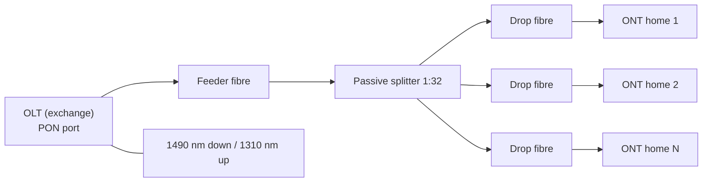

# 09 - GPON, EPON and FTTH

## Learning Objectives

1. Explain why PON exists: passive splitters, no field electronics, shared feeder fibre.
2. Draw the PON topology (OLT, ODN, splitter, ONT/ONU) and state what each element does.
3. Explain downstream broadcast and upstream TDMA, including ranging and equalisation delay.
4. State GPON rates (2.488 Gbps down, 1.244 Gbps up) and the 125 us frame.
5. Compute splitter loss, per-user bandwidth and power budget for any split ratio (L4).
6. Compare EPON, GPON, XGS-PON and NG-PON2 on rate, symmetry, split and reach.
7. Define FTTH, FTTB, FTTC and FTTN, and argue the deployment economics of each.
8. Describe OLT-ONT provisioning and OMCI management at awareness level.
9. Explain triple play over FTTH and how each service is carried.
10. Choose between copper, fibre, microwave and satellite using a decision table.
11. Explain leased lines and MPLS-TP, and why carriers use them.
12. Compare fibre and microwave for mobile backhaul.

## Introduction

This is the second half of the 24-mark Transmission block. Chapter 08 was the backbone - long spans, SDH, DWDM, OTN. This chapter is the **last mile**, and it is where most of the questions that mention BSNL actually live: FTTH, GPON, broadband access, backhaul.

It is winnable for the same three reasons as chapter 08, with one addition:

- **Recall**: 2.488/1.244, 1:32/1:64, 1490/1310 nm, Class B+ 28 dB. A dozen numbers cover a third of the questions.
- **Comparison**: EPON vs GPON vs XGS-PON, FTTH vs FTTB vs FTTC, fibre vs microwave. Two-column tables again.
- **Arithmetic**: split-ratio loss, per-user bandwidth, power budget. One formula, `10 x log10(N)`, plus a subtraction chain.
- **The addition**: the arithmetic here is the **most forgiving** in the paper. Splitter loss is a log of an integer, and power budgets are sums of five numbers. There is no physics to get wrong.

The trap is that candidates memorise "GPON is 2.5G" and then cannot answer "how much does each user get on a 1:64 split". That second question is the one that appears. This chapter drills it.

## Prerequisites

- **Logarithms base 10**: log10(2) = 0.301, so 10 x log10(2) = 3.01 dB.
- **The dB ladder from chapter 08**: 3 dB halves power, 10 dB is a tenth, 20 dB is a hundredth.
- **Powers of two**: 2, 4, 8, 16, 32, 64, 128 - the split ratios.
- **Unit conversion**: 1 Gbps = 1000 Mbps; 2.488 Gbps = 2488 Mbps.
- **Chapter 08 sections 4 and 8** (attenuation and units discipline). This chapter assumes both.

## Key Terminology

| Term | Meaning |
|---|---|
| **PON** | Passive Optical Network; one fibre from the exchange split passively to many homes |
| **OLT** | Optical Line Terminal; the exchange-side equipment, one PON port per feeder fibre |
| **ODN** | Optical Distribution Network; the fibre, splitters, connectors and closures between OLT and ONT |
| **Splitter** | Passive coupler dividing one fibre into N; loss is `10 x log10(N)` plus excess loss |
| **ONT / ONU** | Optical Network Terminal (customer premises) / Optical Network Unit (street or building); same device, different location |
| **Feeder / distribution / drop** | OLT to splitter / splitter to access point / access point to home |
| **Downstream** | OLT to ONT, 1490 nm, continuous broadcast |
| **Upstream** | ONT to OLT, 1310 nm, TDMA bursts |
| **TDMA** | Time Division Multiple Access; each ONU transmits only in its assigned slot |
| **Ranging** | Measuring each ONU's distance so bursts arrive aligned; sets the equalisation delay |
| **GEM** | GPON Encapsulation Method; variable-length frame with a 12-bit Port-ID |
| **OMCI** | ONT Management and Control Interface (G.988); the management channel to the ONT |
| **FTTH / FTTB / FTTC / FTTN** | Fibre to the home / building / curb (cabinet) / neighbourhood |
| **Triple play** | Voice, video and data over one access line |

## Theory

### 1. Why PON: the economics of a passive splitter

The access network problem is that a carrier has thousands of customers and one exchange. Two naive answers fail:

- **Home run fibre**: one fibre per customer from the exchange. Works, but the cable, trench and OLT port count scale with customers. For 300 customers 5 km away that is 1500 km of fibre and 300 OLT ports.
- **Active star**: put a switch in the street. Saves fibre, but you must power, cool, house and maintain electronics in every cabinet - and pay for it before a single customer connects.

PON is the third answer: **share one fibre and one OLT port across many homes using only glass**. A passive splitter in a street cabinet or closure divides the light. There is no power, no battery, no fan, no electronics, and nothing to fail in the field except the glass itself.

The consequences are the exam answers:

| Property | Why it matters |
|---|---|
| No field electronics | No power, no cooling, no battery, near-zero maintenance |
| Shared feeder fibre | Feeder cost divided by the split ratio |
| One OLT port per 32-128 homes | Port cost divided by the split ratio |
| Passive splitters are bidirectional | The same glass carries both directions |
| Shared bandwidth | Capacity is divided among active users, not dedicated |
| Limited power budget | Split ratio and reach trade against each other |

The last two are the costs. PON is cheap per subscriber but it is a **shared** medium, and the splitter eats optical power. Every L4 question in this chapter is about that trade.

### 2. PON topology: OLT, ODN, splitter, ONT



- **OLT**: sits in the exchange. One PON port drives one feeder fibre and serves the whole split. It schedules upstream grants, encrypts downstream, and aggregates traffic onto the metro network.
- **ODN**: everything passive between OLT and ONT - feeder cable, splitters, distribution cable, drop cable, connectors, closures. The ODN is where the loss budget is spent.
- **Splitter**: a fused-fibre or planar lightwave circuit (PLC) coupler. 1:2, 1:4, 1:8, 1:16, 1:32, 1:64, 1:128. It works in **both directions**, which is why one fibre serves both paths.
- **ONT/ONU**: the customer device. It terminates the PON, provides Ethernet ports, VoIP ports and often Wi-Fi. "ONT" usually means the box in the home; "ONU" the box in a building or on a pole. The distinction is location, not technology.

**Splitter placement** matters: a single 1:32 at the cabinet is cheapest in fibre but puts all subscribers on one point of failure. Cascaded splitters (1:4 then 1:8) let you build out gradually - install the 1:4 first, add 1:8s as streets fill - at the cost of extra excess loss.

### 3. Downstream broadcast, upstream TDMA

The two directions are not symmetric, and this is the most examined mechanism in the chapter.

**Downstream (OLT to ONT, 1490 nm)**: the OLT transmits a **continuous** stream. The splitter copies it to every ONT. Each ONT reads only the GEM frames addressed to its own Port-ID/ONU-ID and discards the rest. This is a broadcast medium with logical addressing, exactly like a shared Ethernet hub.

**Upstream (ONT to OLT, 1310 nm)**: if two ONTs transmitted at once, their light would collide in the splitter and arrive as noise. So upstream is **TDMA**: the OLT grants each ONU a timeslot (an allocation), and each ONU transmits a burst only in its slot, with its laser off otherwise.

**Ranging** makes TDMA work. The OLT measures each ONU's round-trip delay and assigns an **equalisation delay** so that all bursts arrive at the OLT aligned to the frame boundary, regardless of distance. GPON supports a logical reach of about 60 km with a differential distance of 20 km between the nearest and farthest ONU. Ranging happens at activation and is refreshed to track drift.

```
downstream:  | frame | frame | frame |        continuous, all ONTs listen
upstream:    | ONU1  | ONU2  | ONU3  | ...    one burst per grant, aligned
```

Two consequences follow, and both get asked:

1. **Downstream capacity is shared by listening**, upstream capacity is shared by **scheduling**. The OLT's scheduler is the real traffic manager.
2. **Upstream burst mode** needs a physical-layer preamble and delimiter so the receiver can recover amplitude and clock within nanoseconds for each burst. That is why upstream optics are harder than downstream optics, and why upstream rates are often lower.

### 4. GPON: rates, frame, split ratios

GPON is ITU-T **G.984**. Its numbers are the most quoted in Indian telecom exams.

| Parameter | Value |
|---|---|
| Downstream line rate | 2.488 Gbps (2,488,320 kbps) |
| Upstream line rate | 1.244 Gbps (1,244,160 kbps) |
| Frame period | 125 us (8000 frames per second) |
| Downstream wavelength | 1490 nm |
| Upstream wavelength | 1310 nm |
| Video overlay (optional) | 1550 nm |
| Split ratios | 1:32, 1:64, 1:128 |
| Reach | 20 km typical, 60 km logical |
| Downstream encapsulation | GEM, 12-bit Port-ID |
| ONU addressing | 8-bit ONU-ID (255 usable) |
| Management | OMCI over a dedicated GEM channel |

The rates are not arbitrary: they are **8 kHz x 155,520 bits** and **8 kHz x 77,760 bits**, because GPON's 125 us frame is locked to the same 8 kHz clock as PCM and SDH. That is the same trick as STM-1 in chapter 08, and it is worth one mark if it appears.

**Why 2.488 and not 2.5?** Because 2.48832 Gbps is 16 x 155.52 Mbps. GPON was designed to be carried inside an SDH/OTN container without rate adaptation. The exact number is the answer; "2.5 Gbps" is prose.

**Power budget classes** (G.984.2) decide how much loss the ODN may have:

| Class | Budget | Typical use |
|---|---|---|
| B+ | 28 dB | 1:32, 20 km |
| C+ | 32 dB | 1:64, 20 km, or 1:32 over longer reach |
| C++ | 35 dB | 1:128, rural and long reach |

The budget is simply `launch power - receiver sensitivity`. A Class B+ OLT launching +3 dBm into an ONT sensitive at -25 dBm gives 28 dB to spend on fibre, splitters, connectors and margin. When a question gives you a class, it has given you the total.

### 5. Per-user bandwidth arithmetic (L4 numerical)

The naive calculation divides the line rate by the split ratio:

```
fair share per user = line rate / split ratio
```

At 1:64 downstream: `2488.32 Mbps / 64 = 38.88 Mbps`. Upstream: `1244.16 / 64 = 19.44 Mbps`.

At 1:32: 77.76 Mbps down, 38.88 Mbps up. At 1:128: 19.44 Mbps down, 9.72 Mbps up.

Three refinements the exam may expect:

1. **Line rate is not payload rate**. GPON overhead (GEM headers, PCBd, upstream burst preamble and guard bands) costs roughly 5-10%, so usable downstream is about 2.3-2.4 Gbps.
2. **Fair share is not peak rate**. If other users are idle, one ONU can burst to the full 2.488 Gbps, because downstream is a broadcast and the OLT decides. The 38.88 Mbps figure is what each user gets when everyone is active.
3. **Oversubscription** is deliberate. A carrier may sell 100 Mbps packages on a 1:64 PON because not all users are active at once. The ratio of sold bandwidth to PON capacity is the oversubscription factor, and it is a commercial choice, not a technical limit.

That distinction - **fair share versus peak** - is the difference between a candidate who memorised a division and one who understands a shared medium.

### 6. EPON, GPON, XGS-PON, NG-PON2

| Feature | EPON | GPON | XGS-PON | NG-PON2 |
|---|---|---|---|---|
| Standard | IEEE 802.3ah | ITU-T G.984 | ITU-T G.9807.1 | ITU-T G.989 |
| Downstream | 1.25 Gbps line | 2.488 Gbps | 9.953 Gbps | 40 Gbps (4 x 10G) |
| Upstream | 1.25 Gbps line | 1.244 Gbps | 9.953 Gbps | 10 or 40 Gbps |
| Symmetry | Symmetric | Asymmetric | Symmetric | Asymmetric or symmetric |
| Split | 1:32 | 1:32 / 1:64 / 1:128 | 1:128 | 1:256 |
| Reach | 20 km | 20 km (60 km logical) | 40 km | 60 km |
| Down/up wavelength | 1490 / 1310 nm | 1490 / 1310 nm | 1577 / 1270 nm | TWDM, multiple |
| Data unit | Ethernet frame | GEM frame | XGEM | XGEM |
| Management | Ethernet OAM | OMCI | OMCI | OMCI |

**Reading the table**: EPON carries Ethernet natively and is simple; GPON carries anything in GEM and has better management (OMCI) and a stronger budget; XGS-PON is the 10G symmetric upgrade that coexists with GPON on the same ODN by using different wavelengths; NG-PON2 stacks four 10G wavelengths (TWDM) to reach 40G and is the furthest-looking but least deployed of the four.

Two numbers that trip people: **EPON's 1.25 Gbps is the line rate, 1 Gbps is the data rate**; and **10G-EPON (802.3av) is not XGS-PON** - different standards, different wavelengths, different management.

### 7. FTTH, FTTB, FTTC, FTTN

The four terms differ only in **where the fibre stops** and copper takes over.

| Architecture | Fibre reaches | Remaining copper | Typical speed | Cost per subscriber |
|---|---|---|---|---|
| **FTTH** | Inside the home (ONT) | None | 100 Mbps to 1 Gbps+ | Highest |
| **FTTB** | Building basement or riser | In-building copper or VDSL | 50-100 Mbps | Medium |
| **FTTC** | Street cabinet (curb) | 100-300 m of copper, VDSL2 | 30-100 Mbps | Lower |
| **FTTN** | Neighbourhood node | 1 km+ of copper, ADSL2+/VDSL | 10-40 Mbps | Lowest |

The economics are a trade between **civil works** and **copper length**. Trenching to every home is the expensive part of FTTH; stopping at the cabinet reuses existing copper drops and delays that cost. But copper attenuation rises with frequency and distance, so the shorter the copper, the faster the line. FTTC is the compromise most incumbents took first.

Two commercial points worth stating in an answer:

- **Take rate** decides viability. A PON port and splitter are paid for whether or not every home subscribes, so revenue per home passed matters as much as revenue per subscriber.
- **FTTH is future-proof in a way copper is not**: the same glass supports GPON, XGS-PON and NG-PON2 by changing only the electronics at each end. That upgrade path is the strongest argument for going straight to FTTH.

### 8. OLT-ONT provisioning and OMCI

Bringing a subscriber up is a fixed sequence, and exam questions ask for the order or the element:

1. **Physical install**: fibre drop, connector clean, ONT powered.
2. **ONT registration**: the ONT is identified by serial number (and often a registration ID/password). The OLT must know the serial before it will grant service - this is the security boundary that stops a random ONT joining the PON.
3. **Ranging and activation**: the OLT measures delay, assigns an ONU-ID and equalisation delay.
4. **Management channel**: OMCI (G.988) runs over a dedicated GEM channel (the OMCC) and creates a managed entity tree in the ONT - T-CONTs, GEM ports, VLANs, service profiles.
5. **Service provisioning**: bind GEM ports to T-CONTs, map VLANs, set upstream/downstream rates and queues.
6. **Turn-up test**: optical power at the ONT, error counters, throughput.

**OMCI is management, not data.** It configures the ONT; customer traffic flows through GEM ports. A question that says "which protocol manages the ONT" wants OMCI; one that says "which protocol carries user frames" wants GEM (or Ethernet, above the PON).

**Triple play** rides the same PON with separate GEM ports and VLANs:

| Service | Transport | Requirement |
|---|---|---|
| Data (HSI) | IP over Ethernet, PPPoE or IPoE | Best-effort, high downstream |
| Voice (VoIP) | SIP to the softswitch/IMS | Low latency, small bandwidth, high priority |
| Video (IPTV) | Multicast (IGMP) or unicast | High bandwidth, jitter-sensitive, often 1550 nm overlay |

The multicast point matters: a popular channel is sent **once** down the PON and replicated at the splitter's optical level to every ONT that joined the group. That is the only way IPTV scales on a shared medium.

### 9. Transmission media comparison

| Medium | Typical capacity | Reach | Latency | Cost | Best for |
|---|---|---|---|---|---|
| Twisted pair (copper) | 1 Gbps (LAN), 100 Mbps (VDSL2) | 100 m LAN, 300 m VDSL | Low | Lowest | In-building, short drop |
| Coax | 1 Gbps+ (DOCSIS 3.1) | 1-2 km per node | Low | Low (reuses cable TV plant) | Existing cable estates |
| Optical fibre | 1 Gbps to 100 Gbps+ | 20-100 km per span | Lowest | Medium to high | Backbone, FTTH, backhaul |
| Microwave | 100 Mbps to 1 Gbps | 1-40 km line of sight | Low (<1 ms) | Medium | Rapid deploy, no fibre route |
| Satellite | 10-100 Mbps per beam | Global | GEO 480-600 ms RTT; LEO 20-60 ms | High per bit | Remote, maritime, backup |

**Decision table** (the form the exam uses):

| Requirement | Choose | Why |
|---|---|---|
| Highest capacity, future-proof | Fibre | Unlimited bandwidth, lowest loss |
| Deploy in weeks, no trenching | Microwave | No civil works, line of sight only |
| Rural area, no line of sight | Satellite | Coverage independent of terrain |
| Reuse existing in-building wiring | Copper (VDSL/G.fast) | No new drop |
| Existing cable TV franchise | Coax (DOCSIS) | Plant already paid for |
| Mobile site backhaul, fibre available | Fibre | Capacity and latency for 4G/5G |
| Mobile site, remote hilltop | Microwave | Cost per km beats trenching |

The exam answer is almost always "fibre unless there is a specific reason not to". The specific reasons are: no route or right of way, a need for rapid deployment, terrain, or a temporary/backup link.

### 10. Leased lines and MPLS-TP

A **leased line** is a dedicated point-to-point circuit with a contractual SLA: committed rate, latency, jitter, availability and repair time. Historically these were E1 or STM-N circuits from SDH; today they are usually Ethernet (E-Line) services carried over fibre.

**MPLS-TP** (MPLS Transport Profile, ITU-T G.8110) is the transport-grade version of MPLS:

| Feature | MPLS (IP/MPLS) | MPLS-TP |
|---|---|---|
| Control plane | Distributed IP routing (LDP, RSVP-TE) | Static or a management/control plane; can run without IP |
| OAM | Limited, IP-based | Built-in, like SDH (G.8113.1) |
| Protection | Fast reroute, slower | 1+1 and 1:1 at <50 ms |
| Design goal | Scale and flexibility | Determinism and operability |

Why it exists: carriers wanted MPLS's label switching and VPN support, but with SDH-style OAM and 50 ms protection, and without needing an IP control plane at every node. MPLS-TP gives packet transport the operational feel of SDH, which is why it appears in backhaul and metro transport.

For the exam, the pairing to remember is: **leased line = dedicated bandwidth and SLA; MPLS-TP = packet transport with carrier-grade OAM and protection**.

### 11. Mobile backhaul: fibre versus microwave

Every base station needs backhaul from the cell site to the core. Two media dominate.

| Criterion | Fibre | Microwave |
|---|---|---|
| Capacity | 1-100 Gbps | 100 Mbps to 1 Gbps (E-band higher) |
| Reach | Tens of km per span | 1-40 km, line of sight |
| Latency | Lowest, sub-millisecond | Low, sub-millisecond, plus propagation |
| Deployment time | Weeks to months (trenching, permits) | Days |
| Cost model | High upfront, low per bit | Low upfront, capacity-limited |
| Reliability | Very high | Rain fade, obstructions |
| Constraint | Needs a route and right of way | Needs line of sight and spectrum licence |

The rule carriers use: **fibre where it exists or is cheap to build, microwave where it is not**. Urban macro sites with fibre in the street get fibre; remote hilltop sites and rapid rollouts get microwave. 5G raises the stakes because cell sites need 1-10 Gbps and tighter latency, which pushes more sites onto fibre and pushes microwave toward E-band and higher-order modulation.

### 12. Why BSNL's FTTH rollout matters commercially

This section is reasoning, not announcement - do not memorise dates or subscriber numbers, because they change and are not examinable facts.

BSNL's position is unusual: it has a **large existing copper access network and a large exchange footprint**, built for voice. That asset cuts both ways.

- **The opportunity**: FTTH lets a copper incumbent sell 100 Mbps+ where DSL cannot reach, and bundle voice, broadband and IPTV on one line. The exchange footprint means an OLT can often be placed in a building the carrier already owns, and the existing duct network reduces trenching cost - the single largest FTTH cost item.
- **The PON fit**: passive splitters mean no powered cabinet in the field, which suits a carrier with many small towns and rural exchanges where a powered street cabinet would be uneconomic to maintain. A 1:64 split serves a village lane from one OLT port.
- **The competitive pressure**: cable operators and private ISPs have taken urban broadband with higher speeds. FTTH is the only way to answer on speed rather than price, and the upgrade path (GPON to XGS-PON) protects the investment.
- **The constraint**: revenue per user in many service areas is low, so the business case depends on take rate and on sharing civil works with other services. That is why FTTH rollouts are phased by demand, not by map coverage.

The exam-safe version: **FTTH converts a voice-centric copper network into a broadband-capable one without rebuilding the access ducts, and PON keeps the field passive, which matters where maintenance cost per cabinet is high**. That is the commercial argument, and it does not depend on any statistic.

### 13. Units discipline: dB and dBm in the access budget

The access network uses the same three units as chapter 08, and the same rule: **dB adds, dBm does not**.

- **dBm is an absolute power**: OLT launch power (+3 dBm), ONT sensitivity (-25 dBm), received power at the ONT.
- **dB is a ratio**: splitter loss, fibre loss, splice loss, connector loss, margin, and the power budget itself.
- **The budget is a subtraction of two dBm values**, so the answer is in dB: `+3 dBm - (-25 dBm) = 28 dB`.
- **Along the ODN you add dB**: 16.5 dB splitter + 7.0 dB fibre + 0.4 dB splices + 1.0 dB connectors = 24.9 dB. Then `+3 dBm - 24.9 dB = -21.9 dBm` at the ONT, which beats -25 dBm by 3.1 dB.

| Expression | Meaning | Valid? |
|---|---|---|
| dBm + dB = dBm | Launch power minus a loss | Yes |
| dBm - dBm = dB | Power budget, or margin | Yes |
| dB + dB = dB | Cascaded losses | Yes |
| dBm + dBm | Two powers added by their dB values | No - convert to mW first |
| "28 dBm budget" | A ratio written as a power | No - it is 28 dB |

Two access-specific habits:

1. **Never write the split ratio as a loss.** "1:32" is not 32 dB; it is 15.05 dB of splitting loss plus excess.
2. **Bandwidth is not a dB quantity.** Per-user rate is Mbps or Gbps, obtained by division, not subtraction. Mixing the two is how candidates produce "38.88 dB per user".

**dBm/Hz** appears in access only for analogue RF video overlay, where noise is specified as a power spectral density in a 1 Hz or 4 MHz reference bandwidth. If a question mentions CNR or noise density for a CATV overlay, that is the unit family in play; for GPON data, you will not need it.

## Worked Examples

### Example 1: Splitter loss, single stage and cascaded

Find the loss of a 1:32 splitter, then of a 1:8 followed by a 1:4, with 1.5 dB excess loss in the first and 1.0 dB in the second.

```
ideal splitting loss = 10 x log10(N)

1:32:  10 x log10(32) = 10 x 1.505 = 15.05 dB
       plus excess 1.5 dB  ->  16.55 dB

cascaded 1:8 then 1:4:
  1:8: 10 x log10(8)  = 9.03 dB  + 1.5 excess = 10.53 dB
  1:4: 10 x log10(4)  = 6.02 dB  + 1.0 excess =  7.02 dB
  total = 17.55 dB
```

Note that the **splitting** loss is identical (9.03 + 6.02 = 15.05), because 8 x 4 = 32. The cascaded version is worse only because **excess loss is paid twice**. That is the trap: splitter loss is per stage, not per split ratio.

### Example 2: Per-user bandwidth at 1:64

A GPON port runs 2.488 Gbps down and 1.244 Gbps up with a 1:64 split.

```
downstream fair share = 2488.32 Mbps / 64 = 38.88 Mbps
upstream fair share   = 1244.16 Mbps / 64 = 19.44 Mbps
```

If 16 of the 64 ONTs are active, the active users share the same 2.488 Gbps, so each gets 2488.32 / 16 = 155.52 Mbps. If only one ONT is active it can burst to the full line rate. **Fair share assumes everyone is active; peak rate assumes nobody else is.**

### Example 3: Class B+ power budget at 1:32 over 20 km

Class B+ gives 28 dB. Use a 1:32 splitter at 16.5 dB, 20 km of fibre at 0.35 dB/km (upstream 1310 nm), 4 splices at 0.1 dB, 2 connectors at 0.5 dB, and a 3 dB margin.

```
splitter      16.50 dB
fibre         20 km x 0.35 dB/km =  7.00 dB
splices       4 x 0.10 dB        =  0.40 dB
connectors    2 x 0.50 dB        =  1.00 dB
margin                            =  3.00 dB
------------------------------------------------
total                             = 27.90 dB
```

27.90 dB against a 28 dB budget: the link closes with 0.1 dB to spare. That is uncomfortably tight, which is why real designs use a lower-loss splitter, a shorter reach, or Class C+.

### Example 4: Maximum reach with a 1:64 splitter

Same fibre and connectors, but a 1:64 splitter at 19.5 dB. Find the maximum reach in a Class B+ budget.

```
available for fibre = 28 - 19.5 - 1.0 (connectors) - 0.4 (splices) - 3.0 (margin)
                    = 4.10 dB
L = 4.10 dB / 0.35 dB/km = 11.7 km
```

So 1:64 is not simply "twice as many homes"; it costs about 8 km of reach in Class B+. The design triangle is **split ratio, reach and budget - pick two**.

### Example 5: Upstream TDMA slot arithmetic

GPON upstream is 1.24416 Gbps in 125 us frames, shared by 64 ONUs. Find the bytes per ONU per frame and the resulting rate.

```
bits per frame  = 1.24416e9 x 125e-6 = 155,520 bits
bytes per frame = 155,520 / 8 = 19,440 bytes
per ONU         = 19,440 / 64 = 303.75 bytes per frame
frames per sec  = 1 / 125e-6 = 8000
rate per ONU    = 303.75 x 8000 = 2,430,000 bytes/s = 19.44 Mbps
```

The cross-check is the same division as Example 2: 1244.16 / 64 = 19.44 Mbps. Two routes to one answer is how you catch an arithmetic slip under exam pressure.

### Example 6: Feeder fibre saved by PON

300 homes, 5 km from the exchange, 0.5 km drop each. Compare home-run fibre with a PON using ten 1:32 splitters.

```
home run: 300 x 5 km                  = 1500 km of fibre
PON:      feeder 10 x 5 km            =   50 km
          drops  300 x 0.5 km         =  150 km
          total                       =  200 km
saving    = 1500 / 200 = 7.5x less fibre
```

The saving is the whole business case: 1300 km of fibre and 290 OLT ports are replaced by glass and ten passive splitters. The price is the shared 2.488 Gbps and the splitter loss - the two costs this chapter keeps returning to.

### Example 7: XGS-PON upgrade at 1:128

An operator upgrades a GPON ODN to XGS-PON at 9.953 Gbps symmetric with a 1:128 split. Find the fair share, and compare with GPON at 1:64.

```
XGS-PON down = 9953.28 Mbps / 128 = 77.76 Mbps
XGS-PON up   = 9953.28 Mbps / 128 = 77.76 Mbps
GPON   down  = 2488.32 Mbps / 64  = 38.88 Mbps
GPON   up    = 1244.16 Mbps / 64  = 19.44 Mbps
```

Doubling the split ratio and quadrupling the line rate gives **2x the downstream and 4x the upstream** per user. That is the argument for XGS-PON: it quadruples capacity and doubles subscribers on the same glass, changing only the electronics.

## Exam Traps and Common Mistakes

1. **Splitter loss = N dB.** It is `10 x log10(N)`: 1:32 is 15.05 dB, not 32 dB. A 1:2 splitter is 3 dB, not 2 dB.
2. **Forgetting excess loss.** A real 1:32 is about 16.5 dB, not 15.05. And in a cascade, excess loss is paid at **every stage** even though the splitting loss is the same.
3. **Saying both directions are broadcast.** Downstream is broadcast (all ONTs listen, filter by address); upstream is TDMA (one ONT transmits at a time).
4. **Putting ranging in the downstream.** Ranging measures upstream arrival times and sets each ONT's equalisation delay. It exists because of TDMA.
5. **Using 2.5 Gbps in arithmetic.** Use 2.48832 Gbps (or 2488.32 Mbps). The difference compounds across 64 users.
6. **Confusing EPON line rate with data rate.** EPON is 1.25 Gbps on the line, 1 Gbps of Ethernet payload.
7. **Treating fair share as a guarantee.** 38.88 Mbps at 1:64 is what each user gets when all are active; a single active user can take the whole 2.488 Gbps.
8. **Mixing the power budget classes.** B+ = 28 dB, C+ = 32 dB, C++ = 35 dB. If the question says B+, the total spend is 28 dB including margin.
9. **Swapping wavelengths.** Downstream 1490 nm, upstream 1310 nm, video overlay 1550 nm. Upstream is the short wavelength, which surprises people.
10. **Calling FTTC "fibre to the home".** FTTC leaves copper in the last few hundred metres; FTTH has no copper in the access path.
11. **Thinking OMCI carries user traffic.** OMCI configures the ONT; GEM ports carry the traffic.
12. **Assuming microwave is cheaper at any distance.** Microwave wins on deployment time and terrain, not on capacity per rupee at high load.

## Summary

PON shares one feeder fibre and one OLT port across 32 to 128 homes using only passive splitters, so there is no powered electronics in the field. The topology is OLT, ODN, splitter, ONT. Downstream at 1490 nm is a continuous broadcast that each ONT filters by address; upstream at 1310 nm is TDMA, made possible by ranging and equalisation delay. GPON is 2.488 Gbps down and 1.244 Gbps up in 125 us frames, with GEM encapsulation and OMCI management, in power classes B+ (28 dB), C+ (32 dB) and C++ (35 dB).

Splitter loss is `10 x log10(N)` plus excess loss, paid per stage. Per-user bandwidth is line rate divided by split ratio, but that is a fair share, not a guarantee. The design triangle is split ratio, reach and power budget: a 1:64 split costs about 8 km of reach in Class B+ compared with 1:32. EPON, GPON, XGS-PON and NG-PON2 form a rate and symmetry ladder, with XGS-PON as the 10G symmetric upgrade on the same ODN.

FTTH, FTTB, FTTC and FTTN differ in where fibre stops and how much copper remains; the trade is civil works against copper length. Provisioning runs from physical install through serial-number registration, ranging, OMCI configuration and service binding, with triple play carried in separate GEM ports and VLANs. Fibre beats copper, microwave and satellite on capacity and latency; microwave wins on deployment time and terrain; satellite covers what neither reaches. Leased lines sell dedicated bandwidth with an SLA, and MPLS-TP gives packet transport SDH-style OAM and 50 ms protection. For BSNL, FTTH converts a copper voice network into a broadband one using ducts it already owns, with a passive field that suits dispersed exchanges.

## Practical Takeaways

- Memorise: 2.488/1.244 Gbps, 1490/1310 nm, 1:32/1:64/1:128, B+ 28 dB, 125 us frame.
- Splitter loss is `10 x log10(N)`: 1:2 = 3.01, 1:4 = 6.02, 1:8 = 9.03, 1:16 = 12.04, 1:32 = 15.05, 1:64 = 18.06, 1:128 = 21.07 dB.
- Cascaded splitters add excess loss per stage; the splitting loss is unchanged.
- Per-user = line rate / split ratio, and say out loud that it is a fair share.
- Power budget = launch - sensitivity; spend it on splitter, fibre, splices, connectors and margin.
- Downstream broadcast, upstream TDMA, ranging upstream.
- FTTH has no copper; FTTC leaves 100-300 m of it.
- Fibre unless there is a stated reason: no route, no time, no line of sight.

## Chapter Quiz

**Q1.** The GPON downstream line rate is:
(a) 1.244 Gbps (b) 2.488 Gbps (c) 9.953 Gbps (d) 10.3125 Gbps
**Answer: (b).** GPON is 2.488 Gbps down and 1.244 Gbps up. Option (c) is XGS-PON, (d) is 10G-EPON.

**Q2.** Upstream transmission on a PON uses:
(a) Broadcast with address filtering (b) TDMA bursts in granted slots (c) FDM subcarriers (d) CSMA/CD
**Answer: (b).** Only one ONT may transmit at a time, so the OLT grants slots and ranging aligns the bursts.

**Q3.** The ideal loss of a 1:32 splitter is:
(a) 3.01 dB (b) 15.05 dB (c) 18.06 dB (d) 32 dB
**Answer: (b).** `10 x log10(32) = 15.05 dB`. Real devices add 1-2 dB of excess loss.

**Q4.** XGS-PON provides:
(a) 2.488/1.244 Gbps (b) 1.25 Gbps symmetric (c) 10 Gbps symmetric (d) 40 Gbps downstream
**Answer: (c).** XGS-PON (G.9807.1) is 9.953 Gbps in both directions. Option (d) is NG-PON2.

**Q5.** In FTTC, the fibre terminates:
(a) Inside the customer's home (b) In the building basement (c) At the street cabinet, with copper to the home (d) At the neighbourhood node, with over 1 km of copper
**Answer: (c).** FTTC leaves a few hundred metres of copper; FTTB stops at the building and FTTN at a distant node.

## Exercises

1. Compute the ideal and typical (with 1.5 dB excess) loss of 1:8, 1:16 and 1:64 splitters. *(Numerical)*
2. A 1:4 splitter feeds four 1:8 splitters. Compute the total splitting loss, the total excess loss at 1.0 dB per stage, and the end-to-end loss. *(Numerical)*
3. A GPON port at 2.488 Gbps serves a 1:128 split. Compute the downstream fair share, then the share if only 20 ONTs are active. *(Numerical)*
4. Class C+ gives 32 dB. With a 1:64 splitter at 19.5 dB, 15 km of fibre at 0.35 dB/km, 6 splices at 0.1 dB, 2 connectors at 0.5 dB and a 3 dB margin, does the link close? By how much? *(Numerical)*
5. Upstream is 1.24416 Gbps in 125 us frames shared by 32 ONTs. Compute bytes per ONT per frame and the rate per ONT, then cross-check by division. *(Numerical)*
6. Explain in under 120 words why a passive splitter, rather than an active street switch, dominates access networks. Mention power, maintenance and the cost of early deployment.
7. Draw the PON topology and mark the feeder, distribution and drop sections, the splitter, and the two wavelengths with their directions.
8. A mobile operator must backhaul 40 new sites: 25 urban with fibre in the street, 15 on hilltops with line of sight but no fibre route. Recommend a medium for each group and justify it in two lines each.

## Next

Chapter 10 moves from the network to the signal: time and frequency domain, sampling and aliasing, PCM bit rate and the 6.02n + 1.76 dB quantization formula, then analogue and digital modulation with Shannon capacity. It is the block where a CSE graduate's signals course finally pays off, and where the arithmetic gets denser than anything in Transmission - so the unit discipline you practised here is the prerequisite, not the revision.
