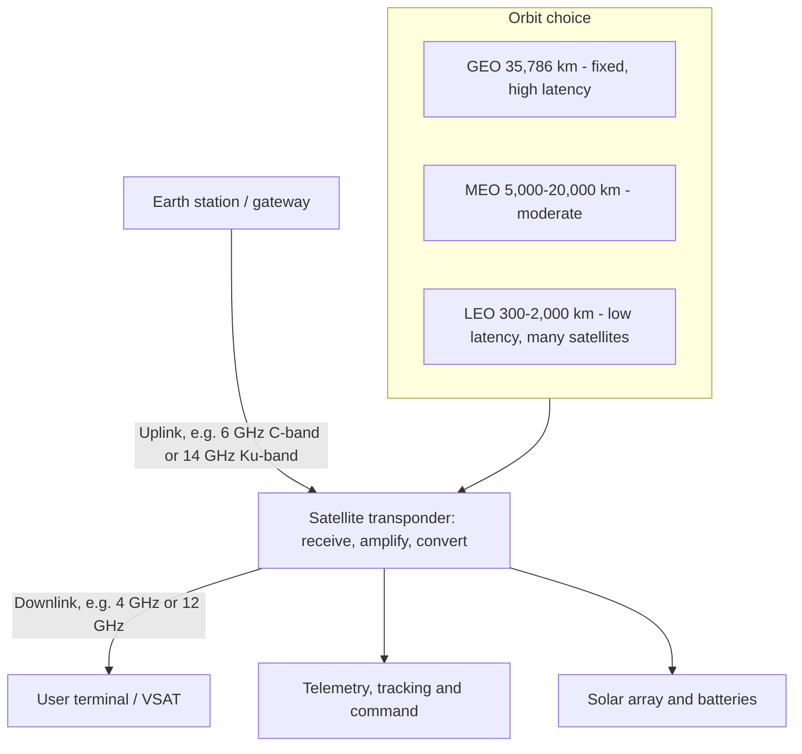
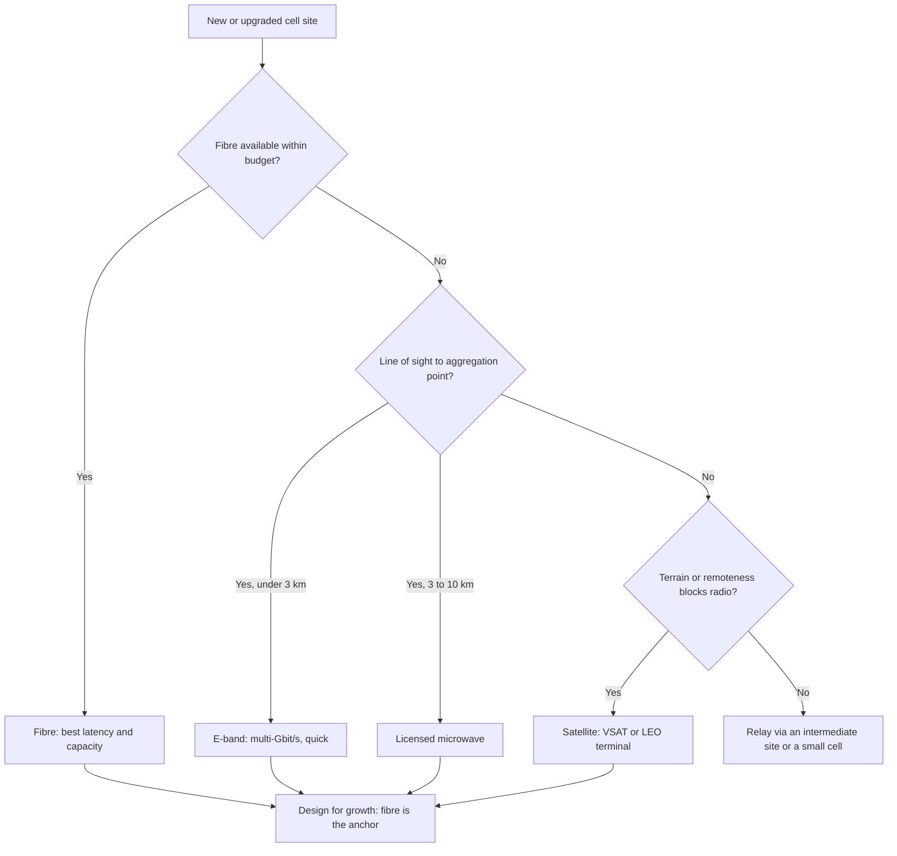

# 14 - Antennas, Propagation, Satellite and Backhaul

## Learning Objectives

After this chapter you will be able to:

1. Define isotropic radiator, antenna gain in dBi, EIRP, half-power beamwidth, front-to-back ratio and polarisation.
2. Compute parabolic antenna gain from diameter, frequency and efficiency, and convert between gain, aperture and beamwidth (L4 numerical).
3. Apply the free-space path loss formula and explain when it overestimates or underestimates real loss (L4 numerical).
4. Distinguish reflection, diffraction and scattering, and classify fading as Rayleigh, Rician, shadowing or rain fade.
5. Build a complete link budget and state the fade margin in dB (L4 numerical).
6. Explain MIMO, massive MIMO and the three beamforming architectures.
7. Compare GEO, MEO and LEO satellites on altitude, latency, footprint, handover and Doppler.
8. Explain transponders, VSAT and the backhaul implications of LEO constellations.
9. Choose between microwave, E-band, fibre and satellite backhaul for a given site using a decision table.
10. Compare latency and capacity across media with numbers.

## Introduction

This chapter is the physical layer under everything in chapters 12 and 13, and it is where the paper's most reliable numerical marks sit. Three formulas - antenna gain, free-space path loss and link budget - account for most of the calculation questions in the whole Wireless block, and all three are one line of arithmetic once you know the units. Candidates lose these marks not because the physics is hard but because they mix dBm with dBW, forget to convert km to metres, or add a loss where they should subtract it.

The chapter also covers satellite, which is a small but sharply defined topic: one table of orbits, one latency calculation, one Doppler calculation, and the VSAT/transponder vocabulary. Questions here are almost always of the form "which orbit has the lowest latency" or "why does a LEO constellation need many satellites" - and the answers follow directly from altitude.

Backhaul closes the chapter because it connects the radio world to the transmission world of chapters 8 and 9. The exam likes the comparison: fibre for capacity and latency, microwave for speed of deployment, satellite for reach, E-band for short high-capacity links. A decision table makes those questions mechanical.

Difficulty note: about 45% numerical in this chapter's exam share, 35% recall and comparison, 20% conceptual. The numerical share is higher than elsewhere in the block, so practise the worked examples until the unit handling is automatic.

## Prerequisites

- **Chapter 10** for decibels, dBm versus dBW, and the relationship between bandwidth, SNR and capacity (Shannon).
- **Chapter 11** for spectrum, wavelength and why higher frequencies behave differently.
- **Chapter 12 and 13** for where antennas sit in the network and why sectorisation and MIMO matter.
- Arithmetic: `20 log10` of a ratio, `10 log10` of a ratio, `lambda = c / f` with c = 3e8 m/s, and the ability to keep km, m and MHz straight.

## Key Terminology

| Term | Meaning |
|---|---|
| Isotropic radiator | A hypothetical antenna radiating equally in all directions; the 0 dBi reference. It cannot be built. |
| Antenna gain | The ratio of power density in the peak direction to that of an isotropic radiator, in dBi. A passive antenna does not amplify power; it concentrates it. |
| Directivity | Gain before losses (efficiency); gain = directivity x efficiency. |
| EIRP | Effective Isotropic Radiated Power = transmit power + antenna gain - feeder loss, in dBm or dBW. |
| ERP | Effective Radiated Power, referenced to a half-wave dipole; ERP(dBW) = EIRP(dBW) - 2.15. |
| Half-power beamwidth | The angular width over which gain falls by 3 dB; narrower beam means higher gain. |
| Front-to-back ratio | Ratio of forward gain to gain in the reverse direction, in dB; a measure of how well a sector antenna rejects what is behind it. |
| Polarisation | Orientation of the electric field: linear (vertical/horizontal) or circular (right/left hand). |
| FSPL | Free-space path loss: the spreading loss of a radio wave in an unobstructed path. |
| Rayleigh fading | Fading when there is no line of sight and many scattered paths add vectorially; deep fades are common. |
| Rician fading | Fading with a dominant line-of-sight component plus scatter, described by a K factor. |
| Shadowing | Slow variation of the local mean due to buildings and terrain; modelled as log-normal with a standard deviation in dB. |
| Transponder | The satellite's receive-amplify-frequency-convert-retransmit chain; a satellite carries many transponders. |
| VSAT | Very Small Aperture Terminal: a small dish (about 0.6 to 3.8 m) for data via satellite, typically star topology through a hub. |
| Backhaul | The link between a cell site and the core network. |

## Theory

### 1. Antenna fundamentals

An antenna is a transducer between guided waves on a transmission line and free-space waves. Its two key properties are **where** it puts the energy and **how** it is polarised.

**Gain.** The isotropic radiator is the reference: it radiates uniformly, so its gain is 1, or 0 dBi. A real antenna concentrates energy in some directions, so its gain in the peak direction is greater than 1. Gain is a passive concentration, not amplification: the total radiated power is unchanged, but the power density in the wanted direction rises.

```
G(dBi) = 10 log10 (power density in peak direction / power density of isotropic)
G(dBi) = G(dBd) + 2.15        (dBd is referenced to a half-wave dipole)
```

Reference values worth memorising: half-wave dipole 2.15 dBi, quarter-wave monopole over a ground plane 5.15 dBi, a typical cellular sector panel 15 to 18 dBi, a 1.2 m Ku-band earth station dish about 40 to 42 dBi, a large 3 to 4 m dish about 45 to 50 dBi.

**EIRP.** EIRP is the single number that describes how loud a transmitter is in the wanted direction:

```
EIRP(dBm) = Ptx(dBm) + Gtx(dBi) - Lfeeder(dB)
EIRP(dBW) = EIRP(dBm) - 30
```

**Beamwidth.** Gain and beamwidth are inversely related: concentrate more, and the beam gets narrower. For an aperture antenna the 3 dB beamwidth is approximately `70 x lambda / D` degrees. A narrower beam needs better pointing accuracy, which is why satellite dishes on moving platforms need tracking.

**Front-to-back ratio.** A sector antenna should radiate forward and not backward, or it interferes with the cell behind it. Typical cellular panel values are 25 to 40 dB.

**Polarisation.** Linear polarisation (vertical or horizontal) is used in terrestrial mobile; circular polarisation (RHCP/LHCP) is used in satellite links because it is immune to Faraday rotation in the ionosphere and to misalignment. Dual-polarised antennas with +/-45 deg slants are standard for MIMO, because two orthogonal polarisations give two independent channels in the same spectrum. Cross-polar discrimination of 20 to 30 dB is typical.

**Dipole versus parabolic.** A dipole is roughly omnidirectional in one plane, low gain, cheap, and used for coverage. A parabolic reflector is highly directional, high gain, and used for point-to-point microwave and satellite. The choice is coverage versus reach.


### 2. Gain and aperture arithmetic (L4 numerical)

For an aperture antenna (parabolic dish, horn, panel), gain follows from physical area:

```
G = eta x (pi x D / lambda)^2        as a ratio
G(dBi) = 10 log10( eta x (pi x D / lambda)^2 )
A = eta x pi x D^2 / 4               effective aperture area
G = 4 x pi x A / lambda^2            equivalent form
lambda = c / f = 3e8 / f(Hz)
```

where `eta` is aperture efficiency, typically 0.55 to 0.70 for a practical dish. The two forms are the same equation; the aperture form is easier to remember physically (gain is effective area measured in square wavelengths, times 4 pi).

Two consequences that exam questions exploit:

- **Gain scales with frequency squared for a fixed dish.** Doubling the frequency quadruples the gain (plus 6 dB) and halves the beamwidth. This is why a small Ka-band dish matches a large C-band dish.
- **Gain scales with diameter squared.** Doubling the diameter gives 6 dB more gain and half the beamwidth.

### 3. Free-space path loss (L4 numerical)

FSPL is the spreading loss of an ideal unobstructed link. In the form you should memorise:

```
FSPL(dB) = 32.45 + 20 log10( f in MHz ) + 20 log10( d in km )
```

Equivalent forms: `FSPL = 20 log10(4 pi d / lambda)`, with d and lambda in the same units.

Properties to state in an answer:

- FSPL increases **6 dB per doubling of distance** and **6 dB per doubling of frequency** (20 log10 2 = 6.02).
- It contains no antenna gain and no material loss; it is purely geometric spreading (plus the lambda^2 term that comes from the receiving aperture).
- It is accurate for satellite links and clear line-of-sight microwave hops; it **underestimates** loss in terrestrial mobile because it ignores ground reflection, buildings, foliage and body loss.

A useful practical rule: at 1 km, FSPL is 91.5 dB at 900 MHz, 98.9 dB at 2100 MHz and 103.3 dB at 3.5 GHz.

### 4. Propagation effects and fading

Real channels add three mechanisms on top of FSPL:

| Mechanism | What happens | When it dominates |
|---|---|---|
| Reflection | Wave bounces off a large smooth surface (ground, building facade, water); creates a second path with a phase shift. | Below about 10 GHz, open areas, two-ray ground reflection. |
| Diffraction | Wave bends around an obstacle edge into the shadow region; explains why there is signal behind a building. | Urban canyons, hills, rooftop edges. |
| Scattering | Wave hits objects small compared with the wavelength (foliage, street furniture, rain) and spreads in many directions. | Dense clutter, vegetation, higher frequencies. |

These produce **multipath**: several copies of the signal arrive with different delays and phases. Adding them vectorially gives either a boost or a deep cancellation. The resulting small-scale fading is classified by whether a dominant path exists:

- **Rayleigh fading** - no line of sight; the sum of many equal-strength scattered paths has a Rayleigh amplitude distribution. Deep fades of 20 to 30 dB occur, and the spacing between fades is about half a wavelength, so a moving handset at 900 MHz (lambda = 33 cm) crosses fades every 16 cm.
- **Rician fading** - a strong line-of-sight path plus scatter; the K factor is the ratio of LOS power to scattered power. High K approaches a clean channel.
- **Shadowing (large-scale fading)** - the local mean varies slowly as the mobile moves behind buildings; modelled as log-normal with a standard deviation of typically 6 to 10 dB in urban areas.
- **Rain fade** - absorption and scattering by raindrops, significant above about 10 GHz and severe at mmWave; ITU-R P.838 gives specific attenuation in dB/km as a function of rain rate. At 28 GHz heavy rain costs several dB per km; near 60 GHz, oxygen absorption alone is roughly 10 to 15 dB/km, which is why 60 GHz is used for short dense links, not coverage.

The engineering response to fading is diversity and margin: space diversity (two antennas), frequency diversity (spread spectrum, frequency hopping), time diversity (interleaving and HARQ), polarisation diversity, and simply a **fade margin** of 20 to 30 dB in the link budget.

### 5. The link budget (L4 numerical)

A link budget is an accounting identity: every gain added, every loss subtracted, from transmitter to receiver.

```
Prx(dBm) = Ptx + Gtx - Ltx - FSPL - Lmisc + Grx - Lrx
Link margin(dB) = Prx - receiver sensitivity
```

where `Lmisc` collects rain, foliage, body loss, polarisation mismatch and implementation margin. The link closes if the margin is positive; a design target of 20 to 30 dB is normal for terrestrial links, and satellite links are designed to a required Eb/N0 rather than a simple power margin.

The same identity applies in reverse to satellites: the **uplink** budget runs earth station to satellite, the **downlink** runs satellite to earth station, and the weaker of the two sets the overall carrier-to-noise ratio. A transponder's gain and saturation power determine how much downlink EIRP is available, which is why satellite operators quote **G/T** (antenna gain over system noise temperature, dB/K) for the receiving side.

### 6. MIMO and beamforming

**MIMO** uses multiple antennas at both ends. Three distinct gains:

- **Array gain** - coherent combining gives `10 log10(N)` dB for N elements (3 dB per doubling). Used for coverage.
- **Spatial multiplexing** - independent data streams in the same spectrum, up to `min(Nt, Nr)` layers. Used for capacity in rich scattering.
- **Diversity** - independent fading paths reduce outage probability.

**Massive MIMO** scales the base-station array to tens or hundreds of elements (for example 64 transmit and 64 receive). The extra degrees of freedom allow multi-user MIMO: several users served in the same time-frequency resource, separated spatially. The theory (Marzetta) says that with very many antennas, noise and fast fading average out and simple linear precoding becomes near-optimal; the practical limits become pilot contamination, RF chain cost and physical size.

**Beamforming** is how the array is used:

| Type | How | Beams at once | Cost and power | Where used |
|---|---|---|---|---|
| Analogue (RF) | Phase shifters on one RF chain per sub-array | One per sub-array | Low | Early mmWave, satellite user terminals |
| Digital | One RF chain per antenna element, precoding in baseband | Many, per subcarrier | High (converters and power) | Sub-6 GHz massive MIMO |
| Hybrid | A few RF chains, each driving a sub-array of phase shifters | Several | Medium | Practical mmWave 5G |

Beamforming also has a coverage cost: a narrow beam must be steered and tracked, so 5G defines beam sweeping, beam measurement and beam failure recovery procedures that 4G did not need.

### 7. Satellite communications

A satellite is a repeater in the sky. The **transponder** receives on the uplink frequency, amplifies, converts to the downlink frequency (to avoid interference between the two directions), and retransmits. A bent-pipe transponder does no demodulation; a regenerative transponder demodulates and re-modulates on board. The **footprint** is the area on Earth the antenna illuminates.



| Property | GEO | MEO | LEO |
|---|---|---|---|
| Altitude | 35,786 km | about 5,000 to 20,000 km | about 300 to 2,000 km |
| Orbital period | 24 h (geostationary) | about 6 to 12 h | about 90 to 120 min |
| One-way propagation delay | about 119 ms | about 20 to 70 ms | about 2 to 7 ms |
| Typical round-trip latency | 240 ms propagation, 500 to 600 ms in a voice call | 60 to 130 ms | 20 to 40 ms |
| Footprint | About one third of the Earth | Regional | Small, a few hundred to about 3,000 km |
| Satellites for global coverage | 3 (polar regions excluded) | 10 to 20 | Tens to thousands |
| Handover | None, the satellite appears fixed | Occasional | Frequent, every few minutes |
| Doppler shift | Negligible | Moderate | Significant |
| Earth station tracking | Fixed dish | Slow tracking | Fast tracking or phased array |
| Best use | Broadcast TV, VSAT, backhaul to remote sites, maritime | Navigation (GPS), some broadband | Low-latency broadband, IoT, direct-to-handset |

Doppler matters for LEO because the satellite moves at about 7.5 km/s relative to the ground:

```
Doppler shift = (v / c) x f = (7.5 / 3e5) x f
At 2 GHz: 50 kHz;  at 12 GHz: 300 kHz
```

That shift must be pre-compensated by the terminal or the satellite, and it is why LEO systems need frequent handover and accurate timing.

**VSAT.** A very small aperture terminal is a dish of roughly 0.6 to 3.8 m used for data. Most VSAT networks are star topology: remotes talk to a hub over a shared outbound carrier and request inbound capacity (DAMA - demand assignment multiple access). Applications are banking branches, petrol stations, rural connectivity and enterprise backup. VSAT is attractive where fibre and microwave are impossible, and expensive per bit compared with fibre.

**LEO constellations and backhaul.** A LEO constellation needs many satellites in several orbital shells, inter-satellite links (laser or RF) to route traffic between satellites, and a dense network of ground gateways. The backhaul implications are the exam point:

- Each satellite is over a given ground point for only a few minutes, so traffic must be handed over between satellites and between beams.
- Ground gateway sites must be numerous and well connected by fibre, because the satellite only provides the access hop.
- Inter-satellite links let traffic avoid a ground gateway entirely, but add processing and pointing complexity.
- The capacity per satellite is shared among all beams, so per-user rates fall as the constellation fills.
- Latency is low but not zero: propagation plus routing plus processing typically lands at 20 to 40 ms, not the 5 ms of a pure two-hop calculation.

### 8. Mobile backhaul options

Backhaul connects each cell site to the aggregation network and the core. Four options dominate:

| Option | Typical band / medium | Typical hop distance | Typical capacity | Latency | Deployment speed | Cost | Best for |
|---|---|---|---|---|---|---|---|
| Microwave (licensed) | 6 to 42 GHz | 1 to 10 km, up to 50 km with high towers | 50 Mbit/s to 1 Gbit/s per channel | About 3.3 us/km plus processing | Days | Medium | Urban and suburban macro sites with line of sight |
| E-band | 71 to 86 GHz | 1 to 3 km | Multi-Gbit/s | Similar to microwave | Days | Medium-low (light licensing) | Dense urban small cells, fibre replacement |
| Fibre | Optical, 1310/1550 nm | Up to 80 km per span without amplification | 10G to 100G and beyond | About 5 us/km | Weeks to months (civil works) | High upfront, low per bit | Any site where ducts exist; the long-term answer |
| Satellite | C, Ku, Ka band | 36,000 km (GEO) or 550 km (LEO) | A few Mbit/s to tens of Mbit/s per terminal | 500 to 600 ms GEO, 20 to 40 ms LEO | Hours | High per bit | Remote, rural, emergency, islands, backup |



The decision logic in words: fibre wins on latency and capacity and loses on time and civil cost; microwave wins on speed of deployment and loses on spectrum, line of sight and capacity; E-band wins on capacity per euro for short hops and loses on rain and range; satellite wins on reach and loses on latency and cost per bit. A question that asks "which backhaul for a rural site with no line of sight" wants satellite, and "which for a dense urban small cell" usually wants fibre or E-band.

### 9. Latency and capacity comparisons

Latency has two parts: **propagation** (distance divided by speed) and **processing/queueing**.

| Medium | Propagation speed | Latency per 1,000 km (one way) |
|---|---|---|
| Free space (radio) | 3e8 m/s | 3.33 ms |
| Optical fibre | about 2e8 m/s (refractive index about 1.47) | about 5 ms |
| Copper | about 2e8 m/s | about 5 ms |

That is why a microwave hop often beats fibre on latency over the same distance, and why trading venues pay for microwave routes. It is also why GEO satellite is hopeless for interactive voice: 119 ms one way is already 238 ms round trip before any processing, and a double-hop call reaches 500 to 600 ms.

Capacity comparison, from the same table as above: fibre is effectively unlimited and cheapest per bit; E-band and microwave are in the hundreds of Mbit/s to a few Gbit/s per link; satellite is tens of Mbit/s per terminal for broadband VSAT and shared across beams in a constellation.

## Worked Examples

### Example 1 - Parabolic antenna gain (L4 numerical)

Find the gain of a 1.2 m dish at 12 GHz with aperture efficiency 0.65, and its 3 dB beamwidth.

```
lambda = 3e8 / 12e9 = 0.025 m
pi x D / lambda = 3.1416 x 1.2 / 0.025 = 150.8
Ratio = 0.65 x 150.8^2 = 0.65 x 22,740 = 14,781
G = 10 log10(14,781) = 41.7 dBi
Beamwidth = 70 x 0.025 / 1.2 = 1.46 deg
```

Answer: **41.7 dBi and 1.46 deg.** A 1.46 deg beam at geostationary distance covers about 900 km on the ground, which shows why pointing accuracy matters.

### Example 2 - EIRP (L4 numerical)

A base station transmits 20 W into an antenna of 18 dBi through 2 dB of feeder loss. Find EIRP in dBm and dBW, and the equivalent ERP.

```
Ptx = 10 log10(20,000 mW) = 43.0 dBm
EIRP = 43.0 + 18 - 2 = 59.0 dBm
EIRP in dBW = 59.0 - 30 = 29.0 dBW
ERP = 29.0 - 2.15 = 26.85 dBW
Linear check: 10^(59/10) mW = 794 W
```

Answer: **59 dBm = 29 dBW = 794 W EIRP.** The 794 W is not generated by the transmitter; it is 20 W concentrated by 16 dB of net antenna gain.

### Example 3 - Free-space path loss at two frequencies (L4 numerical)

Compute FSPL for 900 MHz at 1 km and for 2100 MHz at 5 km.

```
900 MHz, 1 km:  FSPL = 32.45 + 20log10(900) + 20log10(1)
                     = 32.45 + 59.08 + 0 = 91.5 dB
2100 MHz, 5 km: FSPL = 32.45 + 20log10(2100) + 20log10(5)
                     = 32.45 + 66.44 + 13.98 = 112.9 dB
```

Answer: **91.5 dB and 112.9 dB**, a difference of 21.4 dB. Cross-check: 6 dB for the frequency ratio (2.33x) plus 14 dB for the distance ratio (5x) equals 20 dB, plus the rounding of the ratios, which matches.

### Example 4 - Full link budget (L4 numerical)

A 2100 MHz macro link over 5 km: Ptx 43 dBm, Gtx 18 dBi, feeder loss 2 dB, Grx 0 dBi, body loss 3 dB, receiver sensitivity -104 dBm. Find received power and margin.

```
FSPL (from Example 3) = 112.9 dB
Prx = 43 + 18 - 2 - 112.9 - 3 + 0 = -56.9 dBm
Margin = -56.9 - (-104) = 47.1 dB
```

Answer: **Prx = -56.9 dBm, margin 47.1 dB.** That margin is spent on shadowing (about 8 dB sigma, so 2 sigma is 16 dB), in-car loss (8 to 10 dB), foliage (5 to 10 dB) and interference rise. A design that budgets 47 dB and plans for 20 dB of combined margin is reasonable; one that assumes the full 47 dB is available at the cell edge is not.

### Example 5 - Satellite latency (L4 numerical)

Compute one-way propagation delay and round-trip time for GEO (35,786 km) and for a 550 km LEO satellite, and compare with fibre over the same distance.

```
GEO:  t = 35,786 km / 300,000 km/s = 0.1193 s = 119 ms one way, 238 ms RTT
LEO:  t = 550 km / 300,000 km/s = 1.83 ms one way, 3.7 ms RTT
Fibre equivalent 35,786 km at 2e8 m/s = 179 ms one way
```

Answer: **GEO 119 ms one way / 238 ms RTT; LEO 1.83 ms / 3.7 ms.** Real GEO voice calls show 500 to 600 ms because the call is double-hopped and processing adds delay; real LEO broadband shows 20 to 40 ms because of routing and processing.

### Example 6 - Orbit path loss difference (L4 numerical)

Compare FSPL at 12 GHz for GEO and for a 550 km LEO satellite.

```
GEO:  FSPL = 32.45 + 20log10(12000) + 20log10(35786)
           = 32.45 + 81.58 + 91.07 = 205.1 dB
LEO:  FSPL = 32.45 + 81.58 + 20log10(550)
           = 32.45 + 81.58 + 54.81 = 168.8 dB
Difference = 36.3 dB
```

Answer: **36.3 dB less path loss for LEO.** That is the physical reason a LEO terminal can use a small phased array instead of a large dish, and the reason a LEO satellite needs far less transmit power per beam.

### Example 7 - Doppler shift for LEO (L4 numerical)

A LEO satellite at 550 km moves at 7.5 km/s relative to a ground terminal. Find the Doppler shift at 2 GHz and at 12 GHz.

```
f_d = (v/c) x f
2 GHz:  (7.5 / 3e5) x 2e9 = 50 kHz
12 GHz: (7.5 / 3e5) x 12e9 = 300 kHz
```

Answer: **50 kHz at 2 GHz, 300 kHz at 12 GHz.** For a 20 MHz channel that is 0.25% and 1.5% of the band respectively, which is why the receiver must track and correct it continuously.

### Example 8 - Shannon capacity with MIMO (L4 numerical)

A 20 MHz channel has an SNR of 20 dB. Find the single-link capacity and the capacity with 4x4 spatial multiplexing.

```
SNR = 20 dB = 100 (linear)
C = B log2(1 + SNR) = 20e6 x log2(101) = 20e6 x 6.66 = 133 Mbit/s
4x4 MIMO: up to 4 independent streams -> about 4 x 133 = 532 Mbit/s
```

Answer: **133 Mbit/s single stream, up to about 532 Mbit/s with 4x4.** The 4x figure is an upper bound: it needs rich scattering, uncorrelated antennas and a high SNR on every stream.

## Exam Traps and Common Mistakes

1. **dBi versus dBd.** dBi is referenced to the isotropic radiator, dBd to a half-wave dipole. `dBi = dBd + 2.15`. Adding 2.15 the wrong way is a classic one-mark loss.
2. **dBm versus dBW.** `dBW = dBm - 30`. A 20 W transmitter is 43 dBm or 13 dBW, not 43 dBW.
3. **FSPL frequency term is 20 log10, not 10 log10.** Path loss rises 6 dB per doubling of frequency, not 3 dB.
4. **FSPL uses km and MHz in the 32.45 form.** If you use metres, the constant becomes -27.55 and the frequency must be in MHz; mixing the two forms is the most common arithmetic error in the block.
5. **Antenna gain is not amplification.** A 18 dBi antenna radiates the same total power as an isotropic one, just concentrated. "The antenna amplifies the signal by 18 dB" is a wrong statement in a conceptual question.
6. **Reuse distance versus reuse factor** (repeated from chapter 12 because it recurs): N is a count, D is a distance, `D = R sqrt(3N)`.
7. **GEO versus LEO latency.** GEO is about 119 ms one way, LEO a few ms. A question offering "GEO has lower latency because it is higher" is testing whether you know propagation delay grows with distance.
8. **GEO footprint is not global.** One GEO satellite covers about a third of the Earth; three cover most of it, excluding the polar regions.
9. **LEO does not remove the need for ground infrastructure.** Gateways, fibre backhaul and inter-satellite links are still required; the satellite replaces the access hop, not the core.
10. **Rain fade is a high-frequency problem.** Below about 10 GHz it is minor; at 28 GHz and above it is a design driver; at 60 GHz oxygen absorption dominates even without rain.
11. **Rayleigh versus Rician.** Rayleigh means no line of sight; Rician means a dominant line of sight plus scatter. Reversing them is a common error.
12. **Fibre is not always the lowest latency.** Radio in free space travels at 3e8 m/s against about 2e8 m/s in fibre, so a straight microwave path can beat a fibre path that takes a longer route.

## Summary

- Antenna gain in dBi is concentration relative to an isotropic radiator; EIRP = Ptx + Gtx - feeder loss; ERP = EIRP - 2.15 dB.
- Aperture gain `G = eta (pi D / lambda)^2`; gain rises 6 dB per doubling of diameter or frequency, and beamwidth falls as `70 lambda / D`.
- FSPL(dB) = 32.45 + 20 log10(f in MHz) + 20 log10(d in km); 6 dB per doubling of distance or frequency.
- Real propagation adds reflection, diffraction and scattering; multipath gives Rayleigh (no LOS) or Rician (LOS plus scatter) fading, plus log-normal shadowing and rain fade above about 10 GHz.
- A link budget is additive in dB: `Prx = Ptx + Gtx - Ltx - FSPL - Lmisc + Grx - Lrx`; the margin is `Prx - sensitivity`.
- MIMO gives array gain, spatial multiplexing (up to min(Nt,Nr) layers) and diversity; massive MIMO adds multi-user spatial separation; beamforming is analogue, digital or hybrid.
- GEO (35,786 km) has a fixed footprint and about 119 ms one-way latency; MEO is in between; LEO (300 to 2,000 km) gives a few ms but needs constellations, handover and Doppler correction.
- Transponders receive, amplify, convert and retransmit; VSAT is a small dish in a star network with DAMA; LEO constellations need many gateways and inter-satellite links.
- Backhaul: fibre for capacity and latency, microwave for speed, E-band for short high-capacity hops, satellite for reach.
- Latency per 1,000 km: about 3.3 ms by radio, about 5 ms by fibre or copper.

## Practical Takeaways

- Write the units on every line of a numerical. Most lost marks in this block are unit errors, not physics errors.
- For any link budget question, list gains and losses in two columns before adding; the sign error rate drops to near zero.
- Remember the three 6 dB rules: doubling distance, doubling frequency, and doubling antenna diameter all add about 6 dB of loss or gain.
- For satellite questions, start from altitude: latency, footprint, satellite count, handover rate and Doppler all follow from it.
- For backhaul questions, answer with a trade-off sentence (capacity, latency, cost, deployment time), never with a single technology name.
- Keep the four reference numbers: 91.5 dB (900 MHz, 1 km), 98.9 dB (2100 MHz, 1 km), 103.3 dB (3.5 GHz, 1 km), 205 dB (12 GHz to GEO).

## Chapter Quiz

**Q1.** An antenna with 15 dBd gain has what gain in dBi?

A. 12.85 dBi  B. 15 dBi  C. 17.15 dBi  D. 45 dBi

**Answer: C.** `dBi = dBd + 2.15 = 17.15`. Option A subtracts instead of adding.

**Q2.** FSPL at 1800 MHz over 10 km is approximately:

A. 97.5 dB  B. 107.5 dB  C. 117.5 dB  D. 127.5 dB

**Answer: C.** `32.45 + 20log10(1800) + 20log10(10) = 32.45 + 65.1 + 20 = 117.5 dB`.

**Q3.** Which orbit gives the lowest propagation latency?

A. GEO  B. MEO  C. LEO  D. They are equal because all use radio waves

**Answer: C.** Latency is distance divided by the speed of light, so the lowest orbit wins: a few ms for LEO against about 119 ms one way for GEO.

**Q4.** A dominant line-of-sight path plus scattered multipath produces which fading model?

A. Rayleigh  B. Rician  C. Log-normal shadowing  D. Rain fade

**Answer: B.** A strong LOS component plus scatter is Rician, described by the K factor. Rayleigh is the no-LOS case; shadowing is a slow large-scale variation.

**Q5.** For a dense urban small cell 1 km from a fibre point, with line of sight and a need for several Gbit/s within a week, the best backhaul is:

A. GEO satellite  B. Licensed 7 GHz microwave  C. E-band (71 to 86 GHz)  D. Copper E1 leased lines

**Answer: C.** E-band gives multi-Gbit/s over 1 to 3 km with light licensing and fast deployment. Satellite has too much latency and too little capacity, 7 GHz is capacity-limited, and E1 lines are obsolete for this rate.

## Exercises

**E1.** Compute FSPL at 3.5 GHz over 2 km.
*Answer:* `32.45 + 20log10(3500) + 20log10(2) = 32.45 + 70.88 + 6.02 = 109.4 dB`.

**E2.** A 3.8 m dish operates at 6 GHz with efficiency 0.6. Find its gain and beamwidth.
*Answer:* lambda = 0.05 m; `pi x 3.8 / 0.05 = 238.8`; `0.6 x 238.8^2 = 34,213`; G = 45.3 dBi; beamwidth = `70 x 0.05 / 3.8 = 0.92 deg`.

**E3.** Link budget: Ptx 40 dBm, Gtx 30 dBi, Ltx 1.5 dB, 6 GHz, 40 km, Grx 38 dBi, sensitivity -85 dBm. Find Prx and the margin.
*Answer:* FSPL = `32.45 + 75.56 + 32.04 = 140.05 dB`; Prx = `40 + 30 - 1.5 - 140.05 + 38 = -33.55 dBm`; margin = 51.45 dB.

**E4.** A GEO satellite is at 35,786 km and a LEO at 1,200 km. Compute the one-way delay for each.
*Answer:* GEO `35,786/300,000 = 119.3 ms`; LEO `1,200/300,000 = 4.0 ms`.

**E5.** Find the Doppler shift at 2 GHz for a LEO satellite moving at 7.5 km/s.
*Answer:* `(7.5/300,000) x 2e9 = 50 kHz`.

**E6.** A transmitter delivers 5 W to a 24 dBi antenna through 1 dB of loss. Find EIRP in dBm, dBW and watts.
*Answer:* Ptx = 37 dBm; EIRP = `37 + 24 - 1 = 60 dBm = 30 dBW`; linear = `10^6 mW = 1,000 W`.

**E7.** A 40 MHz channel has 15 dB SNR. Find the Shannon capacity and the capacity with 4x4 MIMO.
*Answer:* SNR = 31.6; `log2(32.6) = 5.03`; C = `40e6 x 5.03 = 201 Mbit/s`; 4x4 upper bound about 805 Mbit/s.

**E8.** Explain in three sentences why a LEO constellation needs inter-satellite links and many ground gateways.
*Answer:* Each satellite is visible to a given ground point for only a few minutes, so traffic must be handed over continuously between satellites and beams. Inter-satellite links let traffic travel along the constellation to a gateway that does have fibre connectivity, instead of requiring a gateway under every satellite. Many gateways are still needed because the constellation carries far more traffic than a few landing points can absorb, and because gateway diversity protects against rain fade at the higher bands.

## Next

You have finished the Wireless Technologies block (chapters 12 to 14, 24 marks). Before moving to Project Management in chapter 15, do a closed-book retrieval pass: redraw the GSM and EPS element tables from memory, write the five formulas (reuse distance, C/I, RB throughput, slot timing, FSPL, link budget) on one sheet, and redo the worked examples without looking. Then attempt 30 mixed wireless questions from the error log format in `03-revision-mocks-and-error-log.md`; anything you get wrong twice goes on the formula sheet, not back into the chapter.
