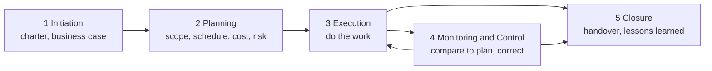
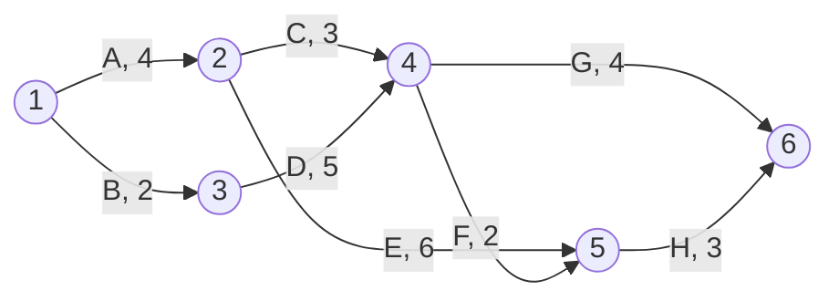

# 15 - Project Management: The Easiest 16 Marks on the Paper

## Learning Objectives

After this chapter you will be able to:

1. Distinguish a project from an operation and name the five process groups.
2. Compute payback, NPV, IRR, ROI, profitability index and a weighted scoring model, and choose between two projects when NPV and IRR disagree.
3. Build a WBS, read a RACI matrix, and pick between a bar chart, a Gantt chart and a milestone chart.
4. Convert a precedence table into an AON network, run both passes, compute total and free float, and name the critical path.
5. Compute PERT expected time, variance and the probability of finishing by a target date.
6. Compute a cost slope, crash a network to minimum duration, and prove you have not crashed a non-critical activity.
7. Compute PV, EV, AC, CV, SV, CPI, SPI, EAC and TCPI from a one-line status report.
8. Recall the four threat responses and the quality and communication facts asked at awareness level.

## Introduction

Project Management is **10% of the paper: 16 of 200 marks**, and it is the most arithmetic-dense block per page of syllabus.

That combination is the opportunity. Every other block can ask you something you have never read. This one cannot. The question families are finite, the formulas are short, and the answers are numbers you can verify on paper. A candidate who has never opened a PMBOK can still reach 13 or 14 out of 16 in about twelve hours, because the paper asks:

- "What is the expected time of this activity?" - one line of arithmetic.
- "What is the total float of activity D?" - two passes over a small network.
- "Which activity should be crashed first?" - one division.
- "What is the CPI?" - one division.

Compare that with Wireless Technologies, where 24 marks sit behind three months of unfamiliar vocabulary. This is the block where **preparation converts to marks at the highest rate in the paper**, and for a CSE graduate with no management background it is the best return on study time available.

Two cautions. Half the block is definitional recall (lifecycle phases, chart selection, risk response names, RACI letters) - cheap marks, and the ones candidates drop because they read the numericals and skip the vocabulary. And the numericals punish half-learned method harder than any other topic: a subnetting question with a wrong mask still leaves four plausible options, but a CPM question with a wrong backward pass gives a confident wrong number. You must be able to run both passes **without looking at a worked example**. That is the standard this chapter trains to.

## Prerequisites

- Percentages, ratios, simple and compound interest, and the idea of discounting a future cash flow.
- Ability to read a table and a small directed graph.
- No prior management study assumed; every term the paper uses is defined here.
- No calculator in the hall. Every example below uses numbers that stay small. If a calculation needs more than two lines of long division, you have missed a shortcut.

## Key Terminology

| Term | Meaning |
|---|---|
| Project | Temporary endeavour with a defined start and end, creating a unique result |
| Operation | Ongoing, repetitive work that sustains the business |
| Deliverable | Any measurable, verifiable outcome, document or product |
| WBS | Work Breakdown Structure: deliverable-oriented hierarchy decomposing scope into work packages |
| Work package | Lowest WBS level, small enough to estimate, schedule and assign to one owner |
| RACI | Responsible, Accountable, Consulted, Informed - a responsibility assignment matrix |
| AON / AOA | Activity on Node / Activity on Arrow network representation |
| Dummy activity | Zero-duration AOA arrow carrying logic only, drawn dashed |
| Critical path | Longest path through the network; fixes project duration; zero total float |
| Total float | Time an activity can slip without delaying the project finish |
| Free float | Time an activity can slip without delaying any successor's earliest start |
| Cost slope | Extra cost per unit of time saved by crashing |
| PV / EV / AC | Planned Value, Earned Value, Actual Cost |
| CPI / SPI | Cost Performance Index, Schedule Performance Index |
| BAC / EAC | Budget at Completion, Estimate at Completion |
| EMV | Expected Monetary Value: probability x impact |

## Theory

### 1. Project versus operations

A project is **temporary** (it ends), produces a **unique** output, and is progressively elaborated. Operations are the opposite on all three.

| Dimension | Project | Operations |
|---|---|---|
| Duration | Temporary, defined end | Ongoing, no end date |
| Output | Unique product or service | Repetitive, standardised |
| Success | Scope, time, cost, quality targets met | Efficiency, throughput, cost per unit |
| Team | Cross-functional, then disbanded | Stable, functional |
| Example | Rolling out FTTH in one district | Running the existing broadband helpdesk |

Typical phrasing: "commissioning a new 5G site" is a project; "operating the site's power backup routine" is an operation.

### 2. Project lifecycle phases

The paper uses the five PMBOK **process groups**. Learn the order and a one-line purpose for each.



- **Initiation** - authorise the project. Outputs: project charter (which names the manager and grants authority), stakeholder register.
- **Planning** - produce the baselines: scope (WBS), schedule, cost. Iterative, not a one-time gate.
- **Execution** - direct and manage the work, acquire and develop the team, manage communications.
- **Monitoring and Control** - measure against baselines, run integrated change control, approve or reject changes.
- **Closure** - verify deliverables, obtain formal acceptance, archive, release resources, record lessons learned.

**Sequential (waterfall)** phases run one after another; **overlapping (fast tracking)** runs them in parallel to compress schedule at the cost of rework risk. A **phase gate** or kill point is a review where the sponsor decides to continue, change or terminate.

### 3. Project selection methods (L4 numerical)

Selection answers one question: with limited money, which candidate projects do we fund? The paper tests arithmetic, not judgement.

**3.1 Payback period.** Time for cumulative inflow to recover the outlay. For uneven flows: count full years, then divide the unrecovered amount by the next year's flow.

**3.2 Net Present Value.** Discount every future flow at the cost of capital, subtract the outlay.

```
NPV = SUM over t=1..n of [ CFt / (1+r)^t ] - Initial outlay
```

Accept if NPV > 0; between mutually exclusive projects pick the higher NPV.

**3.3 Internal Rate of Return.** The rate at which NPV = 0. Accept if IRR > cost of capital. Hand-compute by linear interpolation:

```
IRR = r1 + (r2 - r1) x [ NPV1 / (NPV1 - NPV2) ]
```

where r1 gives NPV1 > 0 and r2 gives NPV2 < 0.

**3.4 ROI and accounting rate of return.** ROI = (total benefit - total cost)/total cost x 100. Accounting rate of return = average annual profit / average investment x 100. Neither discounts, so both are inferior to NPV for decisions, but both get asked.

**3.5 Profitability index.** PI = PV of inflows / outlay. Accept if PI > 1. Useful under capital rationing because it ranks by value per rupee invested.

**3.6 Scoring models.** Non-financial criteria (strategic fit, regulatory compulsion, technical risk, manpower) are scored and combined. **Unweighted**: sum raw scores. **Weighted**: multiply each score by its criterion weight and sum; weights must total 1.0. **Forced ranking / paired comparison**: rank projects against each other when criteria resist scoring.

**3.7 NPV versus IRR conflict.** When projects differ in size or cash-flow timing the two can rank differently. NPV is theoretically correct: it measures absolute value added and assumes reinvestment at the cost of capital, whereas IRR assumes reinvestment at the IRR itself. A small project can show a spectacular IRR and a tiny NPV; if you can fund only one and the aim is value, fund the large-NPV project.

### 4. Work Breakdown Structure

A WBS is a **deliverable-oriented** hierarchical decomposition of total scope. Rules the paper tests:

- **100% rule**: the children of a node must account for exactly 100% of the parent's scope.
- Decompose to **work packages** one person can own and that can be estimated.
- **8-80 rule** (heuristic): a work package should take more than 8 and less than 80 hours.
- A WBS is **not** an org chart and **not** a schedule: it answers "what", not "who" or "when".
- The **WBS dictionary** defines each element: scope, acceptance criteria, owner, cost. Stop decomposing when you can estimate reliably; over-decomposition adds administrative cost.

The **OBS** (organisational breakdown structure) intersected with the WBS gives the responsibility matrix.

### 5. Responsibility assignment matrix (RACI)

A grid of work packages against people or units, each cell carrying one letter:

| Letter | Meaning | Rule |
|---|---|---|
| R | Responsible - does the work | Can be several |
| A | Accountable - owns the outcome, signs off | **Exactly one per row** |
| C | Consulted - two-way input before the work | As needed |
| I | Informed - one-way update after the decision | As needed |

The favourite trap is the single-A rule: two accountable people means nobody is accountable. A variant is **RASCI**, with S = Support.

### 6. Scheduling charts

| Chart | Shows | Does not show | Use |
|---|---|---|---|
| Bar chart | Activities as bars against a calendar | Dependencies, logic | Simple progress reporting |
| Gantt chart | Bars + dependency arrows + milestones + progress | Logic deeply enough for float analysis | The standard schedule picture |
| Milestone chart | Only key events and their dates | Activity detail, durations | Management and client reporting |

A **milestone** has zero duration and marks an event ("trial run completed"), not work. A Gantt is a bar chart with logic added; a milestone chart is a Gantt stripped to events. If a question asks which chart best shows **interdependencies**, the answer is the network diagram (or a Gantt with dependency links), never a plain bar chart.

### 7. Network diagrams: AON and AOA

**AON (precedence diagram)** puts each activity on a node, arrows for precedence, and needs no dummies. Modern software uses AON. **AOA (arrow diagram)** puts activities on arrows and nodes are events. Two rules force dummy activities: no two activities may share the same start and end node, and every activity must be uniquely identified by its two node numbers.



Path lengths in this network, used throughout the chapter: 1-2-4-6 = 11, 1-2-4-5-6 = 12, 1-2-5-6 = **13**, 1-3-4-6 = 11, 1-3-4-5-6 = 12. The **longest** path is critical: 1-2-5-6, activities A, E, H.

### 8. PERT three-point estimation (L4 numerical)

PERT treats duration as a random variable described by three estimates: Optimistic (O), Most likely (M), Pessimistic (P).

```
Expected time   te  = (O + 4M + P) / 6
Variance        var = ((P - O) / 6)^2
Standard dev    sigma = (P - O) / 6
```

The beta distribution behind these formulas weights M four times.

**Path arithmetic** - the part candidates get wrong:

```
Path expected duration = SUM of te
Path variance          = SUM of variances      (variances add, standard deviations do not)
Path standard dev      = sqrt(SUM of variances)
Z = (T - Path mean) / Path sigma
```

Read the normal table: Z = 0 gives 0.50, 1.0 gives 0.8413, 1.28 gives 0.90, 1.645 gives 0.95, 2.0 gives 0.9772.

**PERT versus CPM**, a standard two-mark comparison:

| | PERT | CPM |
|---|---|---|
| Time estimates | Three (O, M, P), probabilistic | One, deterministic |
| Orientation | Event-oriented, AOA tradition | Activity-oriented |
| Focus | Probability of meeting a date | Time-cost trade-off, crashing |
| Use | R&D, first-of-a-kind work | Repetitive, well-understood work |

### 9. CPM: forward pass, backward pass, float (L4 numerical)

**Forward pass** - earliest times, left to right:

```
ES(activity) = max over predecessors of EF(predecessor)
EF = ES + duration
```

Project duration is the EF of the last activity (or the max EF across end nodes).

**Backward pass** - latest times, right to left, starting with LF = project duration at the end node:

```
LF(activity) = min over successors of LS(successor)
LS = LF - duration
```

**Float:**

```
Total float TF = LS - ES = LF - EF
Free float  FF = min ES of successors - EF of the activity
```

Consequences worth memorising:

- TF = 0 on every activity of the critical path, and the critical path is the chain of zero-TF activities.
- FF <= TF always. An activity can have positive TF and zero FF: it has room, but its immediate successor has none.
- **Negative float** means the project is already forecast to miss its deadline; it is removed by compressing the schedule.

### 10. Project crashing (L4 numerical)

Crashing buys time with money. The rule is mechanical:

```
Cost slope = (Crash cost - Normal cost) / (Normal time - Crash time)
```

Procedure:

1. Find the critical path and its duration.
2. List the crashable activities **on the critical path only**.
3. Crash the one with the **lowest cost slope**, one unit of time at a time.
4. Recompute the network after each unit. The critical path may change and a parallel critical path may appear.
5. With two parallel critical paths, further compression needs one activity crashed on **each** path; the effective slope is the sum of the two (or crash a shared activity if one exists).
6. Stop when the crash cost per unit exceeds the delay penalty per unit, when the target duration is reached, or when nothing more can be crashed.

Minimum possible duration is reached when every critical activity is at its crash time. Total cost = normal direct cost + cumulative crash cost + indirect cost, and indirect cost usually falls as duration falls.

### 11. Resource levelling (awareness)

- **Resource levelling** moves non-critical activities within their float so demand for a scarce resource stays under a cap. It **can extend** the project duration.
- **Resource smoothing** shifts work within float **without** changing the critical path or finish date. If float is insufficient, smoothing is impossible and levelling is required.
- The resource histogram is the picture; the resource-constrained schedule is the output.

### 12. Risk management

**Process**: plan risk management -> identify -> qualitative analysis -> quantitative analysis -> plan responses -> implement -> monitor.

**Identification tools**: brainstorming, Delphi (anonymous expert rounds reaching consensus without confrontation), interviews, checklists, SWOT, assumption analysis, cause-and-effect diagrams.

**Qualitative analysis** ranks risks for attention using a probability-impact matrix (risk score = probability x impact). Fast, subjective, applied to every risk. **Quantitative analysis** puts numbers on the important ones: EMV = probability x impact, decision trees, Monte Carlo simulation, sensitivity analysis (tornado diagram).

**Negative risk (threat) responses** - learn these four names exactly:

| Strategy | Meaning | Example |
|---|---|---|
| Avoid | Change the plan so the risk cannot occur | Use a proven vendor, not the unproven one |
| Transfer | Shift the financial consequence to a third party | Insurance, fixed-price contract, bond |
| Mitigate | Reduce probability or impact | Prototype first, add redundancy, more testing |
| Accept | Acknowledge and hold a contingency | Active: reserve time or money. Passive: do nothing until it happens |

**Positive risk (opportunity) responses**: exploit, share, enhance, accept.

**Reserves**: the **contingency reserve** covers known unknowns (identified risks), sits under the project manager's control and inside the cost baseline. The **management reserve** covers unknown unknowns, needs sponsor approval, and sits outside the baseline.

### 13. Cost control and earned value (L4 numerical)

Earned value compares three numbers at a status date: **PV** (Planned Value, BCWS) is the budgeted cost of work scheduled by now; **EV** (Earned Value, BCWP) is the budgeted cost of work actually completed; **AC** (Actual Cost, ACWP) is money actually spent.

```
CV = EV - AC        positive = under budget
SV = EV - PV        positive = ahead of schedule
CPI = EV / AC       > 1 = efficient
SPI = EV / PV       > 1 = fast
EAC = BAC / CPI                       (current efficiency continues)
EAC = AC + (BAC - EV)                 (atypical variance, remaining work at budget)
EAC = AC + (BAC - EV) / (CPI x SPI)   (cost and schedule pressure both continue)
ETC = EAC - AC
VAC = BAC - EAC
TCPI = (BAC - EV) / (BAC - AC)        efficiency needed to finish on budget
```

**SV is money measuring time**: a negative SV means behind schedule, not overspent, which is why practitioners prefer SPI for schedule. Negative CV and negative SV together mean late and over budget - the normal failure mode.

### 14. Quality and communication management (awareness)

**Quality**: **assurance** is process-oriented and preventive (are we working the right way?); **control** is product-oriented and detective (does the output meet specification?). Cost of quality = prevention + appraisal + internal failure + external failure, and external failure is the most expensive because it carries reputation and warranty. Tools: cause-and-effect (Ishikawa/fishbone), Pareto (the vital few, 80/20), check sheet, histogram, control chart (upper and lower control limits), scatter diagram, flowchart. Improvement runs on **PDCA**: Plan, Do, Check, Act.

**Communication**: the communication management plan defines who needs what, in what format, how often, through which channel. The sender-receiver model is encode -> medium -> decode -> feedback, with noise. **Channels = n(n-1)/2**, so 10 stakeholders give 45 channels - the standard argument for small teams and structured communication.

### 15. Case: FTTH rollout in a district (L4 numerical)

A BSNL district plans FTTH for 4,000 homes across three towns.

| ID | Work package | Pred. | Normal weeks | Budget (Rs lakh) |
|---|---|---|---|---|
| A | Survey, route design, BoQ | - | 6 | 20 |
| B | Procurement: OLT, ONT, splitters, fibre | A | 10 | 180 |
| C | OLT and core installation at exchange | B | 4 | 40 |
| D | Duct, trenching, fibre laying in 3 towns | B | 12 | 120 |
| E | Splicing, OTDR testing, power-budget check | D | 3 | 25 |
| F | ONT installation and activation (4,000 homes) | C, E | 8 | 60 |
| G | Acceptance testing, as-built docs, handover | F | 2 | 15 |

BAC = 20 + 180 + 40 + 120 + 25 + 60 + 15 = **Rs 460 lakh**. Paths: A-B-D-E-F-G = **41 weeks** (critical); A-B-C-F-G = 30 weeks, so C carries **11 weeks of total float**.

Crash options: a second splicing crew shortens E from 3 to 1 week for Rs 6 lakh (slope Rs 3 lakh/week); an extra trenching contractor shortens D from 12 to 10 weeks for Rs 8 lakh (slope Rs 4 lakh/week). To recover 3 weeks: crash E twice (Rs 6 lakh), then D once (Rs 4 lakh) - total **Rs 10 lakh**, new duration 38 weeks.

At week 20: PV = Rs 200 lakh, EV = Rs 180 lakh, AC = Rs 210 lakh. So CPI = 0.857, SPI = 0.90, CV = -30 lakh, SV = -20 lakh, and EAC = 460/0.857 = **Rs 537 lakh**, a Rs 77 lakh overrun. Recovery means compression on the critical path plus a scope review of the ONT count.

## Worked Examples

### Example 1 - Payback period (L4 numerical)

Cost Rs 50 lakh; returns Rs 12, 18, 15, 20, 10 lakh in years 1 to 5.

Cumulative: 12, 30, 45, 65. Recovery happens in year 4. Unrecovered at the start of year 4 = 50 - 45 = 5 lakh. Fraction = 5/20 = 0.25.

**Payback = 3.25 years = 3 years 3 months.** Note the weakness: payback ignores the Rs 15 lakh arriving after recovery and ignores the time value of money.

### Example 2 - NPV and profitability index (L4 numerical)

Outlay Rs 100 lakh; inflows Rs 40, 45, 50 lakh in years 1 to 3; cost of capital 10%. Discount factors 0.909, 0.826, 0.751.

| Year | Flow | DF at 10% | PV |
|---|---|---|---|
| 1 | 40 | 0.909 | 36.36 |
| 2 | 45 | 0.826 | 37.17 |
| 3 | 50 | 0.751 | 37.55 |
| | | Total PV | 111.08 |

**NPV = 111.08 - 100 = +Rs 11.08 lakh** - positive, so accept. **PI = 111.08/100 = 1.11** - greater than 1, so accept. Both rules must agree for a single project.

### Example 3 - IRR by interpolation (L4 numerical)

Same project. At 10%, NPV = +11.08. At 18% (DFs 0.847, 0.718, 0.609): PV = 33.88 + 32.31 + 30.45 = 96.64, so NPV = **-3.36**.

```
IRR = 10 + (18 - 10) x [ 11.08 / (11.08 + 3.36) ]
    = 10 + 8 x (11.08 / 14.44)
    = 10 + 8 x 0.767
    = 16.1%
```

Check at 16% (DFs 0.862, 0.743, 0.641): 34.48 + 33.44 + 32.05 = 99.97, NPV = -0.03. So **IRR is approximately 16%**, above the 10% cost of capital, so accept.

### Example 4 - Weighted scoring model (L4 numerical)

Weights: strategic fit 0.35, cost 0.25, risk 0.20, time 0.20. Scores out of 100.

| Project | Strategic | Cost | Risk | Time | Weighted score |
|---|---|---|---|---|---|
| A | 90 | 70 | 60 | 80 | 31.5 + 17.5 + 12.0 + 16.0 = 77.0 |
| B | 70 | 90 | 80 | 60 | 24.5 + 22.5 + 16.0 + 12.0 = 75.0 |
| C | 80 | 60 | 90 | 90 | 28.0 + 15.0 + 18.0 + 18.0 = 79.0 |

**Select C (79.0).** B wins on cost alone, C wins on risk and time. The weighted model exists precisely to stop one criterion from deciding. Always confirm the weights sum to 1.0 before multiplying.

### Example 5 - PERT expected time, variance and probability (L4 numerical)

| Activity | O | M | P | te | Variance |
|---|---|---|---|---|---|
| A | 4 | 6 | 14 | (4+24+14)/6 = 7.0 | ((10)/6)^2 = 2.78 |
| B | 5 | 8 | 11 | (5+32+11)/6 = 8.0 | ((6)/6)^2 = 1.00 |
| C | 6 | 9 | 18 | (6+36+18)/6 = 10.0 | ((12)/6)^2 = 4.00 |

Path mean = 7 + 8 + 10 = **25 weeks**. Path variance = 2.78 + 1.00 + 4.00 = **7.78**, so sigma = sqrt(7.78) = **2.79 weeks**.

Probability of finishing within 28 weeks: Z = (28 - 25)/2.79 = 1.08, giving about **0.86, i.e. 86%**. Probability of finishing within 25 weeks is exactly **50%**, because the mean is 25.

The trap: adding standard deviations (1.67 + 1.00 + 2.00 = 4.67) instead of variances. That overstates sigma and understates the probability.

### Example 6 - CPM: both passes, float, critical path (L4 numerical)

Using the network in section 7. Forward pass left to right; backward pass right to left from LF(H) = 13.

| Act | Dur | ES | EF | LS | LF | TF | FF |
|---|---|---|---|---|---|---|---|
| A | 4 | 0 | 4 | 0 | 4 | 0 | 0 |
| B | 2 | 0 | 2 | 1 | 3 | 1 | 0 |
| C | 3 | 4 | 7 | 5 | 8 | 1 | 0 |
| D | 5 | 2 | 7 | 3 | 8 | 1 | 0 |
| E | 6 | 4 | 10 | 4 | 10 | 0 | 0 |
| F | 2 | 7 | 9 | 8 | 10 | 1 | 1 |
| G | 4 | 7 | 11 | 9 | 13 | 2 | 2 |
| H | 3 | 10 | 13 | 10 | 13 | 0 | 0 |

Worked fragments: ES(F) = max(EF of C, EF of D) = max(7, 7) = 7. LF(D) = min(LS of F, LS of G) = min(8, 9) = 8. TF(B) = 1 - 0 = 1, FF(B) = ES(D) - EF(B) = 2 - 2 = 0.

**Critical path: A-E-H, 13 weeks** (the three zero-TF activities). Read the B row: TF = 1 but FF = 0. B can slip a week without delaying the project, but any slip immediately delays D, because D's earliest start equals B's earliest finish. That is the distinction the paper tests.

Now delay D by 2 weeks. D has TF = 1, so the first week is absorbed; the second pushes the path 1-3-4-5-6 to 2 + 7 + 2 + 3 = 14, longer than A-E-H at 13. **New duration 14 weeks, critical path B-D-F-H.** A delay on a non-critical activity can create a new critical path, which is why the network is recomputed, never patched.

### Example 7 - Crashing with cost slope (L4 numerical)

| Activity | Normal | Crash | Normal cost (Rs '000) | Crash cost (Rs '000) | Slope (Rs '000/wk) |
|---|---|---|---|---|---|
| A (1-2) | 4 | 3 | 4.0 | 6.0 | 2.0 |
| B (1-3) | 3 | 2 | 3.0 | 5.0 | 2.0 |
| C (2-3) | 1 | 1 | 1.0 | 1.0 | not crashable |
| D (2-4) | 5 | 3 | 6.0 | 12.0 | 3.0 |
| E (3-4) | 2 | 1 | 3.0 | 5.0 | 2.0 |

Normal: paths 1-2-4 = 9, 1-2-3-4 = 7, 1-3-4 = 5. **Critical path A-D, 9 weeks.** Normal direct cost = 4+3+1+6+3 = **Rs 17.0 thousand**.

*Crash 1 (9 -> 8).* Critical activities A and D, slopes 2.0 and 3.0. Crash A by 1 week: +Rs 2.0 thousand. A is now at its crash limit (3). Other paths: A-C-E = 6, B-E = 5, so no new critical path.

*Crash 2 (8 -> 7).* A cannot go further, so crash D by 1 week at slope 3.0: +Rs 3.0 thousand. Cumulative Rs 5.0 thousand. A-D = 7, A-C-E = 6.

*Crash 3 (7 -> 6).* Crash D once more: +Rs 3.0 thousand. Now A-D = 6 and A-C-E = 6: two parallel critical paths. Cumulative crash cost **Rs 8.0 thousand**.

*Stop*: D is at its crash limit (3), and so is A. **Minimum duration 6 weeks; total direct cost 17.0 + 8.0 = Rs 25.0 thousand.**

With a penalty of Rs 4 thousand per week, all three crashes pay, because each unit costs at most Rs 3 thousand. With a penalty of Rs 2.5 thousand per week, only the first crash (slope 2.0) pays.

### Example 8 - Earned value (L4 numerical)

BAC = Rs 60 lakh. At the status date PV = 40, EV = 36, AC = 42 (all Rs lakh).

```
CV  = 36 - 42 = -6          over budget by Rs 6 lakh
SV  = 36 - 40 = -4          behind schedule, worth Rs 4 lakh of work
CPI = 36 / 42 = 0.857       85.7 paise of value per rupee spent
SPI = 36 / 40 = 0.90        90% of planned progress
EAC = 60 / 0.857 = 70.0 lakh
ETC = 70 - 42 = 28.0 lakh
VAC = 60 - 70 = -10.0 lakh
TCPI = (60 - 36) / (60 - 42) = 24 / 18 = 1.33
```

Interpretation: to finish within the original budget the team must now deliver at **133%** of budgeted efficiency, which is unlikely. Forecast final cost Rs 70 lakh, an overrun of Rs 10 lakh. Had the variance been judged atypical, EAC = 42 + (60 - 36) = Rs 66 lakh - always state which formula you used.

### Example 9 - FTTH district rollout (L4 numerical, composite)

From section 15: BAC = Rs 460 lakh, critical path 41 weeks, C has TF = 11 weeks.

(a) Float of "OLT installation" = **11 weeks**.
(b) Cheapest way to save 3 weeks: crash E twice (Rs 3 lakh/week, Rs 6 lakh), then D once (Rs 4 lakh) = **Rs 10 lakh**, new duration 38 weeks.
(c) Does crashing C help? **No** - C is not on the critical path, so shortening it changes nothing until its float is exhausted.
(d) Given PV 200, EV 180, AC 210, CPI = **0.857**.
(e) EAC = **Rs 537 lakh**, an overrun of Rs 77 lakh.

## Formula Sheet

| Quantity | Formula | Decision rule |
|---|---|---|
| Payback period | Full years + (unrecovered / next year flow) | Shorter is better; ignores TVM |
| NPV | SUM CFt/(1+r)^t - outlay | Accept if > 0 |
| IRR | Rate where NPV = 0; interpolate | Accept if > cost of capital |
| Interpolation | r1 + (r2 - r1) x NPV1/(NPV1 - NPV2) | r1 gives +, r2 gives - |
| ROI | (benefit - cost)/cost x 100 | Higher is better |
| PI / BCR | PV inflows / outlay | Accept if > 1 |
| Weighted score | SUM (weight x score), weights sum to 1 | Highest wins |
| PERT expected time | te = (O + 4M + P)/6 | Per activity |
| PERT variance | var = ((P - O)/6)^2 | Variances add along a path |
| Path sigma | sqrt(SUM of variances) | Never add sigmas |
| Z value | (T - mean)/sigma | Read normal table |
| ES / EF | EF = ES + t; ES = max predecessor EF | Forward pass |
| LS / LF | LS = LF - t; LF = min successor LS | Backward pass |
| Total float | TF = LS - ES = LF - EF | Zero on critical path |
| Free float | FF = min successor ES - EF | FF <= TF always |
| Cost slope | (Crash cost - Normal cost)/(Normal time - Crash time) | Crash lowest slope on critical path |
| EMV | Probability x Impact | Negative for threats |
| CV | EV - AC | Negative = over budget |
| SV | EV - PV | Negative = behind schedule |
| CPI | EV / AC | > 1 good |
| SPI | EV / PV | > 1 good |
| EAC (typical) | BAC / CPI | Most common in exams |
| EAC (atypical) | AC + (BAC - EV) | Variance will not recur |
| ETC / VAC | EAC - AC; BAC - EAC | Remaining cost; overrun |
| TCPI | (BAC - EV)/(BAC - AC) | > 1 means harder than planned |
| Communication channels | n(n - 1)/2 | n = number of stakeholders |

## Exam Traps and Common Mistakes

1. **Payback is not discounted.** If a solution discounts the flows it is computing discounted payback, a different method.
2. **NPV and IRR can disagree.** "X has the higher IRR but Y has the higher NPV" means Y for value maximisation. Do not default to IRR because it looks more impressive.
3. **Adding standard deviations on a PERT path.** Variances add; sigmas do not. This single error flips the probability answer by 10 to 20 points.
4. **Calling the shortest path critical.** The critical path is the **longest** path, because it fixes the earliest possible finish.
5. **Confusing total float with free float.** TF is measured against the project finish, FF against the immediate successor's earliest start. TF = 1 with FF = 0 is normal.
6. **Crashing a non-critical activity.** Adding money to an activity with float buys nothing. Confirm the activity is critical before computing its slope.
7. **Crashing one of two parallel critical paths.** With two critical paths, compressing one leaves the duration unchanged; compress both, and the effective slope is the sum.
8. **Sign confusion in earned value.** Both indices are "earned minus something", and negative means bad in both cases. A negative SV means late, not overspent.
9. **Using EAC = BAC/CPI when the variance is one-off.** If the question says "the delay was a one-time permit issue", use AC + (BAC - EV).
10. **Two accountable people in a RACI row.** Exactly one A per row; R can be many.
11. **Treating transfer as elimination.** Insurance transfers the financial impact; the event can still occur. Only avoid removes the risk.

## Summary

Project Management is 16 marks of finite, verifiable arithmetic inside a paper that is mostly unfamiliar domain knowledge. The block splits into four numerical engines and one vocabulary layer.

The engines are **selection** (payback, NPV, IRR, PI, weighted scoring), **estimation** (PERT three-point, variance, Z probability), **scheduling** (forward pass, backward pass, total and free float, critical path), and **control** (cost slope and crashing, earned value indices). Each is a small number of formulas applied without judgement. Learn them until you can run a five-activity network on paper in four minutes.

The vocabulary layer is lifecycle phases, WBS rules, RACI letters, chart selection, the four threat responses, and quality versus control. One-line facts, several marks.

The strategic point: this is where a CSE candidate can beat an ECE candidate who spent all year on modulation. Sixteen marks, mostly arithmetic, no prior domain knowledge required. Score 13 or 14 here and you have bought a full question of slack elsewhere.

## Practical Takeaways

- Drill the CPM forward and backward pass until a six-activity network takes under four minutes with no template.
- Memorise discount factors 0.909, 0.826, 0.751 (10%) and 0.870, 0.756, 0.658 (15%) so NPV questions need no table.
- Write float as TF = LS - ES and FF = min successor ES - EF; never derive it under pressure.
- For every crashing question: circle the critical activities first, then sort by slope. Two lines of working, no exceptions.
- Learn the four threat responses as a fixed list: avoid, transfer, mitigate, accept.
- In earned value, write CV and SV before CPI and SPI; the signs come out right and the indices follow.
- Keep this chapter's formula sheet on one page. It is the highest marks-per-gram page in the course.

## Chapter Quiz

**Q1.** A project has an outlay of Rs 80 lakh and a constant annual inflow of Rs 20 lakh for 6 years. Its payback period is:
(a) 3 years (b) 4 years (c) 5 years (d) 6 years
**Answer: (b).** 80/20 = 4 years of inflow to recover the outlay.

**Q2.** An activity has O = 3, M = 6, P = 15 weeks. Its expected time and standard deviation are:
(a) 7 and 2 (b) 8 and 2 (c) 7 and 1.5 (d) 6 and 2
**Answer: (a).** te = (3 + 24 + 15)/6 = 42/6 = 7; sigma = (15 - 3)/6 = 2.

**Q3.** Activity X has ES = 6, EF = 10, LS = 9, LF = 13. Its total float is:
(a) 0 (b) 3 (c) 4 (d) 7
**Answer: (b).** TF = LS - ES = 9 - 6 = 3, equivalently LF - EF = 13 - 10 = 3.

**Q4.** An activity has normal time 8 weeks at Rs 40,000 and crash time 4 weeks at Rs 60,000. The cost slope is:
(a) Rs 2,500/week (b) Rs 5,000/week (c) Rs 10,000/week (d) Rs 20,000/week
**Answer: (b).** (60,000 - 40,000)/(8 - 4) = 20,000/4 = Rs 5,000 per week.

**Q5.** A project reports EV = Rs 50 lakh, PV = Rs 60 lakh, AC = Rs 55 lakh. Which is correct?
(a) Ahead of schedule, under budget (b) Behind schedule, over budget (c) Behind schedule, under budget (d) Ahead of schedule, over budget
**Answer: (b).** SV = 50 - 60 = -10 (behind), CV = 50 - 55 = -5 (over budget).

## Exercises

1. A project costs Rs 120 lakh and returns Rs 30, 40, 50, 40 lakh over four years. Find the payback period.
   *Answer:* cumulative 30, 70, 120 - payback exactly **3 years**.

2. At 12% (DFs 0.893, 0.797, 0.712), find the NPV of inflows Rs 50, 60, 70 lakh against an outlay of Rs 140 lakh.
   *Answer:* PV = 44.65 + 47.82 + 49.84 = 142.31, so **NPV = +Rs 2.31 lakh**, marginally acceptable.

3. Two projects both cost Rs 100 lakh. P returns Rs 60, 60, 60 lakh; Q returns Rs 10, 40, 200 lakh. Which has the higher IRR, and which should be chosen?
   *Answer:* Q has the higher IRR, because back-loaded flows inflate it, but P's early flows are worth more when discounted. **NPV decides; choose on NPV.**

4. Build the network for A(-,4), B(A,3), C(A,5), D(B,6), E(C,2), F(D,E,3). Find duration and critical path.
   *Answer:* A-B-D-F = 4+3+6+3 = 16; A-C-E-F = 4+5+2+3 = 14. **Duration 16, critical path A-B-D-F**, and C has float 16 - 14 = **2 weeks**.

5. An activity has O = 5, M = 7, P = 21. Find te, variance and sigma, then the probability that a path of three such activities finishes within 39 weeks.
   *Answer:* te = 9, var = 7.11, sigma = 2.67. Path mean 27, variance 21.33, sigma 4.62. Z = 12/4.62 = 2.6, so probability is **about 0.995**.

6. Critical path is 20 weeks. P (critical) has slope Rs 6,000/week, crashable 2 weeks; Q (critical) has slope Rs 4,000/week, crashable 1 week; R (critical) has slope Rs 9,000/week, crashable 3 weeks. Penalty is Rs 5,000/week. How much should be crashed, and what is the saving?
   *Answer:* crash Q by 1 week (cost Rs 4,000, saves Rs 5,000). Next cheapest is P at Rs 6,000, which exceeds the penalty. So crash **1 week, net saving Rs 1,000**.

7. BAC = Rs 200 lakh. At month 6, PV = 100, EV = 80, AC = 95. Find CV, SV, CPI, SPI, EAC, TCPI.
   *Answer:* CV = -15, SV = -20, CPI = 0.842, SPI = 0.80, EAC = 200/0.842 = **Rs 237.5 lakh**, TCPI = 120/105 = **1.14**.

8. Classify: (i) insurance on equipment in transit, (ii) switching to a vendor with a proven record, (iii) running a pilot before full rollout, (iv) budgeting 10% contingency and proceeding.
   *Answer:* (i) transfer, (ii) avoid, (iii) mitigate, (iv) accept (active).

9. A project has 12 stakeholders. How many communication channels exist, and how many more if two join?
   *Answer:* 12 x 11/2 = 66; with 14 it is 91, an increase of **25 channels**.

10. A milestone chart is requested by a sponsor who wants to track only the six major approvals. What does he lose, and why is a Gantt still needed by the team?
    *Answer:* He loses activity durations, dependencies and float. The milestone chart reports events only; the team needs the Gantt or network for execution control.

## Next

With the arithmetic block secured, move to [`ch16-aptitude-for-set.md`](ch16-aptitude-for-set.md). Part I carries a separate 35% disqualification floor, so 40 aptitude marks can end your candidature even after a strong technical performance. Chapter 16 is built around the 24-minute budget and the decision of which questions to abandon.
