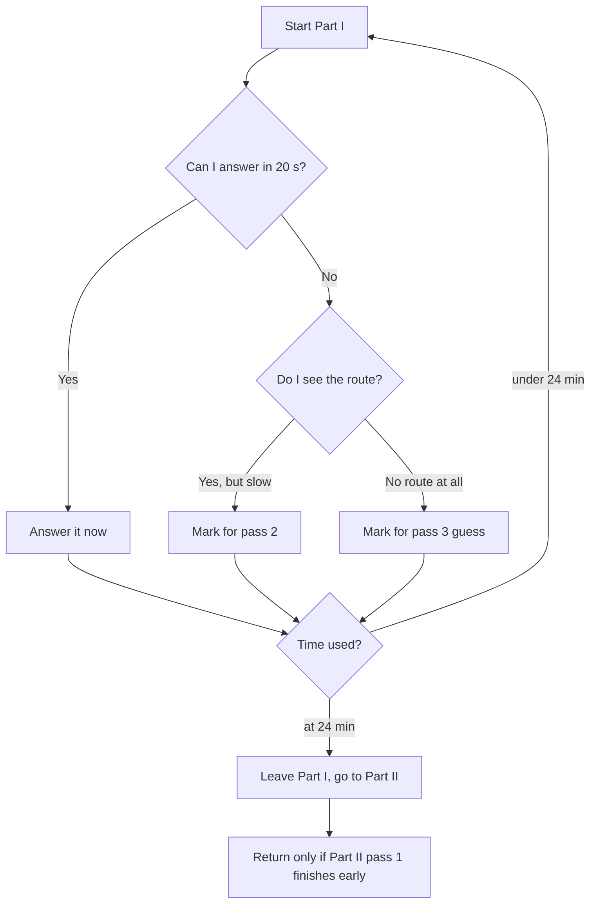

# ch16 - Aptitude for SET

## Learning Objectives

After this chapter you will be able to:

1. State the Part I structure, the time you actually have, and the 35 percent floor that applies to you.
2. Apply the 25-second rule and a three-pass order that maximises marks per minute rather than questions attempted.
3. Use the ten shortcuts that convert most Part I quantitative questions from 90 seconds to 25.
4. Recognise the eight recurring reasoning patterns and answer each in one pass.
5. Apply the three-pass reading strategy for English comprehension and the two-pass strategy for error spotting.
6. Build a telecom-aware general awareness core that does not depend on memorising news.
7. Decide, question by question, whether to solve, guess or skip, using expected value rather than instinct.

## Introduction

Part I is 40 questions and 40 marks out of 200. That is 20 percent of the paper. It also carries a **separate qualifying floor**: for an SC candidate, 35 percent, which is **14 marks**. Fall below it and your technical score is irrelevant, however good it is.

Two numbers define the strategy, and both are uncomfortable.

**The time.** Part II is 160 questions in the same 180 minutes, and it is worth four times as much. If you spend a proportional 36 minutes on Part I you will finish Part II short. The realistic budget is **22 to 26 minutes for Part I**, which is about 35 seconds per question including reading. That is not a maths test; it is a recognition test.

**The accuracy needed.** At 35 seconds per question you cannot derive anything. You must either *recognise* the pattern and apply a shortcut, or move on. This is why the chapter is organised around shortcuts and a skip rule rather than around a syllabus list.

The good news: aptitude at this level is a small, closed set of patterns. Percentages, ratios, averages, work, speed, series, seating and a fixed set of English question types account for the overwhelming majority of any such paper. Learn 12 methods and one skip rule, and 30 out of 40 is routine.

## Prerequisites

- Arithmetic up to class 10: fractions, percentages, ratios, averages.
- Multiplication tables to 20, squares to 30, cubes to 15, and the fraction-to-percentage table. These are the actual prerequisite; without them every shortcut is slower than long division.
- Comfort reading a table and a pie chart.

## Key Terminology

- **Floor:** the minimum qualifying marks in a section. Failing it disqualifies regardless of the total.
- **The 25-second rule:** if a question has not yielded a route in 25 seconds, mark it and move on. It is a rule about *route discovery*, not about solving.
- **Three-pass order:** pass 1 harvests sure shots, pass 2 takes the medium ones, pass 3 guesses the rest.
- **Shortcut:** a method that exploits the structure of the numbers (rounding, ratio, unit digit, option elimination) instead of computing exactly.
- **Option-driven solving:** substituting the four options back into the question instead of solving forwards. Often the fastest method available.
- **Approximation:** computing to two significant figures and choosing the nearest option. Valid whenever the options are far apart, which they usually are.
- **Successive change:** two percentage changes applied one after another, which never add.
- **Alligation:** the rule for the ratio in which two mixtures of different concentration must be combined to hit a target concentration.
- **Unit work:** expressing a rate of work as units per day so that combined rates add as numbers.
- **Data interpretation (DI):** a question set attached to a table, bar, pie or line chart, where most marks come from reading, not calculating.

## Theory

### 1. What Part I actually contains

The official scheme gives Part I as general aptitude. Across comparable PSU papers the composition is stable:

| Area | Typical share | Time per question | Why it is winnable |
|---|---|---|---|
| Quantitative aptitude | about 40 percent | 30 to 40 s | 12 patterns cover it |
| Reasoning | about 30 percent | 25 to 35 s | 8 patterns cover it |
| English | about 20 percent | 20 to 30 s | recognition, not grammar theory |
| General awareness | about 10 percent | 10 to 15 s | you either know it or you do not |

That last row is the most important strategic fact in the chapter. **General awareness questions cost 10 seconds and are either known or guessed.** Do them first. They are free marks or free guesses, and they cost no thinking.

### 2. The order that maximises marks



The order inside Part I:

1. **General awareness** (10 seconds each, no thinking).
2. **English fill-in-the-blank and synonym/antonym** (recognition).
3. **Quant and reasoning questions whose route you see immediately.**
4. **DI sets** (they look long but each set of 3 to 5 questions shares one read).
5. **Everything else** in pass 2.
6. **Blind guesses** in pass 3. Never leave a blank.

### 3. The floor, and why you should overshoot it

| Floor | SC requirement | Marks | What it feels like |
|---|---|---|---|
| Part I | 35 percent of 40 | **14** | 14 correct, or 12 correct and 8 guesses |
| Part II | 35 percent of 160 | **56** | roughly 60 correct |
| Overall | 45 percent of 200 | **90** | not a selection score |

**The 14-mark floor is not a target; it is a tripwire.** At 14 you qualify and lose. Your planning number is **32 out of 40**, because Part I is the cheapest 32 marks on the paper and because a bad aptitude day is the most common way a strong technical candidate is disqualified.

Expected value, at -0.25 for a wrong answer and four options:

```
blind guess EV = 0.25 x (+1) + 0.75 x (-0.25) = +0.0625 marks
```

**A blind guess is worth +0.06 marks.** Twenty blind guesses are worth about +1.25 marks and cost nothing but the seconds to click. This is why "never leave a blank" is a rule and not a preference.

### 4. Quantitative shortcuts

#### 4.1 The fraction table

Memorise these; they replace long division in most percentage questions.

| Fraction | Percent | Fraction | Percent |
|---|---|---|---|
| 1/2 | 50 | 1/8 | 12.5 |
| 1/3 | 33.33 | 1/9 | 11.11 |
| 1/4 | 25 | 1/10 | 10 |
| 1/5 | 20 | 1/12 | 8.33 |
| 1/6 | 16.67 | 1/15 | 6.67 |
| 1/7 | 14.28 | 1/16 | 6.25 |

#### 4.2 Successive percentage change

Two changes of a percent and b percent give a net change of:

```
net = a + b + (a x b)/100
```

A 20 percent increase then a 10 percent decrease is 20 - 10 - 2 = **+8 percent**, not +10.

#### 4.3 Alligation

To mix two quantities at rates r1 and r2 to obtain a mean rate rm, the ratio is:

```
quantity at r1 : quantity at r2 = (r2 - rm) : (rm - r1)
```

Cross-subtract, never solve algebraically.

#### 4.4 Difference between CI and SI

For two years, the difference is:

```
difference = P x (r/100)^2
```

That single formula replaces a full compound calculation, and it is asked constantly.

#### 4.5 Unit work

Take the LCM of the individual times as total work in units. A person who finishes in 12 days does 3 units per day if the LCM is 36. Combined rates then add as whole numbers.

#### 4.6 Speed, time and distance ratios

If the ratio of speeds is a : b, the ratio of times for the same distance is b : a. Inverting the ratio is faster than computing either time.

#### 4.7 Boats

```
downstream speed = boat + stream
upstream speed   = boat - stream
boat   = (down + up) / 2
stream = (down - up) / 2
```

#### 4.8 Trains

A train crossing a pole travels its own length. Crossing a platform travels length plus platform. Time = distance / speed, with km/h converted by multiplying by 5/18.

#### 4.9 Number series

Check in this order: differences, second differences, ratios, alternating patterns, squares and cubes plus or minus a constant, primes. Ninety percent of series questions resolve in the first three checks.

#### 4.10 Option elimination

Before solving, look at the options. If three are in the thousands and one is in the hundreds, a rough estimate decides it. If the question asks for a count of people, eliminate every non-integer. **Options are information.**

### 5. Reasoning patterns

| Pattern | What to look for | Fast method |
|---|---|---|
| Series (number or letter) | A rule that applies position to position | Differences first, then ratios |
| Analogy | Same relationship, different pair | Name the relation in three words |
| Coding-decoding | Letter shifts, reversals, position sums | Write the alphabet with indices 1 to 26 |
| Blood relations | Generations and genders | Draw a small family tree, do not track in your head |
| Direction sense | Turns and distances | Draw axes; north up, east right |
| Seating arrangement | Circular or linear constraints | Fix one person, then place constraints outward |
| Syllogism | "All", "some", "no" statements | Draw the smallest possible Venn diagram that satisfies the premises |
| Statement and assumption | What must be true for the statement to make sense | The assumption is the missing premise, not a conclusion |

**Syllogism warning:** the correct answer is the one that follows from *every* diagram consistent with the premises, not the one that feels true in the real world. A question about "all engineers are graduates" is not about engineers.

### 6. English

| Question type | Time | Method |
|---|---|---|
| Fill in the blank (single) | 15 s | Read the whole sentence; the blank usually needs a preposition or a tense |
| Fill in the blanks (double) | 25 s | Fix the easier blank first, then eliminate |
| Synonym / antonym | 10 s | If unsure, use the word in a sentence and sense the tone |
| Error spotting | 30 s | Check subject-verb agreement, tense, preposition, article, parallelism, in that order |
| Sentence improvement | 30 s | The original is often correct; do not "improve" what is already grammatical |
| One-word substitution | 10 s | Recognition only |
| Reading comprehension | 60 to 90 s per set | Read the questions first, then scan for the answer location |

**The comprehension rule:** the answer is in the passage, not in your opinion. Any option that requires outside knowledge is wrong even if it is true. Options that are extreme ("always", "never", "all") are usually wrong; options that restate the passage in different words are usually right.

### 7. General awareness for a telecom paper

Do not memorise news. Memorise **structure**, and let current affairs be a small weekly read.

| Domain | What to know |
|---|---|
| Telecom institutions | DoT (policy and licensing), TRAI (regulation and recommendations), BSNL and MTNL (PSUs), COAI (industry body) |
| Telecom technology in the news | 5G, spectrum bands, fibre rollout, satellite broadband, undersea cables |
| Government schemes | BharatNet, Digital India, National Broadband Mission (know the purpose, not the budget) |
| Basic economics | GDP, inflation, repo rate, fiscal deficit, budget basics |
| Indian polity | Constitution, fundamental rights, Parliament, President, judiciary basics |
| Geography | States and capitals, major rivers, ports, neighbours |
| Science | Units, basic physics, space programme, ISRO missions |

**The honest method:** 10 minutes a day on a reputable current-affairs digest, plus the seven rows above. Do not read three newspapers; the marginal return collapses.

### 8. Data interpretation

DI sets look expensive and are usually cheap, because one read serves three to five questions.

| Chart type | Read for | Trap |
|---|---|---|
| Table | Column headers and units | A column in thousands next to one in lakhs |
| Bar | Relative heights, not labels | Values printed inside the bar |
| Pie | Shares, and the base of the percentage | A pie of "share of revenue" is not "profit" |
| Line | Trend and turning points | The y-axis does not start at zero |

**DI protocol:** read the title, the units and the axis labels before touching a question. Half the errors in DI are unit errors, not arithmetic errors.

## Formula Sheet

| Topic | Formula |
|---|---|
| Successive change | net = a + b + ab/100 |
| Profit percent | (SP - CP)/CP x 100 |
| Discount percent | (MP - SP)/MP x 100 |
| CI minus SI (2 years) | P x (r/100)^2 |
| Amount, CI | P x (1 + r/100)^n |
| SI | P x r x t / 100 |
| Alligation | (r2 - rm) : (rm - r1) |
| Average | sum / count |
| Weighted average | sum of (value x weight) / sum of weights |
| Work | rate = 1/time; combined = 1/t1 + 1/t2 |
| Pipes with a leak | 1/fill - 1/leak = 1/net |
| Speed | distance / time; km/h x 5/18 = m/s |
| Boats | boat = (down + up)/2; stream = (down - up)/2 |
| Train over platform | (train + platform) / speed |
| nPr | n! / (n - r)! |
| nCr | n! / (r! (n - r)!) |
| Probability | favourable / total |
| Two dice | 36 outcomes; sums 2 to 12 |
| Mean of a list after adding x | new mean = (old sum + x) / (n + 1) |

## Worked Examples

### Example 1 - Successive discount (shortcut)

A shirt marked at Rs 2,000 gets 20 percent off, then a further 10 percent off the reduced price. What is the final price?

**Long method.** 2,000 x 0.8 = 1,600; 1,600 x 0.9 = 1,440.

**Shortcut.** Net discount = 20 + 10 - (20 x 10)/100 = 28 percent.

```
final = 2,000 x 0.72 = Rs 1,440
```

**Answer: Rs 1,440, a net 28 percent discount.** Note that the discounts do not add to 30 percent, which is exactly the distractor the paper will offer.

### Example 2 - Alligation

In what ratio must tea at Rs 300 per kg be mixed with tea at Rs 450 per kg to produce a blend at Rs 380 per kg?

**Step 1 - cross-subtract.**

```
cheaper : dearer = (450 - 380) : (380 - 300) = 70 : 80 = 7 : 8
```

**Step 2 - verify.** In 15 kg, 7 kg at 300 is 2,100 and 8 kg at 450 is 3,600, total 5,700 for 15 kg, which is Rs 380 per kg.

**Answer: 7 : 8.** No algebra needed; the rule is a single cross-subtraction.

### Example 3 - CI minus SI

What is the difference between compound and simple interest on Rs 20,000 at 10 percent per annum for 2 years?

**Shortcut.**

```
difference = P x (r/100)^2 = 20,000 x (0.10)^2 = 20,000 x 0.01 = Rs 200
```

**Check.** SI = 20,000 x 10 x 2 / 100 = 4,000. CI = 20,000 x 1.21 - 20,000 = 4,200. Difference = 200.

**Answer: Rs 200.** The two-year case is the most common; the shortcut exists precisely for it.

### Example 4 - Unit work

A can finish a job in 12 days and B in 18 days. They work together for 4 days, then A leaves. How long does B take to finish?

**Step 1 - total work as LCM.** LCM of 12 and 18 is 36 units.

```
A does 36/12 = 3 units per day
B does 36/18 = 2 units per day
```

**Step 2 - work done together in 4 days.**

```
(3 + 2) x 4 = 20 units
```

**Step 3 - remaining and B's time.**

```
remaining = 36 - 20 = 16 units
B's time  = 16 / 2 = 8 days
```

**Answer: 8 days.** Whole numbers throughout, no fractions, no errors.

### Example 5 - Pipes with a leak

A pipe fills a tank in 6 hours. A leak empties it in 9 hours. With both open, how long to fill?

**Unit method.** LCM of 6 and 9 is 18 units.

```
fill rate  = 18/6 = 3 units per hour
leak rate  = 18/9 = 2 units per hour
net rate   = 1 unit per hour
time       = 18 / 1 = 18 hours
```

**Answer: 18 hours.** The standard trap is to average 6 and 9; the answer is not 7.5.

### Example 6 - Trains

A 150 m train running at 72 km/h crosses a 300 m platform. How long does it take?

**Step 1 - convert speed.**

```
72 km/h x 5/18 = 20 m/s
```

**Step 2 - total distance.**

```
150 + 300 = 450 m
```

**Step 3 - time.**

```
450 / 20 = 22.5 s
```

**Answer: 22.5 seconds.** Crossing a pole would be 150/20 = 7.5 s; the platform adds exactly the extra distance.

### Example 7 - Boats

A boat covers 24 km downstream in 2 hours and returns in 3 hours. Find the boat's speed in still water and the stream's speed.

```
down = 24/2 = 12 km/h
up   = 24/3 = 8 km/h
boat   = (12 + 8)/2 = 10 km/h
stream = (12 - 8)/2 = 2 km/h
```

**Answer: 10 km/h and 2 km/h.** Always compute both speeds first; the two formulas are then one line each.

### Example 8 - Number series

Find the next term: 3, 8, 15, 24, 35, ?

**Step 1 - first differences.** 5, 7, 9, 11.

**Step 2 - the differences rise by 2.** The next difference is 13.

```
35 + 13 = 48
```

**Check as a pattern.** The terms are n^2 - 1 for n = 2, 3, 4, 5, 6, 7: 3, 8, 15, 24, 35, 48. Both routes agree.

**Answer: 48.** Two independent routes in under 20 seconds is the standard to train for.

### Example 9 - Permutations with a constraint

In how many ways can the letters of the word LOGIC be arranged so that the vowels are always together?

**Step 1 - treat the vowel block as one unit.** LOGIC has 2 vowels (O, I) and 3 consonants (L, G, C).

```
units = 3 consonants + 1 vowel block = 4 units
arrangements of units = 4! = 24
```

**Step 2 - arrange inside the block.**

```
2! = 2
```

**Step 3 - multiply.**

```
24 x 2 = 48
```

**Answer: 48.** The block method converts a constraint into a smaller factorial problem.

### Example 10 - Probability with two dice

Two dice are thrown. What is the probability that the sum is 9?

**Step 1 - total outcomes.** 6 x 6 = 36.

**Step 2 - count favourable pairs.** (3,6), (4,5), (5,4), (6,3) = 4.

**Step 3 - probability.**

```
4/36 = 1/9
```

**Answer: 1/9.** Sum 7 has 6 favourable pairs and is the most likely; sum 2 and sum 12 have 1 each.

### Example 11 - Data interpretation

A pie chart shows a company's revenue of Rs 800 crore: telecom 45 percent, IT 25 percent, retail 20 percent, other 10 percent. By how much does telecom revenue exceed IT revenue?

```
telecom = 800 x 0.45 = 360 crore
IT      = 800 x 0.25 = 200 crore
difference = 160 crore
```

**Shortcut.** The difference in share is 20 percentage points, so 800 x 0.20 = 160 crore. One multiplication instead of two.

**Answer: Rs 160 crore.**

### Example 12 - Average with a replacement

The average age of 10 students is 20 years. A student aged 25 leaves and one aged 19 joins. What is the new average?

**Shortcut.** The sum changes by 19 - 25 = -6.

```
new sum = 200 - 6 = 194
new average = 194/10 = 19.4 years
```

**Answer: 19.4 years.** Never recompute the whole sum; track the delta.

## Exam Traps and Common Mistakes

- **Adding successive percentages.** 20 percent then 10 percent is 28 percent, not 30. Use a + b + ab/100.
- **Forgetting the 5/18 conversion.** A speed in km/h must be multiplied by 5/18 to get m/s before dividing a distance in metres.
- **Averaging times instead of rates in work problems.** Two workers at 12 and 18 days finish in 7.2 days, not 15.
- **Treating a discount on the marked price and a discount on the selling price as the same.** They are applied in sequence to different bases.
- **Using the simple-interest formula for compound interest over 3 or more years.** The P(r/100)^2 shortcut is only for the two-year difference.
- **Reading a pie chart's percentage as an absolute value.** A 45 percent share of Rs 800 crore is 360 crore, and the base is not the profit.
- **Answering a syllogism from real-world knowledge.** Only the premises count.
- **Over-reading in comprehension.** The passage is the only source; outside knowledge is a distractor generator.
- **Spending 90 seconds on a 35-second question.** The cost is not 55 seconds, it is the two questions you did not reach.
- **Leaving blanks.** At -0.25 with four options, a blind guess is +0.06 marks. Always click something.
- **Doing Part I first for 40 minutes.** Part II is 160 marks. Part I gets 24 minutes, not a proportional share.
- **"Improving" a correct sentence.** In sentence-improvement questions, "no improvement" is a real and common answer.

## Summary

Part I is 40 marks with a 14-mark floor for an SC candidate and about 24 minutes of real time, which makes it a recognition test rather than a mathematics test. The winning order is general awareness, then recognition English, then immediate quant and reasoning, then DI, then pass 2 and blind guesses. Twelve shortcuts (fraction table, successive change, alligation, CI-SI difference, unit work, speed ratios, boats, trains, series order, option elimination, block permutations, delta averages) convert most questions from derivation to arithmetic. Reasoning is eight patterns, English is six question types with a passage discipline, and general awareness is structure plus a small daily read rather than newspaper volume. And because a blind guess is worth +0.06 marks, the last rule is absolute: never leave a blank.

## Practical Takeaways

- Budget 22 to 26 minutes for Part I. Part II is four times the marks.
- Floor is 14; plan for 32.
- Do general awareness first; it is 10 seconds per question.
- 25-second rule: no route in 25 seconds means mark and move.
- Learn the fraction table and the successive-change formula; they pay for themselves in one mock.
- Unit work with the LCM removes almost all work-and-pipes errors.
- CI minus SI for two years = P(r/100)^2.
- Comprehension answers live in the passage; extreme options are usually wrong.
- Never leave a blank. A blind guess is +0.06 marks.

## Chapter Quiz

**Q1.** A price is increased by 25 percent and then reduced by 20 percent. The net change is:
(a) +5 percent (b) 0 percent (c) -5 percent (d) +45 percent
**Answer: (b).** 25 - 20 - (25 x 20)/100 = 5 - 5 = 0.

**Q2.** A does a job in 10 days and B in 15 days. Working together they finish in:
(a) 5 days (b) 6 days (c) 12.5 days (d) 25 days
**Answer: (b).** LCM 30 units; rates 3 and 2; 30/5 = 6 days.

**Q3.** The difference between CI and SI on Rs 10,000 at 5 percent for 2 years is:
(a) Rs 25 (b) Rs 50 (c) Rs 100 (d) Rs 500
**Answer: (a).** 10,000 x (0.05)^2 = 10,000 x 0.0025 = Rs 25.

**Q4.** Two dice are thrown. The probability that the sum is 7 is:
(a) 1/12 (b) 1/9 (c) 1/6 (d) 1/4
**Answer: (c).** Six favourable pairs out of 36.

**Q5.** With 40 questions and 40 marks, a wrong answer costing 0.25, the expected value of a blind guess among four options is:
(a) -0.25 (b) 0 (c) +0.06 (d) +0.25
**Answer: (c).** 0.25 x 1 + 0.75 x (-0.25) = +0.0625.

## Exercises

1. Time yourself on 20 mixed quant questions with a 25-second rule enforced. Record how many you abandoned and how many you got right. **Target: 14 or more correct in 10 minutes.**
2. A shopkeeper marks goods 40 percent above cost and offers a 25 percent discount. What is the profit percent? **Answer: 1.40 x 0.75 = 1.05, so 5 percent.**
3. A tank is filled by two pipes in 12 and 15 hours and emptied by a third in 20 hours. All three open: how long? **Answer: LCM 60; rates 5 + 4 - 3 = 6; 60/6 = 10 hours.**
4. A 200 m train at 90 km/h crosses another 300 m train moving the same direction at 54 km/h. Time to cross? **Answer: relative 10 m/s; 500/10 = 50 s.**
5. In how many ways can 5 people sit in a row if two particular people must not sit together? **Answer: 5! - 2 x 4! = 120 - 48 = 72.**
6. Write your personal Part I order and your three skip criteria in under 60 words. Then use it in the next mock without deviation.
7. Take one DI set of 4 questions and do it in 3 minutes. Log the time, the errors, and whether any error was a unit error.
8. Build a one-page telecom awareness sheet: DoT, TRAI, BSNL, MTNL, BharatNet, 5G bands, and three recent telecom developments. Update it weekly in 10 minutes.

## Next

Block 5 is complete, and with it the technical paper. Chapter 15 closes the course with project management, the block where 16 marks come from arithmetic you have already seen in aptitude.
