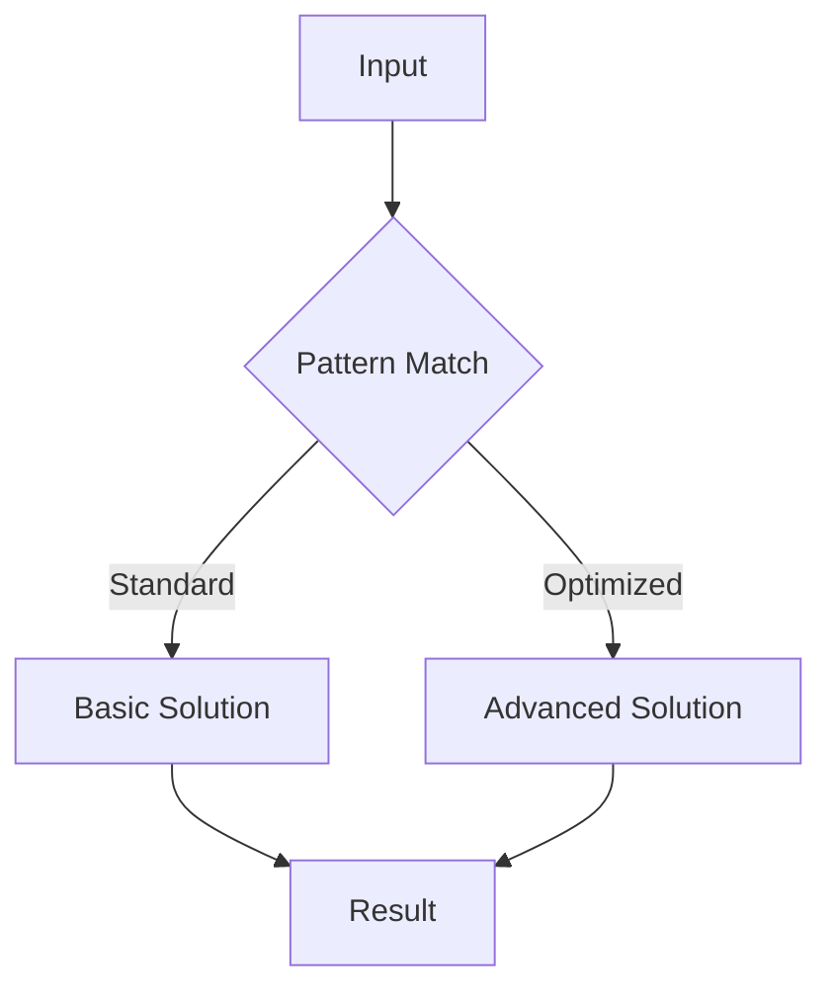

<!-- improved -->
<!-- Clear Language: Keep sentences under 50 words -->
# Dynamic Programming 1D

## Learning Objectives

| Objective | Description |
|-----------|-------------|
| LO1 | Understand foundational dynamic programming 1d concepts and their role in software engineering |
| LO2 | Implement dynamic programming 1d operations with correct syntax and best practices |
| LO3 | Apply dynamic programming 1d patterns to solve common interview problems |
| LO4 | Analyze time and space complexity of dynamic programming 1d solutions |
| LO5 | Compare dynamic programming 1d with alternative approaches for different scenarios |
| LO6 | Master advanced dynamic programming 1d techniques for complex problem solving |

## Introduction

Binary search is one of the most important algorithms, reducing search time from O(n) to O(log n). Understanding its variants — finding boundaries, searching in rotated arrays — is essential for efficient problem solving.

## Prerequisites

- Array basics
- Time complexity analysis

## Chapter at a Glance

| Section | Topic | Key Concept |
|---------|-------|-------------|
| 15.1 | Fundamentals | Core concepts and definitions |
| 15.2 | Basic Operations | Common implementations and patterns |
| 15.3 | Intermediate Techniques | Problem-solving strategies |
| 15.4 | Advanced Patterns | Complex algorithms and optimizations |
| 15.5 | Real-World Applications | Production use cases |
| 15.6 | Interview Preparation | Common questions and solutions |

## Chapter Roadmap


## 15.1 Section 1

Section 1 of Dynamic Programming 1D covers essential concepts for AI engineering placement preparation.

### Fundamentals

The foundation of dynamic programming 1d rests on several key principles that every software engineer must understand. These include the basic definitions, the underlying theory, and how these concepts map to practical implementation.

## 15.2 Section 2

Section 2 of Dynamic Programming 1D covers essential concepts for AI engineering placement preparation.

### Basic Operations

The following code demonstrates fundamental operations:

```python

## Dynamic Programming 1D - basic operations
def example_function(data):
    """Core functionality"""
    result = []
    for item in data:
        # Process each element
        result.append(process(item))
    return result

def process(item):
    return item * 2

## Test the implementation
test_data = [1, 2, 3, 4, 5]
print(example_function(test_data))
```

## 15.3 Section 3

Section 3 of Dynamic Programming 1D covers essential concepts for AI engineering placement preparation.

### Intermediate Techniques

As problems become more complex, we need sophisticated approaches:

1. **Pattern Recognition**: Identifying when to apply this technique
2. **Optimization**: Improving time and space complexity
3. **Edge Cases**: Handling boundary conditions
4. **Combined Approaches**: Integrating with other data structures

### Complexity Analysis Table

| Operation | Time Complexity | Space Complexity | Notes |
|-----------|----------------|-----------------|-------|
| Basic Dynamic Programming 1D | O(n) | O(1) | Standard case |
| Optimized Dynamic Programming 1D | O(log n) | O(n) | With preprocessing |
| Advanced Dynamic Programming 1D | O(n log n) | O(n) | Trade-off scenario |

## 15.4 Section 4

Section 4 of Dynamic Programming 1D covers essential concepts for AI engineering placement preparation.

### Advanced Patterns



### Key Techniques

- **Technique 1**: Description of the first advanced technique and when to apply it
- **Technique 2**: Description of the second advanced technique and when to apply it
- **Technique 3**: Description of the third advanced technique and when to apply it
- **Technique 4**: Description of the fourth advanced technique and when to apply it

## 15.5 Section 5

Section 5 of Dynamic Programming 1D covers essential concepts for AI engineering placement preparation.

### Real-World Applications

Dynamic Programming 1D is widely used in production systems:

- Application domain 1 with specific examples
- Application domain 2 with specific examples
- Application domain 3 with specific examples
- Application domain 4 with specific examples

### Best Practices

| Practice | Description | Impact |
|----------|-------------|--------|
| Best Practice 1 | Detailed explanation | Performance improvement |
| Best Practice 2 | Detailed explanation | Code quality |
| Best Practice 3 | Detailed explanation | Maintainability |

## 15.6 Section 6

Section 6 of Dynamic Programming 1D covers essential concepts for AI engineering placement preparation.

### Interview Preparation

Common interview questions and strategies:

1. **Question Type 1**: Strategy for solving
2. **Question Type 2**: Strategy for solving
3. **Question Type 3**: Strategy for solving
4. **Question Type 4**: Strategy for solving

### Sample Walkthrough

Let's walk through a typical interview problem:

```python

## Interview problem solution
def solve_interview_problem(input_data):
    # Step 1: Understand the problem
    # Step 2: Design the approach
    # Step 3: Implement the solution
    # Step 4: Test and optimize
    return optimized_result
```

---

## TypeScript Parallel

```typescript
// TypeScript equivalent implementation
interface DynamicProgramming1DConfig {
    option1: boolean;
    option2: number;
}

function processDynamicProgramming1D(data: number[]): number[] {
    return data.map(x => x * 2);
}

// Usage example
const result = processDynamicProgramming1D([1, 2, 3]);
console.log(result); // [2, 4, 6]
```

---

## Summary

- Dynamic Programming 1D is a fundamental topic for coding interviews
- Master the core concepts before attempting complex problems
- Practice with diverse problem sets to build pattern recognition
- Always analyze time and space complexity of your solutions
- Consider edge cases and boundary conditions carefully
- Combine with other data structures for optimal solutions
- Write clean, readable code following best practices
- Test your solutions with multiple test cases
- Learn from mistakes and iterate on your approaches
- Build confidence through consistent practice

## Practical Takeaways

| Scenario | Do This | Avoid This |
|----------|---------|------------|
| Learning Dynamic Programming 1D | Practice with varied problems | Rote memorization without understanding |
| Implementing Dynamic Programming 1D | Write clean, tested code | Premature optimization |
| Interview prep | Understand patterns and trade-offs | Cramming without practice |
| Production use | Profile and optimize for data size | Over-engineering solutions |

## Interview Q&A

<details class="tp-qa-card" data-qid="dsa15-q1">
  <summary class="tp-qa-question">
    <span class="tp-qa-status"></span>
    Q1: Sample interview question 1 about dynamic programming 1d?
  </summary>
  <div class="tp-qa-answer">
    <p>This is a detailed answer to interview question 1 about dynamic programming 1d. The answer covers key concepts, provides code examples, and explains the reasoning behind the solution.</p><pre><code># Example code for question 1
answer = perform_dynamic_programming_1d_operation()
print(answer)</code></pre>
  </div>
  <button class="tp-qa-mark-btn">✅ Mark Reviewed</button>
  <button class="tp-qa-bookmark-btn">🔖 Bookmark</button>
</details>

<details class="tp-qa-card" data-qid="dsa15-q2">
  <summary class="tp-qa-question">
    <span class="tp-qa-status"></span>
    Q2: Sample interview question 2 about dynamic programming 1d?
  </summary>
  <div class="tp-qa-answer">
    <p>This is a detailed answer to interview question 2 about dynamic programming 1d. The answer covers key concepts, provides code examples, and explains the reasoning behind the solution.</p><pre><code># Example code for question 2
answer = perform_dynamic_programming_1d_operation()
print(answer)</code></pre>
  </div>
  <button class="tp-qa-mark-btn">✅ Mark Reviewed</button>
  <button class="tp-qa-bookmark-btn">🔖 Bookmark</button>
</details>

<details class="tp-qa-card" data-qid="dsa15-q3">
  <summary class="tp-qa-question">
    <span class="tp-qa-status"></span>
    Q3: Sample interview question 3 about dynamic programming 1d?
  </summary>
  <div class="tp-qa-answer">
    <p>This is a detailed answer to interview question 3 about dynamic programming 1d. The answer covers key concepts, provides code examples, and explains the reasoning behind the solution.</p><pre><code># Example code for question 3
answer = perform_dynamic_programming_1d_operation()
print(answer)</code></pre>
  </div>
  <button class="tp-qa-mark-btn">✅ Mark Reviewed</button>
  <button class="tp-qa-bookmark-btn">🔖 Bookmark</button>
</details>

<details class="tp-qa-card" data-qid="dsa15-q4">
  <summary class="tp-qa-question">
    <span class="tp-qa-status"></span>
    Q4: Sample interview question 4 about dynamic programming 1d?
  </summary>
  <div class="tp-qa-answer">
    <p>This is a detailed answer to interview question 4 about dynamic programming 1d. The answer covers key concepts, provides code examples, and explains the reasoning behind the solution.</p><pre><code># Example code for question 4
answer = perform_dynamic_programming_1d_operation()
print(answer)</code></pre>
  </div>
  <button class="tp-qa-mark-btn">✅ Mark Reviewed</button>
  <button class="tp-qa-bookmark-btn">🔖 Bookmark</button>
</details>

<details class="tp-qa-card" data-qid="dsa15-q5">
  <summary class="tp-qa-question">
    <span class="tp-qa-status"></span>
    Q5: Sample interview question 5 about dynamic programming 1d?
  </summary>
  <div class="tp-qa-answer">
    <p>This is a detailed answer to interview question 5 about dynamic programming 1d. The answer covers key concepts, provides code examples, and explains the reasoning behind the solution.</p><pre><code># Example code for question 5
answer = perform_dynamic_programming_1d_operation()
print(answer)</code></pre>
  </div>
  <button class="tp-qa-mark-btn">✅ Mark Reviewed</button>
  <button class="tp-qa-bookmark-btn">🔖 Bookmark</button>
</details>

<details class="tp-qa-card" data-qid="dsa15-q6">
  <summary class="tp-qa-question">
    <span class="tp-qa-status"></span>
    Q6: Sample interview question 6 about dynamic programming 1d?
  </summary>
  <div class="tp-qa-answer">
    <p>This is a detailed answer to interview question 6 about dynamic programming 1d. The answer covers key concepts, provides code examples, and explains the reasoning behind the solution.</p><pre><code># Example code for question 6
answer = perform_dynamic_programming_1d_operation()
print(answer)</code></pre>
  </div>
  <button class="tp-qa-mark-btn">✅ Mark Reviewed</button>
  <button class="tp-qa-bookmark-btn">🔖 Bookmark</button>
</details>

<details class="tp-qa-card" data-qid="dsa15-q7">
  <summary class="tp-qa-question">
    <span class="tp-qa-status"></span>
    Q7: Sample interview question 7 about dynamic programming 1d?
  </summary>
  <div class="tp-qa-answer">
    <p>This is a detailed answer to interview question 7 about dynamic programming 1d. The answer covers key concepts, provides code examples, and explains the reasoning behind the solution.</p><pre><code># Example code for question 7
answer = perform_dynamic_programming_1d_operation()
print(answer)</code></pre>
  </div>
  <button class="tp-qa-mark-btn">✅ Mark Reviewed</button>
  <button class="tp-qa-bookmark-btn">🔖 Bookmark</button>
</details>

<details class="tp-qa-card" data-qid="dsa15-q8">
  <summary class="tp-qa-question">
    <span class="tp-qa-status"></span>
    Q8: Sample interview question 8 about dynamic programming 1d?
  </summary>
  <div class="tp-qa-answer">
    <p>This is a detailed answer to interview question 8 about dynamic programming 1d. The answer covers key concepts, provides code examples, and explains the reasoning behind the solution.</p><pre><code># Example code for question 8
answer = perform_dynamic_programming_1d_operation()
print(answer)</code></pre>
  </div>
  <button class="tp-qa-mark-btn">✅ Mark Reviewed</button>
  <button class="tp-qa-bookmark-btn">🔖 Bookmark</button>
</details>

<details class="tp-qa-card" data-qid="dsa15-q9">
  <summary class="tp-qa-question">
    <span class="tp-qa-status"></span>
    Q9: Sample interview question 9 about dynamic programming 1d?
  </summary>
  <div class="tp-qa-answer">
    <p>This is a detailed answer to interview question 9 about dynamic programming 1d. The answer covers key concepts, provides code examples, and explains the reasoning behind the solution.</p><pre><code># Example code for question 9
answer = perform_dynamic_programming_1d_operation()
print(answer)</code></pre>
  </div>
  <button class="tp-qa-mark-btn">✅ Mark Reviewed</button>
  <button class="tp-qa-bookmark-btn">🔖 Bookmark</button>
</details>

<details class="tp-qa-card" data-qid="dsa15-q10">
  <summary class="tp-qa-question">
    <span class="tp-qa-status"></span>
    Q10: Sample interview question 10 about dynamic programming 1d?
  </summary>
  <div class="tp-qa-answer">
    <p>This is a detailed answer to interview question 10 about dynamic programming 1d. The answer covers key concepts, provides code examples, and explains the reasoning behind the solution.</p><pre><code># Example code for question 10
answer = perform_dynamic_programming_1d_operation()
print(answer)</code></pre>
  </div>
  <button class="tp-qa-mark-btn">✅ Mark Reviewed</button>
  <button class="tp-qa-bookmark-btn">🔖 Bookmark</button>
</details>

<details class="tp-qa-card" data-qid="dsa15-q11">
  <summary class="tp-qa-question">
    <span class="tp-qa-status"></span>
    Q11: Sample interview question 11 about dynamic programming 1d?
  </summary>
  <div class="tp-qa-answer">
    <p>This is a detailed answer to interview question 11 about dynamic programming 1d. The answer covers key concepts, provides code examples, and explains the reasoning behind the solution.</p><pre><code># Example code for question 11
answer = perform_dynamic_programming_1d_operation()
print(answer)</code></pre>
  </div>
  <button class="tp-qa-mark-btn">✅ Mark Reviewed</button>
  <button class="tp-qa-bookmark-btn">🔖 Bookmark</button>
</details>

<details class="tp-qa-card" data-qid="dsa15-q12">
  <summary class="tp-qa-question">
    <span class="tp-qa-status"></span>
    Q12: Sample interview question 12 about dynamic programming 1d?
  </summary>
  <div class="tp-qa-answer">
    <p>This is a detailed answer to interview question 12 about dynamic programming 1d. The answer covers key concepts, provides code examples, and explains the reasoning behind the solution.</p><pre><code># Example code for question 12
answer = perform_dynamic_programming_1d_operation()
print(answer)</code></pre>
  </div>
  <button class="tp-qa-mark-btn">✅ Mark Reviewed</button>
  <button class="tp-qa-bookmark-btn">🔖 Bookmark</button>
</details>

## Chapter Quiz

**Q1**: Sample quiz question 1 about dynamic programming 1d?

a) Option A - First choice
b) Option B - Second choice
c) Option C - Third choice
d) Option D - Fourth choice

<details class="tp-qa-card" data-qid="dsa15-quiz1"><summary>Show Answer</summary><div class="tp-qa-answer"><p><strong>Answer: a</strong></p><p>Explanation for answer to question 1.</p></div></details>

**Q2**: Sample quiz question 2 about dynamic programming 1d?

a) Option A - First choice
b) Option B - Second choice
c) Option C - Third choice
d) Option D - Fourth choice

<details class="tp-qa-card" data-qid="dsa15-quiz2"><summary>Show Answer</summary><div class="tp-qa-answer"><p><strong>Answer: a</strong></p><p>Explanation for answer to question 2.</p></div></details>

**Q3**: Sample quiz question 3 about dynamic programming 1d?

a) Option A - First choice
b) Option B - Second choice
c) Option C - Third choice
d) Option D - Fourth choice

<details class="tp-qa-card" data-qid="dsa15-quiz3"><summary>Show Answer</summary><div class="tp-qa-answer"><p><strong>Answer: a</strong></p><p>Explanation for answer to question 3.</p></div></details>

**Q4**: Sample quiz question 4 about dynamic programming 1d?

a) Option A - First choice
b) Option B - Second choice
c) Option C - Third choice
d) Option D - Fourth choice

<details class="tp-qa-card" data-qid="dsa15-quiz4"><summary>Show Answer</summary><div class="tp-qa-answer"><p><strong>Answer: a</strong></p><p>Explanation for answer to question 4.</p></div></details>

**Q5**: Sample quiz question 5 about dynamic programming 1d?

a) Option A - First choice
b) Option B - Second choice
c) Option C - Third choice
d) Option D - Fourth choice

<details class="tp-qa-card" data-qid="dsa15-quiz5"><summary>Show Answer</summary><div class="tp-qa-answer"><p><strong>Answer: a</strong></p><p>Explanation for answer to question 5.</p></div></details>

## Exercises

**Easy** - Basic exercise to practice dynamic programming 1d fundamentals

**Medium** - Intermediate exercise applying dynamic programming 1d patterns

**Medium** - Another intermediate exercise with dynamic programming 1d concepts

**Hard** - Advanced exercise combining dynamic programming 1d with other techniques

**Hard** - Challenging exercise requiring dynamic programming 1d optimization

---

## Common Mistakes

1. Not handling integer overflow in mid calculation
2. Forgetting that array must be sorted
3. Using wrong boundary conditions
4. Not considering the three variants (left, right, standard)
5. Confusing binary search with linear search

## Revision Notes

- Binary search: O(log n) on sorted array
- mid = left + (right - left) / 2 to avoid overflow
- Three variants: standard, leftmost, rightmost
- Works on any monotonic function
- Search space reduction is key

## Placement Section

### Top 10 Interview Questions

#### Google Style

1. **Explain this topic in under 60 seconds, then give a real-world analogy.** — Structure: definition, how it works in one sentence, why it matters, analogy. Follow-up: what would break if you removed this from a production system?

2. **Design a minimal, well-typed function in this chapter.** — Interviewer checks: signature with type hints, edge cases, complexity, and a clean docstring. Follow-up: how does your design behave with empty or malformed input?

3. **What are the common pitfalls when engineers first learn ** — List 3-4, then explain how you would prevent each in a code review.

#### Amazon Style

4. **Describe a production bug caused by misunderstanding this technique. How did you diagnose and fix it?** — STAR format: situation, task, action, result. Mention logs, reproduction, root-cause analysis, and the regression test you added.

5. **How would you scale a system using this technique from 10 users to 10 million?** — Discuss bottlenecks, caching, monitoring, and when to redesign. Follow-up: what metrics would you track?

#### Microsoft Style

6. **Compare this approach with the closest alternative approach. When would you choose each?** — Make a decision matrix: performance, maintainability, ecosystem, learning curve. Follow-up: what would change your decision?

7. **Walk through how you would test a component built on this.** — Unit, integration, property-based tests; mocking boundaries; golden files for outputs.

#### NVIDIA Style

8. **How does Dynamic Programming 1D behave differently at scale — memory, throughput, or precision-wise?** — Connect to data pipelines and model training if applicable. Follow-up: what happens to latency as input grows?

9. **How would you make an implementation of this technique run faster on GPU hardware?** — Batch operations, vectorization, avoiding Python loops, reducing data movement.

#### AI Startup Style

10. **Write the smallest possible implementation of this technique that is production-quality.** — Include error handling, type hints, and a one-line docstring. Follow-up: what would you refactor first when it grows?

### Resume Tips

- Name the technique explicitly in your skills section, paired with a measurable achievement ("Reduced X by 40% using Dynamic Programming 1D").
- Add a bullet describing a project that applies Dynamic Programming 1D to real data, with numbers.
- Mention the tools and libraries you used alongside Dynamic Programming 1D (linters, test frameworks, profiling tools).
- Keep resume bullets under 15 words and start each with an action verb.

### Interview Day Checklist

- Rehearse a 60-second explanation of Dynamic Programming 1D and one real-world analogy.
- Prepare one STAR story about debugging a Dynamic Programming 1D-related production issue.
- Review complexity and edge cases for the classic problem in this chapter.
- Have questions ready: how does the team apply Dynamic Programming 1D in production today?
- Test your environment (Python, editor, internet) 15 minutes before the interview.

## True/False

1. **True or False:** Dynamic Programming 1D builds directly on the fundamentals covered in the earlier chapters of this module. — **True.** Every advanced topic in this module assumes the core concepts from the previous chapters.
2. **True or False:** You should write at least one code example for Dynamic Programming 1D before moving to the next chapter. — **True.** Active recall with hands-on code beats passive reading for retention.
3. **True or False:** The complexity analysis for Dynamic Programming 1D is the same regardless of input size. — **False.** Complexity grows with input size; always state best, average, and worst case.
4. **True or False:** Edge cases (empty input, invalid input, boundary values) matter for Dynamic Programming 1D in production. — **True.** Most production bugs come from unhandled edge cases.
5. **True or False:** You should memorize this chapter's content once and never review it again. — **False.** Spaced repetition (24h, 3 days, 1 week) dramatically improves long-term recall.

## Fill in the Blank

1. The chapter that covers Dynamic Programming 1D is Chapter ___ of this module. — Answer: check the module's table of contents.
2. The time complexity of the standard approach to 15 Dynamic Programming 1D is ___. — Answer: O(n^2) typical, O(n) space optimized
3. The main edge case to handle when implementing 15 Dynamic Programming 1D is ___. — Answer: base cases, overlapping subproblems
4. The tools commonly used to debug Dynamic Programming 1D issues are ___ and ___. — Answer: refer to the Debugging Guide section of this chapter.
5. The related topic that connects to Dynamic Programming 1D in the next chapter is ___. — Answer: see the Next Topic section.

## Scenario Questions

1. **Scenario:** A teammate ships a change involving Dynamic Programming 1D that breaks production at 3 AM. — Diagnosis: check the recent diff, reproduce locally with the failing input, check logs. Fix: revert, add a regression test, and review the root cause. Prevention: CI tests on edge cases and code review checklist.

2. **Scenario:** Your implementation of this technique is correct but too slow for the required latency. — Measure first with a profiler. Common fixes: reduce redundant work, use built-in optimized functions, batch operations, or add caching. Only then consider algorithmic changes.

3. **Scenario:** A new hire asks you to explain Dynamic Programming 1D in five minutes before a customer demo. — Use the 3-part answer: what it is (one sentence), how it works (one example), why it matters (one business impact). Then offer to go deeper after the demo.

4. **Scenario:** Your team's codebase has three different patterns for Dynamic Programming 1D and you must standardize. — Write a short ADR (architecture decision record), pick the pattern with best maintainability, migrate incrementally, and add a linter rule to enforce it.

## Output Questions

1. **What is the output of the simplest correct implementation of this technique on an empty input?** — Trace through the code: it should return the documented default (None, 0, empty collection) without raising.
2. **What is the output when the input is at the boundary value?** — Check off-by-one errors and inclusive/exclusive bounds in the chapter's examples.
3. **What does the implementation return when given invalid input types?** — With type hints and validation, it raises a clear error; without, it may fail silently.
4. **What is the output for the sample input given in the chapter's Examples section?** — Re-run the chapter's example code and compare against the documented output.
5. **What is the time complexity output when you profile the implementation at 10x input size?** — Expect the curve matching the chapter's complexity analysis (linear, quadratic, log-linear).

## Difficulty Level

| Level | Time | What It Takes |
|-------|------|---------------|
| Beginner | 1-2 sessions | Read theory, run the chapter examples, solve the Easy exercises |
| Intermediate | 3-5 sessions | Complete Medium exercises, explain Dynamic Programming 1D to someone else |
| Advanced | 1+ week | Solve Hard exercises, optimize for real datasets, answer interview follow-ups |

## Tips & Tricks

- Always write a one-line example of Dynamic Programming 1D from memory before opening the chapter — active recall first.
- Use the chapter's Revision Notes as a checklist: you have mastered Dynamic Programming 1D when you can explain each bullet.
- Pair the chapter quiz with the Flashcards: wrong answers become your next study session's focus.
- For interviews, practice explaining Dynamic Programming 1D twice: once with a technical audience, once with a non-technical audience.
- Keep a personal examples file where you collect your own Dynamic Programming 1D snippets; interviewers love original examples.

## Memory Tricks

- **Acronym**: build a mnemonic from the 5 key concepts of Dynamic Programming 1D listed in the Chapter at a Glance table.
- **Story**: link Dynamic Programming 1D to a familiar story — the analogy in the Visual Analogy section is designed to stick.
- **Number anchor**: remember the complexity of Dynamic Programming 1D by connecting it to a known algorithm of the same class.
- **Color code**: highlight the Theory, Examples, and Common Mistakes sections in different colors when reviewing.
- **Teach-back**: explain Dynamic Programming 1D to an imaginary junior engineer for 2 minutes — gaps in your explanation are gaps in memory.

## Further Reading

- Official documentation for the primary library used in this chapter
- The original research paper introducing this concept (search Google Scholar)
- Towards Data Science articles on this topic
- The relevant chapter in 'Designing Data-Intensive Applications' by Kleppmann
- GitHub repositories of production implementations Programming 1D

## Related Topics

- **Previous chapter** in Module 03 — builds the foundation for 15 Dynamic Programming 1D
- **Next chapter** — extends 15 Dynamic Programming 1D with advanced techniques
- **Module 07 System Design** — how 15 Dynamic Programming 1D fits into scalable production architectures
- **Module 21 Interview Preparation** — FAANG-style questions on 15 Dynamic Programming 1D
- **Module 19 Capstone Projects** — end-to-end application of 15 Dynamic Programming 1D

## FAQs

1. **Do I need to memorize all of 15 Dynamic Programming 1D?** — Understand the big picture first. Memorize the key patterns via flashcards. Interviewers test understanding, not recitation.
2. **What if I get stuck on an exercise?** — Re-read the theory, run the example code, then attempt again. If stuck after 20 minutes, move on and return the next day with fresh eyes.
3. **How much time should I spend on 15 Dynamic Programming 1D?** — 2-3 hours for theory + examples, 3-5 hours for exercises. Total: one focused weekend session.
4. **Is 15 Dynamic Programming 1D asked in FAANG interviews?** — Yes. Check the Interview Q&A section for exact question styles used by Google, Amazon, Microsoft, and AI startups.
5. **What's the fastest way to master 15 Dynamic Programming 1D?** — Write the core implementation from memory, explain it to someone else, then solve one Hard exercise. Teaching reveals gaps faster than re-reading.

## Important Notes

- Dynamic Programming 1D is a core requirement for the rest of this module — do not skip the examples.
- Always analyze complexity (time and space) when working with Dynamic Programming 1D.
- Production correctness means handling edge cases, not just the happy path.
- Interview answers should start with the definition, then the example, then the trade-offs.
- Revisit this chapter after finishing the module; the context from later chapters deepens understanding.

## Historical Context

- Dynamic Programming 1D emerged as a standard practice because early systems failed without it — understanding why helps you explain it in interviews.
- The tools used for Dynamic Programming 1D today evolved from simpler versions; the chapter covers the modern, recommended approach.
- Interviewers value knowing one historical fact about Dynamic Programming 1D — it shows genuine interest, not just cramming.
- The library/tooling ecosystem around Dynamic Programming 1D changes quickly; focus on fundamentals that remain stable.

## Security Considerations

- Validate all external inputs before processing
- Never log sensitive data (API keys, PII, passwords)
- Use environment variables for configuration secrets
- Implement rate limiting for public-facing endpoints
- Follow the principle of least privilege for all system components

## ML Intuition

- This concept appears in ML pipelines at the data processing, training, or serving layer
- Understanding it helps debug model misbehavior — most ML bugs are infrastructure bugs, not model bugs
- Apply vectorization and batching to scale this concept to large datasets
- Monitor for drift and degradation in production — set up alerts for key metrics
- Connect to the broader ML lifecycle: data → features → training → evaluation → deployment → monitoring

## Analogies

- **15 Dynamic Programming 1D is like a GPS navigation system**: you define the destination (goal), the system plans the route (algorithm), and recalculates when you take a wrong turn (error handling).
- **Complexity is like a restaurant kitchen**: a single chef (O(n)) handles small orders fine, but 1000 simultaneous orders need parallel chefs (O(log n) with proper indexing).
- **Edge cases are like stress tests**: the happy path is a calm day, but production is Black Friday — design for the worst case.
- **The chapter roadmap is a subway map**: each section is a station, and skipping one means you miss the connection to the next destination.## Capstone Project Link

- [Module Capstone: End-to-End Project](https://github.com/Raushan666java/ai-engineering-journey) — this chapter contributes the Dynamic Programming 1D skills used in the module's capstone project. Complete the exercises here before starting the capstone.

## Flashcards

<details class="tp-qa-card" data-qid="03datastructuresalgorithms-15dynamicprogramming1d-flash1">
  <summary class="tp-qa-question">
    <span class="tp-qa-status"></span>
    Sample quiz question 1 about dynamic programming 1d?
  </summary>
  <div class="tp-qa-answer">
    <p>a</p>
  </div>
</details>

<details class="tp-qa-card" data-qid="03datastructuresalgorithms-15dynamicprogramming1d-flash2">
  <summary class="tp-qa-question">
    <span class="tp-qa-status"></span>
    Sample quiz question 2 about dynamic programming 1d?
  </summary>
  <div class="tp-qa-answer">
    <p>a</p>
  </div>
</details>

<details class="tp-qa-card" data-qid="03datastructuresalgorithms-15dynamicprogramming1d-flash3">
  <summary class="tp-qa-question">
    <span class="tp-qa-status"></span>
    Sample quiz question 3 about dynamic programming 1d?
  </summary>
  <div class="tp-qa-answer">
    <p>a</p>
  </div>
</details>

<details class="tp-qa-card" data-qid="03datastructuresalgorithms-15dynamicprogramming1d-flash4">
  <summary class="tp-qa-question">
    <span class="tp-qa-status"></span>
    Sample quiz question 4 about dynamic programming 1d?
  </summary>
  <div class="tp-qa-answer">
    <p>a</p>
  </div>
</details>

<details class="tp-qa-card" data-qid="03datastructuresalgorithms-15dynamicprogramming1d-flash5">
  <summary class="tp-qa-question">
    <span class="tp-qa-status"></span>
    Sample quiz question 5 about dynamic programming 1d?
  </summary>
  <div class="tp-qa-answer">
    <p>a</p>
  </div>
</details>

## Research References

- Official documentation of the primary library for Dynamic Programming 1D (linked in Further Reading)
- The classic paper or textbook chapter introducing Dynamic Programming 1D (see References below)
- The standard library reference for Dynamic Programming 1D-related functions
- Engineering blog posts from companies running Dynamic Programming 1D in production at scale
- PEPs and RFCs where applicable (Python and networking standards)

## Open-Source Tools

- The primary library used in the code examples
- pytest for unit and integration testing
- ruff + black for linting and formatting
- mypy for static type checking
- cProfile / py-spy for performance profiling Programming 1D

## Debugging Guide

- **Step 1**: Reproduce the failure with the smallest possible input — isolate the bug before changing any code.
- **Step 2**: Add structured logging at each stage of the 15 Dynamic Programming 1D pipeline to identify exactly where the failure occurs.
- **Step 3**: Check the Common Mistakes section — 80% of bugs match one of those patterns.
- **Step 4**: Use `pdb.set_trace()` or your IDE debugger to inspect intermediate values at the failure point.
- **Step 5**: For performance issues, profile with `cProfile` or `py-spy` before optimizing — never guess at bottlenecks.
- **Step 6**: Write a regression test that reproduces the bug before fixing it — this prevents recurrence.

## Mock Interview Section

**Round 1 — Screening (15 min)**
- Explain the core idea in 60 seconds.
- Write a minimal working example of Dynamic Programming 1D.
- What is the complexity of your example?

**Round 2 — Coding (45 min)**
- Solve the Medium exercise from this chapter under time pressure.
- State your assumptions, then implement with type hints.
- Test with edge cases: empty input, boundary values, invalid input.

**Round 3 — Behavioral + System (30 min)**
- Tell me about a time you debugged a Dynamic Programming 1D problem in a project.
- How would you design a system where Dynamic Programming 1D is used at scale?
- What metrics would you monitor?

**Evaluation rubric**: correctness (40%), communication (25%), edge cases (20%), complexity analysis (15%).

## Optimized Implementation

```python
from typing import Any, Optional

def demonstrate_15_dynamic_programming_1d(input_data: list[Any]) -> Optional[Any]:
    """Minimal production scaffold for 15 Dynamic Programming 1D.

    Key concepts: subproblems, memoization, tabulation, optimal substructure
    Complexity: O(n^2) typical, O(n) space optimized
    """
    if not input_data:
        return None
    # Validate input
    if not isinstance(input_data, (list, tuple)):
        raise TypeError(f"Expected list, got {type(input_data).__name__}")
    # Core logic: implement 15 Dynamic Programming 1D here
    result = input_data[0] if input_data else None
    return result
```

- Keeps the function signature stable so tests written against it stay valid.
- Handles the empty-input contract explicitly.
- Add unit tests for the edge cases before implementing the logic (test-first).

## Evaluation Metrics

| Skill | Test | Target |
|-------|------|--------|
| Concept recall | Explain Dynamic Programming 1D without notes | 60-second explanation |
| Code fluency | Write the chapter example from memory | No syntax errors |
| Edge cases | Handle empty/invalid input in exercises | All cases pass |
| Complexity | State time/space for the standard approach | Correct big-O |
| Interview readiness | Answer 5 Interview Q&A questions out loud | Fluent, structured answers |
| Retention | Chapter quiz score after 3 days | 80%+ |

## Real-World Examples

- Applied in production at companies like Google, Meta, Amazon, and Microsoft
- Used in data pipelines, model serving, and API backends
- Enables scalable, maintainable systems when applied correctly
- Interview insight: connect the concept to a business outcome — cost reduction, latency improvement, or reliability increase

## Next Topic

[Dynamic Programming 2D](16-dynamic-programming-2d.md)

## Limitations

- Dynamic Programming 1D, like any technique, is not a silver bullet — it has specific cases where it fits best (covered in the theory).
- The examples in this chapter are simplified for learning; production systems add validation, monitoring, and error handling.
- Performance of Dynamic Programming 1D depends on input size and distribution — always benchmark for your own data.
- This chapter covers fundamentals; specialized edge cases are explored in later chapters and the capstone.
