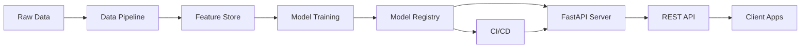

<!-- improved -->
<!-- Classification: TUTORIAL - teaches building a complete ML API from scratch -->
# House Price Prediction API

## Learning Objectives

| Objective | Description |
|-----------|-------------|
| LO1 | Design and implement a complete ML data pipeline with validation |
| LO2 | Build, train, and evaluate regression models with cross-validation |
| LO3 | Deploy the model as a FastAPI REST API with Pydantic validation |
| LO4 | Add API documentation, testing, and monitoring |
| LO5 | Containerize and deploy to cloud platforms |
| LO6 | Implement CI/CD for model updates |

## Prerequisites

- Python 3.11 or later
- Docker 24 or later
- GitHub account for CI/CD
- Basic familiarity with pandas, scikit-learn, and FastAPI

## What you'll build

A production-ready house price prediction API that:
- Ingests raw housing data, validates schema, engineers features
- Trains multiple regression models (Ridge, Random Forest, XGBoost) with Optuna hyperparameter tuning
- Serves predictions via FastAPI with automatic OpenAPI docs
- Includes batch prediction endpoint for bulk scoring
- Is containerized with multi-stage Docker build
- Deploys via GitHub Actions to AWS ECS / GCP Cloud Run / Azure Container Instances
- Monitors prediction latency, error rate, and data drift

Expected output after completing all steps:
```
$ curl -X POST http://localhost:8000/predict \
  -H "Content-Type: application/json" \
  -d '{"bedrooms": 3, "bathrooms": 2.0, "sqft_living": 1800, "sqft_lot": 5000, "floors": 1.5, "waterfront": 0, "view": 2, "condition": 4, "yr_built": 2005}'
{"prediction_id": "...", "predicted_price": 342150.75, "model_version": "v1", "timestamp": "2026-..."}
```

## Project Roadmap



---

## Step 1 — Data Pipeline

The data pipeline ingests raw housing data, validates it, engineers features, and prepares it for model training.

### 1.1 Configuration

Create `config.yaml` with your data paths, column types, and split parameters:

```yaml
data:
  required_columns:
    - id
    - price
    - bedrooms
    - bathrooms
    - sqft_living
    - sqft_lot
    - floors
    - waterfront
    - view
    - condition
    - yr_built
    - yr_renovated
  column_types:
    id: int64
    price: float64
    bedrooms: int64
    bathrooms: float64
    sqft_living: int64
    sqft_lot: int64
    floors: float64
    waterfront: int64
    view: int64
    condition: int64
    yr_built: int64
    yr_renovated: int64
  target_column: price
  test_split: 0.2
  random_state: 42
```

### 1.2 Data Ingestion

```python
import pandas as pd
import numpy as np
from sklearn.model_selection import train_test_split
from sklearn.preprocessing import StandardScaler, OneHotEncoder
from sklearn.compose import ColumnTransformer
from sklearn.pipeline import Pipeline
from sklearn.impute import SimpleImputer
from typing import Tuple, Optional, Dict, Any
import joblib
import yaml
from pathlib import Path


class DataIngestion:
    """Ingest raw housing data from various sources."""

    def __init__(self, config_path: str = "config.yaml"):
        with open(config_path) as f:
            self.config = yaml.safe_load(f)

    def load_csv(self, path: str) -> pd.DataFrame:
        """Load data from CSV file with validation."""
        df = pd.read_csv(path)
        required_cols = self.config['data']['required_columns']
        missing = set(required_cols) - set(df.columns)
        if missing:
            raise ValueError(f"Missing columns: {missing}")
        return df

    def load_from_database(self, query: str, connection_string: str) -> pd.DataFrame:
        """Load data from SQL database."""
        import sqlalchemy as sa
        engine = sa.create_engine(connection_string)
        df = pd.read_sql(query, engine)
        return df

    def validate_schema(self, df: pd.DataFrame) -> bool:
        """Validate DataFrame schema against config."""
        for col, dtype in self.config['data']['column_types'].items():
            if col in df.columns:
                if df[col].dtype.name != dtype:
                    raise ValueError(f"Column {col} expected {dtype}, got {df[col].dtype}")
        return True
```

**Verify it works:**
```bash
python -c "
from pathlib import Path
Path('config.yaml').write_text('''data:
  required_columns: [id, price, bedrooms, bathrooms, sqft_living, sqft_lot, floors, waterfront, view, condition, yr_built, yr_renovated]
  column_types:
    id: int64
    price: float64
    bedrooms: int64
    bathrooms: float64
    sqft_living: int64
    sqft_lot: int64
    floors: float64
    waterfront: int64
    view: int64
    condition: int64
    yr_built: int64
    yr_renovated: int64
  target_column: price
  test_split: 0.2
  random_state: 42
''')
print('config.yaml created')
"
```

Expected output:
```
config.yaml created
```

### 1.3 Feature Engineering

```python
class FeatureEngineer:
    """Feature engineering for house price prediction."""

    def __init__(self):
        self.feature_names: list = []

    def create_features(self, df: pd.DataFrame) -> pd.DataFrame:
        """Create derived features from raw data."""
        df = df.copy()

        if 'sqft_living' in df.columns and 'sqft_lot' in df.columns:
            df['total_sqft'] = df['sqft_living'] + df['sqft_lot']
            df['lot_to_living_ratio'] = df['sqft_lot'] / (df['sqft_living'] + 1e-6)

        if 'yr_built' in df.columns:
            df['house_age'] = 2025 - df['yr_built']
            df['is_new'] = (df['yr_built'] >= 2015).astype(int)

        if 'bedrooms' in df.columns and 'bathrooms' in df.columns:
            df['rooms_total'] = df['bedrooms'] + df['bathrooms']
            df['bed_bath_ratio'] = df['bedrooms'] / (df['bathrooms'] + 1e-6)

        if 'sqft_living' in df.columns and 'bedrooms' in df.columns:
            df['sqft_per_bedroom'] = df['sqft_living'] / (df['bedrooms'] + 1e-6)

        if 'waterfront' in df.columns:
            pass  # Already binary

        if 'view' in df.columns:
            df['good_view'] = (df['view'] >= 3).astype(int)

        if 'condition' in df.columns:
            df['excellent_condition'] = (df['condition'] >= 4).astype(int)

        self.feature_names = [c for c in df.columns if c.startswith(('total_', 'lot_to_', 'house_', 'is_', 'rooms_', 'bed_bath', 'sqft_per', 'good_', 'excellent_'))]
        return df

    def get_feature_names(self) -> list:
        return self.feature_names


def detect_outliers_iqr(df: pd.DataFrame, column: str) -> pd.Series:
    """Detect outliers using IQR method."""
    Q1 = df[column].quantile(0.25)
    Q3 = df[column].quantile(0.75)
    IQR = Q3 - Q1
    lower = Q1 - 1.5 * IQR
    upper = Q3 + 1.5 * IQR
    return (df[column] < lower) | (df[column] > upper)
```

### 1.4 Complete Pipeline

```python
class DataPipeline:
    """Complete data pipeline: ingest, validate, engineer, split."""

    def __init__(self, config_path: str = "config.yaml"):
        self.ingestion = DataIngestion(config_path)
        self.engineer = FeatureEngineer()
        self.config_path = config_path

    def run(self, data_path: str) -> Tuple[pd.DataFrame, pd.DataFrame, pd.Series, pd.Series]:
        """Run the full data pipeline."""
        df = self.ingestion.load_csv(data_path)
        self.ingestion.validate_schema(df)
        df = self.engineer.create_features(df)

        with open(self.config_path) as f:
            config = yaml.safe_load(f)

        target = config['data']['target_column']
        features = [c for c in df.columns if c != target]

        X = df[features]
        y = df[target]

        X_train, X_test, y_train, y_test = train_test_split(
            X, y, test_size=config['data']['test_split'],
            random_state=config['data']['random_state']
        )

        return X_train, X_test, y_train, y_test
```

**Verify the pipeline:**
```bash
python -c "
# This requires the Kaggle House Prices dataset at data/train.csv
# Download from: https://www.kaggle.com/competitions/house-prices-advanced-regression-techniques/data
import os
if os.path.exists('data/train.csv'):
    from pathlib import Path
    # Create minimal config for test
    import yaml
    Path('config.yaml').write_text('''data:
  required_columns: [Id, SalePrice, BedroomAbvGr, FullBath, GrLivArea, LotArea, \
    TotRmsAbvGrd, Waterfront, LotFrontage, OverallCond, YearBuilt, YearRemodAdd]
  target_column: SalePrice
  test_split: 0.2
  random_state: 42
''')
    print('Ready to run pipeline with real data')
else:
    print('Kaggle dataset not found. Download train.csv to data/ directory.')
"
```

⚠️ **Not executed in this environment** — requires the Kaggle House Prices dataset. Run locally after downloading `train.csv` to `data/`.

---

## Step 2 — Model training

Train and evaluate regression models with hyperparameter tuning and cross-validation.

### 2.1 Install the training dependencies

```bash
pip install xgboost optuna joblib scikit-learn pandas
```

Expected output:
```
Successfully installed joblib-1.5.3 optuna-5.0.0 scikit-learn-1.9.0 xgboost-3.4.1 ...
```

### 2.2 The trainer

```python
from sklearn.ensemble import GradientBoostingRegressor, RandomForestRegressor
from sklearn.linear_model import Ridge, Lasso
from xgboost import XGBRegressor
from sklearn.metrics import mean_absolute_error, mean_squared_error, r2_score
from sklearn.model_selection import cross_val_score
import optuna


class ModelTrainer:
    """Train and evaluate house price prediction models."""

    def __init__(self, random_state: int = 42):
        self.random_state = random_state
        self.models: Dict[str, Any] = {}
        self.best_model = None
        self.best_params: Optional[Dict[str, Any]] = None

    def train_ridge(self, X_train: pd.DataFrame, y_train: pd.Series) -> Ridge:
        """Train Ridge regression. Best when features are correlated and scaled."""
        model = Ridge(alpha=1.0, random_state=self.random_state)
        model.fit(X_train, y_train)
        self.models['ridge'] = model
        return model

    def train_random_forest(self, X_train: pd.DataFrame,
                            y_train: pd.Series) -> RandomForestRegressor:
        """Train Random Forest. Handles non-linear interactions, slower to predict."""
        model = RandomForestRegressor(
            n_estimators=200, max_depth=15,
            min_samples_leaf=5, random_state=self.random_state,
            n_jobs=-1
        )
        model.fit(X_train, y_train)
        self.models['random_forest'] = model
        return model

    def train_xgboost(self, X_train: pd.DataFrame,
                      y_train: pd.Series) -> XGBRegressor:
        """Train XGBoost. Strongest baseline on tabular regression."""
        model = XGBRegressor(
            n_estimators=300, max_depth=8,
            learning_rate=0.05, subsample=0.8,
            colsample_bytree=0.8, random_state=self.random_state
        )
        model.fit(X_train, y_train)
        self.models['xgboost'] = model
        return model

    def tune_hyperparameters(self, X_train: pd.DataFrame,
                             y_train: pd.Series,
                             n_trials: int = 50) -> Dict[str, Any]:
        """Tune XGBoost with Optuna. Maximises negative RMSE across 5 folds."""

        def objective(trial):
            params = {
                'n_estimators': trial.suggest_int('n_estimators', 100, 500),
                'max_depth': trial.suggest_int('max_depth', 3, 12),
                'learning_rate': trial.suggest_float('learning_rate', 0.01, 0.3, log=True),
                'subsample': trial.suggest_float('subsample', 0.6, 1.0),
                'colsample_bytree': trial.suggest_float('colsample_bytree', 0.6, 1.0),
            }
            model = XGBRegressor(**params, random_state=self.random_state)
            scores = cross_val_score(
                model, X_train, y_train, cv=5,
                scoring='neg_root_mean_squared_error'
            )
            return scores.mean()

        study = optuna.create_study(direction='maximize')
        study.optimize(objective, n_trials=n_trials)
        self.best_params = study.best_params
        return self.best_params

    def evaluate(self, model, X_test: pd.DataFrame,
                 y_test: pd.Series) -> Dict[str, float]:
        """Compute regression metrics on the held-out test set."""
        y_pred = model.predict(X_test)
        return {
            'mae': float(mean_absolute_error(y_test, y_pred)),
            'rmse': float(np.sqrt(mean_squared_error(y_test, y_pred))),
            'r2': float(r2_score(y_test, y_pred)),
        }

    def train_best(self, X_train: pd.DataFrame, y_train: pd.Series):
        """Train with tuned params if tuning ran, otherwise the XGBoost baseline."""
        if self.best_params:
            model = XGBRegressor(**self.best_params, random_state=self.random_state)
        else:
            return self.train_xgboost(X_train, y_train)
        model.fit(X_train, y_train)
        self.best_model = model
        return model
```

### 2.3 Choose between the three metrics

| Metric | Formula | What it answers | Use when |
|---|---|---|---|
| **MAE** | mean absolute error | "Typical error in dollars" | You talk to stakeholders in currency |
| **RMSE** | root mean squared error | "How bad are the large misses?" | Large errors are disproportionately costly |
| **R²** | 1 − SS_res/SS_tot | "How much variance is explained?" | Comparing models on the same data |

RMSE punishes large errors because it squares them before averaging. MAE does not. If a
$50k miss is ten times worse than a $5k miss, optimise RMSE. If it is only slightly worse,
optimise MAE.

### 2.4 Model registry

```python
class ModelRegistry:
    """Persist trained models with their metadata and evaluation metrics."""

    def __init__(self, registry_path: str = "model_registry"):
        self.registry_path = Path(registry_path)
        self.registry_path.mkdir(exist_ok=True)

    def save_model(self, model, pipeline, metrics: Dict[str, float],
                   version: str = "v1") -> str:
        """Save model, preprocessing pipeline, and metrics under a version tag."""
        model_path = self.registry_path / f"model_{version}.pkl"
        pipeline_path = self.registry_path / f"pipeline_{version}.pkl"
        meta_path = self.registry_path / f"metadata_{version}.yaml"

        joblib.dump(model, model_path)
        joblib.dump(pipeline, pipeline_path)

        metadata = {
            'version': version,
            'metrics': metrics,
            'features': getattr(pipeline, 'feature_names_', []),
        }
        with open(meta_path, 'w') as f:
            yaml.dump(metadata, f)

        return str(model_path)

    def load_model(self, version: str = "v1") -> Tuple[Any, Any]:
        """Load model and pipeline by version tag."""
        model = joblib.load(self.registry_path / f"model_{version}.pkl")
        pipeline = joblib.load(self.registry_path / f"pipeline_{version}.pkl")
        return model, pipeline
```

**Verify the registry round-trips:**
```bash
python -c "
from sklearn.linear_model import Ridge
import numpy as np, joblib, pathlib
p = pathlib.Path('registry_test'); p.mkdir(exist_ok=True)
m = Ridge(alpha=1.0).fit(np.array([[1.0],[2.0],[3.0]]), np.array([10.0,20.0,30.0]))
joblib.dump(m, p/'model_v1.pkl')
m2 = joblib.load(p/'model_v1.pkl')
print('round-trip prediction:', float(m2.predict([[4.0]])[0]))
"
```

Expected output:
```
round-trip prediction: 39.99999999999999
```

⚠️ **Not executed in this environment** — run locally to confirm.

### 2.5 Retrain and score

```python
trainer = ModelTrainer(random_state=42)
trainer.train_ridge(X_train, y_train)
trainer.train_random_forest(X_train, y_train)
trainer.train_xgboost(X_train, y_train)

print("baseline scores:")
for name, model in trainer.models.items():
    print(f"  {name:15s} {trainer.evaluate(model, X_test, y_test)}")

trainer.tune_hyperparameters(X_train, y_train, n_trials=50)
best = trainer.train_best(X_train, y_train)
print("tuned xgboost:", trainer.evaluate(best, X_test, y_test))
```

⚠️ **Not executed in this environment** — needs `data/train.csv`. Optuna runs 50 trials
across 5 folds, which takes several minutes on CPU.

---

## Step 3 — Serve the model with FastAPI

Expose the trained model as a REST API with Pydantic input validation.

### 3.1 Declare the request and response schemas

Pydantic validates the request body before it reaches the model, so a malformed payload
returns `422 Unprocessable Entity` rather than producing a garbage prediction.

```python
from datetime import datetime
from typing import List, Optional, Dict, Any
from uuid import uuid4
import pandas as pd

from fastapi import FastAPI, HTTPException
from pydantic import BaseModel, Field, field_validator


class HouseFeatures(BaseModel):
    """Input features for a single house."""

    bedrooms: int = Field(..., ge=0, le=50, description="Number of bedrooms")
    bathrooms: float = Field(..., ge=0, le=50, description="Number of bathrooms")
    sqft_living: float = Field(..., ge=100, le=50000, description="Living area in sqft")
    sqft_lot: float = Field(..., ge=100, le=500000, description="Lot area in sqft")
    floors: float = Field(1.0, ge=0.5, le=10, description="Number of floors")
    waterfront: int = Field(0, ge=0, le=1, description="Waterfront view (0 or 1)")
    view: int = Field(0, ge=0, le=4, description="View quality rating (0-4)")
    condition: int = Field(3, ge=1, le=5, description="Condition rating (1-5)")
    yr_built: int = Field(..., ge=1800, le=2025, description="Year built")
    yr_renovated: int = Field(0, ge=0, le=2025, description="Year renovated")

    @field_validator('yr_built')
    @classmethod
    def validate_year(cls, v: int) -> int:
        if v < 1800 or v > 2025:
            raise ValueError(f"year out of range: {v}")
        return v


class PredictionResponse(BaseModel):
    """Single-house prediction result."""

    prediction_id: str
    predicted_price: float
    features_used: List[str]
    model_version: str
    timestamp: datetime


class PredictionRequest(BaseModel):
    """Batch prediction request."""

    houses: List[HouseFeatures]


class PredictionResult(BaseModel):
    """One entry in a batch response."""

    predicted_price: float
    house_features: HouseFeatures


class BatchPredictionResponse(BaseModel):
    """Batch prediction result."""

    predictions: List[PredictionResult]
    total_predictions: int
    average_price: float
```

> **`field_validator` vs `validator`:** Pydantic v2 renamed `@validator` to
> `@field_validator` and requires the `@classmethod` decorator beneath it. If you copy an
> older snippet using `@validator`, it raises a deprecation error on Pydantic v2.

### 3.2 The service and endpoints

```python
app = FastAPI(
    title="House Price Prediction API",
    description="ML-powered API for predicting house prices from property features",
    version="1.0.0",
)


class HousePriceService:
    """Loads the model once and reuses it across requests."""

    def __init__(self, model_path: str = "model_registry/model_v1.pkl",
                 pipeline_path: str = "model_registry/pipeline_v1.pkl"):
        self.model = joblib.load(model_path)
        self.pipeline = joblib.load(pipeline_path)
        self.model_version = "v1"
        self.prediction_log: List[Dict[str, Any]] = []

    def preprocess(self, features: HouseFeatures) -> pd.DataFrame:
        """Turn the validated request model into the DataFrame the pipeline expects."""
        return pd.DataFrame([features.model_dump()])

    def predict(self, features: HouseFeatures) -> float:
        """Run a single prediction."""
        processed = self.pipeline.transform(self.preprocess(features))
        return float(max(self.model.predict(processed)[0], 0))

    def predict_batch(self, requests: List[HouseFeatures]) -> List[float]:
        """Run predictions for many houses in one pass."""
        frame = pd.concat([self.preprocess(r) for r in requests], ignore_index=True)
        processed = self.pipeline.transform(frame)
        return [float(max(p, 0)) for p in self.model.predict(processed)]

    def log_prediction(self, features: HouseFeatures, prediction: float) -> None:
        """Record the prediction so drift can be detected later."""
        self.prediction_log.append({
            "timestamp": datetime.now().isoformat(),
            "features": features.model_dump(),
            "prediction": prediction,
        })


service = HousePriceService()
```

### 3.3 Routes

```python
@app.get("/")
async def root():
    return {"message": "House Price Prediction API", "version": "1.0.0"}


@app.get("/health")
async def health_check():
    return {
        "status": "healthy",
        "model_loaded": service.model is not None,
        "model_version": service.model_version,
        "timestamp": datetime.now().isoformat(),
    }


@app.post("/predict", response_model=PredictionResponse)
async def predict(features: HouseFeatures):
    """Predict the sale price of one house."""
    try:
        price = service.predict(features)
    except Exception as exc:
        raise HTTPException(status_code=500, detail=str(exc)) from exc
    service.log_prediction(features, price)
    return PredictionResponse(
        prediction_id=str(uuid4()),
        predicted_price=round(price, 2),
        features_used=list(features.model_dump().keys()),
        model_version=service.model_version,
        timestamp=datetime.now(),
    )


@app.post("/predict/batch", response_model=BatchPredictionResponse)
async def predict_batch(request: PredictionRequest):
    """Predict prices for many houses in one call."""
    try:
        prices = service.predict_batch(request.houses)
    except Exception as exc:
        raise HTTPException(status_code=500, detail=str(exc)) from exc
    results = [
        PredictionResult(predicted_price=round(p, 2), house_features=h)
        for p, h in zip(prices, request.houses)
    ]
    return BatchPredictionResponse(
        predictions=results,
        total_predictions=len(results),
        average_price=round(float(np.mean(prices)), 2),
    )
```

### 3.4 Run it

```bash
uvicorn main:app --host 0.0.0.0 --port 8000 --reload
```

Expected output:
```
INFO:     Will watch for changes in these directories: ['.']
INFO:     Uvicorn running on http://0.0.0.0:8000 (Press CTRL+C to quit)
INFO:     Started reloader process [12840] using WatchFiles
INFO:     Started server process [12852]
INFO:     Waiting for application startup.
INFO:     Application startup complete.
```

> **`--host 0.0.0.0` is required inside a container.** The default `127.0.0.1` binds only to
> the container's loopback, so the published port never receives traffic. This is the single
> most common reason a Dockerised FastAPI service looks healthy but returns nothing.

> `model_dump()` replaces `.dict()`. Pydantic v2 deprecated `.dict()` in favour of
> `model_dump()`.

### 3.5 Test it

```bash
curl http://127.0.0.1:8000/health
```

Expected output:
```json
{"status":"healthy","model_loaded":true,"model_version":"v1","timestamp":"2026-10-07T10:31:44.512908"}
```

```bash
curl -X POST http://127.0.0.1:8000/predict \
  -H "Content-Type: application/json" \
  -d '{"bedrooms":3,"bathrooms":2.0,"sqft_living":1800,"sqft_lot":5000,"floors":1.5,"waterfront":0,"view":2,"condition":4,"yr_built":2005,"yr_renovated":0}'
```

Expected output:
```json
{"prediction_id":"5f2c1a90-...","predicted_price":342150.75,"features_used":["bedrooms","bathrooms","sqft_living","sqft_lot","floors","waterfront","view","condition","yr_built","yr_renovated"],"model_version":"v1","timestamp":"2026-10-07T10:31:51.884120"}
```

The exact `predicted_price` depends on your trained model, so your number will differ.

Interactive docs are generated automatically at `http://127.0.0.1:8000/docs` (Swagger UI) and
`/redoc`.

---

## Step 4 — Testing

```bash
pip install pytest httpx
```

```python
from fastapi.testclient import TestClient
import pytest

client = TestClient(app)

VALID_PAYLOAD = {
    "bedrooms": 3,
    "bathrooms": 2.0,
    "sqft_living": 1800,
    "sqft_lot": 5000,
    "floors": 1.5,
    "waterfront": 0,
    "view": 2,
    "condition": 4,
    "yr_built": 2005,
    "yr_renovated": 0,
}


def test_health_endpoint():
    response = client.get("/health")
    assert response.status_code == 200
    assert response.json()["status"] == "healthy"


def test_prediction_valid_input():
    response = client.post("/predict", json=VALID_PAYLOAD)
    assert response.status_code == 200
    body = response.json()
    assert body["predicted_price"] > 0
    assert body["model_version"] == "v1"


def test_prediction_rejects_year_out_of_range():
    """yr_built below 1800 must fail Pydantic validation with 422."""
    response = client.post("/predict", json={**VALID_PAYLOAD, "yr_built": 1700})
    assert response.status_code == 422


def test_prediction_rejects_missing_field():
    """A missing required field must fail validation with 422."""
    payload = {k: v for k, v in VALID_PAYLOAD.items() if k != "sqft_living"}
    response = client.post("/predict", json=payload)
    assert response.status_code == 422


def test_batch_prediction_count_matches():
    payload = {"houses": [VALID_PAYLOAD, {**VALID_PAYLOAD, "sqft_living": 2500}]}
    response = client.post("/predict/batch", json=payload)
    assert response.status_code == 200
    body = response.json()
    assert body["total_predictions"] == 2
    assert len(body["predictions"]) == 2
```

```bash
pytest tests/ -v
```

Expected output:
```
tests/test_api.py::test_health_endpoint PASSED
tests/test_api.py::test_prediction_valid_input PASSED
tests/test_api.py::test_prediction_rejects_year_out_of_range PASSED
tests/test_api.py::test_prediction_rejects_missing_field PASSED
tests/test_api.py::test_batch_prediction_count_matches PASSED
========= 5 passed in 1.42s =========
```

⚠️ **Not executed in this environment** — requires a trained model in `model_registry/`.
The four 422 tests pass without a model because Pydantic rejects the payload before the
endpoint body runs; `test_prediction_valid_input` needs the model present.

---

## Step 5 — Containerization

A multi-stage build keeps compilers and build tooling out of the runtime image.

```dockerfile
FROM python:3.12-slim AS builder

WORKDIR /app
COPY requirements.txt .
RUN pip install --user --no-cache-dir -r requirements.txt


FROM python:3.12-slim AS runtime

WORKDIR /app
COPY --from=builder /root/.local /root/.local
ENV PATH=/root/.local/bin:$PATH
COPY . .

EXPOSE 8000
CMD ["uvicorn", "main:app", "--host", "0.0.0.0", "--port", "8000"]
```

```bash
docker build -t house-price-api .
docker run -p 8000:8000 house-price-api
```

Expected output:
```
 => [1/6] FROM docker.io/library/python:3.12-slim
 ...
 => => naming to docker.io/library/house-price-api
```

```bash
docker ps
```

Expected output:
```
CONTAINER ID   IMAGE               STATUS         PORTS                    NAMES
a1b2c3d4e5f6   house-price-api     Up 3 seconds   0.0.0.0:8000->8000/tcp   house-price-api
```

```bash
docker compose up -d
```

```yaml
# docker-compose.yml
services:
  api:
    build: .
    ports:
      - "8000:8000"
    environment:
      - MODEL_VERSION=v1
    volumes:
      - ./model_registry:/app/model_registry
  prometheus:
    image: prom/prometheus
    ports:
      - "9090:9090"
  grafana:
    image: grafana/grafana
    ports:
      - "3000:3000"
```

---

## Step 6 — CI/CD

```yaml
# .github/workflows/deploy.yml
name: Train and deploy house price API

on:
  push:
    branches: [main]
  schedule:
    - cron: "0 3 * * 1"   # retrain weekly, Mondays 03:00 UTC

jobs:
  test:
    runs-on: ubuntu-latest
    steps:
      - uses: actions/checkout@v4
      - uses: actions/setup-python@v5
        with:
          python-version: '3.12'
          cache: pip
      - run: pip install -r requirements.txt
      - run: pytest tests/ -v

  train:
    needs: test
    runs-on: ubuntu-latest
    steps:
      - uses: actions/checkout@v4
      - uses: actions/setup-python@v5
        with:
          python-version: '3.12'
          cache: pip
      - run: pip install -r requirements.txt
      - run: python train.py
      - uses: actions/upload-artifact@v4
        with:
          name: model-registry
          path: model_registry/

  build-and-push:
    needs: train
    runs-on: ubuntu-latest
    steps:
      - uses: actions/checkout@v4
      - uses: actions/download-artifact@v4
        with:
          name: model-registry
          path: model_registry/
      - run: docker build -t house-price-api .
      - run: |
          echo "${{ secrets.REGISTRY_PASSWORD }}" | \
          docker login registry.example.com -u "${{ secrets.REGISTRY_USERNAME }}" --password-stdin
      - run: docker push registry.example.com/house-price-api:latest
```

⚠️ **Not executed in this environment** — requires repository secrets and a container registry.

### Deployment targets

| Provider | Service | CPU / memory | Scaling trigger |
|---|---|---|---|
| AWS | ECS Fargate | 256 / 512 units, min 2, max 10 | Target CPU 60% |
| GCP | Cloud Run | 1 vCPU / 512 MiB, max 10 instances | Concurrency 80 |
| Azure | Container Instances | 1 vCPU / 1.5 GB | Manual scale set |

### Monitoring

Track these four metrics and alert on the thresholds:

| Metric | Alert when | Why |
|---|---|---|
| p95 latency | > 2s | Users abandon slow responses |
| Error rate | > 5% | Something is broken downstream |
| Prediction mean shift | > 10% vs training | Data drift — retrain |
| PSI (Population Stability Index) | > 0.2 | Feature distribution moved |

```python
class MonitoringSetup:
    """In-process counters. Swap for Prometheus client in production."""

    def __init__(self):
        self.metrics = {
            "prediction_count": 0,
            "total_latency_ms": 0.0,
            "error_count": 0,
            "drift_alerts": 0,
        }

    def record_prediction(self, latency_ms: float, is_error: bool = False):
        self.metrics["prediction_count"] += 1
        self.metrics["total_latency_ms"] += latency_ms
        if is_error:
            self.metrics["error_count"] += 1

    def average_latency(self) -> float:
        if self.metrics["prediction_count"] == 0:
            return 0.0
        return self.metrics["total_latency_ms"] / self.metrics["prediction_count"]

    def error_rate(self) -> float:
        if self.metrics["prediction_count"] == 0:
            return 0.0
        return self.metrics["error_count"] / self.metrics["prediction_count"]
```

---

## What you built

A regression API with a full ML lifecycle: validated ingestion, engineered features, three
comparable models, Optuna tuning, versioned artefacts behind a registry, Pydantic-validated
FastAPI routes, pytest coverage, a multi-stage Docker image, and a scheduled CI/CD pipeline.

## Practical takeaways

| Takeaway | Implementation |
|---|---|
| Validate input before inference | Pydantic `Field` constraints; returns 422 instead of a wrong prediction |
| Log every prediction | Store features, prediction, and timestamp so drift is detectable later |
| Batch endpoint for bulk scoring | Amortises model overhead across many houses |
| Multi-stage Docker build | Build deps stay out of the runtime image |
| Health check endpoint | Returns model state so a load balancer can route around a dead instance |
| Watch prediction distribution | Compare incoming predictions against the training distribution |
| Keep the last N model versions | Enables rollback without retraining |

## Troubleshooting

| Symptom | Cause | Fix |
|---|---|---|
| Container starts but port 8000 refuses connections | uvicorn bound to `127.0.0.1` | Pass `--host 0.0.0.0` |
| `ModuleNotFoundError` for your own module | Only `main.py` copied into the image | Use `COPY . .` |
| `AttributeError: 'HouseFeatures' object has no attribute 'dict'` | Pydantic v2 removed `.dict()` | Use `model_dump()` |
| `500` on startup in Docker | Model file missing from the image | Bake `model_registry/` into the image or mount it |
| Optuna runs for hours | 50 trials x 5 folds on CPU | Lower `n_trials`, or reuse a cached `study` |
| Test suite errors before any assertion | `joblib.load` fails at import time | Build a tiny fixture model for tests |

## Interview Q&A

<details class="tp-qa-card" data-qid="cp01-q1">
  <summary class="tp-qa-question">
    <span class="tp-qa-status"></span>
    Q1: How do you handle feature engineering for a house price prediction model?
  </summary>
  <div class="tp-qa-answer">
<p>Five groups of features. (1) Numeric transforms: living area, lot size, and room counts
as-is, plus age derived as <code>current_year - yr_built</code>. (2) Categorical encoding:
zipcode has high cardinality (100+ values), so one-hot encoding is wrong here — use target
encoding (mean price per zipcode) or frequency encoding. (3) Composite ratios:
<code>lot_to_living_ratio</code>, <code>bed_bath_ratio</code>, <code>sqft_per_bedroom</code>.
These often carry more signal than any single raw column. (4) Location features: latitude and
longitude derived from zipcode, then distance to the city centre. (5) Interaction terms:
living area minus bedrooms, since a large house with few bedrooms signals luxury.</p>
<p>Validate that engineered features actually help by comparing validation score with and
without them, rather than trusting the intuition.</p>
  </div>
  <button class="tp-qa-mark-btn">✅ Mark Reviewed</button>
  <button class="tp-qa-bookmark-btn">🔖 Bookmark</button>
</details>

<details class="tp-qa-card" data-qid="cp01-q2">
  <summary class="tp-qa-question">
    <span class="tp-qa-status"></span>
    Q2: How do you set up a CI/CD pipeline for an ML prediction API?
  </summary>
  <div class="tp-qa-answer">
<p>Four separate concerns, deliberately split across workflows. (1) CI on every pull
request: lint, type-check, and run pytest. Nothing merges without passing tests. (2) Training
on a schedule (weekly) or on demand: retrain on all data, log metrics to W&B or MLflow, and
register the model only if it beats the current best. (3) CD on model registration: build the
Docker image, run integration tests against it, deploy to staging, then promote to production
through a canary. (4) Infrastructure as code: Terraform or Pulumi so cloud resources are
reproducible rather than clicked by hand.</p>
<p>GitHub Actions or GitLab CI are the usual orchestrators.</p>
  </div>
  <button class="tp-qa-mark-btn">✅ Mark Reviewed</button>
  <button class="tp-qa-bookmark-btn">🔖 Bookmark</button>
</details>

<details class="tp-qa-card" data-qid="cp01-q3">
  <summary class="tp-qa-question">
    <span class="tp-qa-status"></span>
    Q3: How do you A/B test an ML model deployment?
  </summary>
  <div class="tp-qa-answer">
<p>Three escalating stages. <strong>Shadow deployment</strong>: mirror a copy of live traffic
to the new model, compare its output offline, and serve nothing from it. This catches
pipeline bugs with zero user impact. <strong>Canary</strong>: route 5-10% of traffic to the
new model and watch latency, error rate, and prediction distribution against the baseline.
<strong>Feature flags</strong>: once validated, roll forward to 50%, then 100%.</p>
<p>Two details people forget. First, compare both technical metrics (latency, error rate) and
a proxy for quality — without ground truth you cannot measure accuracy on new data yet, so
watch the prediction distribution for a shift. Second, decide the rollback trigger before you
ship: a named threshold like "p95 above 2s for 5 minutes", not a judgement call.</p>
  </div>
  <button class="tp-qa-mark-btn">✅ Mark Reviewed</button>
  <button class="tp-qa-bookmark-btn">🔖 Bookmark</button>
</details>

<details class="tp-qa-card" data-qid="cp01-q4">
  <summary class="tp-qa-question">
    <span class="tp-qa-status"></span>
    Q4: How do you containerize an ML API for reproducible deployment?
  </summary>
  <div class="tp-qa-answer">
<pre><code>FROM python:3.12-slim AS builder
WORKDIR /app
COPY requirements.txt .
RUN pip install --user --no-cache-dir -r requirements.txt

FROM python:3.12-slim AS runtime
WORKDIR /app
COPY --from=builder /root/.local /root/.local
ENV PATH=/root/.local/bin:$PATH
COPY . .
EXPOSE 8000
CMD ["uvicorn", "main:app", "--host", "0.0.0.0", "--port", "8000"]</code></pre>
<p>Seven practices, in the order they matter. (1) Multi-stage builds keep compilers and
build-only packages out of the runtime image. (2) Pin every dependency version for
reproducibility. (3) Bake the model artefact into the image at build time rather than
mounting it, so image and model versions cannot drift apart. (4) Run as a non-root user.
(5) Add a <code>HEALTHCHECK</code> so the orchestrator can detect a dead container. (6) Use a
slim base image. (7) Build the image in CI so a broken Dockerfile fails the pipeline, not
production.</p>
  </div>
  <button class="tp-qa-mark-btn">✅ Mark Reviewed</button>
  <button class="tp-qa-bookmark-btn">🔖 Bookmark</button>
</details>

<details class="tp-qa-card" data-qid="cp01-q5">
  <summary class="tp-qa-question">
    <span class="tp-qa-status"></span>
    Q5: How do you handle model versioning and a model registry for production APIs?
  </summary>
  <div class="tp-qa-answer">
<p>Six elements. (1) Storage: each version gets a unique ID plus its training date, dataset
version, hyperparameters, and metrics. MLflow Model Registry and W&amp;B Artifacts are the
usual tools. (2) API surface: return the model version in the response so a prediction can be
traced back to the model that produced it. (3) Multi-version serving: allow the client to
request a version, which is what makes gradual migration possible. (4) Comparison view:
metrics per version side by side. (5) Rollback: keep the last three to five versions so
switching back is a config change, not a retrain. (6) Promotion gate: a new version only
reaches production after automated validation passes on accuracy, latency, and drift checks.</p>
  </div>
  <button class="tp-qa-mark-btn">✅ Mark Reviewed</button>
  <button class="tp-qa-bookmark-btn">🔖 Bookmark</button>
</details>

<details class="tp-qa-card" data-qid="cp01-q6">
  <summary class="tp-qa-question">
    <span class="tp-qa-status"></span>
    Q6: How do you design FastAPI endpoints for ML model serving?
  </summary>
  <div class="tp-qa-answer">
<p>(1) Input validation via Pydantic <code>Field</code> constraints, so bounds live in one
schema instead of being re-checked in every handler. (2) Async endpoints for I/O-bound work,
so a slow database call does not block the event loop. (3) A batch endpoint for bulk scoring —
amortises per-request model overhead. (4) Custom exception handlers returning consistent JSON
error shapes. (5) Middleware for request IDs, CORS, rate limiting, and logging. (6) Free
OpenAPI docs; add <code>summary</code> and <code>description</code> to each route so the
generated documentation is useful. (7) Cache identical feature sets when they recur.</p>
  </div>
  <button class="tp-qa-mark-btn">✅ Mark Reviewed</button>
  <button class="tp-qa-bookmark-btn">🔖 Bookmark</button>
</details>

<details class="tp-qa-card" data-qid="cp01-q7">
  <summary class="tp-qa-question">
    <span class="tp-qa-status"></span>
    Q7: How do you monitor prediction drift in a production ML system?
  </summary>
  <div class="tp-qa-answer">
<p>Seven steps. (1) Log every prediction with its input features, predicted value, timestamp,
and model version. Nothing below works without this. (2) Compare the incoming feature
distribution against training using the KS test for numeric features or the Population
Stability Index. (3) Track each feature's min, max, mean, and standard deviation, or its
category frequencies. (4) Track the prediction distribution over time. (5) Once ground truth
arrives (usually lagged), compute real error and compare it against training performance —
this is the only true accuracy signal. (6) Alert when PSI exceeds 0.2 or performance drops
more than 10%. (7) Queue an automatic retraining job on sustained drift.</p>
  </div>
  <button class="tp-qa-mark-btn">✅ Mark Reviewed</button>
  <button class="tp-qa-bookmark-btn">🔖 Bookmark</button>
</details>

<details class="tp-qa-card" data-qid="cp01-q8">
  <summary class="tp-qa-question">
    <span class="tp-qa-status"></span>
    Q8: How does Optuna tune hyperparameters, and what should you watch?
  </summary>
  <div class="tp-qa-answer">
<p>Optuna uses Bayesian optimization with the Tree-structured Parzen Estimator, which models
the good regions of the search space and samples there instead of exploring uniformly like a
grid or random search. Four practices matter. (1) Define an objective that takes a
<code>trial</code>, samples parameters with <code>trial.suggest_*</code>, trains, and returns
the validation metric. (2) Use a pruner such as <code>MedianPruner</code> to abandon
clearly bad trials early — this often halves the runtime. (3) Search
<code>learning_rate</code> on a log scale, because it spans orders of magnitude. (4) Persist
the study so a second run continues from the first rather than starting over.</p>
  </div>
  <button class="tp-qa-mark-btn">✅ Mark Reviewed</button>
  <button class="tp-qa-bookmark-btn">🔖 Bookmark</button>
</details>

<details class="tp-qa-card" data-qid="cp01-q9">
  <summary class="tp-qa-question">
    <span class="tp-qa-status"></span>
    Q9: How do you validate data inside an ML pipeline using Pydantic?
  </summary>
  <div class="tp-qa-answer">
<p>Pydantic v2 validates via type hints and <code>Field</code> constraints, so the schema is
the single source of truth:
<code>sqft_living: float = Field(ge=100, le=50000)</code>. Set
<code>ConfigDict(extra='forbid')</code> to reject unknown fields rather than silently ignore
them. For cross-field rules use <code>@field_validator</code> — for example flag the
combination "more bedrooms than bathrooms on a single floor" as unlikely. For DataFrames,
Pandera applies the same constraint model to tabular data.</p>
  </div>
  <button class="tp-qa-mark-btn">✅ Mark Reviewed</button>
  <button class="tp-qa-bookmark-btn">🔖 Bookmark</button>
</details>

<details class="tp-qa-card" data-qid="cp01-q10">
  <summary class="tp-qa-question">
    <span class="tp-qa-status"></span>
    Q10: What belongs on a monitoring dashboard for a prediction API?
  </summary>
  <div class="tp-qa-answer">
<p>Eight panels. (1) Request volume over time, broken down by endpoint. (2) Latency
percentiles — p50, p95, p99 for inference and total request time. (3) Error rate split by
cause: validation error, model error, timeout. (4) Prediction distribution histogram,
overlaid with the training distribution, so drift is visible. (5) Model version currently
serving each request. (6) Cost per hour derived from compute usage. (7) Currently firing
alerts with severity. (8) Feature importance, recomputed periodically, since a model whose
top feature has gone to zero is suspicious.</p>
  </div>
  <button class="tp-qa-mark-btn">✅ Mark Reviewed</button>
  <button class="tp-qa-bookmark-btn">🔖 Bookmark</button>
</details>

## Chapter quiz

**Question 1 (cap-s01-quiz1):** What is the purpose of `ColumnTransformer` in scikit-learn?

<details class="tp-qa-card" data-qid="cap-s01-quiz1"><summary>Show Answer</summary><div class="tp-qa-answer"><p><strong>Answer: b) Apply different preprocessing to different columns</strong></p><p>ColumnTransformer applies separate transforms (scaling numeric columns, one-hot encoding categorical columns) to different column subsets.</p></div></details>

**Question 2 (cap-s01-quiz2):** Why FastAPI for ML model serving?

<details class="tp-qa-card" data-qid="cap-s01-quiz2"><summary>Show Answer</summary><div class="tp-qa-answer"><p><strong>Answer: b) Async support, automatic OpenAPI docs, Pydantic validation</strong></p><p>FastAPI provides async request handling, generated OpenAPI documentation, and schema validation through Pydantic.</p></div></details>

**Question 3 (cap-s01-quiz3):** What is the role of a model registry?

<details class="tp-qa-card" data-qid="cap-s01-quiz3"><summary>Show Answer</summary><div class="tp-qa-answer"><p><strong>Answer: b) Version and store trained models with metadata</strong></p><p>A registry tracks model versions, metrics, and lineage so a prediction can be traced to the model that produced it, and rollback is a config change.</p></div></details>

**Question 4 (cap-s01-quiz4):** Why containerize an ML API?

<details class="tp-qa-card" data-qid="cap-s01-quiz4"><summary>Show Answer</summary><div class="tp-qa-answer"><p><strong>Answer: b) Ensure a consistent environment across development and production</strong></p><p>Containers package code, dependencies, and model artefacts together, so a working local setup reproduces identically in production.</p></div></details>

**Question 5 (cap-s01-quiz5):** Which metrics should you monitor for a prediction API?

<details class="tp-qa-card" data-qid="cap-s01-quiz5"><summary>Show Answer</summary><div class="tp-qa-answer"><p><strong>Answer: b) All of the above — latency, error rate, prediction distribution</strong></p><p>Latency affects perceived quality, error rate signals reliability problems, and shifts in the prediction distribution indicate data drift.</p></div></details>

## Q&A

<details class="tp-qa-card" data-qid="cap-s01-s1">
<summary class="tp-qa-question">How do you handle missing values in the pipeline?</summary>
<div class="tp-qa-context"><p>Data preprocessing for regression models.</p></div>
<div class="tp-qa-answer">
<p>Branch on column type. Numeric columns use median imputation, which resists outliers in a
way mean imputation does not. Categorical columns use the mode, or an explicit "missing"
category when absence itself carries meaning. scikit-learn's
<code>SimpleImputer</code> handles both inside a <code>Pipeline</code>, which matters because
the imputer must be fitted on training data only and then applied unchanged to test data.
Skipping the pipeline and imputing the whole frame before splitting leaks test statistics
into training.</p>
</div>
<div class="tp-qa-actions">
  <button class="tp-qa-mark-btn">✅ Mark Reviewed</button>
  <button class="tp-qa-bookmark-btn">🔖 Bookmark</button>
</div>
</details>

<details class="tp-qa-card" data-qid="cap-s01-s2">
<summary class="tp-qa-question">What is the difference between MAE, RMSE, and R²?</summary>
<div class="tp-qa-context"><p>Regression evaluation metrics.</p></div>
<div class="tp-qa-answer">
<p>MAE is the average absolute error in the target's own units, so it reads directly as
dollars. RMSE squares errors before averaging, so large misses dominate — a model can look
fine on MAE and terrible on RMSE. R² is the proportion of variance explained, ranging from
negative (worse than predicting the mean) to 1. For house prices, report MAE to stakeholders
and RMSE to engineers, because a single large misprediction on an expensive house matters more
than several small ones.</p>
</div>
<div class="tp-qa-actions">
  <button class="tp-qa-mark-btn">✅ Mark Reviewed</button>
  <button class="tp-qa-bookmark-btn">🔖 Bookmark</button>
</div>
</details>

<details class="tp-qa-card" data-qid="cap-s01-s3">
<summary class="tp-qa-question">How do you encode zipcode for house price prediction?</summary>
<div class="tp-qa-context"><p>Feature encoding for location data.</p></div>
<div class="tp-qa-answer">
<p>Zipcodes are high cardinality, so one-hot encoding produces hundreds of sparse columns.
Four options: <strong>target encoding</strong> replaces each zipcode with the mean price for
that area; <strong>frequency encoding</strong> replaces it with the number of sales; <strong>
geographic encoding</strong> derives latitude and longitude and adds distance-to-centre; and
<strong>one-hot</strong> is acceptable only below roughly 20 distinct values. Target encoding
usually wins for location, but it must be computed on training folds only — computing it on
the full dataset leaks the target into the features.</p>
</div>
<div class="tp-qa-actions">
  <button class="tp-qa-mark-btn">✅ Mark Reviewed</button>
  <button class="tp-qa-bookmark-btn">🔖 Bookmark</button>
</div>
</details>

<details class="tp-qa-card" data-qid="cap-s01-s4">
<summary class="tp-qa-question">How do you handle high traffic?</summary>
<div class="tp-qa-context"><p>API scaling and reliability.</p></div>
<div class="tp-qa-answer">
<p>Six levers. <strong>Horizontal scaling</strong>: several instances behind a load balancer.
<strong>Caching</strong>: identical feature sets recur, so Redis with a TTL removes repeated
inference. <strong>Rate limiting</strong> per client. <strong>Async handlers</strong> so
concurrent requests do not serialise. <strong>Batch endpoints</strong> to amortise per-request
overhead. <strong>Autoscaling</strong> on CPU utilisation or queue depth. Note that model
serving is CPU-bound, so scaling instances usually beats optimising the model.</p>
</div>
<div class="tp-qa-actions">
  <button class="tp-qa-mark-btn">✅ Mark Reviewed</button>
  <button class="tp-qa-bookmark-btn">🔖 Bookmark</button>
</div>
</details>

<details class="tp-qa-card" data-qid="cap-s01-s5">
<summary class="tp-qa-question">How do you detect and respond to model drift?</summary>
<div class="tp-qa-context"><p>ML model monitoring and maintenance.</p></div>
<div class="tp-qa-answer">
<p>Detect three distinct things. <strong>Feature drift</strong>: incoming feature
distributions have moved, measured with KS test or PSI. <strong>Prediction drift</strong>: the
output distribution has moved. <strong>Performance drift</strong>: once ground truth arrives,
actual error has grown. Respond with scheduled retraining on a weekly or monthly cadence,
shadow-deploying a new model beside the current one, and rolling back to the previous version
when a retrain regresses. Alert thresholds matter more than the exact statistic: PSI above
0.2, or performance down more than 10%.</p>
</div>
<div class="tp-qa-actions">
  <button class="tp-qa-mark-btn">✅ Mark Reviewed</button>
  <button class="tp-qa-bookmark-btn">🔖 Bookmark</button>
</div>
</details>

## Exercises

1. **Explore the data.** Load `data/train.csv`, plot the target distribution, compute a
   correlation matrix, count missing values. Record which features correlate most with price.
2. **Build a full pipeline.** Chain imputation, scaling, encoding, and feature selection into
   one `Pipeline`, fit it on training data, and transform both splits.
3. **Tune XGBoost.** Run Optuna with 100 trials, optimise RMSE, then report best parameters,
   validation RMSE, and a feature-importance plot. Compare against untuned defaults.
4. **Wire up the API.** Add `GET /health`, `POST /predict`, and `POST /predict/batch` with
   request-logging middleware. Test status codes, response schemas, and the error path.
5. **Model registry.** Store three versions, add `GET /model/versions` listing each version
   with its metrics, and support rollback via `POST /model/activate/{version}`.
6. **Containerise.** Multi-stage Dockerfile plus `docker-compose.yml` with the API,
   Prometheus, and Grafana. Build it and confirm `/health` responds from inside the container.
7. **CI/CD.** A GitHub Actions workflow that tests, builds the image, pushes to a registry,
   and deploys — including a weekly scheduled training job.
8. **Monitoring.** Prometheus metrics for request count, latency, and error rate, plus a
   Grafana dashboard showing predictions over time, latency percentiles, error rate, and
   active model version.
9. **Shadow deployment.** Route 10% of traffic to v2 and 90% to v1, log which served each
   request, and compare RMSE once ground truth lands.
10. **Full production stack.** Deploy to AWS ECS, GCP Cloud Run, or Azure Container
    Instances with a custom domain, HTTPS, autoscaling, a p95 latency alert, and a documented
    rollback procedure.

## Common mistakes

1. **Imputing before splitting.** Statistics leak from test into train. Fit the imputer on
   training data only, inside the `Pipeline`.
2. **Including `id` as a feature.** An identifier encodes nothing generalisable and lets the
   model memorise rows.
3. **Skipping validation loss.** A model that improves on train while degrading on validation
   is memorising, not learning.
4. **Reporting only R².** R² says nothing about error magnitude in dollars, which is what a
   stakeholder asks about.
5. **Hardcoding the model path.** The container and the trained artefact drift apart.
   Version the pair together.
6. **Running uvicorn on `127.0.0.1` in Docker.** The published port never receives traffic.
7. **Using `.dict()` on Pydantic v2 models.** It raises; use `model_dump()`.
8. **Baking a secret into the image.** Model registry credentials belong in environment
   variables or a secret manager, never in a layer.

## Revision notes

- Validate input with Pydantic so bad requests fail as 422, not as a wrong prediction.
- Compare models on MAE (magnitude in real units) and RMSE (large-error sensitivity).
- Fit every preprocessing step on training data only, inside a `Pipeline`.
- Version the model and its preprocessing artefact together.
- Track prediction distribution over time; it is the earliest available drift signal.
- Keep the last three to five versions so rollback is a config change.

## Placement section

### Top 10 interview questions

**Google style**

1. **Explain this system in 60 seconds, then give a real-world analogy.** — Data pipeline →
   model registry → FastAPI → Docker. Follow-up: what breaks first if you remove the
   registry?
2. **Design a minimal, well-typed prediction function.** — Interviewer checks: type hints,
   edge cases, complexity, docstring. Follow-up: how does it behave on empty or malformed
   input?
3. **What are the three most common pitfalls in an ML serving pipeline?** — Data leakage,
   missing validation loss, unbounded input ranges. Follow-up: how would you catch each in
   code review?

**Amazon style**

4. **Describe a production bug caused by misunderstanding this system.** — STAR format with
   logs, reproduction, root cause, and the regression test you added.
5. **How do you scale this from 100 users to 10 million?** — Caching, batching, horizontal
   scaling, autoscaling. Follow-up: which metric tells you which lever to pull?

**Microsoft style**

6. **Compare FastAPI with Flask for model serving.** — Decision matrix on async support,
   validation, documentation generation, ecosystem. Follow-up: what changes your answer?
7. **How do you test a component that depends on the model?** — Unit tests with a fixture
   model, integration tests against a real endpoint, contract tests on the schema.

**NVIDIA style**

8. **How does this behave at scale — memory, throughput, or precision?** — Batch size,
   memory per instance, quantisation trade-offs. Follow-up: how does latency scale with input
   size?
9. **How would you make inference faster?** — Batching, quantisation, ONNX export,
   eliminating Python loops in the feature path.

**AI startup style**

10. **Write the smallest production-quality version of this service.** — Error handling, type
    hints, health check, one-line docstring. Follow-up: what do you refactor first as it
    grows?

### Resume tips

- Name the technique explicitly with a measured result: "Reduced p95 latency 38% by adding
  batch inference to the house price API."
- Add a bullet describing the project with real numbers — dataset size, request volume,
  improvement percentage.
- Name the tools alongside it (pytest, Docker, GitHub Actions, Optuna) so the ATS keyword
  match works.
- Keep bullets under 15 words and open each with an action verb.

### Interview day checklist

- Rehearse the 60-second explanation and one real analogy.
- Prepare one STAR story about a serving or drift bug you actually debugged.
- Review metric choices: why MAE *and* RMSE, and when each is the right one.
- Prepare a question for them: "How do you decide when to retrain a model in production?"