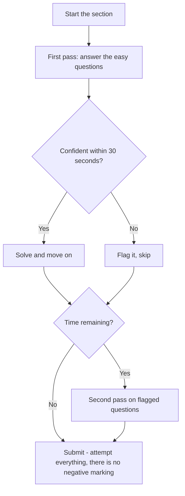

<!-- improved -->
# Mock Test — Any Company #1 (Generic Pattern, 30 Questions)

> Company-neutral aptitude simulation: 12 quant, 9 logical, 9 verbal. Time: 45 minutes.
> Rule: 60-90 seconds per question. Answers at the bottom — no peeking.
> Difficulty tags: (E) Easy, (M) Medium, (H) Hard.

## Learning Objectives

- Complete 30 mixed questions in 45 minutes without leaving a question unread.
- Classify each question as attempt-now, attempt-later or abandon within fifteen seconds.
- Convert percentage, ratio, time-work and series questions into one equation each.
- Draw the row or grid for every arrangement question instead of holding it in memory.
- Score 24 or more, which is the threshold this paper sets for moving to Mock #2.

## Attempt Strategy

This paper is a calibration test, not a company test. Its job is to tell you which
of the sixteen quant topics and twelve reasoning types you actually own. Treat a
wrong answer as information about a topic, not as a verdict on you.

## Section 1 - Quantitative Aptitude (12 questions)

1. (E) A shopkeeper sells an article for ₹1,035 at a 15% profit. What was the cost price?
2. (E) The average of 15 numbers is 32. If one number 47 is removed, what is the new average?
3. (M) A train 160 m long crosses a platform 240 m long in 20 seconds. What is the speed in km/hr?
4. (M) A and B can complete a job in 15 days and 20 days respectively. Working together, in how many days will they finish?
5. (M) What is the compound interest on ₹18,000 at 10% per annum for 2 years, compounded annually?
6. (M) The ratio of two numbers is 4:7. If their difference is 45, what is the smaller number?
7. (M) 30% of a number is 135. What is 80% of the same number?
8. (M) In how many ways can 6 books be arranged on a shelf?
9. (M) A die is rolled once. What is the probability of getting a number greater than 4?
10. (M) Find the next term: 2, 5, 14, 41, 122, ?
11. (M) A pipe fills a tank in 18 hours and a leak empties it in 27 hours. If both are open, how long will the tank take to fill?
12. (M) The HCF and LCM of two numbers are 9 and 360. If one number is 45, what is the other?

## Section 2 — Logical Reasoning (9 questions)

13. (E) Find the next term: 5, 11, 23, 47, 95, ?
14. (E) In a code, "MOON" is written as "NPPO". How is "STAR" written?
15. (M) Statements: All birds are animals. Some animals are pets.
    Conclusions: I. Some birds are pets. II. Some pets are animals.
    Which conclusion follows?
16. (M) A man walks 5 km North, then 12 km East. How far is he from the start?
17. (M) In a row of 35 students, Ravi is 12th from the left and Sita is 15th from the right. How many students are between them?
18. (M) A is the father of B. B is the sister of C. C is the son of D. How is A related to C?
19. (M) Data sufficiency: What is the value of x?
    (I) x + y = 12
    (II) x − y = 4
20. (M) Input: 9 2 7 4 5. Step 1: 2 9 7 4 5. Step 2: 2 4 9 7 5. What is Step 3?
21. (H) Five friends P, Q, R, S, T stand in a line. P is taller than Q. R is shorter than S. T is taller than P. Q is taller than R. Who is the tallest?

## Section 3 — Verbal Ability (9 questions)

22. (E) Synonym of "prompt": (A) slow (B) quick (C) late (D) lazy
23. (E) Antonym of "victory": (A) success (B) defeat (C) trophy (D) game
24. (M) Fill in the blank: "The team ___ yet to submit its report." (has / have)
25. (M) Spot the error: "He has been (A) working in (B) this company (C) since five years (D)."
26. (M) Correct the sentence: "Each of the players were given a medal."
27. (M) Para jumble: (a) The app then notified the user. (b) The payment was processed in seconds. (c) A customer scanned the QR code. (d) Finally, the receipt appeared on screen. Order?
28. (M) Idiom: "To be on cloud nine" means: (A) to be flying (B) to be extremely happy (C) to be confused (D) to be working
29. (M) Fill in the blank: "Unless you study, you ___ pass the exam." (will / will not)
30. (H) Choose the correct spelling: (A) occurence (B) occurrence (C) occurrance (D) ocurrence

---

## Answer Key

### Section 1 — Quantitative

1. **₹900** (CP = 1035/1.15)
2. **30.93** (total = 480; minus 47 = 433; 433/14)
3. **72 km/hr** (400 m in 20 s = 20 m/s)
4. **8.57 days** (15 × 20/35)
5. **₹3,780** (CI = 18000 × 0.21)
6. **60** (3k = 45 → k = 15; smaller = 4 × 15)
7. **360** (number = 135/0.3 = 450; 0.8 × 450)
8. **720** (6!)
9. **1/3** (5 and 6 → 2/6)
10. **365** (×3 − 1: 122 × 3 − 1)
11. **54 hours** (1/18 − 1/27 = 1/54)
12. **72** (9 × 360/45)

### Section 2 — Logical

13. **191** (×2 + 1: 95 × 2 + 1)
14. **TUBS** (+1 each letter)
15. **Only II** (I is not guaranteed — "some animals are pets" says nothing about birds; II is the valid conversion of the premise)
16. **13 km North-East** (5-12-13 triangle)
17. **8 students** (Sita = 21st from left; 21 − 12 − 1 = 8)
18. **Father** (A is B's father; B is C's sister, so C shares that parent — A is C's father. D is C's other parent.)
19. **Both together** (x = 8, y = 4)
20. **2 4 5 9 7** (smallest moves left; 5 next)
21. **T** (T > P > Q > R and S > R — P vs S unknown, but T > P makes T tallest since T > P > Q and no one exceeds T)

### Section 3 — Verbal

22. **B) quick**
23. **B) defeat**
24. **has** (team = singular)
25. **C** (since → for)
26. **"Each of the players was given a medal"** (each = singular)
27. **c, b, a, d** (scanned → processed → notified → receipt)
28. **B) to be extremely happy**
29. **will not** (unless = if not)
30. **B) occurrence**

## Score Interpretation

| Score | Level | Next Step |
|---|---|---|
| 24+ | Ready | Try Mock #2 (harder) |
| 18-23 | Good | Re-drill failed topics |
| <18 | Needs work | Re-read theory files, retake in 3 days |

## Summary

Thirty questions in 45 minutes means 90 seconds each, and that budget is unforgiving:
one stuck question costs you two others. The paper deliberately mixes topics so you
cannot settle into a rhythm, which is exactly what real company papers do.

Section scores matter more than the total. A 24 built on 11/12 quant and 5/9 verbal is
a different problem from a 24 built evenly — the first needs verbal work, the second
needs nothing urgently.

## Practical Takeaways

- Record the topic of every wrong answer; two misses in one topic is a revision task.
- Never spend more than 90 seconds on a first pass; flag and return.
- Write the equation before calculating — most errors here are setup errors, not arithmetic.
- Re-take this mock after three days without reviewing the answers, to test retention rather than memory.
- Use the section split, not the total, to choose what to study next.

## Chapter Quiz

**1.** An article sells for ₹1,035 at a 15% profit. The cost price is:

(A) ₹880 (B) ₹900 (C) ₹920 (D) ₹950

**2.** The average of 5 numbers is 20. Removing one number raises the average to 22. The removed number is:

(A) 10 (B) 12 (C) 14 (D) 16

**3.** Compound interest on ₹18,000 at 10% per annum for 2 years, compounded annually, is:

(A) ₹3,600 (B) ₹3,780 (C) ₹3,900 (D) ₹4,000

**4.** A pipe fills a tank in 18 hours; a leak empties it in 27 hours. With both open, the tank fills in:

(A) 36 hours (B) 45 hours (C) 54 hours (D) 60 hours

**5.** Fill in the blank: "Neither of the two candidates ___ qualified."

(A) were (B) was (C) have been (D) are

### Answers

1. **(B)** — CP = 1035 / 1.15 = ₹900.
2. **(B)** — Total 100; remaining total 4 × 22 = 88; removed = 12.
3. **(B)** — 18000 × (1.1² − 1) = 18000 × 0.21 = ₹3,780.
4. **(C)** — 1/18 − 1/27 = 3/54 − 2/54 = 1/54, so 54 hours.
5. **(B)** — "neither" is singular, so "was", despite the plural noun after "of".

## Exercises

1. Retake the paper in 40 minutes instead of 45 and note which questions you dropped.
2. List every topic that produced a wrong answer and rank them by frequency.
3. Solve five time-and-work questions using the 1/a + 1/b shortcut only.
4. Write down the three questions you spent longest on and explain why they were slow.
5. Re-attempt the paper after three days with no review, and compare section scores.