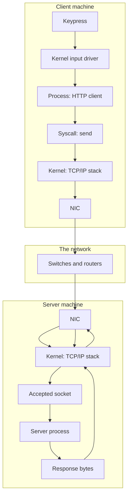
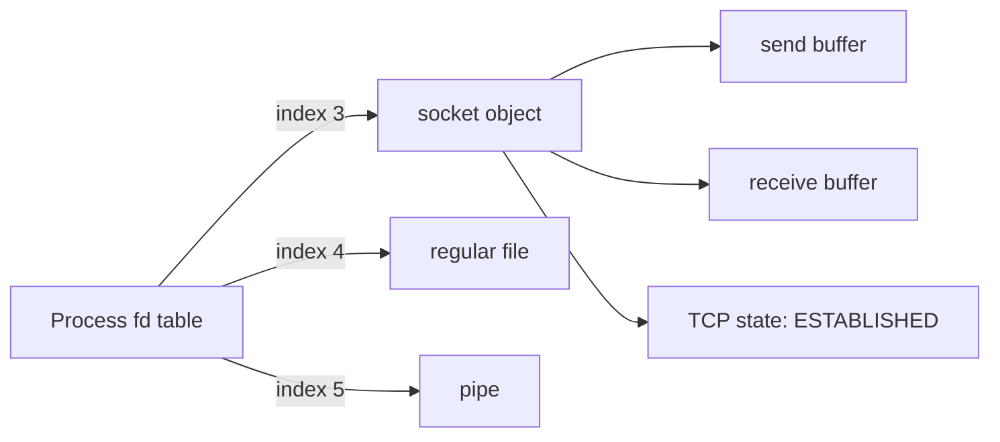
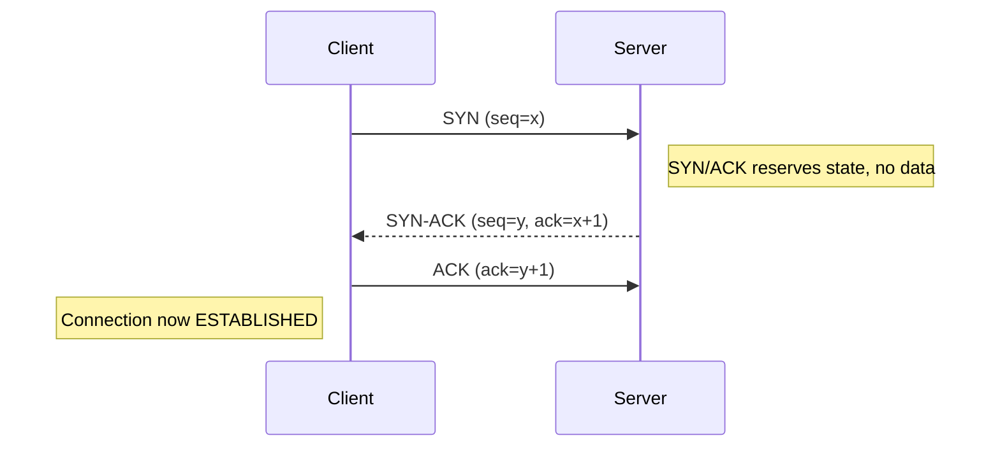
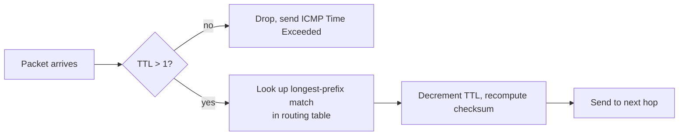
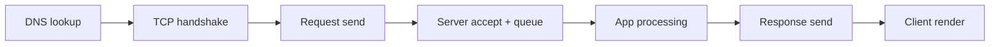

# Chapter 19: From Keystroke to Response — How the OS and Network Work Together

> **GFG/Javatpoint Depth — Processes vs threads, the syscall boundary, file descriptors, sockets, the three-way handshake, DNS, routing, accept/fork, latency budgets, and where user space ends**

## Learning Objectives

1. Trace a single HTTP request from a keypress to a rendered response, naming the OS and network mechanism at each hop.
2. Explain the syscall boundary: what crosses from user space to kernel space, and what the return path costs.
3. Describe a socket as a kernel object surfaced to a process as a file descriptor, and predict what happens when a descriptor is leaked.
4. Account for every millisecond of a request's latency: DNS, handshake, congestion window, server queueing, and transfer.
5. Distinguish a function call from a syscall, and a thread from a process, in terms of what the kernel must do for each.
6. Diagnose a slow or hung request by locating which stage of the pipeline is responsible.

> **Diagram note:** the four Mermaid diagrams in this chapter are the visual source. The
> raster asset for this chapter has not been generated yet; run the repo's diagram pipeline
> to produce `assets/images/diagrams/computer-networks/ch19-keystroke-to-response.png`.

## Table of Contents

- [19.1 Two Machines, One Abstraction Stack](#191-two-machines-one-abstraction-stack)
- [19.2 Keystroke to Process — Interrupt, Handler, Scheduler](#192-keystroke-to-process--interrupt-handler-scheduler)
- [19.3 The System Call Boundary](#193-the-system-call-boundary)
- [19.4 A Socket Is a Kernel Object Wearing a File Descriptor](#194-a-socket-is-a-kernel-object-wearing-a-file-descriptor)
- [19.5 Connection Establishment — The Three-Way Handshake](#195-connection-establishment--the-three-way-handshake)
- [19.6 DNS — Turning a Name into an Address](#196-dns--turning-a-name-into-an-address)
- [19.7 Routing — Getting There](#197-routing--getting-there)
- [19.8 The Server Side — Accept, Fork, Serve](#198-the-server-side--accept-fork-serve)
- [19.9 The Response Path — Coming Back](#199-the-response-path--coming-back)
- [19.10 Where the Boundaries Blur](#1910-where-the-boundaries-blur)
- [19.11 When It Breaks — Latency, Blocking, Failure Modes](#1911-when-it-breaks--latency-blocking-failure-modes)
- [19.12 Comparison Tables](#1912-comparison-tables)
- [19.13 Interview Corner](#1913-interview-corner)
- [19.14 Applications in Real Systems](#1914-applications-in-real-systems)
- [19.15 Pro Tips](#1915-pro-tips)
- [19.16 Chapter Quiz](#1916-chapter-quiz)
- [Practical Takeaways](#practical-takeaways)
- [19.17 Summary](#1917-summary)
- [19.18 Exercises](#1918-exercises)

---

## 19.1 Two Machines, One Abstraction Stack

A web request looks like one thing: you press a key, a page appears. It is actually two independent machines agreeing on a story, and every step of that story belongs to either an operating system or a network protocol.

The useful framing is that **your machine runs a program, and the OS is what lets that program use the network at all**. There is no networking inside a language runtime. When a TypeScript program writes to a socket, the runtime eventually asks the kernel to do it. The OS and the network stack are not two optional topics that meet occasionally; they are one continuous mechanism seen from two ends.



Read that diagram as a single causal chain. Every arrow is a hand-off between two components that do not share memory, or between a process and the kernel. The hand-offs are where time is spent and where failures happen.

**The central idea of this chapter:** a network call is a *sequence* of kernel operations, and each one costs something measurable. Performance work on the network is really syscall work.

## 19.2 Keystroke to Process — Interrupt, Handler, Scheduler

The request does not begin when your code calls `fetch`. It begins at the keyboard, and the path from there is entirely operating-system work.

1. **The keyboard controller raises an interrupt.** This is a hardware signal on a dedicated line. It does not carry the key value itself; it says only "something happened".
2. **The CPU takes the interrupt.** Because an interrupt is higher priority than whatever the CPU was doing, the current instruction finishes and then control transfers to the kernel's interrupt handler. This is a *mode switch* from user space into kernel space.
3. **The handler reads the device.** The driver reads the keyboard controller's register to learn which key was pressed and writes the scancode into a buffer maintained by the kernel, commonly a ring buffer, because the CPU may not service the next interrupt immediately.
4. **The kernel signals the process.** A thread waiting on that buffer is made runnable. The scheduler may or may not run it right away.
5. **The process reads the character.** Only now does user-space code call `read()` to get the byte.

This is why an idle editor can still respond instantly: the CPU is not polling the keyboard in a loop. It is asleep, and the interrupt wakes it.

```typescript
// Step 5 in isolation: a process reading from an input source.
// The interrupt, handler, and scheduler work above happens underneath this.
import { readFileSync } from "node:fs";

function readConfig(path: string): string {
  // read() is a syscall. The bytes were buffered by the kernel long ago.
  return readFileSync(path, "utf8");
}

const raw = readConfig("./request.json");
console.log(`loaded ${raw.length} bytes`);
```

The consequence for network debugging: **latency before your code runs is not your code's fault.** If a keystroke takes 200 ms to become a character, look at scheduling and device handling, not at the network.

## 19.3 The System Call Boundary

A syscall is a controlled, documented transition from user space into kernel space. It is not a function call, and the difference is the single most misunderstood thing in systems work.

| | Function call | System call |
|---|---|---|
| Runs in | same mode | user mode → kernel mode |
| Trust | trusted code | untrusted input must be validated |
| Cost | ~nanoseconds | ~hundreds of nanoseconds to microseconds |
| Switching | none | mode switch, often register save/restore |
| Can it fail arbitrarily | no | yes: EACCES, ENOMEM, EAGAIN, EINTR |

The kernel must validate every argument. A user process can pass any pointer it likes, including one that traps, so the kernel re-derives and bounds-checks the data rather than trusting the caller.

```typescript
// What a syscall costs, made visible.
// Every iteration performs real work in the kernel: read() then write().
import { openSync, writeSync, closeSync } from "node:fs";

function writeAll(fd: number, text: string): void {
  const buf = Buffer.from(text, "utf8");
  let offset = 0;
  while (offset < buf.length) {
    // write() is a syscall. It may write fewer bytes than asked.
    offset += writeSync(fd, buf, offset, buf.length - offset);
  }
}

const fd = openSync("./scratch.txt", "w");
const t0 = process.hrtime.bigint();
for (let i = 0; i < 2000; i++) writeAll(fd, `line ${i}\n`);
const t1 = process.hrtime.bigint();
closeSync(fd);

const perCallNs = Number(t1 - t0) / (2000 * 2);
console.log(`~${(perCallNs / 1000).toFixed(2)} us per syscall (read+write loop)`);
```

Run it, and you will see the real cost on your machine rather than a number from a textbook. Expect a figure in the low microseconds on Windows and an order of magnitude lower on Linux, because Windows syscall and context-transition overhead is genuinely higher.

**Why this matters for the network:** a chatty protocol that issues one syscall per byte pays microseconds per byte. Buffering 1 KB and issuing one syscall costs about the same as 1 byte. This is the single highest-leverage performance rule in networked code.

```typescript
// BAD: one syscall per piece of data
import { openSync, writeSync, closeSync } from "node:fs";

const fd = openSync("./bad.txt", "w");
for (const part of ["a", "b", "c", "d"]) {
  writeSync(fd, part);       // 4 syscalls
}
closeSync(fd);
```

```typescript
// GOOD: one syscall for the whole payload
import { openSync, writeSync, closeSync } from "node:fs";

const fd = openSync("./good.txt", "w");
writeSync(fd, "abcd");       // 1 syscall
closeSync(fd);
```

## 19.4 A Socket Is a Kernel Object Wearing a File Descriptor

Unix unified three unrelated things behind one abstraction: files, pipes, and sockets. A process refers to each with an integer, the **file descriptor**. That unification is why `read`, `write`, and `close` work identically on all three.

The descriptor is an index into the process's descriptor table. The entry points at a kernel object. For a socket, that object is a `struct socket` holding the send buffer, receive buffer, sequence numbers, and connection state.



The consequence that bites in production: **a socket is closed when its descriptor is closed, and that can happen by accident.** If a function returns before closing, the descriptor leaks. Leaked descriptors exhaust the per-process limit, and then new socket calls fail with `EMFILE`.

```typescript
// Detecting descriptor leaks: count open descriptors before and after work.
import { openSync, closeSync, readFileSync, writeSync } from "node:fs";

function descriptorsOpen(): number {
  // Linux exposes these under /proc/self/fd; this is a real, checkable signal.
  try {
    return readFileSync("/proc/self/fd").toString()
      .split("\n")
      .filter((l) => l.trim() !== "").length - 1; // minus the fd used to read
  } catch {
    return -1; // not Linux
  }
}

function leakOnce(n: number): void {
  // Deliberately not closed, to show the counter climbing.
  const fd = openSync(`./tmp-leak-${n}.txt`, "w");
  writeSync(fd, "x");
  console.log(`after ${n} unclosed opens: ${descriptorsOpen()} descriptors`);
}

const before = descriptorsOpen();
console.log(`baseline: ${before} descriptors`);
for (let i = 1; i <= 3; i++) leakOnce(i);
console.log("if that number grew by 3, each open leaked one descriptor");
```

The fix is unglamorous: use `try/finally`, or let a scoped construct handle it.

```typescript
// Correct: the descriptor cannot outlive the block.
function writeSafely(path: string, text: string): void {
  const fd = openSync(path, "w");
  try {
    writeSync(fd, text);
  } finally {
    closeSync(fd);            // runs even if writeSync throws
  }
}

writeSafely("./scoped.txt", "committed");
console.log("descriptor closed regardless of outcome");
```

## 19.5 Connection Establishment — The Three-Way Handshake

TCP is a connection-oriented, reliable, ordered byte stream. Before any byte of application data moves, both sides agree on starting sequence numbers. That agreement is the three-way handshake, and it is the single largest fixed cost in a short HTTP request.



Two things matter for performance:

- **One full round trip before any data can be sent.** At 100 ms RTT, that is 100 ms spent before the request even starts.
- **The server allocates state on SYN.** An attacker who never completes the handshake exhausts that state. This is the mechanism behind SYN flooding, and it is why `tcp_syncookies` exists.

```typescript
// Measuring the handshake cost directly: connect() completes the 3-way handshake.
import { connect } from "node:net";

function measureHandshake(host: string, port: number): Promise<number> {
  return new Promise((resolve, reject) => {
    const t0 = process.hrtime.bigint();
    const sock = connect({ host, port }, () => {
      const t1 = process.hrtime.bigint();
      console.log(`connected to ${host}:${port}`);
      sock.end();
      resolve(Number(t1 - t0));
    });
    sock.on("error", reject);
  });
}

const ms = await measureHandshake("example.com", 443);
console.log(`handshake+connect: ${(ms / 1e6).toFixed(1)} ms`);
```

Compare that against a reused connection. On the second connection the handshake is skipped, which is exactly what `keep-alive` buys you.

## 19.6 DNS — Turning a Name into an Address

`example.com` is not an address. Before any packet can be sent, the name must be resolved. DNS is itself a network protocol, so it can fail, time out, and be slow — a fact that surprises people whose "network problem" is really a resolver problem.

Resolution order is worth knowing because it explains most DNS latency:

1. **Browser cache** — may be minutes to hours.
2. **OS resolver cache** — typically seconds.
3. **`/etc/hosts`** (or the Windows equivalent) — checked before any query leaves the machine.
4. **Recursive resolver** — your ISP's or a public one, queried over the network.
5. **Authoritative nameserver** — the source of truth for the zone.

```typescript
// Observe the resolver cache directly. This is a real command you can run.
import { execFileSync } from "node:child_process";

function dnsCacheSize(): string {
  try {
    // On Windows: ipconfig /displaydns. Output can be large, so count entries.
    const out = execFileSync("ipconfig", ["/displaydns"], { encoding: "utf8" });
    const entries = out.match(/Record Name/g)?.length ?? 0;
    return `${entries} cached records`;
  } catch (e) {
    return `unavailable: ${(e as Error).message}`;
  }
}

console.log(dnsCacheSize());
```

Run it twice with a `fetch` in between. The second lookup should be faster, and that gap is the resolver cache doing its job.

**Consequence:** a cold resolver cache can add tens or hundreds of milliseconds that have nothing to do with the server. This is why load tests that bypass DNS produce results that never reproduce in production.

## 19.7 Routing — Getting There

Once the destination address is known, each machine along the path independently decides where to send the packet. No single machine knows the whole route; each hop only knows its next hop.

At every router:



Two details cause real outages:

- **TTL is decremented at every hop.** When it reaches zero the packet is dropped and an ICMP Time Exceeded is returned. This is why long paths fail even when the address is valid.
- **The checksum must be recomputed** because the IP header changed. On hardware-accelerated routers this is free, but on constrained devices it is not.

```typescript
// The routing decision itself, so the longest-prefix-match rule is concrete.
type Route = { prefix: string; mask: string; nextHop: string };

const routes: Route[] = [
  { prefix: "10.0.0.0",   mask: "255.0.0.0",   nextHop: "gateway-a" },
  { prefix: "10.1.0.0",   mask: "255.255.0.0", nextHop: "gateway-b" }, // more specific, wins
  { prefix: "0.0.0.0",    mask: "0.0.0.0",    nextHop: "gateway-default" },
];

function toInt(ip: string): number {
  return ip.split(".").reduce((acc, o) => ((acc << 8) | Number(o)) >>> 0, 0);
}

function longestPrefixMatch(ip: string): string {
  const addr = toInt(ip);
  let best = routes[0];
  let bestMask = -1;
  for (const r of routes) {
    const m = toInt(r.mask);
    // Host bits must all match under this mask.
    if (((addr & m) >>> 0) === ((toInt(r.prefix) & m) >>> 0)) {
      const popcount = m.toString(2).split("1").length - 1;
      if (popcount > bestMask) { bestMask = popcount; best = r; }
    }
  }
  return best.nextHop;
}

for (const ip of ["10.1.2.3", "10.2.2.3", "8.8.8.8"]) {
  console.log(`${ip} -> ${longestPrefixMatch(ip)}`);
}
```

Output:

```console
10.1.2.3 -> gateway-b
10.2.2.3 -> gateway-a
8.8.8.8 -> gateway-default
```

`10.1.2.3` goes to `gateway-b` because `10.1.0.0/16` is longer than `10.0.0.0/8`. This single rule is the whole of IP forwarding, and it is why overlapping routes are such a persistent source of misconfiguration.

## 19.8 The Server Side — Accept, Fork, Serve

The server kernel does the mirror image of the client work. The important part is what it does with a *completed* connection.

A listening socket does not serve requests itself. It exists to produce new connected sockets, one per client. The accepted socket is a different kernel object with its own buffers.

```typescript
// A single-process TCP echo server, so the accept loop is visible end to end.
import { createServer } from "node:net";

const server = createServer((socket) => {
  // Runs once per accepted connection, in the same event loop.
  socket.on("data", (buf) => {
    socket.write(buf);            // echo
  });
  socket.on("error", () => {
    // A peer that resets mid-write must not kill the server.
    socket.destroy();
  });
});

server.listen(9000, "127.0.0.1", () => {
  console.log("listening on 9000");
});

// Run:  node echo.mjs
// Then:  curl -s --data-binary "hello" http://127.0.0.1:9000 --output -
```

Three real servers use different strategies, and the choice determines what happens under load:

| Model | Isolation | Cost per connection | Fails as |
|---|---|---|---|
| Thread per connection | shared memory | thread stack (~8 MB virtual) | thread exhaustion |
| Process per connection (`fork`) | full isolation | whole address space copy-on-write | memory pressure |
| Event loop | none, single thread | small, one context switch | head-of-line blocking |

The event loop is cheapest per connection and worst at isolation: one slow computation stalls every client. This is the trade-off behind every "async" framework.

## 19.9 The Response Path — Coming Back

The response retraces the client path, and it is worth being explicit because **the return trip is not symmetric**. The server's congestion window is usually large, so it can send the whole response without growing slowly. The client's receive window starts small, so flow control matters on the way back too.

The full path of one request, with the hop where time is usually lost:



**When a request is slow, exactly one of these is the culprit**, and the only reliable method is to measure rather than guess:

- DNS slow → cold resolver cache
- Handshake slow → RTT, or TCP retransmit
- Queue slow → server accept backlog is full
- App slow → your code, the database, or a downstream call
- Render slow → main-thread work, or an unoptimised asset

## 19.10 Where the Boundaries Blur

Three boundaries that experienced engineers routinely conflate:

**Function call vs syscall.** A function call stays in the same mode and is cheap. A syscall enters the kernel and is not. Calling `readFileSync` on a small file is one syscall, not one per byte — but a loop of individual `read()` calls is one per iteration.

**Thread vs process.** Threads share an address space, so communication is a pointer assignment and a bug in one corrupts all of them. Processes have separate address spaces, so isolation is free but communication needs IPC. Choosing wrongly costs either safety or throughput.

**Async vs fast.** `await` does not make work parallel; it keeps the thread free while waiting. If the awaited work is CPU-bound in JavaScript, `await` makes it worse by adding scheduling to a task that was already blocking.

```typescript
// Two ways to hash many files. The async version is NOT faster.
import { createHash } from "node:crypto";
import { readFile } from "node:fs/promises";

async function hashManyAsync(paths: string[]): Promise<string[]> {
  const out: string[] = [];
  for (const p of paths) {
    const buf = await readFile(p);          // yields between reads: good
    out.push(createHash("sha256").update(buf).digest("hex"));
  }
  return out;
}

function hashManySync(paths: string[]): string[] {
  return paths.map((p) => {
    const buf = require("node:fs").readFileSync(p);
    return createHash("sha256").update(buf).digest("hex");
  });
}
```

For I/O-bound work the async version wins because the thread is released during each read. For CPU-bound work the async version is strictly worse: it adds scheduling overhead to work that never yielded anyway. Know which kind you have before reaching for `async`.

## 19.11 When It Breaks — Latency, Blocking, Failure Modes

**Latency budget.** A typical p50 request of 100 ms decomposes roughly as: DNS 5 ms, handshake 20 ms (1 RTT), server processing 30 ms, transfer 45 ms. Every optimisation targets one of these. Tail latency is a different problem entirely: a p99 of 2 s usually means queueing, not slow code.

**Head-of-line blocking.** In the event-loop model, one 500 ms database call delays every other client, because the thread cannot advance until it returns. This is why blocking calls in async handlers are the most common production outage.

**Connection exhaustion.** Each open socket costs kernel memory and a file descriptor. A leak of 10,000 sockets will exhaust the limit and start failing new connections with `EMFILE` — the symptom looks like "the network is down" but is purely local.

**Half-open connections.** A connection can die without either side noticing. Keep-alive amplifies this: a connection idle for too long is silently dead, and the next write fails long after the failure occurred. TCP keepalive probes exist for exactly this.

**The thundering herd.** When a resource recovers after an outage, every client that backed off retries at once. Exponential backoff *with jitter* is the fix; exponential backoff *without* jitter synchronises clients perfectly and repeats the outage.

```typescript
// Backoff with jitter. The jitter is the part people omit.
function delay(ms: number): Promise<void> {
  return new Promise((r) => setTimeout(r, ms));
}

async function withRetry<T>(fn: () => Promise<T>, attempts = 5): Promise<T> {
  let lastErr: unknown;
  for (let i = 0; i < attempts; i++) {
    try {
      return await fn();
    } catch (err) {
      lastErr = err;
      const base = Math.min(2 ** i * 100, 5000);
      // Full jitter: random in [0, base]. Without it, retries synchronise.
      await delay(Math.random() * base);
    }
  }
  throw lastErr;
}
```

## 19.12 Comparison Tables

**Function call vs syscall**

| Aspect | Function call | System call |
|---|---|---|
| Mode | user only | user → kernel |
| Validation | none | every argument |
| Typical cost | ~1 ns | ~0.5–5 us |
| Failure modes | exceptions | errno values |
| Can be preempted | no | yes, signal delivery |

**Thread vs process**

| Aspect | Thread | Process |
|---|---|---|
| Address space | shared | separate |
| Communication | shared memory, cheap | IPC, expensive |
| Isolation | none | complete |
| Creation cost | ~10 us | ~1 ms |
| Failure impact | can corrupt all | contained |
| Typical limit | thousands | hundreds |

**Transport comparison**

| Aspect | TCP | UDP | QUIC |
|---|---|---|---|
| Connection | handshake | none | handshake (1 RTT) |
| Reliability | ordered, retransmits | best effort | ordered, retransmits |
| Overhead | in kernel | minimal | user space |
| Encryption | separate (TLS) | separate (DTLS) | built in |
| Head-of-line blocking | yes at transport | n/a | per stream only |
| Typical use | HTTP, SSH, DB | DNS, video, games | HTTP/3 |

**Layer boundary summary**

| Stage | Who owns it | Failure looks like |
|---|---|---|
| Keystroke → process | OS (interrupt, scheduler) | input lag |
| Process → kernel | OS (syscall) | EACCES, EMFILE |
| Kernel → NIC | OS (driver) | tx queue drops |
| Host → host | network (routing, TCP) | timeout, RST |
| Host → application | both (accept, queue) | 502, connection refused |

## 19.13 Interview Corner

**Q: What happens between pressing Enter and the request leaving the NIC?**

Interrupt-driven input capture, scheduling of the reader thread, application construction of the request, a syscall to write, kernel TCP/IP processing including checksum, driver hand-off to the NIC, and the NIC framing the packet onto the medium.

**Q: Why does `connect()` take two round trips before data can be sent?**

Because TCP must agree on initial sequence numbers in both directions before either side can be confident about ordering and retransmission. The first RTT establishes the client's sequence number, the second confirms it.

**Q: A service has p50 = 80 ms but p99 = 3 s. What is the likely cause?**

Queueing, not slow code. If processing were uniformly slow, p50 would also be high. A p99 far above p50 usually means a resource pool is saturating: threads busy, connection pool exhausted, or a downstream dependency slow for a minority of requests.

**Q: Why does one syscall per byte perform so badly?**

Each syscall costs a mode switch, argument validation, and scheduler interaction, in the microsecond range. Sending 1 KB byte-by-byte costs thousands of syscalls. Buffering and issuing one call reduces the cost to nearly the same as one byte.

**Q: How do you tell a DNS problem from a server problem?**

Resolve the name repeatedly. If resolution time varies widely while the server's own response time is stable, it is DNS. Confirm by connecting to the resolved IP address directly, bypassing name resolution entirely.

**Q: What does `EMFILE` mean and what causes it?**

Too many open files for a process. On a network service it almost always means sockets are not being closed: a leak, or a connection pool that grows without bound.

## 19.14 Applications in Real Systems

**Reverse proxy.** Accepts on the public socket, then opens a second connection to the origin. Two handshakes instead of one, which is why a well-configured proxy pools upstream connections aggressively.

**Connection pooling.** Databases and HTTP clients keep sockets warm to avoid repeated handshakes. The pool size is the tuning knob: too small queues requests, too large exhausts descriptors. This is the same `EMFILE` risk under a friendlier name.

**gRPC and HTTP/2 multiplexing.** Many logical streams share one connection, so one handshake serves many requests. This removes per-request handshake cost but reintroduces head-of-line blocking at the connection level, which is the specific problem QUIC's independent streams solve.

**Service mesh.** A sidecar proxy accepts the application's connection and makes its own to the upstream. Tracing, retries, and mTLS become transparent. The cost is exactly the double handshake above, paid on every hop.

**Serverless cold starts.** The platform must start a process, load the runtime, and initialise your code before handling a request. Every step is an OS operation, which is why cold-start latency is dominated by process creation and I/O rather than your business logic.

## 19.15 Pro Tips

1. **Measure before optimising.** Split DNS, handshake, server time, and transfer. Guessing wastes days.
2. **Buffer aggressively.** One large write beats thousands of small ones, always.
3. **Always use `finally` for cleanup.** Descriptor leaks present as network outages.
4. **Add jitter to every backoff.** Without it, retries re-synchronise clients.
5. **Set connection and idle timeouts.** Unbounded connections are unbounded resource use.
6. **Keep-alive only pays off if you reuse.** One request per connection throws away the entire handshake saving.
7. **Watch `EMFILE` and `ENFILE` as separate limits.** Per-process versus system-wide; they fail differently.
8. **Test with cold caches.** Warm DNS and warm connections hide the latency real users feel.
9. **Distinguish p50 from p99.** Optimise the tail; it dominates perceived speed.
10. **Never block an event loop.** A single synchronous call can stall every connection.

## 19.16 Chapter Quiz

**Q1:** What is the first thing that happens when a user presses a key?
a) The keyboard driver writes to the process's memory
b) The keyboard controller raises a hardware interrupt
c) The OS scheduler pre-empts the running process
d) The console driver forwards to the browser

<details>
<summary>Answer</summary>
**b)** The keyboard controller raises a hardware interrupt. The driver reads the scancode only *after* the CPU takes the interrupt. Option (a) reverses cause and effect; (c) is a consequence, not the trigger; (d) assumes a browser that may not exist.
</details>

**Q2:** What is the primary difference between a function call and a syscall?
a) Syscalls are always faster
b) Function calls cross into kernel space
c) Syscalls cross into kernel space and validate arguments
d) Syscalls cannot fail

<details>
<summary>Answer</summary>
**c)** Syscalls transition from user to kernel mode and validate every argument, since the caller is untrusted. (a) is backwards — syscalls are far slower. (b) is inverted. (d) is false: syscalls return errno values routinely.
</details>

**Q3:** On a server with p50 = 80 ms and p99 = 3000 ms, what is the most likely cause?
a) The CPU is uniformly slow
b) Network bandwidth is saturated
c) Queueing from a saturating resource pool
d) DNS resolution is slow

<details>
<summary>Answer</summary>
**c)** A p99 far above p50 indicates queueing. Uniform slowness (a) would raise p50 too. Bandwidth saturation (d) tends to affect all requests. DNS (d) is usually bimodal, not a long smooth tail.
</details>

**Q4:** A service starts returning new connections refused only under load. Which error would most likely explain it?
a) `EACCES`
b) `EINVAL`
c) `EMFILE`
d) `ENOENT`

<details>
<summary>Answer</summary>
**c)** `EMFILE` is the per-process open-file limit, which sockets consume. If sockets leak, new connections fail while existing ones survive — matching "only under load". `EACCES` is permissions, `EINVAL` a bad argument, `ENOENT` a missing path.
</details>

**Q5:** In the routing table, why does `10.1.2.3` prefer `10.1.0.0/16` over `10.0.0.0/8`?
a) The `/8` route is administratively disabled
b) Longest-prefix match wins
c) `/16` was configured more recently
d) `/8` has a higher priority number

<details>
<summary>Answer</summary>
**b)** Forwarding uses longest-prefix match: the most specific matching route wins. (a) is irrelevant, (c) has no effect on forwarding, (d) is not a real concept.
</details>

**Q6:** Why does a server process call `listen()` on one socket but `accept()` on another?
a) `listen()` binds the port, `accept()` creates a new connected socket
b) `listen()` opens the port, `accept()` closes it
c) They are aliases in modern kernels
d) `accept()` runs in user space

<details>
<summary>Answer</summary>
**a)** `listen()` marks a bound socket as passive and queues incoming connection attempts; each `accept()` returns a *new* connected socket with its own buffers. (b) is nonsense, (c) is false, (d) is false — both are syscalls.
</details>

**Q7:** What does adding full jitter to exponential backoff prevent?
a) Retries exceeding the deadline
b) Clients re-synchronising and retrying simultaneously
c) The server from detecting load
d) TLS renegotiation

<details>
<summary>Answer</summary>
**b)** Without jitter, all clients that backed off by the same amount retry at the same moment, reproducing the outage. Full jitter randomises each delay independently.
</details>

**Q8:** Which transport removes transport-level head-of-line blocking for HTTP?
a) TCP
b) UDP
c) QUIC
d) IP

<details>
<summary>Answer</summary>
**c)** QUIC carries independent streams over one connection, so a stalled stream does not block others. (a) is exactly the problem. (b) has no ordering to block. (d) is not a transport.
</details>

## Practical Takeaways

| Scenario | Do | Avoid |
|---|---|---|
| Many small writes | Buffer, then write once | One syscall per item |
| Socket lifecycle | `try/finally` close | Relying on GC timing |
| Retries | Exponential backoff **with jitter** | Backoff without jitter |
| Latency work | Measure DNS/handshake/server separately | Guessing from p50 alone |
| Connection reuse | Pool and keep-alive | One request per connection |
| Tail latency | Fix queueing and pools | Micro-optimising the median |
| Async handlers | Never block the event loop | `await` on CPU-bound work |
| Resource limits | Cap pools, watch `EMFILE` | Unbounded connection growth |

## 19.17 Summary

- A network call is a sequence of kernel operations, and performance work on the network is really syscall work.
- Input arrives by interrupt, is buffered by the kernel, and only then does user code read it. Latency before your code runs is not your code's fault.
- A syscall crosses a mode boundary and validates every argument. It costs microseconds, so syscall count dominates small-write performance.
- A socket is a kernel object reached through a file descriptor. Leaking descriptors surfaces as `EMFILE` and looks exactly like a network outage.
- TCP must complete a one-RTT handshake before any data moves. Keep-alive removes that cost only if connections are actually reused.
- DNS resolution is a network operation with its own caches. Cold DNS is a frequent cause of latency blamed on the server.
- Forwarding is longest-prefix match; TTL is decremented at every hop.
- A listening socket produces connected sockets. Thread-per-connection, process-per-connection, and event loop each trade isolation against cost.
- The response path is not symmetric: the server's congestion window is already large.
- p50 and p99 are different problems. A long tail means queueing.
- Unbounded pools, blocking the event loop, and backoff without jitter are the three failure modes that recur most.

## 19.18 Exercises

**Easy** — Write a function that opens a file, writes three separate chunks, and guarantees the descriptor is closed even if the second write throws. Demonstrate the leak by removing the `finally` and counting descriptors before and after.

**Easy** — Use `net.createServer` to accept exactly three connections, log the descriptor number assigned to each, and show that the numbers differ, proving each `accept()` returns a new kernel object.

**Medium** — Implement the routing table from section 19.7 with `/24`, `/16`, and default routes. Add a route table and print the chosen next hop for 20 addresses, including addresses that fall inside two matching prefixes.

**Medium** — Measure the time for `connect()` to a public host, then measure a second connection to the same host with keep-alive. Report both figures and explain the difference in terms of the handshake.

**Medium** — Write an event-loop server with one route that blocks synchronously for 500 ms and another that returns immediately. Issue ten concurrent requests to each and show that the fast route is delayed by the slow one. Explain which production pattern this reproduces.

**Hard** — Build a connection pool for an HTTP client with a configurable maximum. When the maximum is reached, queue requests rather than opening more sockets. Then set the maximum to 1 and drive it past the process descriptor limit to observe `EMFILE`, and explain why the pool prevents it.

**Hard** — Instrument a full request path: time DNS resolution, `connect()`, time to first byte, and total transfer separately. Compare against a warm-cache run and attribute the difference to the DNS and handshake stages specifically.

### Challenge Problems

**1.** A service shows p50 of 90 ms and p99 of 4.2 s. Profiling shows CPU at 15% and memory stable. The service makes one downstream HTTP call per request using a pool of 20 connections. Diagnose the cause, name the specific mechanism, and propose two changes with their expected effect on p99.

<details>
<summary>Solution</summary>
Low CPU with a long tail rules out the service itself as the bottleneck. The downstream call is the suspect, and a pool of 20 is the specific mechanism: when more than 20 requests arrive concurrently, the rest queue *inside the pool*, waiting for a connection to free up. Each queued request waits for the entire downstream round trip of the one ahead of it, so p99 grows with queue depth while CPU stays idle — the signature of queueing, not saturation.

Two changes. First, raise the pool size so concurrency matches arrival rate, which cuts queueing but transfers pressure downstream; this only helps if the downstream has headroom. Second, add a per-request timeout and fail fast so queued requests do not accumulate behind a slow dependency, which converts a latency spike into a bounded error. A third option, if the downstream supports it, is caching or request coalescing to remove the dependency from the hot path entirely.
</details>

**2.** A Node.js HTTP service leaks roughly 300 file descriptors per hour under production load. `EMFILE` appears every few days and takes the service down. The leak is in a helper that wraps socket creation. Describe how you would localise it with `lsof` or `/proc/self/fd`, explain why a garbage-collected runtime does not save you, and propose a fix that makes the leak structurally impossible.

<details>
<summary>Solution</summary>
Localise it by sampling the descriptor count over time and then taking a snapshot when the count is elevated: `ls -l /proc/self/fd` on Linux, or `Get-Process -Id &lt;pid&gt; | Select-Object -ExpandProperty Handles` on Windows. Correlate the fd targets with the helper's call sites; sockets appear as `socket:[inode]`, regular files by path, so the target type immediately narrows whether the leak is socket- or file-shaped.

A garbage collector does not help because descriptors are not memory. They are kernel table entries, closed only by an explicit `close()`. A dropped `Socket` object becomes eligible for collection, but nothing in the language runtime closes the underlying descriptor, and the finalizer that might is not guaranteed to run. Worse, GC pressure is unrelated to the leak rate, so the failure timing looks random.

The structural fix is ownership: the component that opens the resource is the only component allowed to close it, enforced by a scoped helper using `try/finally` so the close happens on the success path, the error path, and the throw path. With that in place the leak is not merely less likely, it is unrepresentable — there is no code path that can open without closing. Add a descriptor-count assertion in CI to catch regressions before production does.
</details>

---

> **End of Chapter 19 — From Keystroke to Response**